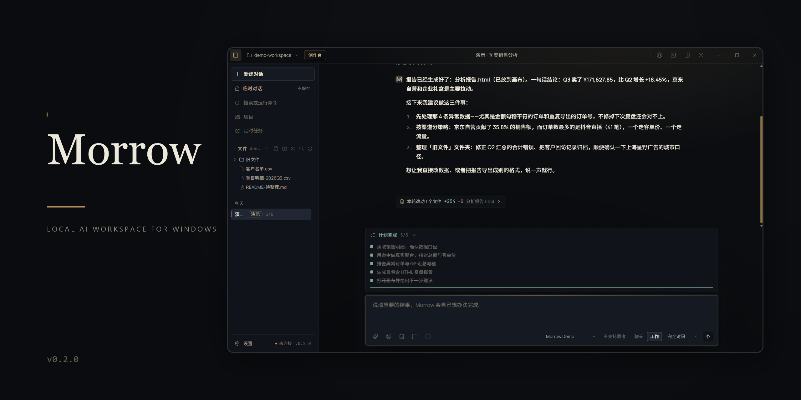
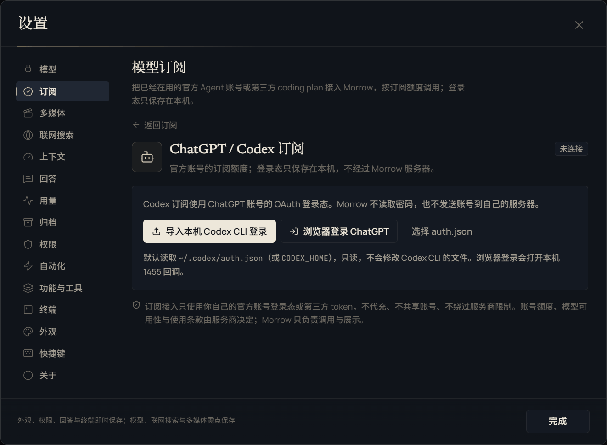
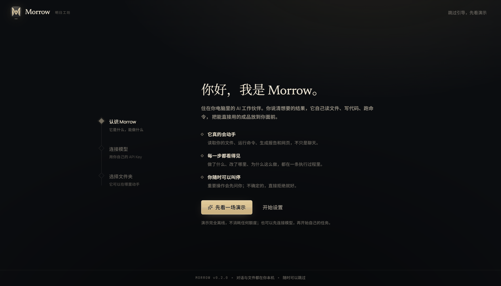
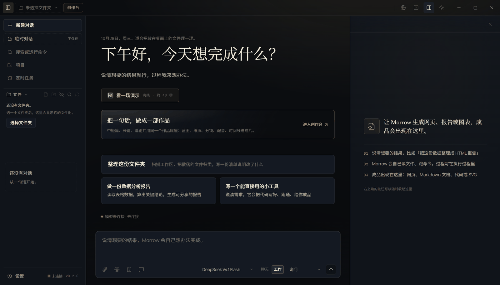

<p align="center"></p>

<h1 align="center">Morrow</h1>
<p align="center">A local-first AI work partner for Windows that reads your files, runs commands, and delivers results inside the folder you choose.</p>
<p align="center"><a href="README.zh.md">中文</a></p>

<p align="center">
  <a href="https://www.electronjs.org/"></a>
  <a href="https://react.dev/"></a>
  <a href="https://www.typescriptlang.org/"></a>
  <a href="https://www.microsoft.com/windows"></a>
  <a href="LICENSE"></a>
  <a href="https://github.com/youyuwangzi0001/Morrow/releases"></a>
</p>

## Overview

Morrow is a Windows desktop application that puts an AI agent inside a folder you own. You describe the result you want; Morrow reads the relevant files, proposes a plan, asks before a risky action, runs the work, and leaves the result in your workspace. Conversation, a code editor, an artifact canvas, a real terminal, Git, a built-in browser, project memory, skills, MCP connectors, and local media engines live in the same window instead of a dozen tabs.

It is built for people who work on local files: writing and editing, data analysis, front-end and script work, reports and documents, image and video generation. Models can come from an API key, an existing official agent subscription, or a local llama.cpp / Ollama / LM Studio server. Sessions, snapshots, logs, memory, and credentials stay on the machine, and API keys are encrypted with Windows DPAPI through Electron `safeStorage`.

## Features

### Describe the result, then review the work

- Five ways to work: chat (read-only), work, plan (`/plan`), deep research (`/research`), and long-running goals (`/goal`). Plan and research runs stop for your approval before acting; goal runs advance under the same permission rules.
- Permission modes — read-only, ask, full access — with an approval card that names the tool, target, impact, and risk. Dangerous commands, out-of-workspace paths, and external side effects are confirmed one call at a time and never get a permanent "always allow".
- Every user turn creates a checkpoint, and files are snapshotted before they are written. You can rewind code, conversation, or both; conflicting files are refused rather than overwritten.
- While a run is active you can queue the next message, steer with an immediate send, or stop; `/btw` opens a side chat that never writes to the main session, and `/swarm` splits independent work across 1–10 members that share the main agent's workspace rules.

### One workspace for files, terminal, Git, and the browser

- A workspace-scoped file tree, a CodeMirror editor with multi-tab editing, save, find, and version history, and a canvas that previews HTML, Markdown, SVG, images, PDF, Office files, audio, and video.
- A real PTY terminal with tabs and background tasks; Git Bash is the default shell, with PowerShell 7 and WSL available. A Git workbench handles diffs, staging, commits, branches, history, and discarding changes.
- A multi-tab built-in browser for checking the page you just built. Web pages, MCP resources, and search results are treated as untrusted data, never as instructions.
- Projects store background, documents, sessions, and a folder scope; the memory center keeps project memory, global long-term memory, and task episodes with an injection preview. Skills, MCP connectors, hooks, custom commands, custom agent roles, and scheduled tasks extend the same agent without widening its permissions.

### Models, subscriptions, and local media engines

- Built-in presets for DeepSeek, Kimi, Qwen, GLM, MiniMax, MiMo, Anthropic Claude, OpenAI, Gemini, Grok, and Meta Muse, plus any OpenAI-compatible endpoint and local llama.cpp / Ollama / LM Studio servers.
- Official agent subscriptions for ChatGPT/Codex, Qoder, Kimi Code, GLM Coding Plan, MiniMax Code, Step Plan, Command Code, Cline Pass, Google Antigravity, and OpenCode, plus third-party coding plans. Credentials are encrypted locally and proxied through a loopback server.
- Model capabilities are runtime metadata: the picker shows the real model name, thinking effort only lists levels the model declares, and context tiers (for example Qoder 200K / 400K / 1M) are selectable per session.

<p align="center"></p>
- Local media through ComfyUI, llama.cpp, Ollama, and LM Studio: image and video generation, short films, animations, editing and inspection with ffmpeg, and `describe_media` review that prefers the current chat model and falls back only to a model that declares vision.

## Installation

Morrow 0.1.0 ships as two Windows x64 executables plus a source archive on the [Releases](https://github.com/youyuwangzi0001/Morrow/releases) page.

| Asset | Use it when |
|---|---|
| `Morrow-0.1.0-portable.exe` | You want one file and no installation. The first launch unpacks a runtime next to the exe; data defaults to a `Morrow Data` folder beside it. |
| `Morrow-0.1.0-setup.exe` | You want Start menu and desktop shortcuts and a per-user install. Data defaults to `%APPDATA%\Morrow`. |
| `Morrow-0.1.0-source.zip` | You want to read or build the exact source of this release. |

<p align="center"></p>

The executables are not code-signed, so Windows SmartScreen may warn on first launch: choose **More info → Run anyway** after verifying the download. Compare the file hash with `SHA256SUMS.txt` attached to the Release:

```powershell
Get-FileHash .\Morrow-0.1.0-portable.exe -Algorithm SHA256
```

To run from source you need Windows 10/11 x64 and Node.js 22 or newer:

```powershell
npm install
npm run dev
```

To build and run the production bundle:

```powershell
npm run build
npm run preview
```

## Usage

1. Open **Settings → Models**, add an API key for a built-in provider, enable a local server, or connect a subscription account under **Settings → Subscriptions**.
2. Choose a working folder. File tools, the terminal, media inputs, and outputs stay inside it.
3. Describe the outcome in the composer and press Enter. Choose a mode first when you want a plan, a research brief, or a long-running goal.
4. Review approval cards and file diffs as they appear. Finished artifacts open in the canvas; commands run in the terminal panel.

<p align="center"></p>

The full walkthrough, including the three-step first-run guide, is in [Getting started](docs/GETTING-STARTED.md).

## Configuration

Settings has 15 pages: Models, Subscriptions, Media, Web search, Context, Answer, Usage, Archive, Permissions, Automation, Features & tools, Terminal, Appearance, Shortcuts, and About. The data directory can be viewed or migrated under **About** — portable builds keep data beside the exe, installed builds use `%APPDATA%\Morrow`.

Environment variables are only needed for specific setups: `MORROW_ANTIGRAVITY_CLIENT_SECRET` enables the Antigravity login (no OAuth secret is bundled), and `MORROW_MCP_CONFIG` points at an MCP configuration file. Data locations, all supported variables, shortcuts, and the built-in skill list are in [Reference](docs/REFERENCE.md).

## Project structure

```text
src/main/      Electron main process, services, IPC, subscriptions, terminal, media
src/core/      Agent loop, tools, permissions, providers, context management
src/preload/   Whitelisted contextBridge API exposed as window.morrow
src/renderer/  React 19 UI and Zustand stores
src/shared/    Shared types, model catalog, commands, protocol constants
docs/          User, reference, architecture, development, and verification docs
scripts/       Build, packaging, screenshot, and audit scripts
tests/         Vitest unit suites and Playwright Electron suites
```

## Releases

Published builds and asset checksums live on the [Releases](https://github.com/youyuwangzi0001/Morrow/releases) page. User-visible changes per version are recorded in [CHANGELOG.md](CHANGELOG.md); the evidence for this build is in [docs/VERIFICATION.md](docs/VERIFICATION.md).

## Security

- No Morrow server receives workspace content. Requests go directly to the model service or local engine you configure.
- API keys and subscription tokens are encrypted with the system credential store and are never sent to the renderer; logs and tool output are redacted.
- File, terminal, and media paths must resolve inside a registered workspace; external URLs must be `http(s)`; the built-in browser and MCP content cannot issue agent instructions.
- Dangerous commands and external side effects are confirmed per call. Unattended scheduled runs deny approvals instead of waiting forever.
- The executables are unsigned, and Antigravity requires your own `MORROW_ANTIGRAVITY_CLIENT_SECRET`. Report vulnerabilities as described in [SECURITY.md](SECURITY.md).

## Known limitations

- Windows 10/11 x64 is the only supported delivery target. WSL requires an installed distribution.
- The portable and installed executables are not code-signed; SmartScreen may warn until you verify the SHA-256.
- Git Bash can fail under a restricted token or low-integrity environment. Switch the default shell to PowerShell 7 in **Settings → Terminal**.
- Local media generation needs a running ComfyUI / llama.cpp / Ollama / LM Studio engine, a suitable GPU, and ffmpeg on `PATH` (or configured). Morrow reports a real error when an engine is missing instead of inventing a result.
- Subscription endpoints are controlled by their vendors and can change; Morrow surfaces the real login or quota error instead of showing a connected state. Only Qoder and Codex were verified with real accounts on the build machine.

## License

MIT. See [LICENSE](LICENSE).