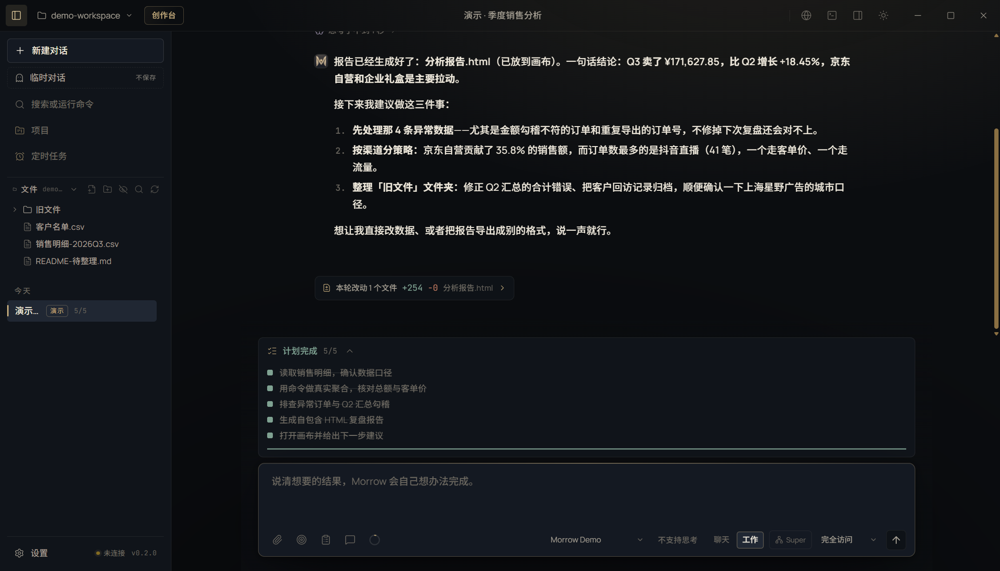
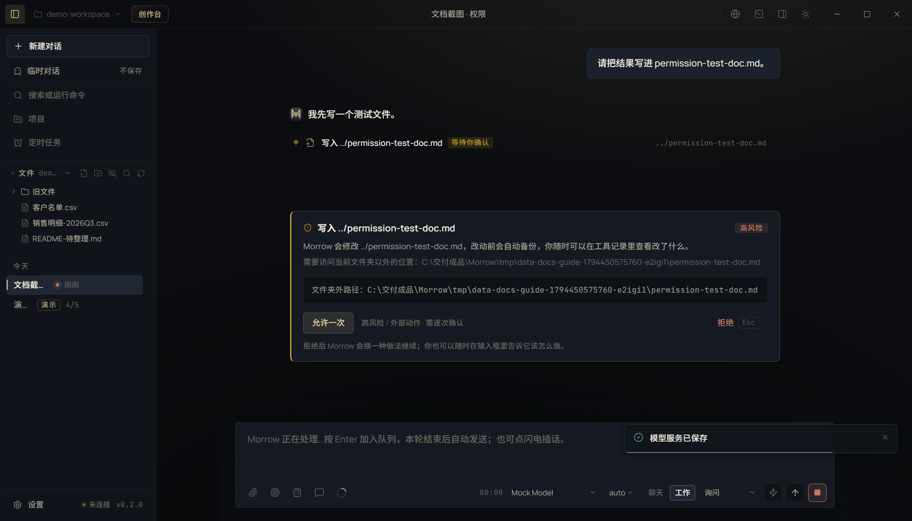

# Morrow · 明日工坊

Morrow 是住在 Windows 电脑里的本地 AI 工作伙伴。它不只是聊天：能读文件、写代码、跑命令、操作浏览器和桌面，把结果做成可打开的成品；也能进入创作台，从一句话开始写小说或做漫剧，最后交付成片、电子书或工程包。

- **Agent**：工作区内的真实读写、终端、Git、浏览器、电脑操作、审批与长任务。
- **Studio**：中短篇、长篇与漫剧三条创作链路，蓝图、写作、分镜、时间线、配音、配乐、检查与交付。
- **本地优先**：会话、记忆、作品、密钥和数据目录都在本机；模型与引擎由你接入。
- **默认窗口**：2100×1200 物理像素；界面同时适配 1280–3840 宽的桌面窗口。



## 当前版本

`0.2.0`。发布包只保留两个文件：

| 文件 | 用途 |
|---|---|
| `Morrow-0.2.0-portable.exe` | 单文件便携版；首次运行在 exe 同级解压运行时缓存 |
| `Morrow-0.2.0-setup.exe` | NSIS 安装包；可选安装目录与快捷方式 |

两个 exe 均未配置代码签名，Windows 可能提示“已保护你的电脑”，选择“更多信息 → 仍要运行”。校验值、测试与冒烟记录见 [docs/VERIFICATION.md](docs/VERIFICATION.md)。

## 快速开始

### 使用发布包

1. 运行便携版或安装包。
2. 首次引导三步：认识 Morrow → 连接模型 → 选择工作文件夹；也可以先看离线演示。
3. 在输入框说清想要的结果；需要写入、命令或外部动作时，Morrow 会先征求同意。

### 从源码运行

环境：Windows 10/11 x64、Node.js 22+、Git（推荐 Git Bash）。

```powershell
npm install
npm run dev
```

常用命令：

```powershell
npm run typecheck     # 类型检查
npm run test:unit     # 509 项单元
npm run test:e2e      # 86 条 Electron 流程（会先构建）
npm run verify        # 类型、UI、文档、清单、单元与 Electron
npm run dist:final    # 重建两个交付 exe
npm run smoke:packaged
```

## 文档地图

文档采用扁平结构，一个主题一个文件：

| 文档 | 内容 |
|---|---|
| [docs/START-HERE.md](docs/START-HERE.md) | 一页版：打开 Morrow、接模型（含不用 API Key 的订阅路线）、选文件夹、排错 |
| [docs/GUIDE.md](docs/GUIDE.md) | 安装、界面、工作模式、审批、文件/终端/Git/浏览器/电脑操作、模型、订阅、记忆、Super-Agent |
| [docs/STUDIO.md](docs/STUDIO.md) | 创作台三条链路、协作者、时间线、交付、质量、数据与回收站 |
| [docs/REFERENCE.md](docs/REFERENCE.md) | 模型与订阅清单、媒体引擎、内置技能、快捷键、数据路径、环境变量 |
| [docs/ARCHITECTURE.md](docs/ARCHITECTURE.md) | 进程模型、扁平源码结构、数据、IPC、Agent/Super-Agent、压缩、Studio、设计系统、安全、去重记录 |
| [docs/DEVELOPMENT.md](docs/DEVELOPMENT.md) | 开发环境、测试、质量门槛、打包、第三方许可、文档截图流程 |
| [docs/VERIFICATION.md](docs/VERIFICATION.md) | 当前交付哈希、冒烟、测试结果与截图清单 |
| [CONTRIBUTING.md](CONTRIBUTING.md) | 提交前检查与协作约定 |
| [SECURITY.md](SECURITY.md) | 漏洞报告与安全边界 |

## 核心能力

### Agent：从一句话到可验收的成品

- 九类工作区工具：读写、搜索、编辑、命令、网页、媒体、记忆、成品、任务。
- 工作 / 聊天 / 计划三种基础方式，叠加深度研究与长期目标。
- 权限三档（只读 / 询问 / 完全访问）与危险动作审批；拒绝优先于允许。
- 真实 PTY 终端、Git 工作台、多标签内置浏览器与 Windows UI Automation。
- Super-Agent：Morrow 负责拆解与汇总，成员并行执行；支持独立工作副本、成果版本、独立验收、记录、并发上限、卡住提醒与试点回退。



### Studio：从一句话到可交付作品


- 中短篇、长篇、漫剧；蓝图确认后才开始产生费用。
- 写作、分镜、时间线、漫剧画布、配音、配乐、检查与交付。
- 协作者先把大白话改成可审阅的修改计划，确认后才改，可撤销。
- 本地确定性检查 + 真实模型审稿；没有模型/引擎时明确失败，不用假候选冒充。

## 项目规模与质量

- `src/`：89 个 TS/TSX 文件，148,833 行；含 CSS/HTML 共 119 个文件，191,800 行。
- 代码合计（统一口径：生产源码 + 测试 + 构建脚本 + 启动器，按 `wc -l` 换行计）：185 个文件，232,462 行；运行 `node scripts/count-code.mjs` 可复现。
- 核心回归：509 项单元 + 86 条 Electron 流程；41 个功能域。
- 质量门槛：类型检查、UI token 审计、核心清单、单元、Electron 与打包冒烟。
- 文档截图：27 张主文档截图 + 18 张修复记录截图，全部 2100×1200 原始 PNG，不缩放、不压缩。

## 开发与打包

```powershell
npm run build        # 类型检查 + electron-vite 构建
npm run dist:final   # 两个交付 exe → deliver/
npm run docs:capture # 重拍 docs/screens 的 2100×1200 截图
npm run docs:check   # 检查文档链接与截图尺寸
```

源码按职责扁平放在 `src/main`、`src/core`、`src/renderer/features`、`src/shared`；协作域已合并为 `src/core/collaboration.ts` 与 `src/main/collaboration.ts`。详见 [docs/ARCHITECTURE.md](docs/ARCHITECTURE.md) 与 [docs/DEVELOPMENT.md](docs/DEVELOPMENT.md)。

## 安全与隐私

- 数据默认保存在本机；发送给模型的内容由你选择的服务商处理。
- 密钥由系统安全存储加密，界面不回显明文。
- 工作区外读取只在你明确选择作为附件时发生；写操作仍受权限与审批约束。
- 浏览器、网页、MCP 与桌面内容均按不可信数据处理。
- 报告问题见 [SECURITY.md](SECURITY.md)；详细边界见 [docs/ARCHITECTURE.md](docs/ARCHITECTURE.md#安全边界)。

## 已知限制

- 仅提供 Windows x64 构建；两个 exe 未签名。
- ComfyUI、llama.cpp、Ollama、LM Studio、FFmpeg、配音引擎不随包内置，缺失时真实失败并提示。
- 订阅渠道的登录态与额度取决于服务商；未完成实测的渠道不会显示为“已连接”。
- 真实模型质量、外部引擎速度与长媒体表现由你的环境决定。

## 许可

MIT。第三方组件与内置技能来源见 [docs/DEVELOPMENT.md](docs/DEVELOPMENT.md#第三方组件与许可)。
