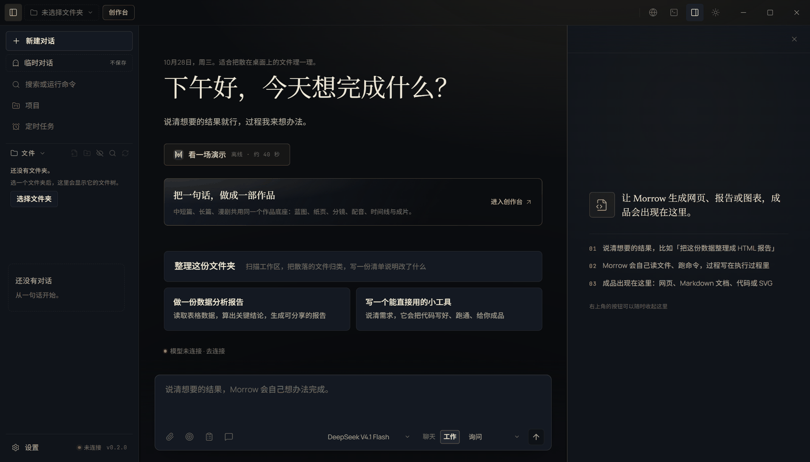
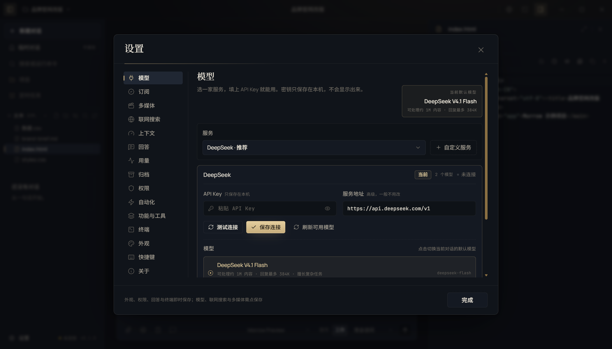

# Morrow · 明日工坊

> **住在你电脑里的 AI 工作伙伴。** 你说清想要的结果，它自己读文件、写代码、跑命令、做报告，把成品放到你面前。
>
> Windows 10/11 · Electron 44 · React 19 · TypeScript · 本地优先 · 无遥测 · MIT



Morrow 是一个面向非技术用户的桌面 AI Agent。它不是只会聊天的助手：会真实读写你选择的文件夹、运行命令、维护计划与长期目标、联网查资料，并把 HTML、Markdown、代码、表格、图片或视频放到右侧画布。

当前版本 **0.1.0**，优先保证单机可用、过程可审计、结果可验证。接口与内部结构仍可能调整，欢迎通过 Issue / PR 参与共建。

---

## 核心能力

### 对话与执行

- **聊天 / 工作双模式**：聊天只讨论与只读分析；工作模式可读写文件、运行命令、推进计划与目标。
- **计划模式**：先只读探索，给出可验证的步骤、风险与验收标准；用户批准后才执行。输入 `/plan 任务` 即可进入。
- **长期目标**：按复杂度自动估算轮次预算，每轮落盘摘要与下一步；完成必须有真实文件证据，阻塞会如实停止。
- **深度研究**：`/research [quick|standard|deep] 问题` 先出可编辑研究计划，再多轮检索、交叉核对，最终交付带引用的报告。
- **模型订阅**：在「设置 → 订阅」接入 ChatGPT/Codex、Qoder、Kimi、GLM、MiniMax、Step、Command Code、Cline、Antigravity、OpenCode 与第三方 coding plan；每条渠道都有真实登录/导入、加密存储、本地 Provider 与额度状态。
- **集群（Agent Swarm）**：把独立子任务并行派发给不同角色，实时显示每个成员的状态、工具轨迹与结论；失败不会伪装成完成。
- **执行过程与回退**：工具调用、命令输出、文件 diff 都在对话中可见；每轮结束可一次性回退对话与 Morrow 写过的文件。
- **上下文管理**：达到阈值自动压缩，保留任务锚点、最近消息与工具对；长任务可跨轮继续。
- **队列、后台运行、分叉、导出**：运行中可插话或排队；可切到其他对话查看；对话可分支、导出 Markdown / JSON。

### 文件、编辑器与预览

- 工作区文件树：新建、重命名、移动、复制、删除、搜索；写入前快照，支持冲突检测。
- CodeMirror 编辑器：多标签、查找替换、撤销重做、外部修改冲突、历史版本与 Markdown / HTML 预览。
- 预览：图片、PDF、Word、Excel、PPT、RTF / ODT / EPUB、ZIP 目录、CSV / TSV、音频、视频；扫描版 PDF 可用本机 OCR 离线识别。

### 本机多媒体与任意模型

- 通过可注册清单接入 **ComfyUI、llama.cpp、Ollama、LM Studio** 或自建引擎；支持检查、安装、启动、停止、下载和使用。
- **应用内添加本机模型**：设置 → 多媒体 → 添加本机模型。llama.cpp 选 GGUF，Ollama/LM Studio 填引擎内 ID；ComfyUI 直接粘贴 API 格式工作流 JSON，填写输出节点与输出类型即可注册。模型文件在引擎目录外时自动复制，重名自动加序号。
- 内置 Qwen-Image 2.1 Turbo、MiniMax-H3 等预设，也可注册任意图片 / 视频 / 音频 / 多模态模型；**Morrow 不自带生成引擎或模型文件**。
- Agent 工具：`generate_image` / `edit_image` / `generate_video` / `generate_film` / `edit_media` / `inspect_media` / `describe_media` / `render_animation` / `run_local_model`。

### 工作台与系统能力

- **真实终端**：PowerShell 7 / Windows PowerShell / CMD / Git Bash / WSL；后台任务、标签页、复制粘贴、拖动调高。
- **Git 工作台**：查看差异、暂存、提交、切换 / 新建分支、浏览历史；可在面板内配置仓库身份。
- **内置浏览器**：渲染层 chrome + 主进程 WebContentsView；Agent 与用户共用同一页面；支持多标签、下载确认、返回主页面并保留页面状态。
- **全局搜索、记忆、项目、定时任务、MCP、技能**：跨对话 / 文件 / 成品搜索；长期记忆与任务经验；项目说明与资料按文件夹带进对话；定时任务无人值守运行；MCP 外部工具与本地技能可安装、启停、审计。
- **computer-use**：受控桌面操作，逐次审批，敏感窗口拒绝。
- **双主题与代码字体**：深色墨夜书房 / 浅色素纸界面；应用字号 12–15（默认 14），代码字号 11–14（默认 12），代码字体默认 JetBrains Mono。

### 模型

- 国内：DeepSeek、Kimi、通义千问、智谱 GLM、MiniMax、小米 MiMo
- 国际：Anthropic Claude、OpenAI GPT、Google Gemini、xAI Grok、Meta Muse
- 本地：llama.cpp / Ollama / LM Studio / 任意 OpenAI 兼容服务

设置 → 模型选择服务并填 API Key；本机或局域网服务可以留空。支持运行时同步模型列表，思考强度使用 `auto / low / medium / high / xhigh / max`。



## 架构一览

Morrow 采用 Electron 三进程结构，业务核心与 UI 解耦：

```text
┌──────────────────────────── Electron Main ────────────────────────────┐
│ 窗口/生命周期    AgentService（run、审批、事件、持久化）              │
│ Session/Settings  MediaService / Catalog   MCP / Browser / Terminal   │
│ ipc.ts + feature:<name>:<action> 窄 IPC 注册中心                       │
└───────────────────────────────┬───────────────────────────────────────┘
                                │ contextBridge（窄接口）
┌───────────────────────────────┴───────────────────────────────────────┐
│ Renderer：React 19 + Zustand + Vite                                    │
│ shell / composer / chat / activity / artifacts / files / settings      │
│ 只做展示与交互；不直接接触 Node、文件系统或密钥                        │
└───────────────────────────────┬───────────────────────────────────────┘
                                │ Provider / Tool 注入
┌───────────────────────────────┴───────────────────────────────────────┐
│ Core（纯 TS，无 Electron/React）：AgentRuntime、上下文压缩、工具、     │
│ 权限、Provider（OpenAI 兼容 / Anthropic / 本地）、媒体工具             │
└───────────────────────────────────────────────────────────────────────┘
```

设计原则：

- **单机优先**：对话、设置、记忆与文件都在本机；默认不发送遥测。
- **最小信任面**：渲染层通过 preload 的窄 API 访问主进程；所有文件路径先 realpath + 工作区边界校验。
- **过程可审计**：工具调用、审批、文件改动与运行结果都有事件与落盘记录。
- **可验证交付**：计划/目标完成必须有真实证据；失败、阻塞与停止不会被描述成完成。
- **可扩展而非写死**：模型、引擎、技能、MCP、自定义命令都通过清单/文件扩展。

完整设计见 [ARCHITECTURE.md](docs/ARCHITECTURE.md)。

## 快速开始

### 从源码运行

环境：Windows 10/11 x64、Node.js 22+、npm；可选的多媒体功能需要 NVIDIA 显卡、ComfyUI 与 ffmpeg。

```bash
npm ci
npm run dev          # 开发模式（Electron + Vite HMR）
npm run typecheck    # 主进程 / 渲染层类型检查
npm run audit:ui     # UI 令牌审计
npm run test:unit    # 14 个单元套件 / 943 个用例
npm run test:e2e     # 17 个 E2E 套件 / 208 个用例（真实 Electron；真实登录/本地模型按环境跳过）
npm run build        # 类型检查 + 生产构建
npm run dist         # 生成单文件便携 exe + NSIS 安装包
```

常用可选测试：

```bash
npm run test:eval                                  # 四项质量评测，写 eval-results.json
MORROW_MEDIA_INTEGRATION=1 npx vitest run tests/unit/main/media.test.ts
MORROW_MEDIA_REAL=1 npx playwright test tests/e2e/16-media.spec.ts -g "雨后纸鹤"
MORROW_LOCAL_MODEL=1 npx playwright test tests/e2e/15-local-model.spec.ts
MORROW_AGENT_EVAL=1 npx playwright test tests/e2e/15-local-model.spec.ts -g "Morrow Agent 通用能力评测"
```

### 使用发布包

**安装包（推荐日常使用）**：运行 `Morrow-0.1.0-setup.exe`，按向导选择安装目录。默认按当前用户安装，创建开始菜单/桌面快捷方式；安装版数据默认保存在 `%APPDATA%\Morrow`，可在「设置 → 关于」更改或恢复数据目录。卸载在 Windows 设置 → 应用 → Morrow 中完成，用户数据默认保留。

**单文件便携版**：

1. 运行 `Morrow-0.1.0-portable.exe`。若来自浏览器/聊天工具，先右键 → 属性 → 解除锁定。
2. 首次启动会在 exe 同级解压 `.morrow-runtime-0.1.0-r010`（约 5–10 秒），之后复用缓存。
3. 若出现 Windows SmartScreen：点「更多信息 → 仍要运行」。本次构建未配置代码签名证书，便携版与安装包均未签名；签名能力已内置于打包脚本。
4. 在「设置 → 模型」填入自己的 API Key；在顶栏选择文件夹，然后直接描述目标。

便携版数据默认在 exe 同级的 `Morrow Data`；可在「设置 → 关于」更改或恢复数据目录（需重启，可迁移对话、设置、项目、记忆与技能，不含浏览器缓存/登录状态）。API Key 使用系统加密（Windows DPAPI）保存，只在本机。

## 测试与质量

- **类型**：`npm run typecheck`，TypeScript 严格模式，主进程与渲染层分开检查。
- **UI 令牌**：`npm run audit:ui` 扫描渲染层 CSS/TSX，字号/字重/行高/字距必须走顶层 token；设置域 E2E 校验页面标题、提示、正文、按钮高度、权限卡与订阅详情排版。
- **单元**：`npm run test:unit` → **14 个套件、943 个用例（935 passed + 8 skipped）**（含按环境跳过的真实引擎/本地模型集成）。覆盖 Agent 循环、双协议 Provider、工具、权限、上下文压缩、会话持久化、媒体目录/工具、输出隐私守卫、评测指标与 8 条订阅渠道的协议规则。
- **端到端**：`npm run test:e2e` → **17 个套件、208 个用例**，使用真实 Electron + 真实主进程；默认用 Mock LLM/ComfyUI，可选真实本地模型、引擎与 Codex 订阅登录。
- **质量评测**：四项离线确定性指标（工具成功率、60 轮漂移、压缩保留、Token 曲线）见 [EVALUATION.md](docs/EVALUATION.md)。
- **打包冒烟**：`npm run smoke:packaged` 启动便携 exe，检查渲染、预加载 API 与截图。
- **证据与包体**：最新验收记录、双主题截图、文件数与包体哈希见 [VERIFICATION.md](docs/verification/VERIFICATION.md) 与 [artifacts.json](docs/verification/artifacts.json)。

## 仓库结构

```text
src/
  shared/          # 领域类型、IPC 契约、模型/媒体清单、纯函数
  core/            # 纯 TS Agent：循环、上下文、Provider、工具、权限
  main/            # Electron 主进程：窗口/生命周期、服务、feature IPC
  preload/         # contextBridge，只暴露窄 API
  renderer/src/    # React 界面：shell、composer、chat、activity、artifacts…
tests/
  unit/            # 13 个领域套件（core / main / shared）
  e2e/             # 17 个主题套件 + launch/store helpers
  fixtures/        # Mock LLM / ComfyUI、媒体与文档样本
scripts/           # 构建、打包、冒烟、探针
build/             # 图标、启动器（C#）与打包资源
docs/              # 用户指南、功能参考、架构、设计、安全、排障与验收
```

## 安全与隐私

- 文件操作限制在用户选择的工作区内；越界、危险命令、外部动作逐次审批。
- 权限三档：只读 / 询问 / 完全访问；默认询问，完全访问仅建议在隔离或可恢复任务中使用。
- 写文件前快照；回退检测外部修改；冲突整体拒绝。
- 主进程输出链路对已出现的邮箱、用户名、token 做遮蔽；流式分片结束后再兜底扫描。
- 浏览器、MCP、computer-use 默认逐次审批；远程网页内容按不可信资料处理。
- 不接入 Morrow 云服务，不发送遥测；对话、设置、记忆与项目保存在本机。
- 详细说明见 [SECURITY-PRIVACY.md](docs/SECURITY-PRIVACY.md)；漏洞报告请按 [SECURITY.md](SECURITY.md) 私下进行。

## 扩展方式

- **模型 / 引擎**：`shared/media-models.ts` 定义清单；设置页可导入 JSON 或在应用内添加。无需改 UI 即可注册新模型或引擎。
- **Provider**：`core/providers/` 中的 OpenAI 兼容 / Anthropic 适配器；也可通过 OpenAI 兼容网关接入其他服务。
- **工具**：`core/tools/` + `registry.ts`；输入校验、结果截断、权限分类与 UI 展示统一走公共类型。
- **技能**：`src/main/builtin-skill-content/*.md` 内置；用户技能在数据目录 `skills/`，支持本地文件夹或 zip 安装。
- **MCP**：设置 → 外部工具，支持内置目录、手动配置、OAuth；每次调用按权限档位审批。
- **功能面板**：主进程 `main/features/index.ts` 统一注册 + renderer 对应 feature 目录；只通过 `feature:<name>:<action>` 频道通信。

## 已知限制

- 仅提供 Windows 10/11 x64；便携版与安装包均可交付，但本次构建未配置代码签名证书（signed:false），首次运行可能触发 SmartScreen。
- 多媒体功能依赖本机 NVIDIA 显卡、ComfyUI、模型文件与 ffmpeg，均不随包分发；16GB 显存下高分辨率/长视频会明显变慢，代码模型与视频模型需分阶段执行。
- 远程 Provider、MCP、浏览器与 computer-use 依赖网络、服务与系统权限。
- 真实引擎与真实本地模型的测试默认跳过，需要自备环境；Ollama / LM Studio 适配已实现，但尚未纳入真实安装 CI。
- 回退只覆盖 Morrow 通过写文件工具修改的文件；命令直接生成的文件不在范围内。
- 终端使用真实 PTY；应用退出时终端与后台任务会结束。
- 更改数据目录需要重启；迁移不包含浏览器缓存/登录状态，恢复默认目录不会自动合并两边数据。

## 贡献

欢迎 Issue、讨论与 PR。完整约定见 [CONTRIBUTING.md](CONTRIBUTING.md)。提交前请：

1. 说明问题、复现方式与预期结果；涉及 UI 的改动请附截图。
2. 运行 `npm run typecheck && npm run test:unit`；涉及交互/持久化的改动请补充或更新 E2E。
3. 保持现有代码风格与模块边界；优先复用已有工具、Provider 与 UI 组件。
4. 不提交 API Key、用户数据、`deliver/`、`tmp/`、日志或截图缓存。
5. 多媒体与真实模型测试可选；在 PR 中注明未运行的真实环境测试。

## 文档

- [使用说明](docs/USER-GUIDE.md) — 图文上手、操作、权限、数据位置与常见问题
- [功能参考](docs/FEATURES.md) — 按入口列出全部能力与边界
- [排障指南](docs/TROUBLESHOOTING.md) — 安装、模型、订阅、多媒体、终端与数据问题
- [架构说明](docs/ARCHITECTURE.md) — 进程模型、Agent 循环、工具/权限、持久化、媒体与打包
- [安全与隐私](docs/SECURITY-PRIVACY.md) — 本地优先、密钥、权限、数据与网络边界
- [设计系统](docs/DESIGN-SYSTEM.md) — 视觉语言、令牌、字号、权限卡与订阅排版
- [通用模型清单](docs/MEDIA-MODELS.md) — 模型/引擎注册、安装、启停与卸载
- [模型订阅](docs/SUBSCRIPTIONS.md) — 10 条渠道的登录/导入、加密存储、协议转换与额度
- [质量评测](docs/EVALUATION.md) — 工具成功率、长任务漂移、压缩保留与 Token 曲线
- [验收记录](docs/verification/VERIFICATION.md) — 自动化门禁、双主题截图与包体信息
- [贡献指南](CONTRIBUTING.md) — 开发环境、检查项、代码边界与 PR 约定
- [安全策略](SECURITY.md) — 漏洞报告范围与处理原则

## 代码签名（可选）

默认构建未签名。配置以下任一证书来源后运行 `npm run dist`，脚本会对应用本体、便携启动器、单文件便携版与 NSIS 安装包统一签名，并用 `signtool verify /pa` 与 PowerShell `Get-AuthenticodeSignature` 双重校验；校验失败则打包失败。

```bash
MORROW_SIGN_PFX=path/to/cert.pfx MORROW_SIGN_PFX_PASSWORD=*** npm run dist
MORROW_SIGN_THUMBPRINT=<thumbprint> npm run dist
MORROW_SIGN_SUBJECT="CN=Morrow Studio" npm run dist
```

## License

MIT。见 [LICENSE](LICENSE)。
