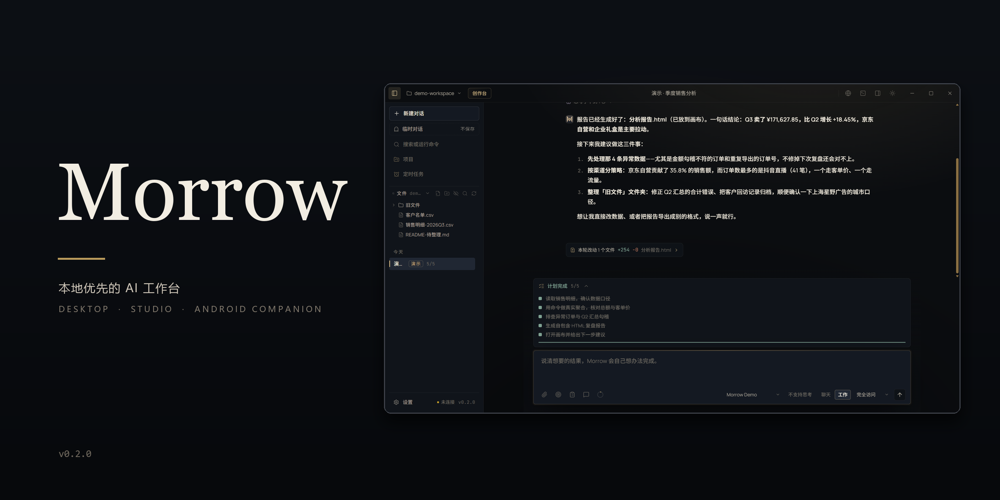
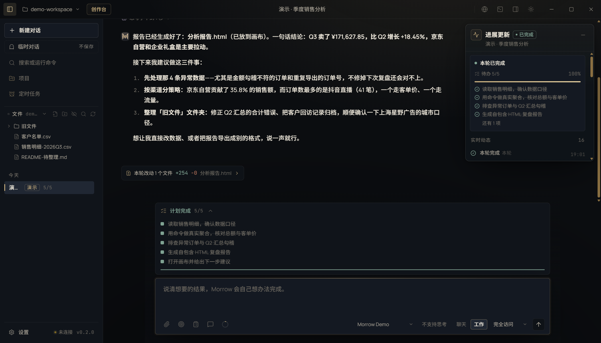
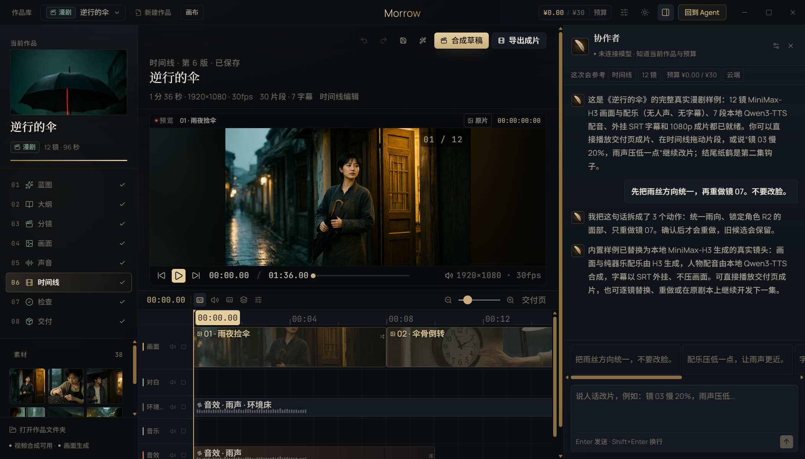
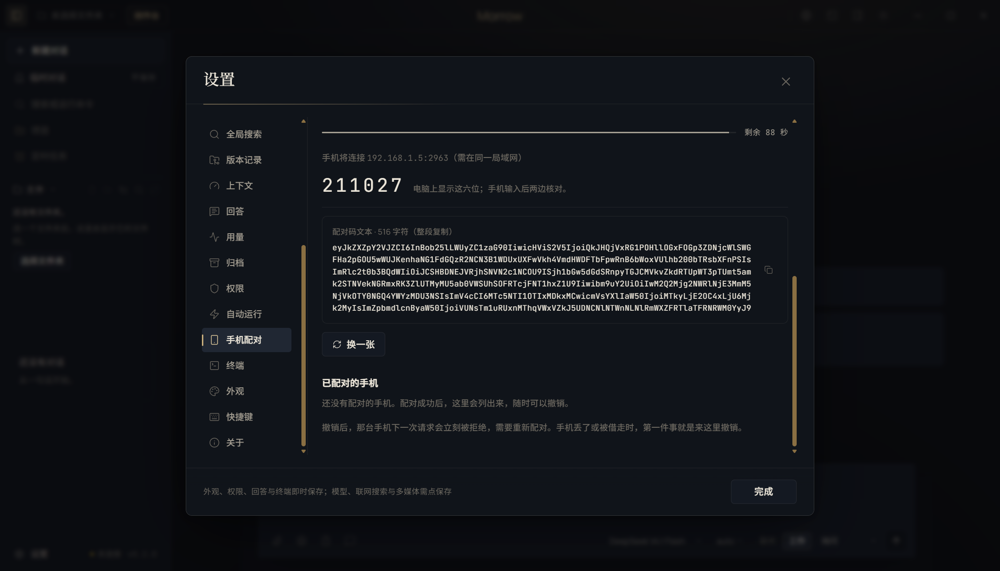
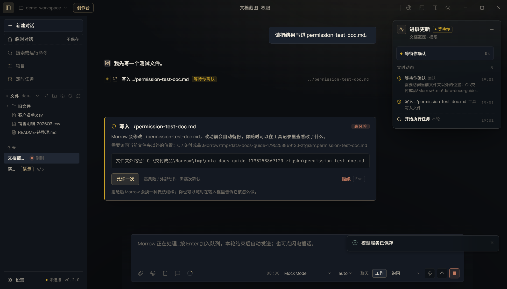

<p align="center">
  
</p>

<h1 align="center">Morrow</h1>

<p align="center">A local-first AI workbench for Windows. You say what you want; a finished file is waiting where you work.</p>

<p align="center"><a href="README.zh.md">中文</a></p>

<p align="center">
  <a href="https://www.electronjs.org/docs/latest"></a>
  <a href="https://react.dev"></a>
  <a href="https://www.typescriptlang.org/docs"></a>
  <a href="https://learn.microsoft.com/windows/"></a>
  <a href="https://developer.android.com/jetpack/compose"></a>
  <a href="LICENSE"></a>
  <a href="https://github.com/youyuwangzi0001/Morrow/releases/tag/v0.2.0"></a>
</p>

<p align="center">
  <a href="docs/README.md">Docs map</a> ·
  <a href="docs/GETTING-STARTED.md">Get started</a> ·
  <a href="docs/PAIRING.md">Pair a phone</a> ·
  <a href="CHANGELOG.md">Changelog</a>
</p>

## Overview

Morrow is a desktop AI agent for Windows 10/11 (x64). You describe the result you want — a cleaned-up spreadsheet, an HTML review, a report, a working script — and Morrow reads your folder, edits files, runs commands, checks its own output, and leaves an artifact you can open. Sessions, memory, workspace files and API keys stay on your machine; you choose which model provider to plug in.

Three surfaces share one product. The **desktop app** is where work happens. **Studio** writes long-form work — short stories, serialized novels and 60–120 second comic dramas — from one sentence to a deliverable file. The **Android companion** shows progress on your phone, lets you approve permission requests, and browses finished work. The phone is a viewer and an approval surface: every tool call still executes on the desktop.

## What you can do

### Work inside a folder you choose

- Five ways to work: chat, work, plan, deep research and long-running goals. Chat only reads; research stays inside a tool allowlist; goals keep running across turns until there is real file evidence of completion.
- A real file tree, a CodeMirror editor, a multi-tab canvas, and previews for HTML, Markdown, PDF, Office files, images, audio and video.
- A real PTY terminal (Git Bash by default, PowerShell 7 or WSL), a Git panel, a multi-tab browser and Windows UI Automation for desktop tasks.
- Three permission levels — read-only, ask, full access — plus per-call approval cards. Read-only refuses every write; ask auto-runs ordinary work inside the folder and asks about destructive commands, outside paths and external side effects; full access stops asking and should only be used on work you trust.
- One checkpoint per ordinary work turn, with file snapshots taken before writes. Rewinding restores the conversation and the files together, and refuses to proceed if the current files no longer match the recorded hashes.



Screenshots in this README come from the application's test mode and built-in demo workspace; the interface is the released one.

### Finish long-form work in Studio

- Short story (18,000 words by default, presets at 30k / 50k / 80k), serialized novel (300,000 by default, presets up to one million) and comic drama (96 seconds by default, presets at 60 / 96 / 120).
- Ten stages — blueprint, outline, writing, storyboard, visuals, voice, music, timeline, review, delivery — with a subset per form. The blueprint is generated by a real text model and billed; later stages only start after you confirm it, and they are billed separately.
- A paper-page editor, a storyboard board, a node canvas for drama shots, a six-track timeline (picture, dialogue, ambience, music, sound effects, subtitles) and real waveforms.
- A collaborator that turns plain-language feedback into a reviewable edit plan; nothing is applied until you confirm, and an applied plan can be undone while no newer edits exist.
- Eight check categories. Errors block the final export; intermediate files can still be exported. Without a real model or engine the step fails loudly instead of inventing a result.
- Delivery as TXT, MD, DOCX, EPUB, PDF, cover, subtitles or a project package; drama adds MP4/MOV/MKV/WebM, WAV/MP3/AAC/FLAC, four-panel comics and a publish bundle.



The works shown are built-in samples seeded by the test harness.

### Watch and approve from your phone

- The Android companion renders a workbench (device state, running task, pending decisions, today's counters, recent artifacts), the approval queue, member tasks, works and the pairing screen.
- It is designed to talk to your desktop over the local network only: the desktop opens a WSS channel with a self-signed certificate, and the phone pins the certificate fingerprint it received in the pairing ticket. Public relay is not implemented.
- Your action is the approval. Dangerous tools cannot be allowed from the phone, and the desktop keeps executing everything.



The companion is a preview, not a finished feature: the shipped APK does not declare the `INTERNET` permission and the desktop panel issues pairing tickets without the LAN address, so a full connection cannot be completed in 0.2.0. Four of its pages are also not yet wired to live data. Every gap is listed in [docs/MOBILE.md](docs/MOBILE.md).

### Keep models, memory and automation in one place

- 15 provider configurations (OpenAI-compatible services, Anthropic native, and Ollama, llama.cpp or LM Studio on the same machine), 12 subscription routes including ChatGPT/Codex and nine coding-plan channels, and seven thinking levels.
- 20 built-in skills, workspace skills under `.morrow/skills`, eight MCP catalog entries, projects, a memory center where suggestions only land after you accept them, and scheduled tasks.
- 17 cloud media presets (image, video, speech, music) next to local ComfyUI, FFmpeg and TTS engines.



## Install

| File | What it is |
|---|---|
| `Morrow-0.2.0-portable.exe` | Single-file portable build; extracts its runtime next to the exe on first run |
| `Morrow-0.2.0-setup.exe` | NSIS installer; choose a directory, creates shortcuts |
| `Morrow-Android-1.0.0-debug.apk` | Android companion (API 26+), sideload, debug key |

Download from the [v0.2.0 release](https://github.com/youyuwangzi0001/Morrow/releases/tag/v0.2.0) and check the files against `SHA256SUMS.txt`. None of the builds is code-signed, so Windows SmartScreen may block the first launch: choose **More info → Run anyway**. The APK needs **Install unknown apps** and is not a store build.

## Quick start

1. Launch Morrow and finish the three-step onboarding: meet Morrow, connect a model, choose a working folder.
2. Say what you want in plain language, for example “turn this sales export into an HTML review and flag the anomalies”.
3. Approve what needs approval. When it finishes, open the artifact from the canvas, the workspace or Studio.

No API key yet? A subscription route such as ChatGPT/Codex reuses a local login, or you can start with the offline demo that spends no quota. Phone pairing takes three minutes and is documented step by step in [docs/PAIRING.md](docs/PAIRING.md).

## Build from source

Requirements: Windows 10/11 x64, Node.js 22.12+, Git (Git Bash is the default terminal).

```powershell
npm install
npm run dev
```

A clean clone cannot build on its own: the prompt bundle is generated at build time from a private source (`%APPDATA%\Morrow-build\prompts`, override with `MORROW_PROMPT_SOURCE`) and `src/generated/` is not committed, so `npm run build` fails loudly without it. This is documented in [docs/DEVELOPMENT.md](docs/DEVELOPMENT.md).

Common checks:

```powershell
npm run typecheck    # both processes
npm run test:unit    # 985 unit tests
npm run test:e2e     # 96 Electron flows (builds first)
npm run docs:check   # links, anchors, screenshot sizes
npm run verify       # the full local chain
```

## Documentation

| Start here | What it covers |
|---|---|
| [docs/README.md](docs/README.md) | Map of the whole documentation set and the rules it follows |
| [docs/GETTING-STARTED.md](docs/GETTING-STARTED.md) | Install, onboarding, first task, first phone pairing |
| [docs/DESKTOP-GUIDE.md](docs/DESKTOP-GUIDE.md) | Interface, modes, permissions, checkpoints, terminal, Git, browser |
| [docs/STUDIO.md](docs/STUDIO.md) | Studio: forms, stages, checks, delivery |
| [docs/MOBILE.md](docs/MOBILE.md) | Android companion: pages, limits, privacy |
| [docs/PAIRING.md](docs/PAIRING.md) | Desktop–phone pairing, LAN channel, protocol |
| [docs/MODELS.md](docs/MODELS.md) | Providers, subscriptions, local models, thinking levels |
| [docs/MEDIA.md](docs/MEDIA.md) | Cloud media presets, ComfyUI, FFmpeg, TTS |
| [docs/REFERENCE.md](docs/REFERENCE.md) | Shortcuts, data paths, environment variables, skills, commands |
| [docs/TROUBLESHOOTING.md](docs/TROUBLESHOOTING.md) | Symptom-first troubleshooting, including phone pairing |
| [docs/ARCHITECTURE.md](docs/ARCHITECTURE.md) | Processes, IPC, agent loop, permission order, Studio pipeline, phone channel |
| [docs/DEVELOPMENT.md](docs/DEVELOPMENT.md) | Environment, tests, CI, screenshots, packaging, licenses |
| [docs/VERIFICATION.md](docs/VERIFICATION.md) | Artifacts, hashes, checks, screenshot inventory, what is not verified |

## Project structure

```text
src/main/       Electron main process: windows, agent, Studio, media, relay, subscriptions
src/core/       Agent loop, providers, tools, permissions, context, compaction
src/renderer/   React interface, feature components and styles
src/shared/     IPC contracts and data types
src/generated/  Prompt bundle generated at build time (not committed)
tests/          Vitest unit suites and Playwright Electron flows
docs/           Documentation, screenshots, diagrams and evidence
scripts/        Build, test, packaging, smoke and documentation checks
```

The Android companion lives in a separate source tree and is shipped here as an APK; [docs/DEVELOPMENT.md](docs/DEVELOPMENT.md) records its stack and why it is not built from this repository.

## Releases

Builds, checksums and release notes live in [Releases](https://github.com/youyuwangzi0001/Morrow/releases); per-version bilingual notes are in [CHANGELOG.md](CHANGELOG.md).

## Security

- The renderer runs with `contextIsolation` and sandboxing, `nodeIntegration` is off, and system access goes through a preload allowlist.
- File tools stay inside the workspace; reading outside it requires an explicit attachment.
- Keys are encrypted with the OS credential store and are never echoed back in the interface.
- Web pages, MCP servers and desktop content are treated as untrusted input.
- The phone channel pins a certificate fingerprint and encrypts every frame; see [docs/PAIRING.md](docs/PAIRING.md).

Report vulnerabilities as described in [SECURITY.md](SECURITY.md).

## Known limitations

- Windows x64 only for the desktop build; no other platform is built or tested.
- No build is code-signed: the two executables and the APK are unsigned or debug-signed.
- ComfyUI, FFmpeg, local model servers and TTS models are not bundled; when they are missing the related action fails with a message instead of producing a placeholder.
- Studio sample works are seeded by the test harness. The packaged build does not ship the demo media, so a fresh install starts with an empty library.
- The Android companion is a preview, not a remote control for arbitrary commands: the shipped APK lacks the `INTERNET` permission, the desktop does not put the LAN address into pairing tickets, four of its pages are not wired to live data, notifications are not wired, and the channel only works on the same local network.
- Model quality, engine speed and long-media behaviour depend on your own environment and accounts.

## License

MIT, see [LICENSE](LICENSE). Third-party components and built-in skill sources are listed in [docs/DEVELOPMENT.md](docs/DEVELOPMENT.md).