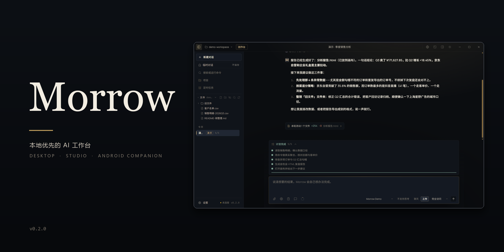
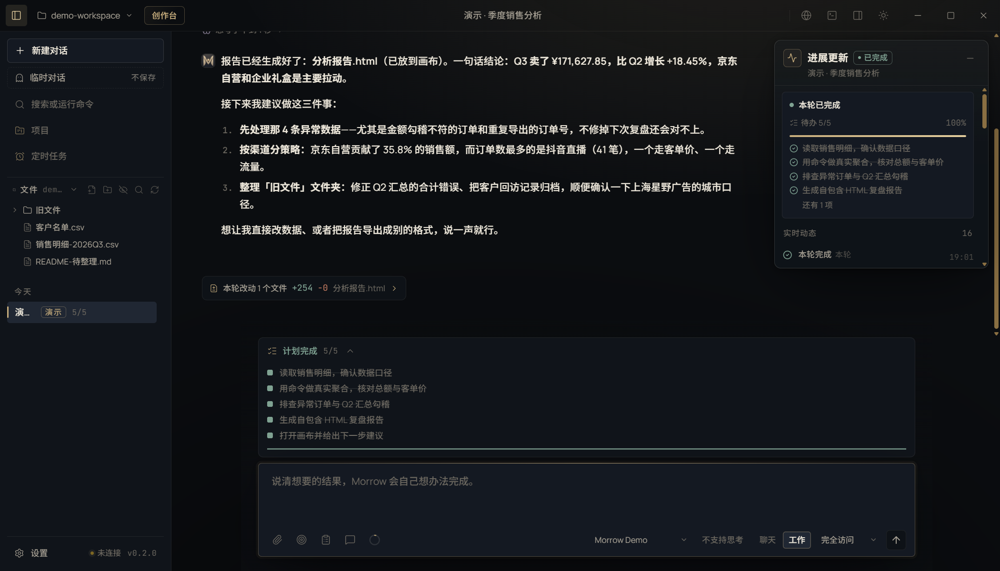
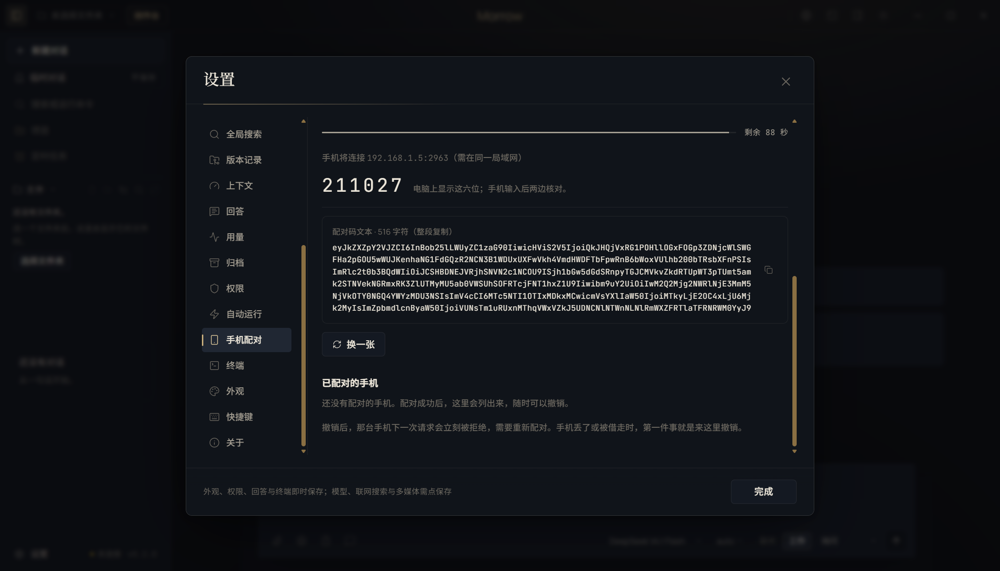
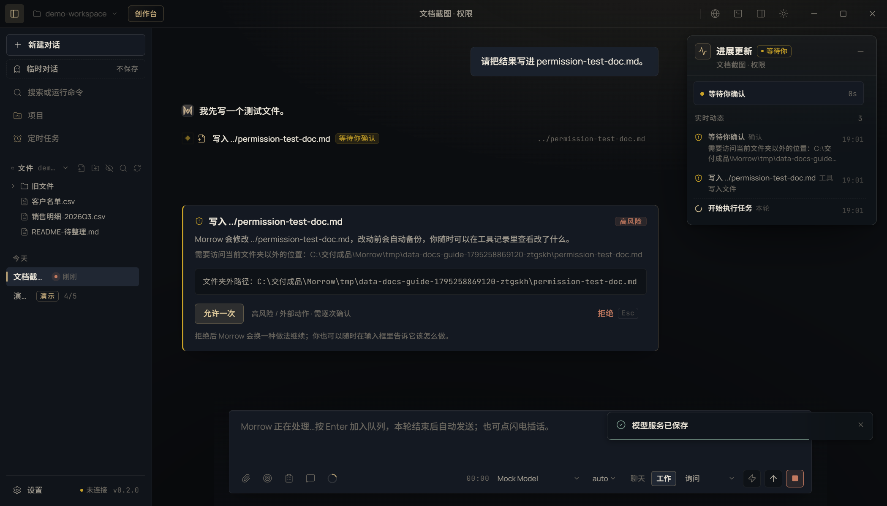

<p align="center">
  
</p>

<h1 align="center">Morrow 明日工坊</h1>

<p align="center">面向 Windows 的本地优先 AI 工作台：你说清想要什么，成品就留在你干活的文件夹里。</p>

<p align="center"><a href="README.md">English</a></p>

<p align="center">
  <a href="https://www.electronjs.org/docs/latest"></a>
  <a href="https://react.dev"></a>
  <a href="https://www.typescriptlang.org/docs"></a>
  <a href="https://learn.microsoft.com/windows/"></a>
  <a href="https://developer.android.com/jetpack/compose"></a>
  <a href="LICENSE"></a>
  <a href="https://github.com/youyuwangzi0001/Morrow/releases/tag/v0.2.0"></a>
</p>

<p align="center">
  <a href="docs/README.md">文档地图</a> ·
  <a href="docs/GETTING-STARTED.md">上手</a> ·
  <a href="docs/PAIRING.md">接上手机</a> ·
  <a href="CHANGELOG.md">变更记录</a>
</p>

## 简介

Morrow 是 Windows 10/11（x64）上的桌面 AI 智能体。你描述想要的结果——整理好的表格、一份 HTML 复盘、一篇报告、一个能跑的脚本——它读你的文件夹、改文件、跑命令、检查自己的产出，最后留下一个能直接打开的文件。会话、记忆、工作区文件和 API Key 都留在本机，模型来源由你接入。

三个面共用一套产品。**桌面端**负责干活；**创作台**负责长内容，从一句话写到可交付的中短篇、长篇或 60–120 秒漫剧；**安卓伴侣端**负责在手机上看进度、批权限、翻成品。手机是旁观与审批端——所有工具调用仍然在桌面执行。

## 能做什么

### 在你选定的文件夹里干活

- 五种工作方式：聊天、工作、计划、深度研究与长期目标。聊天只读；研究限制在工具白名单内；长期目标跨轮续跑，直到有真实文件作为完成证据。
- 真实文件树、CodeMirror 编辑器、多标签画布，以及 HTML、Markdown、PDF、Office、图片、音频与视频预览。
- 真实 PTY 终端（默认 Git Bash，可选 PowerShell 7 或 WSL）、Git 面板、多标签浏览器，以及用于桌面任务的 Windows UI Automation。
- 三档权限——只读、询问、完全访问——外加逐次审批卡。只读拒绝所有写入；询问档自动执行文件夹内的普通操作，只对危险命令、越界路径和外部副作用发问；完全访问不再发问，只用在完全信任的任务上。
- 每个普通工作轮次一个检查点，写文件前留快照。回退会同时恢复对话与文件；如果当前文件已经和记录时的哈希对不上，整体拒绝执行。



本 README 的截图来自应用的测试模式与内置演示工作区，界面与发布版一致。

### 在创作台里把长内容做完

- 中短篇（默认 1.8 万字，档位 3 万 / 5 万 / 8 万）、长篇（默认 30 万字，档位最高 100 万）与漫剧（默认 96 秒，档位 60 / 96 / 120 秒）。
- 十个阶段——蓝图、大纲、写作、分镜、画面、配音、音乐、时间线、检查、交付——按形态取子集。蓝图由真实文本模型生成并计费；确认蓝图后才开始后续阶段，这些阶段另计费用。
- 纸页编辑器、分镜板、漫剧节点画布、六轨时间线（画面、对白、环境床、音乐、音效、字幕）与真实波形。
- 协作者把大白话拆成可审阅的修改计划：确认后才应用，只要之后没有更新的改动就能撤销这次修改。
- 八类检查。存在未解决的错误时禁止导出最终稿，中间文件仍可导出。没有真实模型或引擎时这一步会明确失败，不用假结果顶替。
- 交付为 TXT、MD、DOCX、EPUB、PDF、封面、字幕或工程包；漫剧另有 MP4/MOV/MKV/WebM、WAV/MP3/AAC/FLAC、四格漫画与发布套组。


图中的作品是测试环境播种的内置样例。

### 在手机上查看与审批

- 安卓伴侣端渲染工位（设备状态、运行中的任务、待你决定、今日统计、最近成品）、审批队列、成员任务、作品与配对页。
- 设计上只走局域网：桌面开一条 WSS 通道，用自签证书；手机固定配对票据里拿到的证书指纹。公网中继尚未实现。
- 手机上的动作就是审批本身。危险工具不能在手机上允许，执行端始终在桌面。



伴侣端已不在本仓库构建与发版：源码、文档与 APK 都在 [Morrow-Android](https://github.com/youyuwangzi0001/Morrow-Android) 仓库，两端各自升版本、各自出包。本仓库只负责桌面端与两边共用的通道协议。

### 模型、记忆与自动化放在一处

- 15 个 Provider 配置（OpenAI 兼容服务、Anthropic 原生，以及同机的 Ollama、llama.cpp、LM Studio）、12 类订阅渠道（含 ChatGPT/Codex 与九种编程订阅），以及七档思考强度。
- 20 个内置技能、`.morrow/skills` 下的工作区技能、8 个 MCP 目录项、项目、记忆中心（建议采纳后才写入）与定时任务。
- 17 个云端媒体预设（图片、视频、配音、音乐），与本地 ComfyUI、FFmpeg、TTS 引擎并列管理。



## 安装

| 文件 | 说明 |
|---|---|
| `Morrow-0.2.0-portable.exe` | 单文件便携版；首次运行在 exe 同级解压运行时 |
| `Morrow-0.2.0-setup.exe` | NSIS 安装包；可选安装目录，创建快捷方式 |

从 [v0.2.0 发布页](https://github.com/youyuwangzi0001/Morrow/releases/tag/v0.2.0)下载，并对照 `SHA256SUMS.txt` 校验。两个包使用自签名证书签名（证书链不受信任，SmartScreen 仍可能提示，选择“更多信息 → 仍要运行”）。

安卓伴侣端（API 26 及以上，侧载安装，release 签名）在单独的仓库发布：[Morrow-Android Releases](https://github.com/youyuwangzi0001/Morrow-Android/releases)。

## 上手

1. 启动 Morrow，完成三步引导：认识 Morrow、连接模型、选择工作文件夹。
2. 用大白话说清结果，例如“把这份销售明细做成 HTML 复盘，标出异常订单”。
3. 该批的就批。完成后从画布、工作区或创作台打开成品。

还没有 API Key？可以走 ChatGPT/Codex 这类订阅路线复用本机登录，也可以先用离线演示——它不消耗额度。手机配对大约三分钟，步骤见 [docs/PAIRING.md](docs/PAIRING.md)。

## 从源码运行

环境：Windows 10/11 x64、Node.js 22.12+、Git（默认终端使用 Git Bash）。

```powershell
npm install
npm run dev
```

干净 clone 不能直接构建：提示词包在构建期从私有源生成（`%APPDATA%\Morrow-build\prompts`，可用 `MORROW_PROMPT_SOURCE` 覆盖），`src/generated/` 不入库，缺源时 `npm run build` 会明确失败。说明见 [docs/DEVELOPMENT.md](docs/DEVELOPMENT.md)。

常用检查：

```powershell
npm run typecheck    # 两个进程的类型检查
npm run test:unit    # 1014 项单元测试
npm run test:e2e     # 96 条 Electron 流程（会先构建）
npm run docs:check   # 链接、锚点与截图尺寸
npm run verify       # 本地完整链路
```

## 文档

| 从这里开始 | 内容 |
|---|---|
| [docs/README.md](docs/README.md) | 整套文档的地图与写作约定 |
| [docs/GETTING-STARTED.md](docs/GETTING-STARTED.md) | 安装、引导、第一个任务、第一次配对 |
| [docs/DESKTOP-GUIDE.md](docs/DESKTOP-GUIDE.md) | 界面、模式、权限、检查点、终端、Git、浏览器 |
| [docs/STUDIO.md](docs/STUDIO.md) | 创作台：形态、阶段、检查、交付 |
| [docs/MOBILE.md](docs/MOBILE.md) | 手机端在桌面侧需要知道的部分；页面与边界在 [Morrow-Android](https://github.com/youyuwangzi0001/Morrow-Android) |
| [docs/PAIRING.md](docs/PAIRING.md) | 桌面与手机配对、局域网通道、协议 |
| [docs/MODELS.md](docs/MODELS.md) | Provider、订阅、本机模型、思考档位 |
| [docs/MEDIA.md](docs/MEDIA.md) | 云端媒体预设、ComfyUI、FFmpeg、TTS |
| [docs/REFERENCE.md](docs/REFERENCE.md) | 快捷键、数据路径、环境变量、技能、命令 |
| [docs/TROUBLESHOOTING.md](docs/TROUBLESHOOTING.md) | 按现象索引的排错，含手机配对 |
| [docs/ARCHITECTURE.md](docs/ARCHITECTURE.md) | 进程、IPC、Agent 循环、权限顺序、创作台产线、手机通道 |
| [docs/DEVELOPMENT.md](docs/DEVELOPMENT.md) | 环境、测试、CI、截图、打包、许可 |
| [docs/VERIFICATION.md](docs/VERIFICATION.md) | 交付物、哈希、检查结果、截图清单与未验证项 |

## 项目结构

```text
src/main/       Electron 主进程：窗口、Agent、创作台、媒体、relay、订阅
src/core/       Agent 循环、Provider、工具、权限、上下文与压缩
src/renderer/   React 界面、功能组件与样式
src/shared/     IPC 契约与数据类型
src/generated/  构建期生成的提示词包（不入库）
tests/          Vitest 单元与 Playwright Electron 流程
docs/           文档、截图、示意图与证据
scripts/        构建、测试、打包、冒烟与文档检查
```

安卓伴侣端的源码、文档与分发包都在 [Morrow-Android](https://github.com/youyuwangzi0001/Morrow-Android) 仓库，本仓库不含安卓源码；两端共享的通道协议与配对流程记在 [docs/PAIRING.md](docs/PAIRING.md)。

## 发布

桌面端的安装包、校验文件与发布说明见 [Releases](https://github.com/youyuwangzi0001/Morrow/releases)；逐版本的中英文变更记录见 [CHANGELOG.md](CHANGELOG.md)。安卓端在 [Morrow-Android Releases](https://github.com/youyuwangzi0001/Morrow-Android/releases) 单独发布。

## 安全

- 渲染层开启 `contextIsolation` 与沙箱，关闭 `nodeIntegration`，系统能力只经 preload 白名单访问。
- 文件工具限制在工作区内；读取工作区外文件必须显式作为附件。
- 密钥由系统凭据存储加密，界面不回显明文。
- 网页、MCP 服务与桌面内容一律按不可信输入处理。
- 手机通道固定证书指纹，并对每一帧加密；细节见 [docs/PAIRING.md](docs/PAIRING.md)。

漏洞报告方式见 [SECURITY.md](SECURITY.md)。

## 已知限制

- 桌面端只构建 Windows x64，其他平台没有构建也没有测试。
- 代码签名：两个 exe 用自签名证书签名（非受信任 CA，SmartScreen 仍提示）。
- ComfyUI、FFmpeg、本机模型服务与 TTS 模型都不随包内置；缺失时相关动作会明确失败，而不是给出占位结果。
- 创作台的样例作品由测试环境播种。打包版不带演示素材，全新安装的作品库是空的。
- 安卓伴侣端在独立仓库发版，是桌面的旁观与审批端，不是任意命令的遥控器：通道只在同一局域网可用，未接云消息，成品预览单件上限 4 MiB，作品的编辑与导出只能在桌面做；它自身没有真机运行证据，边界逐条写在 [安卓端文档](https://github.com/youyuwangzi0001/Morrow-Android/blob/main/docs/SCREENS.md)。
- 模型质量、引擎速度与长媒体表现取决于你自己的环境与账号。

## 许可证

MIT，见 [LICENSE](LICENSE)。第三方组件与内置技能来源列在 [docs/DEVELOPMENT.md](docs/DEVELOPMENT.md)。