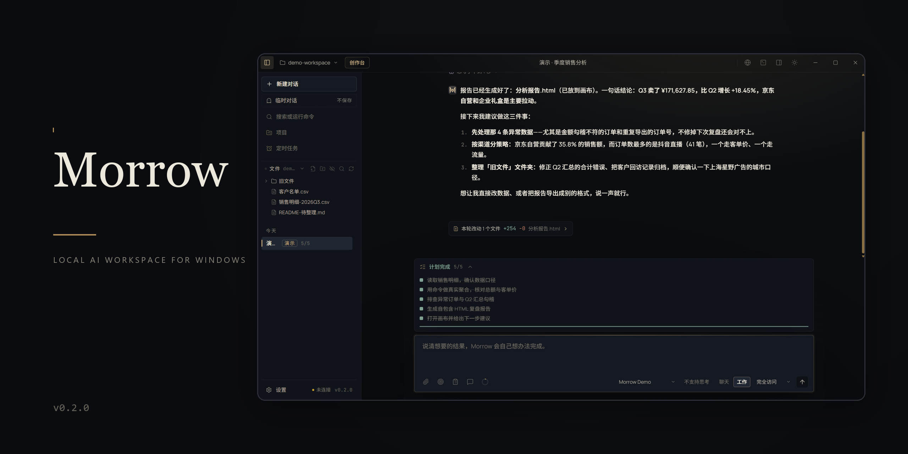
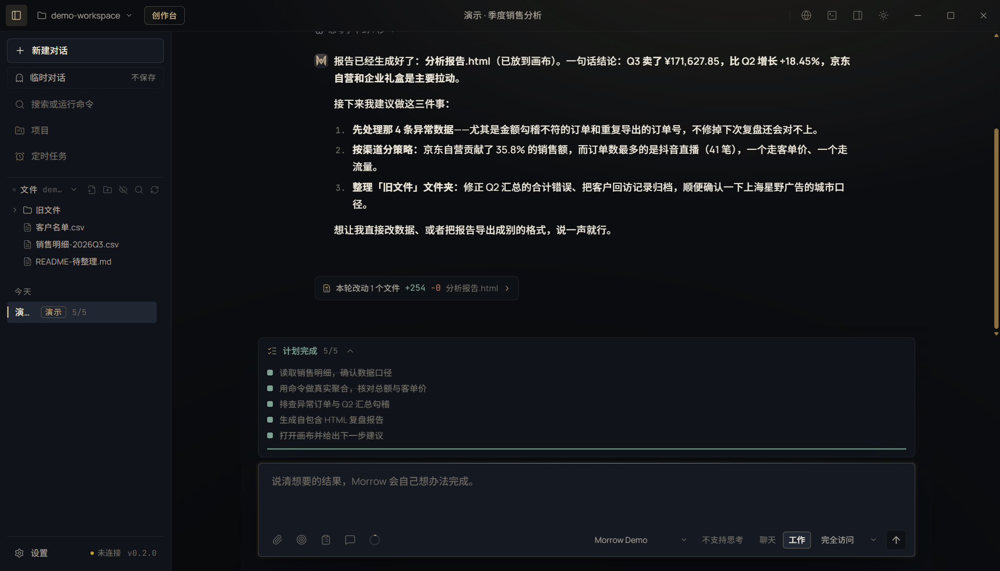
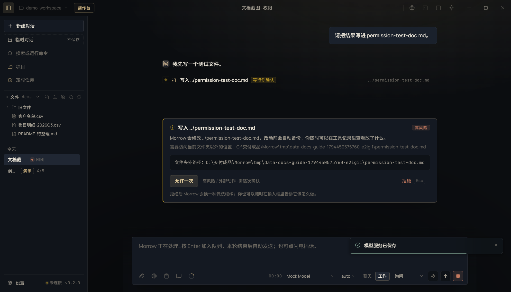

<p align="center">
  
</p>

<h1 align="center">Morrow 明日工坊</h1>
<p align="center">住在 Windows 里的本地优先 AI 工作台：说清结果，直接交付成品。</p>
<p align="center"><a href="README.md">English</a></p>

<p align="center">
  <a href="https://www.electronjs.org/docs/latest"></a>
  <a href="https://react.dev"></a>
  <a href="https://www.typescriptlang.org/docs"></a>
  <a href="https://learn.microsoft.com/windows/"></a>
  <a href="LICENSE"></a>
  <a href="https://github.com/youyuwangzi0001/Morrow/releases"></a>
</p>

## 简介

Morrow 是面向 Windows 10/11 x64 的桌面 AI 智能体。你只说想要的结果，它会读工作区、改文件、跑命令、检查自己的产出，把可打开的成品留在原地。会话、记忆、工作区与密钥都保存在本机，模型来源由你接入。

它还有一个创作台，负责长内容：中短篇、长篇或 30–180 秒的漫剧，从一句话到可交付文件。蓝图由真实文本模型生成并按 token 计费；确认蓝图后才开始写正文、分镜、画面或媒体，这些步骤另计费用。

## 核心特性

### 在你选定的文件夹里真正干活

- 五种工作方式：聊天、工作、计划、深度研究与长期目标。
- 真实文件树、CodeMirror 编辑器、多标签画布，以及 HTML、Markdown、PDF、Office、图片、音频与视频预览。
- 真实 PTY 终端（默认 Git Bash，可选 PowerShell 7 / WSL）、Git 工作台、多标签浏览器与 Windows UI Automation。
- 只读 / 询问 / 完全访问三档权限。危险命令、越界路径与外部副作用动作逐次审批，拒绝始终优先于允许。
- 每个用户轮次一个检查点，写文件前留快照，会话与文件都能回退。



### 能把作品做完的创作台

- 中短篇（3–8 万字）、长篇（20–100 万字）与漫剧（30–180 秒）。
- 蓝图、大纲、分镜、画面、声音、时间线、检查与交付；纸页编辑器、五轨时间线与漫剧节点画布。
- 协作者先把大白话拆成可审阅的修改计划，确认后才应用，改动可撤销。
- 本地确定性检查加真实模型审稿；没有模型或引擎时明确失败，不用假结果冒充。


### 模型、记忆与自动化放在一处

- OpenAI 兼容与 Anthropic 原生 API Key、多种订阅渠道，以及 Ollama、llama.cpp、LM Studio 本机模型。
- 项目、记忆中心、20 个内置技能、工作区技能、MCP 与定时任务。
- 云端图片、视频、配音、配乐服务，与本地 ComfyUI、FFmpeg、TTS 引擎并列管理。



## 安装

### 使用发布包

从[本版本 v0.2.0 的发布页](https://github.com/youyuwangzi0001/Morrow/releases/tag/v0.2.0)下载：

| 文件 | 说明 |
|---|---|
| `Morrow-0.2.0-portable.exe` | 单文件便携版；首次运行在 exe 同级解压运行时缓存 |
| `Morrow-0.2.0-setup.exe` | NSIS 安装包；可选安装目录，创建快捷方式 |

两个 exe 均未签名，Windows 可能提示“已保护你的电脑”，选择“更多信息 → 仍要运行”。运行前请对照 `SHA256SUMS.txt` 校验。

### 从源码运行

环境：Windows 10/11 x64、Node.js 22.12+、Git（默认终端使用 Git Bash）。

```powershell
npm install
npm run dev
```

常用检查：

```powershell
npm run typecheck    # 两个进程的类型检查
npm run test:unit    # 539 项单元测试
npm run test:e2e     # 86 条 Electron 流程（会先构建）
npm run verify       # 类型、UI、文档、清单、单元与 Electron
npm run dist:final   # 重建两个发布 exe
```

## 使用方式

1. 启动 Morrow，完成三步引导：认识 Morrow、连接模型、选择工作文件夹。
2. 用大白话说清结果，例如“把这份销售明细做成 HTML 复盘，标出异常订单”。
3. 需要时批准动作；完成后从画布、工作区或创作台作品库打开成品。

还没有 API Key 时，可以走 ChatGPT / Codex 订阅路线，复用本机 Codex 登录。完整步骤、成功标准与卡住时的处理见 [docs/GETTING-STARTED.md](docs/GETTING-STARTED.md)。

## 配置

模型、订阅与媒体引擎都在应用的**设置**里配置。安装版数据默认在 `%APPDATA%\Morrow`，便携版在 exe 同级的 `Morrow Data`；也可以用 `MORROW_DATA_DIR` 指定。

Provider、订阅渠道、媒体服务、快捷键、数据路径与环境变量的完整清单见 [docs/REFERENCE.md](docs/REFERENCE.md)。

## 项目结构

```text
src/main/       Electron 主进程：窗口、Agent、创作台、媒体、订阅
src/core/       Agent 循环、Provider、工具、权限、上下文、协作
src/renderer/   React 界面、功能组件与样式
src/shared/     IPC 与数据契约
tests/          Vitest 单元与 Playwright Electron 流程
docs/           文档与 2100×1200 截图
scripts/        构建、测试、打包、冒烟与文档检查
```

## 发布

发布包、源码包与校验文件见 [Releases](https://github.com/youyuwangzi0001/Morrow/releases)。逐版本的中英文变更记录见 [CHANGELOG.md](CHANGELOG.md)。

## 安全

- 渲染层开启 `contextIsolation` 与沙箱，关闭 `nodeIntegration`，只通过 preload 白名单访问系统能力。
- 文件工具限制在工作区内；读取工作区外文件必须显式作为附件。
- 密钥由系统凭据存储加密，界面不再回显明文。
- 网页、MCP 与桌面内容一律按不可信输入处理。漏洞报告方式见 [SECURITY.md](SECURITY.md)。

## 已知限制

- 仅提供 Windows x64 构建；两个 exe 均未签名。
- ComfyUI、llama.cpp、Ollama、LM Studio、FFmpeg、ACE-Step 与 TTS 引擎不随包内置，缺失时相关动作会明确失败。
- 订阅登录态与额度由服务商决定；未在本机验证的渠道不会显示为“已连接”。
- 模型质量、引擎速度与长媒体表现取决于你的环境。

## 许可证

MIT，见 [LICENSE](LICENSE)。第三方组件与内置技能来源见 [docs/DEVELOPMENT.md](docs/DEVELOPMENT.md#第三方组件与许可)。