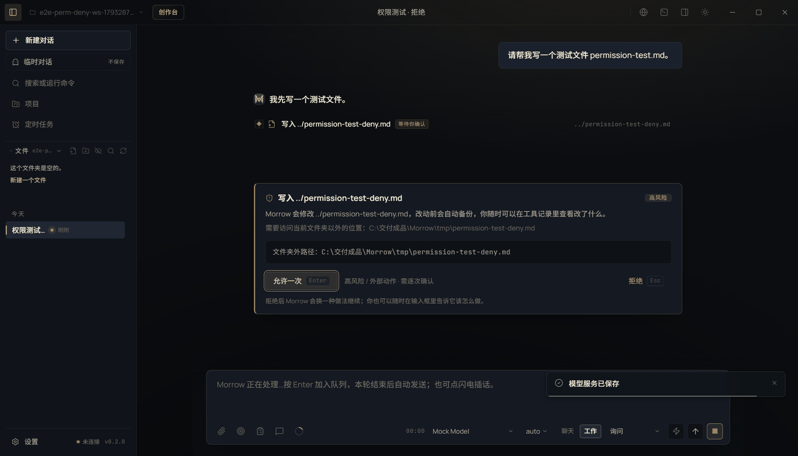

# Security Policy

## 支持版本

Morrow 0.2.0（Windows 10/11 x64）。更早版本不承诺安全修复；请升级到最新 0.2.0 构建。

## 报告方式

请不要在公开 issue 里披露可利用细节、API Key、用户作品或日志原文。通过以下方式私下联系维护者：

- 在 Qoder 协作空间创建仅维护者可见的 Issue，标题以 `[SECURITY]` 开头；
- 或通过仓库维护者公开的联系方式发送加密/脱敏报告。

报告请包含：

- 受影响版本与安装方式（便携/安装）；
- 复现步骤、期望结果、实际结果；
- 影响范围（本地/网络/凭据/数据）；
- 可选的修复建议；
- 脱敏后的日志片段（不要附 Key）。

## 范围

- 路径越界、命令注入、权限绕过；
- API Key/订阅凭据明文泄漏；
- IPC/preload 白名单绕过；
- 网页/MCP/技能内容导致的未授权文件/命令/网络访问；
- 恶意作品/素材导致的解析漏洞；
- 订阅回环/本地服务暴露到公网；
- 打包产物中泄漏源码提示词/密钥/用户数据。

## 非安全范围

- 未签名 exe 的 SmartScreen 提示；
- 用户主动选择“完全访问”后执行的命令；
- 用户自己配置的模型/ComfyUI/MCP/订阅服务端问题；
- 第三方模型/服务商的隐私政策与数据留存；
- 社会工程/用户自己把 Key 贴到聊天里。

## 处理原则

- 先确认影响与复现，再修复；修复前不公开细节。
- 优先保护用户数据与凭据；必要时在更新说明里提醒轮换 Key。
- 修复后补回归测试；发布记录里写清受影响版本与建议动作。

## 已知安全边界

- 便携版/安装包未配置代码签名；请以 SHA-256 校验为准。
- 完全访问档会直接执行危险/越界动作；只在信任任务时使用。
- 网页、MCP、浏览器内容按不可信数据处理；模型仍可能被诱导，权限档位是最后闸门。
- 本机模型/ComfyUI/FFmpeg/TTS 的许可与数据由用户选择的构建决定。
- 详细威胁模型见 [安全与隐私](docs/SECURITY-PRIVACY.md)。
