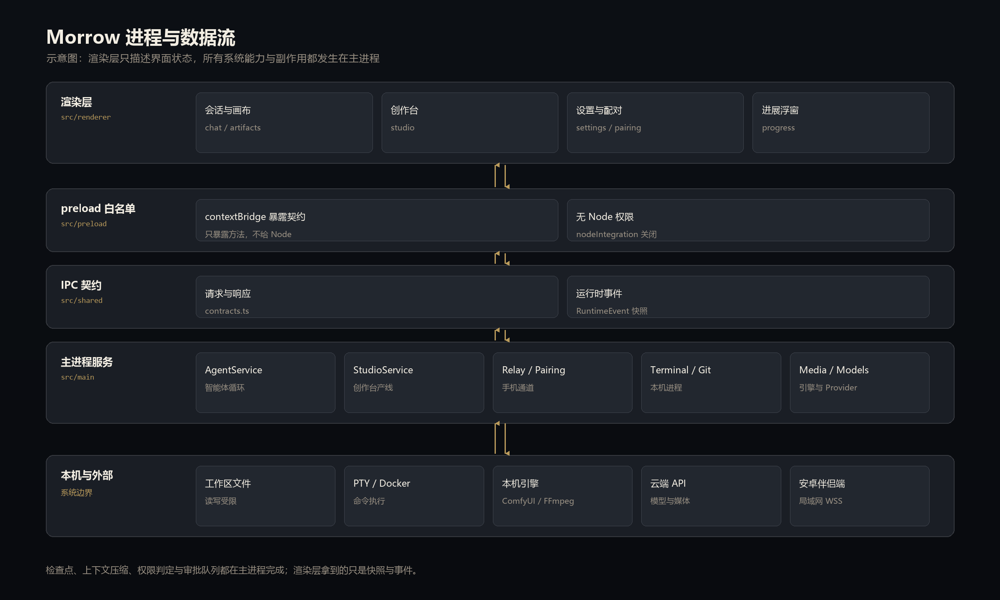

# 架构说明

这一篇写给要改代码或评估风险的人：先讲主进程与渲染层的分工，再讲内核的循环、权限与上下文，最后讲创作台、手机通道、设计系统与构建链路。产品行为与操作步骤见 [DESKTOP-GUIDE.md](DESKTOP-GUIDE.md)，跑起来与打包见 [DEVELOPMENT.md](DEVELOPMENT.md)，交付证据见 [VERIFICATION.md](VERIFICATION.md)。

文中只写当前实现里稳定的边界。具体字段以 `src/shared` 的契约和测试为准；判断某个行为是否成立时，先看对应测试，再看这篇的描述。

## 目录

仓库根只放源码、脚本、测试、文档与交付目录，运行时生成的东西一律不进仓库。

| 路径 | 内容 |
|---|---|
| `src/` | 应用源码，内部按 `main`、`core`、`renderer`、`shared`、`generated`、`preload` 分区 |
| `scripts/` | 构建、测试、打包、冒烟、截图与文档校验脚本 |
| `tests/` | `unit/` 的 Vitest 用例与 `e2e/` 的 Playwright Electron 流程 |
| `docs/` | 中文文档、`screens/` 截图与 `diagrams/` 示意图；打包摘要与证据属于生成物，不入库 |
| `deliver/` | 便携版、安装包与 `SHA256SUMS.txt`，不入库 |
| `resources/`、`build/` | 随包脚本、图标、托盘图与启动器 |
| `.github/workflows/` | L1 质量门槛 |

`out/`、`release/`、`tmp/`、`docs/verification/` 与 `src/generated/` 都是生成物，已在 `.gitignore` 里忽略。

## 进程模型



示意图：这张图画的是进程分层与数据流，不是界面截图，也不代表某次真实运行。

Morrow 是 Electron 应用，但系统能力只在一个进程里。渲染层负责画界面，主进程负责所有会碰文件、进程、网络与设备的动作。

```text
renderer（React 19 + Zustand）
   │ window.morrow（preload 白名单）
preload（contextIsolation、sandbox、无 nodeIntegration）
   │ ipcRenderer.invoke / feature:* / morrow:event
main（Electron 主进程）
   ├─ 窗口、生命周期、单实例、托盘、灵动岛
   ├─ Agent 循环、会话、检查点、权限
   ├─ 创作台、媒体、订阅、搜索
   ├─ 终端、Git、浏览器、电脑操作
   └─ relay（局域网通道、配对、中继占位）
```

- 主进程持有窗口、Agent、创作台、媒体、订阅、终端、Git 与 relay。渲染层不直接读文件、不起进程、不建连接。
- 创建窗口时固定 `contextIsolation: true`、`sandbox: true`、`nodeIntegration: false`，并关闭 `webviewTag`；渲染层只能经 preload 暴露的 `window.morrow` 调白名单方法。
- 启动顺序是硬约束：先在单实例锁之前解析数据目录并 `app.setPath('userData')`，再创建主窗口与灵动岛，然后注册 IPC、拉起按需服务、恢复上次会话。顺序反了会出现两把锁或两套数据。
- 主进程的服务按域分文件，跨域只走显式端口，例如 `CollaborationRuntimePort`、`TerminalToolHandler`、`MediaToolHandler`。不靠可变的全局单例在域之间传状态。
- 渲染进程崩溃会自动重载，并有频率上限。会话状态由主进程持有，重载不会重跑已经完成的工具。
- 后台行为分两类：创作台任务随应用退出停止（下次打开改成待复核），定时任务要求应用仍在运行。两者都不做系统级常驻。

## 扁平源码结构

源码只保留五个根，文件按功能域平铺。新增能力放进已有域，不新建第六个顶层目录。

| 根 | 职责 | 典型文件 |
|---|---|---|
| `src/main` | 系统能力、持久化与服务编排 | `agent.ts`、`studio.ts`、`media.ts`、`terminal-manager.ts`、`relay*.ts` |
| `src/core` | 与 Electron 解耦的 Agent 内核 | `agent.ts`、`providers.ts`、`tools.ts`、`compaction.ts` |
| `src/renderer` | React 界面、feature 组件与样式 | `App.tsx`、`store.ts`、`features/`、`styles.css` |
| `src/shared` | 跨进程契约与纯逻辑 | `contracts.ts`、`types.ts`、`gate.ts`、`scene-integrity.ts` |
| `src/generated` | 构建期提示词产物，不入库 | `prompts.bundle.ts` |

- 为什么扁平：跨域 import 只有一层，重构按域搬文件即可；多层的 `core/agent/`、`studio/` 会让路由与循环依赖一起变复杂。
- 域内合并的例子：远程通道由五个文件承担（`relay.ts` 设置与生命周期、`relay-channel.ts` 通道选择、`relay-crypto.ts` 信封与 TLS 材料、`relay-pairing.ts` 票据与设备、`relay-server.ts` 中继占位）；协作域是 `core/collaboration.ts` 加 `main/collaboration.ts`；搜索域是 `main/search.ts`。
- `src/core` 不 import Electron，文件系统、网络、PTY 与窗口能力都由 `src/main` 注入。这样内核可以只靠类型与端口在 Vitest 里跑。
- `src/renderer` 每个功能域一个组件加一个 `*-core.ts` 纯逻辑文件；跨 feature 复用放 `shared`，不让两个 feature 互相 import。
- `src/generated/prompts.bundle.ts` 由 `scripts/embed-prompts.mjs` 生成，`.gitignore` 已忽略；干净 clone 里这个文件不存在，构建时缺私有提示词源会直接失败（见 [DEVELOPMENT.md](DEVELOPMENT.md)）。
- 测试同样平铺：`tests/unit` 按功能域合并入口，`tests/e2e` 按流程分文件，共用 `helpers.ts`，不恢复 `helpers/` 子目录。

## 数据目录

数据目录决定单实例锁、日志、会话与作品落盘的位置，所以它在创建窗口之前就确定，运行中不迁移。

解析顺序如下，前面的命中就停止：

1. `--data-dir=<绝对路径>`：显式指定，测试与多开用。
2. `%LOCALAPPDATA%\Morrow\data-location.json` 里的自定义指针；目录不可用时回退默认目录，但保留指针给设置页修复。
3. exe 同级存在 `portable.marker`，或进程带 `PORTABLE_EXECUTABLE_DIR`：使用 `<exe 目录>\Morrow Data`。
4. 启动器解压出的 `.morrow-runtime-*` 宿主目录：向上回溯到便携版所在目录。
5. 默认 `%APPDATA%\Morrow`。

目录内按域分文件或子目录：会话、检查点与快照、设置、加密凭据、项目、记忆、技能、定时任务、用量、创作台作品与协作数据各占一份。逐项路径见 [REFERENCE.md](REFERENCE.md)。

- 工作区里的 `.morrow/` 属于工作区，不属于数据目录：项目记忆、经验、技能、命令、角色与 MCP 配置都在这里，换工作区就换一套。
- 写入统一用临时文件加同目录重命名；读取时校验，损坏的文件保留回滚清单而不是静默重建。
- 密钥经系统安全存储加密，界面不回显明文；日志脱敏后按 JSON 行追加，敏感字段不落盘。
- 创作台作品由 `StudioStore` 单一写入口：超长章节按内容哈希写入独立分片，`project.json` 成功后才清理旧分片；读取时逐章校验，只从历史版本恢复损坏章节。

## IPC 与事件

渲染层与主进程之间只有两类通道：请求与事件。请求走 `ipcMain.handle`，事件走单向广播。

- 基础 IPC 之外，扩展功能统一注册为 `feature:<name>:<action>` 精确频道；preload 与主进程两侧都只接受已注册的频道，未注册的直接拒绝。
- 创作台的混合入口 `feature:studio:action` 按 `payload.type` 二分到动作与查询，避免为每个动作开一条频道。
- 请求统一返回 `{ ok: true, data }` 或 `{ ok: false, error }`；错误带可读的 `code` 与 `message`，渲染层不解析异常字符串。
- `RuntimeEvent` 的公共字段是 `seq`、`runId`、`sessionId`、`at`。主进程先脱敏、持久化、登记检查点、更新灵动岛，再广播 `morrow:event`。
- 流式增量按帧合并后推送，渲染层再做一层兜底合并；一 token 一条消息会把 IPC 打满。
- `sessionLoad` 会把内存中仍在进行的消息合并进快照并返回 `liveMessageId`；切回运行中的会话时，界面从实时分片继续，而不是从下一个分片重新开始。
- 工具执行前校验执行身份（主代理、分发层、协作成员）的 token、工具白名单、会话与运行、有效期与写入目录；允许与拒绝写入协作审计日志，日志不含工具参数与文件内容。
- preload 只导出方法与事件订阅；事件回调在组件卸载时取消，不把 `ipcRenderer` 暴露给页面。

## Agent 循环

内核在 `src/core/agent.ts`，主进程只注入 Provider、工具实现、权限上下文与运行时端口。一个普通工作轮次的顺序是：组装上下文、请求模型、落盘消息、执行工具、写检查点、累计用量。

- 默认步数不限：`DEFAULT_MAX_STEPS = Infinity`，长任务不会因为固定步数被截断。计划模式、测试与高级调用方可以传 `maxSteps` 设硬上限，达到上限时先让模型给出已完成与剩余事项，再结束本轮。
- 并行安全工具一批最多 4 个并发执行，其余按顺序执行。并行批次共享 `parallelGroup`，结果按调用顺序回填，模型看到的顺序与发起顺序一致。
- 每个工具调用先按 JSON Schema 校验参数。坏 JSON 有确定的修复路径：去代码围栏、修非法转义与裸换行、截断时明确报截断并带回出错片段；修不好就作为工具错误回给模型，不猜参数。
- Provider 默认重试 3 次，退避 800 / 2000 / 5000 ms。4xx（429 除外）与主动中断不重试；断流时已有正文就续接，只有思考没有正文就重发。
- 工具结果统一为 `ok` 或 `error`；错误带人类可读原因与 `hint`，模型据此换方案，而不是反复重试同一个坏调用。
- 每个普通工作轮次写一个检查点，单会话最多 100 个；演示模式与临时对话不写；回退同时恢复对话与文件，文件哈希冲突时整体拒绝。
- 基础工具 94 个，另有 5 个条件工具：`submit_plan`、`update_goal`、`worker_message`、`worker_ask`、`worker_todo_write`，只在计划、目标或协作模式挂载。
- 停止条件是你主动中断、步数上限、Provider 不可恢复错误或目标预算耗尽。只有思考或空内容不算完成：内核先在本步重试，仍无正文时给出明确错误，不静默停止。

## 权限与审批

所有工具调用都过 `evaluatePermission`。它按固定顺序返回 `allow`、`ask` 或 `deny`，先命中的分支先返回结果；顺序本身就是安全边界。

判定顺序：

1. 聊天或研究模式的工具限制。聊天只放行只读工具、`ask_user` 与 `web_search`；研究只放行资料检索、计划与画布。写文件、跑命令直接拒绝，与权限档位无关。
2. 演示模式直通。演示剧本固定，不弹审批。
3. 只读档拒绝。写文件、命令、外部工具与会写盘的元工具（如 `remember`）直接拒绝；越界写也在这里一并拒绝，不会降级成“询问”。
4. 越界。目标在工作区外时，完全访问直接执行并标记 `escape`；其余档位逐次审批，不提供“始终允许”。你显式附件的文件只读访问不算越界。
5. 工作区 `deny` 规则。命中即拒绝，先于任何放行判断。
6. `meta` 与 `read` 放行。无副作用的元工具与只读工具直接允许。
7. 外部动作。`web_fetch`、`mcp_call` 在询问档逐次审批；被托管的浏览器被动操作放行，点击与输入仍审批；`web_fetch` 可按站点记住到本会话。
8. 命令与终端。危险命令、工作区外路径、外部副作用命令与终端 stdin 写入逐次审批；完全访问直接执行。这些动作没有“始终允许”。
9. 工作区 `allow` 规则。到这一步才生效，不能越过前面的危险命令、越界、外部动作与只读限制。
10. 会话签名。你在本次会话里批准过的同一目标签名直接放行；签名绑定执行身份与参数，换身份或过期后失效。
11. 放行或弹审批。完全访问与询问档在工作区内的普通写与执行直接放行；需要审批时生成审批卡，展示工具、目标、影响范围与预览。

| 档位 | 判定结果 |
|---|---|
| 只读 | 写文件、跑命令、外部动作一律拒绝，只允许读 |
| 询问 | 工作区内普通写与命令放行；越界、危险命令、外部动作、终端写入逐次审批 |
| 完全访问 | 除聊天与研究模式的限制外全部放行，越界直接执行 |

- `deny` 优先于 `allow`；规则在设置 › 权限 › 文件夹权限规则里维护，删改后下一次调用立即生效。
- 审批卡有三个动作：允许一次、始终允许、拒绝。高危动作与终端写入不显示“始终允许”；拒绝结果会回灌给模型，并明确要求不要重试同一操作。
- 定时任务无人值守时，任何审批自动拒绝，错误文案说明需要你手动处理；这是定时任务只有只读与自动两档的原因。
- 工具执行身份与审批绑定：协作成员不能用主代理的批准，过期签名与换运行都不放行。

## 上下文与压缩

上下文分两层，这一点决定了压缩能不能撤销、历史会不会丢。

- `Session.messages` 是完整记录：界面、落盘、导出、搜索与分叉都读它，永不裁剪。`RunContext.modelMessages` 才是发给模型的那一份，压缩只作用于它。
- 触发阈值默认是上下文窗口的 80%，界面可调 50–95%；压缩时保留最近 8 条消息原文。
- 先修剪、后摘要：达到阈值后先对较早的超大工具结果做确定性修剪（保留头尾，中间写省略标记），修剪后回到阈值内就跳过摘要模型；仍需摘要时，摘要模型看到的也是修剪后的内容。
- 摘要以一条 `role=system` 标记插入模型侧，带 `preservedMessageIds`、轮次与节省量；完整记录里原文一条不删，界面把“已压缩”标记画在真实切点。
- 摘要前会从目标、计划、待办、最近指令与产物生成一段运行状态，附在摘要之后；它不交给摘要模型改写，压缩后仍以真实状态为准。
- 规划压缩必须基于 `modelMessages`。用完整记录规划会因记录只增不减而反复触发压缩，还会让 `cutIndex` 与模型侧索引错位。
- 用量有服务商真实占用时标注“API 精确”，否则标“估算”；压缩节省量按同一口径展示。
- 目标比例 0.15 只在内核使用，界面不暴露；工具输出折叠长度写进标记，压缩后新增的消息保持原文。

## 长期目标、研究与定时任务

三者跑在同一个 Agent 循环里，差别是续跑条件、来源门槛与无人值守策略。

| 能力 | 运行边界 | 停止或完成条件 |
|---|---|---|
| 长期目标 | 单段 2–256 轮；用尽仍在推进自动 +12 轮，硬上限 2000；至少 60 分钟有效运行 | 连续 3 轮无进展、你主动停止；完成需工作区内真实文件证据 |
| 深度研究 | 快速 2 轮且至少 4 个来源；标准 4 轮且至少 10 个；深入 6 轮且至少 20 个；先规划再检索 | 来源不足，或没有带引用的报告，都不算完成 |
| 定时任务 | 一次、每天或每周；最多 50 个；5 秒 tick；全局串行；单次 30 分钟超时 | 错过超过 1 小时标 `missed`；应用不运行就不执行 |

- 目标完成由 `update_goal` 声明，必须给出工作区内真实存在的文件路径。只有文字总结不算完成。
- 研究来源要与真实搜索与读取记录比对，编造的 URL 不计入来源数；报告必须带引用。
- 定时任务只有只读与自动两档，没有“询问”；无人值守时任何审批自动拒绝。
- 三者都走同一套工具、权限与事件；定时任务触发时如果已有任务在跑，会排队而不是并行。

## 创作台架构

创作台是主进程里的 `StudioService` 加作品存储 `StudioStore`；渲染层只发动作、订阅事件。

- 产线是一条单向链：形态 → 阶段 → 任务队列 → 检查 → 导出。形态有三种（中短篇、长篇、漫剧），阶段有 10 个（蓝图、大纲、写作、分镜、画面、配音、音乐、时间线、检查、交付），按形态取子集。
- 任务队列有 10 种类型（文本、图片、视频、配音、音乐、音效、渲染、导出、审稿、导入）与 6 种状态（`queued`、`running`、`review`、`done`、`failed`、`cancelled`）。队列在内存与作品文件里各有一份，退出应用后不继续执行。
- 检查有 8 类（连续性、画面、音频、字幕、缺失、价格、配音、质量）。本地确定性检查先跑，模型审稿另计费；存在未解决的 `error` 时禁止导出最终稿，中间文件可以先导出。
- `shared/gate.ts` 把可计算检查汇总成统一门禁，`ERROR > 0` 阻断出包；新增检查项必须同时登记到 `GATE_CHECKS`，`missingGateChecks` 会拦住“加了检查但没接进门禁”。
- 纯判定模块放 `src/shared`：`gate`、`scene-integrity`、`seam-audit`、`director-layer`、`reference-image`。抽帧、FFmpeg、引擎探测与提示词解包留在 `src/main`，因为要碰进程与文件。
- 作品上限：单作品 512 MB、单素材 2 GB、工程包 300 MB；任务记录保留 120 条。退出时把 `running` 与 `queued` 改成 `review`，下次打开不会假装任务还在跑。
- 蓝图由文本模型生成并按 token 计费；确认蓝图后才进入后续阶段，后续步骤另计费。没有真实模型或引擎时明确失败，不用占位素材冒充。
- 提示词基座只来自构建期产物 `src/generated/prompts.bundle.ts`，由 `main/prompt-kit` 在运行时解包；仓库与本机都不保留明文副本。

## 手机通道架构

手机端是桌面端的旁观与审批端，不执行任何工具。桌面端提供通道与配对，Android 端负责连接与展示，两端共享同一套帧格式。

- 桌面端四个文件加一个占位：`relay.ts` 管设置与生命周期，`relay-channel.ts` 做通道选择与直连探测，`relay-crypto.ts` 管信封、AES-GCM 帧与自签证书，`relay-pairing.ts` 管票据、六位码与设备密钥，`relay-server.ts` 是公网中继的占位实现。
- 连接范围是同一局域网内的 `wss://` 直连：证书自签，手机在配对时记住指纹并固定，不验证证书链。公网中继只在本机监听，不承载手机流量，跨网络不可用。
- 通道选择器有三级（局域网直连、中继、推送）。直连持续不可达满宽限期才降级，避免一个丢包让状态来回抖；中继当前不可用，所以实际只有直连与“未连接”。
- 配对：桌面生成一次性票据（90 秒有效、`MORROWPAIR1.` 文本），手机回传公钥与 nonce；六位码由双方公钥派生、两端本地比对，最多错 3 次；ECDH P-256 协商后经 HKDF-SHA256 派生双向密钥。
- 帧用 AES-256-GCM，AAD 绑定方向、设备与单调计数。重复计数与篡改分别以 4402 与 4403 关闭连接，4401 表示未授权；这三个关闭码都不重连。
- Android 端源码不在本仓，在独立仓库 [Morrow-Android](https://github.com/youyuwangzi0001/Morrow-Android)。WebSocket 客户端与 RFC 6455 帧编解码是手写的，`SecureChannel` 负责双向密钥、AAD 与防重放；本仓只保留桌面侧的通道实现。
- 手机端没有桌面连接时停在未配对状态，不编造数据；页面与数据来源见安卓仓库的 `docs/SCREENS.md`，两端共享的协议细节见 [PAIRING.md](PAIRING.md)。
- Android 侧的测试规模与验证边界由那个仓库自己的文档负责，本页不重复摘录。

## 设计系统

界面只有两套主题，所有排版值都走 token。这样切换字号与主题时不会出现局部写死。

- 主题是墨夜（默认）与素纸，共享同一套 token，不新增第三套。破坏性确认使用低饱和酒红。
- 字号阶梯从两个基值推导：`styles.css` 定义 `--font-ui-size` 与 `--font-code-size`，其余 `--fs-*` 全部用 `var()` 从基值算出。切换字号只改基值。
- `ui-token-audit` 是硬门槛：CSS 与 TSX 里禁止裸 `font-size: 13px`、裸 `font-weight`、裸 `line-height`、写死的 `letter-spacing` 与 `outline: 2px`；字号必须走 `var(--fs-*)`、继承或相对单位。
- 焦点环统一 `--focus-ring-width: 2px`；输入框、文本域与下拉使用 `--control-radius` 微圆角与 `--control-focus-shadow` 内嵌焦点环。
- 动效短、只用于状态变化与空间关系；系统开启减少动效时不阻塞操作；正文不使用斜体。
- 样式分三处：`src/renderer/styles.css` 放 token 与基础，`components.css` 放通用组件，各 feature 的 `*.css` 放局部样式。文档与导出预览的 iframe 允许保留自身排版字号，审计里单独放行。

## 安全边界

安全边界由进程隔离、路径限制、审批顺序与密钥处理四条线组成。任何一条被绕过，其余三条都补不回来。

- 进程隔离：`contextIsolation`、`sandbox`、关闭 `nodeIntegration`、禁用 webview；preload 只暴露白名单方法。
- 页面与 CSP：生产包收紧 CSP，只允许应用自身页面与受控预览协议；`window.open` 被拒绝，外链只走系统浏览器。
- 路径：文件工具限制在工作区；工作区外只允许显式附件的只读访问，写入仍走权限审批。
- 命令：危险命令、越界路径、外部副作用与终端 stdin 逐次审批；命令环境过滤敏感变量，不把整份环境交给子进程。
- 不可信内容：网页、MCP 工具结果与桌面窗口内容都按不可信数据处理；浏览器只允许 http(s)；MCP 信任按工作区授予。
- 密钥：系统安全存储加密，界面不回显，日志脱敏；网络请求带 SSRF 防护，本机与局域网模型不误走厂商原生搜索。
- 已知边界：两个 exe 用自签名证书签名（`CN=Morrow Studio`，非受信任 CA，SmartScreen 仍会提示）；ComfyUI、FFmpeg、TTS 模型与音乐服务不随包；Android 是 release 签名包但无真机证据；公网中继未实现；真实模型质量与账号额度由服务商决定。

## 构建、测试与打包

源码构建有一个容易踩的前置：创作台提示词不在仓库里。`prebuild` 调 `scripts/embed-prompts.mjs`，从 `%APPDATA%\Morrow-build\prompts`（可用 `MORROW_PROMPT_SOURCE` 覆盖）读取私有源并生成 `src/generated/prompts.bundle.ts`。缺源时 `npm run build` 明确失败；干净 clone 只能先跑 `typecheck`（`pretypecheck` 用占位产物），不能直接构建。

- `verify` 链是 `typecheck → audit:ui → audit:flex → docs:check → test:suite → test:unit → test:e2e`，任何一步失败都返回非零。
- 测试真值：1014 个单元用例（59 个文件）、96 条 Electron 流程（16 个文件，95 通过加 1 跳过）、43 个功能域。`test:suite` 只做覆盖登记与数量预算的静态校验，不执行用例。
- 打包：`dist:final` 等于 `npm run build` 加 `dist-portable --two-files`，产出便携版与 NSIS 安装包；`smoke:packaged` 真实启动便携包并检查首屏。
- CI：`.github/workflows/quality-gates.yml` 只跑 typecheck、audit:ui、docs:check、test:suite。L2（单测、E2E、打包、冒烟）需要自托管 Windows runner，尚未接入；`audit:flex` 只在本地 `verify` 跑。
- 文档与截图：`docs:capture` 产 27 张、`test:pair-panel` 产 1 张、E2E 顺手产 2 张；`docs:check` 校验链接、锚点、截图尺寸与“每张图被引用”。细节见 [DEVELOPMENT.md](DEVELOPMENT.md)。