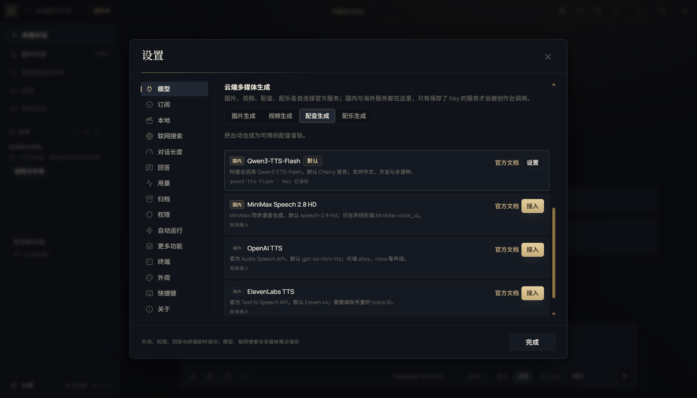
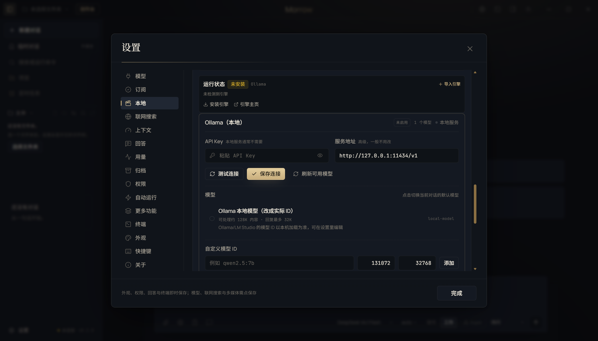

# 云端多媒体服务与「模型 / 本地」分栏

- 日期：2026-11-05
- 范围：设置 → 模型 / 设置 → 本地；创作台的图片、视频、配音、配乐
- 核心文件：`src/shared/media-cloud.ts`、`src/main/media-cloud.ts`、`src/main/settings.ts`、`src/main/studio.ts`、`src/renderer/features/settings.tsx`

## 1. 设置结构

**模型页只接云端。**

- 文本：原有云端文本模型与自定义 OpenAI 兼容服务。
- 多媒体：「云端多媒体生成」四类页签：
  - 图片生成
  - 视频生成
  - 配音生成
  - 配乐生成
- 每张服务卡片都标有「国内」或「海外」，便于直接选择国内直连服务。
- 没有保存 API Key 的服务不会显示成可用，也不会被创作台调用。



**本地页集中所有本地模型。**

- 本地文本模型：Ollama、llama.cpp、LM Studio（不再出现在模型页的服务选择器里）。
- 本地媒体引擎：ComfyUI、FFmpeg、本地 TTS 与本地配乐草稿。
- 模型页的服务选择器不包含任何本地服务。



## 2. 本轮接入的官方服务（截至 2026-11-05）

只加入有公开官方文档、能实际调用的接口；没有用占位服务凑数。

| 类型 | 地区 | 服务 | 协议 | 默认模型 | 官方入口 |
| --- | --- | --- | --- | --- | --- |
| 图片 | 国内 | 火山方舟 Seedream 5.0 Pro | Ark Images | `doubao-seedream-5-0-pro-260628` | `POST /api/v3/images/generations` |
| 图片 | 国内 | 火山方舟 Seedream 5.0 Flash | Ark Images | `doubao-seedream-5-0-flash-260915` | `POST /api/v3/images/generations` |
| 图片 | 国内 | 阿里云百炼 Qwen-Image 2.1 Pro | DashScope 多模态 | `qwen-image-2.1-pro` | `POST /api/v1/services/aigc/multimodal-generation/generation` |
| 图片 | 海外 | OpenAI Images 2.6 Sunburst | OpenAI Images | `gpt-image-2.6-sunburst` | `POST /images/generations` |
| 图片 | 海外 | OpenAI Images 2.6 Flare | OpenAI Images | `gpt-image-2.6-flare` | `POST /images/generations` |
| 图片 | 海外 | Gemini Nano Banana 2.1 | Gemini generateContent | `gemini-nano-banana-2.1` | `POST /models/{model}:generateContent` |
| 图片 | 海外 | Stability SD3.5 | Stable Image API | `sd3.5-large` | `POST /v2beta/stable-image/generate/sd3` |
| 视频 | 国内 | 火山方舟 Seedance 2.5 | Ark Content Generation | `doubao-seedance-2-5-260628` | `POST /api/v3/contents/generations/tasks` |
| 视频 | 国内 | 火山方舟 Seedance 2.0 | Ark Content Generation | `doubao-seedance-2-0-260128` | `POST /api/v3/contents/generations/tasks` |
| 视频 | 国内 | MiniMax H3 | MiniMax Video | `MiniMax-H3` | `POST /v2/video_generation` |
| 视频 | 海外 | Google Veo 3.1 稳定版 | Gemini long-running operation | `veo-3.1-generate-001` | `POST /models/{model}:predictLongRunning` |
| 配音 | 国内 | 阿里云百炼 Qwen3-TTS-Flash | DashScope 多模态 | `qwen3-tts-flash` | `POST /api/v1/services/aigc/multimodal-generation/generation` |
| 配音 | 国内 | MiniMax Speech 2.8 HD | MiniMax T2A v2 | `speech-2.8-hd` | `POST /v1/t2a_v2` |
| 配音 | 海外 | OpenAI TTS | OpenAI Audio Speech | `gpt-4o-mini-tts` | `POST /audio/speech` |
| 配音 | 海外 | ElevenLabs TTS | ElevenLabs TTS | `eleven_v4` | `POST /text-to-speech/{voice_id}` |
| 配乐 | 国内 | 昆仑万维 Mureka V9.5 | Mureka Instrumental | `auto` | `POST /v1/instrumental/generate` |
| 配乐 | 海外 | ElevenLabs Music | ElevenLabs Music | `music_v2_5` | `POST /music` |

## 3. 模型更新说明

- **Imagen 4 已停服**（Google 于 2026-08-17 关闭 Imagen 4 系列），图片服务改为 Gemini 的 Nano Banana 2.1；旧 Imagen 配置不会继续显示为可用。
- **OpenAI Images 2.6** 于 2026-11-04 发布，API 提供 Sunburst（细节与多轮一致性）和 Flare（速度）两个模型；两者都通过 `v1/images/generations` 调用。
- **Veo** 从预览版切换到稳定版 `veo-3.1-generate-001`，避免预览模型关停后请求失败。
- **ElevenLabs** 文生语音更新到 `eleven_v4`，音乐更新到 `music_v2_5`。
- **Stability** 仍以 SD3.5 为最新通用图像模型；本轮没有为了版本号而换成未经验证的模型。
- **OpenAI TTS** 仍使用 `gpt-4o-mini-tts`；官方尚未提供新的 `/audio/speech` 生成模型，旧模型公布的关停日期为 2027-01-06。
- **Qwen-Image 2.1 Pro/Turbo** 已于 2026-10-11 在百炼提供 API，默认从 `qwen-image-2.0-pro` 升级为 `qwen-image-2.1-pro`；需要更快出图时可在「模型 ID」改为 `qwen-image-2.1-turbo`。
- **Seedance** 默认 Seedance 2.5；保留 Seedance 2.0 作为成本更低的备选。
- **MiniMax H3 Max** 没有单独做成预设；需要时可在 H3 卡片的「模型 ID」里改为对应模型。
- **国内配乐**选择 Mureka V9.5 纯音乐 API：Mureka 在 2026 年 3 月的 Artificial Analysis 乐器榜登顶，官方 API 可直接开通；默认 `auto` 使用最新版本，实际模型名与曲目时长以服务商返回为准。MiniMax Music 3.0 的付费音乐接口自 2026-08-20 起不对新用户开放，因此没有作为入口。
- 已保存的旧默认模型（`gpt-image-1`、`veo-3.1-generate-preview`、`eleven_multilingual_v2`、`music_v2`）在读取设置时会自动迁移到当前默认模型；用户自己填过的其他模型 ID 不会被覆盖。
- **配音音色**：OpenAI TTS、Qwen3-TTS-Flash、MiniMax Speech 2.8 的官方系统音色已全部写入声线选择器（分别为 13、48、327 个）；输入框仍允许粘贴自定义或复刻音色 ID。ElevenLabs 的音色属于账号私有资源，保留 Voice ID 输入并提示从 Voice Library 复制。

## 4. 创作台如何使用

- **图片**：有已保存 Key 的云端图片服务时，分镜图片优先走云端，其次才是 ComfyUI；产物记为 `origin.source = cloud-image`。Seedream、Qwen-Image 返回的临时链接会立即下载并保存为本地素材。
- **视频**：Seedance 与 MiniMax H3 会把当前分镜图作为首帧（`data:image/...;base64`）；Seedance 默认 `generate_audio=false`，避免和 Morrow 后续配音/配乐重复。Veo 仍使用 4/6/8 秒档位；Seedance 与 MiniMax 按时长限制在 4–15 秒。
- **配音**：有云端配音服务时优先使用；Qwen3-TTS 默认 Cherry 音色，ElevenLabs 需要 Voice ID。只有本地声线 ID 不会传给云端服务，避免把本地音色误当成云端声线。
- **配乐**：有 ElevenLabs Music 时优先于 ComfyUI ACE-Step；否则保持本地配乐流程。
- 没有云端 Key 就不会发起云端请求；云端已配置时也不会先检查本地 ComfyUI，离线引擎不会阻塞云端链路。

## 5. 验证

```bash
npm run typecheck
npm run test:unit                    # 532 passed（其中 15 项云端多媒体协议测试）
npm run test:suite                   # 532 unit / 85 e2e
npx playwright test tests/e2e/ui.spec.ts -g "国内与海外云端多媒体"   # 1 passed
npx playwright test tests/e2e/studio.spec.ts -g "Seedream 国内服务"  # 1 passed
```

协议级 HTTP 测试覆盖：

- OpenAI Images 2.6：鉴权、请求体与图片写入；
- Gemini Nano Banana 2.1：`generateContent`、图片响应模态、`inlineData` 解码；
- Stability SD3.5：官方 SD3 端点与二进制图片；
- Seedream：方舟图片接口、2K 像素尺寸、外链下载；
- Qwen-Image：百炼多模态请求、返回图片外链下载；
- Qwen3-TTS：百炼请求体、`output.audio.url` 下载与 wav 识别；
- MiniMax Speech 2.8：T2A v2 请求体与 hex 音频解码；
- 官方音色目录：OpenAI 13、Qwen 48、MiniMax 327，默认音色与 Qwen-Image 2.1 Pro 默认模型；
- Mureka 配乐：纯音乐任务创建、轮询、MP3 下载与实际时长读取；
- Veo 3.1：长任务轮询、视频下载；
- Seedance 2.5：首帧 base64、任务轮询、视频下载；
- MiniMax H3：任务创建、查询、`task.content.url` 下载；
- ElevenLabs：v4 Voice ID 路径与 Music v2.5 时长参数；
- 配置归一化：未知/重复服务与跨类型默认值会被丢弃。

创作台 E2E 覆盖：

- 保存 Seedream 服务后，从真实 Studio 任务生成分镜图片；
- 产物 `origin.source = cloud-image`，模型为 `doubao-seedream-5-0-pro-260628`；
- mock 服务收到 `/api/v3/images/generations`、Bearer 鉴权与预期模型 ID。

## 6. 边界

- 云端服务是经过核对的官方列表，不是全量市场；未验证的平台不会以「可选」形式出现。
- 图片暂只做文生图；云端参考图编辑尚未接入，参考图工作流仍可用本地 ComfyUI。
- 国内配乐使用 Mureka 官方纯音乐 API；MiniMax Music 3.0 因付费接口不对新用户开放，未作为入口。各服务商的实际可用性、额度和商用授权仍以用户账号为准。
- 云端计费属于用户自己的服务商账号；Morrow 只显示服务与模型，不估算具体价格。
- Key 走本地加密存储，不写入渲染层状态或项目文件。

官方参考：

- Seedream：<https://www.volcengine.com/docs/82379/1541523>
- Seedance：<https://www.volcengine.com/docs/82379/1393047>
- MiniMax H3：<https://platform.minimax.cn/docs/guides/video-generation>
- MiniMax Speech：<https://platform.minimax.cn/docs/guides/models-intro>
- Qwen-Image：<https://help.aliyun.com/zh/model-studio/qwen-image-api>
- Qwen-Image 2.1 Pro：<https://help.aliyun.com/zh/model-studio/qwen-image-2-1-pro>
- Qwen3-TTS：<https://help.aliyun.com/zh/model-studio/qwen-tts-api>
- Mureka API：<https://platform.mureka.cn/docs/cn/quickstart.html>
- OpenAI Images：<https://platform.openai.com/docs/guides/image-generation>
- OpenAI TTS：<https://platform.openai.com/docs/guides/text-to-speech>
- Gemini 图像：<https://ai.google.dev/gemini-api/docs/image-generation>
- Veo：<https://ai.google.dev/gemini-api/docs/veo>
- Stability：<https://platform.stability.ai/docs/api-reference>
- ElevenLabs TTS：<https://elevenlabs.io/docs/api-reference/text-to-speech/convert>
- ElevenLabs Music：<https://elevenlabs.io/docs/api-reference/music/compose>
