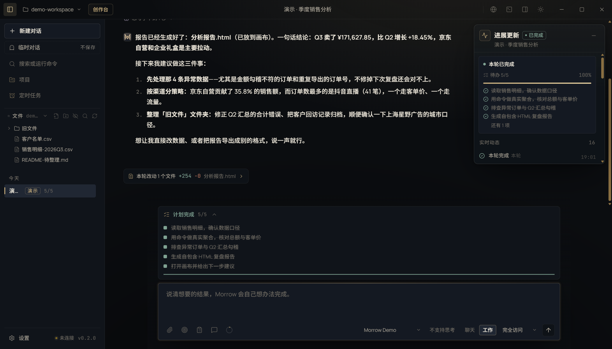
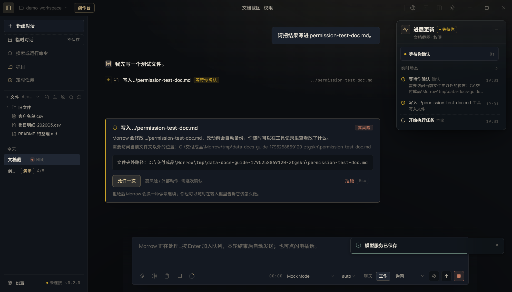
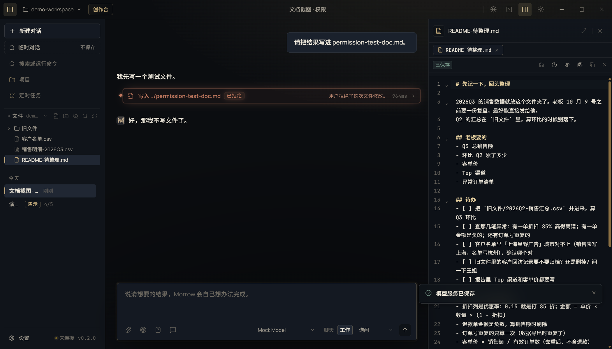
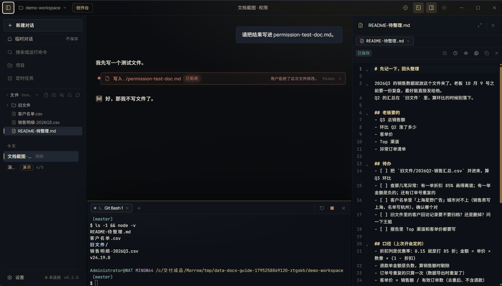
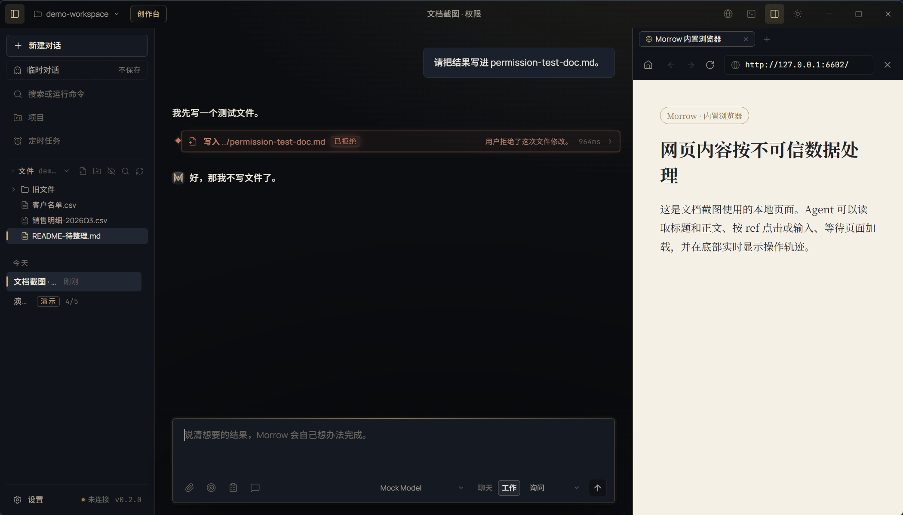
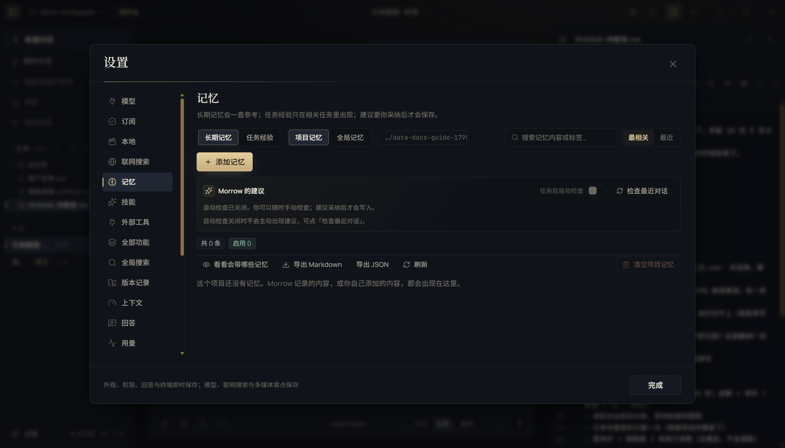
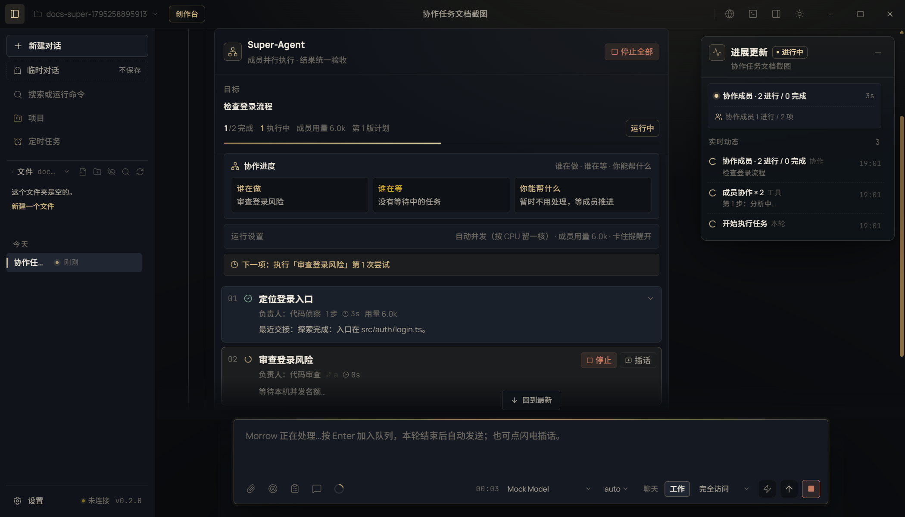
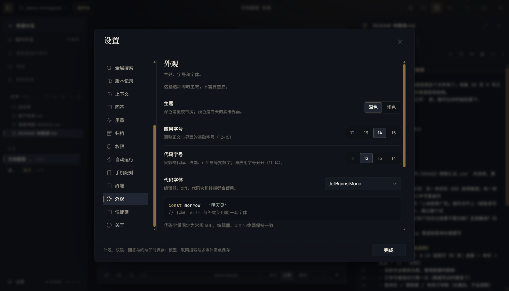

# Morrow 桌面端使用指南：界面、权限与日常任务

这篇写给已经装好 Morrow、准备每天使用的人。下面按主窗口分区、五种工作模式、权限与审批、检查点、各类工具和设置逐项说明，数字与界面文案以当前版本为准。创作台见 [STUDIO.md](STUDIO.md)，模型与订阅见 [MODELS.md](MODELS.md)，卡住时先查 [TROUBLESHOOTING.md](TROUBLESHOOTING.md)。

## 界面地图

主窗口由侧栏、标题栏、对话列和右侧画布组成；进展浮窗与桌面小伙伴是两个独立浮层，不占主布局。先把位置认清，后面的操作都能对上。

| 区域 | 位置 | 作用 |
|---|---|---|
| 侧栏 | 窗口左侧，可收起 | 新建对话、临时对话、搜索或运行命令、项目、定时任务、工作区文件树、对话列表与设置入口。 |
| 标题栏 | 窗口顶部 | 切换侧栏、查看当前文件夹、进入创作台、双击重命名会话；右侧是目标指示、浏览器、终端、画布、主题与窗口控制。 |
| 画布 | 窗口右侧，可拖宽 | 显示成品、文件预览、内置浏览器或侧聊；默认宽度约 420px。 |
| 进展浮窗 | 窗口右上角，可收起 | 汇总当前轮的工具调用、待办、来源与产出；收起后变成一枚胶囊。 |
| 桌面小伙伴（灵动岛） | 桌面上的置顶小窗，可拖动 | 显示待命、进行中、等你确认、已完成、需要看看等状态，也能直接交代任务。 |

截图来自测试模式与内置演示工作区，界面与发布版一致。

进展浮窗在 Agent 运行时自动展开：顶部是本轮状态、正在做的事与耗时，中间是待办和工具记录，底部列出这次用到的来源与产出文件。它不参与主布局，打开内置浏览器时会自动隐藏，避免盖住页面。

桌面小伙伴默认开启，可在设置里关闭。它置顶显示在桌面上，按住顶部可拖到任意角落，位置会被记住；展开后能快速输入一句话、查看最近对话、打开创作台或回到主窗口。它的状态与主窗口里的进展浮窗同源。

## 五种工作模式

输入框左侧的“聊天 / 工作”是一组切换；“计划”“深度研究”“长期目标”是在工作模式上叠加的三个开关。聊天模式固定只读，不能进入计划、研究或目标，也不能发起成员协作。

| 模式 | 适合 | 能做什么 | 不能做什么 |
|---|---|---|---|
| 聊天 | 讨论、读代码、问方案 | 读文件、搜索、查看项目资料，只做只读分析 | 不改文件、不跑命令，不能叠加计划、研究、目标或协作 |
| 工作 | 改文件、跑命令、做成品 | 按当前权限读写文件、执行命令、调用外部工具，可叠加计划、研究、目标或协作 | 权限之外的动作仍会先问你 |
| 计划 | 先审方案再动手 | 只读探索，给出计划卡；你批准后按计划执行 | 批准前不改文件；聊天模式不能进入 |
| 深度研究 | 查资料、要引用 | 自动权限加研究工具白名单，多轮检索并产出带引用报告 | 不写文件、不跑命令，不能叠加计划、目标或成员协作 |
| 长期目标 | 跨轮推进到可验收结果 | 2–256 轮自动续跑，用尽且仍在推进时自动加 12 轮，硬上限 2000 | 聊天与研究模式不能建立；连续 3 轮无进展会停 |

模式决定“能不能动手”，权限档位决定“动手前要不要问你”，两者不要混为一谈。深度研究不是把权限拨到“只读”档：进入研究后由系统接管权限，只放行检索、读取和引用所需的工具。

## 输入框与插话

输入框承载一次任务的起点：选模型、看思考档位、看上下文占用、切权限、加附件、引用文件，都在这一行附近完成。思考档位只显示当前模型真实支持的选项，不会出现模型没有的能力。

- 发送：`Enter` 发送，`Shift+Enter` 换行；发送键可在设置 › 回答里改成 `Ctrl+Enter`。
- 停止：运行中发送按钮变成停止，点一次结束当前轮；已经写出的内容会保留。
- 附件：可添加图片、PDF、文本和代码文件；附件按不可信数据处理，不会因为来自本地就自动获得信任。
- 引用：用 `@` 引用文件、目录、项目或记忆；用 `/` 查看斜杠命令。
- 上下文：输入框旁的占用环显示当前用量；设置 › 上下文可调整自动压缩阈值，默认 80%，可在 50–95% 之间改。

运行中再输入，有两种处理方式。插话会立即停止当前运行并发送这条消息；排队会把它放进队列，等本轮结束后自动发送。输入框右侧的闪电按钮对应插话，箭头按钮对应排队，默认按 `Enter` 走哪一种可在设置 › 回答里选。排队托盘里的消息在发出前还能编辑或删除。

## 权限与审批

三档权限的界面原文如下。它决定 Morrow 在没有你盯着时能做到哪一步，先按任务信任程度选，不要长期停在最宽的一档。

| 档位 | 界面原文 |
|---|---|
| 只读 | 只能查看文件内容；写入、删除、命令执行直接拒绝。 |
| 询问 | 当前文件夹内的写入和命令自动执行；危险命令、外部操作、访问文件夹外时先问你。 |
| 完全访问 | 不再询问，写入、命令、危险操作与文件夹外访问都直接执行。 |

**“询问”不是每一步都问；“完全访问”也不再逐次审批。** 询问档只把危险命令、外部操作和文件夹外访问送到你面前；完全访问档下这些动作直接执行，所以只应在你完全信任的任务里使用。

截图来自测试模式与内置演示工作区，界面与发布版一致。

审批卡出现在对话流末尾，标题写清要做什么，正文说明影响范围，能预览的会给出 diff、命令或参数。卡片默认把焦点放在“拒绝”上，`Esc` 拒绝，`Enter` 允许一次。

- 按钮是“允许一次”“始终允许（本文件夹）”“拒绝”三个；危险动作、外部操作、越界访问和终端写入不提供“始终允许”，卡片会改为提示“高风险 / 外部动作 · 需逐次确认”。
- “始终允许（本文件夹）”只对当前文件夹的同类操作生效，并会保存成一条允许规则；可在设置 › 权限里查看和撤销。拒绝规则优先于允许规则。
- 命令类审批卡可以按次勾选“在沙箱中运行”。沙箱用 Docker，只能访问当前文件夹，默认断网，命令使用 POSIX sh；系统没有可用隔离环境时只提示原因，不提供勾选。
- 问题卡用于 Morrow 需要你补充信息时：可以点选项，也可以直接写自定义回答，按 `Enter` 提交。
- 计划卡用于计划模式：可执行、修改或拒绝；执行中显示步骤进度，中断后可以继续未完成的部分。

定时任务在无人值守时运行，任何需要审批的动作都会被自动拒绝，并把失败原因记在运行结果里。

## 检查点与回退

检查点让你把对话和文件一起退回某个时间点，而不是只撤回聊天记录。每个普通工作轮次建一个检查点，单会话最多保留 100 个；演示模式与临时对话不建检查点。

1. 在回答末尾点“回退”。阶段边界上也会出现“回退到这个阶段完成时”的入口。
2. 确认框会列出会恢复或删除的文件、会移除的对话条数，以及这一轮里可以跳过的步骤。
3. 确认后对话与文件同时回退；这一步不能撤销。运行中或长期目标进行中不能回退，先停止或结束目标。
4. 如果某个文件在 Morrow 写入后又被你或别的程序改过，哈希会对不上。此时整次回退被拒绝，确认按钮不可用，先处理列出的冲突再点“重新检查”。
5. 对话已经被压缩、找不到目标轮次时，回退不可用，界面会说明原因。

“从检查点继续”走另一条路：已成功的步骤保留结果，失败或未执行的步骤重新跑，之前被拒绝的步骤保持拒绝。重跑仍按当前权限模式审批，不会复用旧的“始终允许”。

## 工作区、编辑器与预览

工作区就是你选中的文件夹，也是权限里“当前文件夹”的边界。切换工作区会同时切换文件树、项目记忆、技能、外部工具的信任状态与版本记录。

- 文件树只显示当前工作区；支持新建、重命名、删除、右键菜单、搜索与双击打开。
- 编辑器使用 CodeMirror，支持语法高亮、保存与另存为；大文件会截断保护，避免一次读入过多内容。
- 画布是多标签的，可预览 HTML、Markdown、PDF、Word、Excel、PowerPoint、图片、音频与视频；HTML 成品在独立沙箱里运行，外链交给系统浏览器打开。
- 画布和编辑区之间的分隔条可以拖动，默认宽度约 420px；终端始终贴在对话列底部，不会横跨到右侧画布下面。

截图来自测试模式与内置演示工作区，界面与发布版一致。

## 终端、Git 与浏览器

终端是真实 PTY，不是模拟输出。默认使用 Git Bash，也可以在设置 › 终端里改用 PowerShell 7 或 WSL。多标签、后台任务、复制粘贴与拖动调高都支持；隐藏终端不会结束进程，关闭标签才会。

- 同时最多运行 16 个终端或后台进程；已退出的终端只保留 40 条记录，不占运行名额。
- 名额满时先用列表找出不再需要的进程并停止，不要用一次性命令绕开上限。
- 长任务建议留在终端标签里跑，Agent 仍可在短时间内回读最终输出。

截图来自测试模式与内置演示工作区，界面与发布版一致。

Git 面板只做本地操作：初始化、status、diff、暂存、取消暂存、放弃改动、提交、设置身份、切换或新建本地分支、查看 log 与提交详情。它没有 push、pull、fetch、remote、merge、rebase、stash、reset；需要这些操作时请打开终端执行。面板上的领先/落后数字只是本地记录，不会自动同步远端。

截图来自测试模式与内置演示工作区，界面与发布版一致。

内置浏览器只接受 http(s) 地址，支持多标签、前进后退、刷新与下载；默认在右侧画布栏打开，宽约 420px，拖动左边缘可以调宽。底部会实时显示 Agent 的打开、点击、输入、等待、报错与耗时，可随时停止或回到对话。界面上没有开发者工具入口；`window.open` 被拒绝，网页内容按不可信数据处理。

## 电脑操作与桌面小伙伴

电脑操作通过 Windows UI Automation 完成，一共 22 个工具。常用路径是先列出窗口，再观察目标窗口，拿到带 `ref` 的控件树和截图；之后按 `ref` 读取、点击、设值，只有控件不支持自动化时才退回坐标点击、拖拽、滚轮和键盘输入。

- 应用没安装时，先用包管理器搜索并核对发布者，或从官方下载页取安装包，核对 SHA-256 与 Authenticode 签名后再运行。
- 密码、登录、验证码、支付、银行、系统设置等敏感窗口会被直接拒绝，不进入审批。
- 每次外部动作都要经过当前权限档位；询问档会逐次给审批卡，完全访问档不再逐次审批。操作前台窗口会接管鼠标键盘，开始前先看清卡片上的窗口名。

桌面小伙伴是另一块入口：它是一个置顶的小窗口，不占用主窗口位置。展开后可以直接输入任务、查看最近对话、打开创作台或回到主窗口；它的“关闭 Morrow…”与标题栏关闭按钮共用同一个选择，可在设置 › 外观里设为每次询问、最小化或退出。桌面小伙伴的开关、快捷键与主窗口主题都在设置里调整。

## 项目、记忆、技能与外部工具

这四类内容决定 Morrow 做任务时“知道什么、会什么、能接到什么”，它们都不改变权限。项目、记忆、技能与外部工具各有独立入口，按需开启即可。

- 项目：为一个文件夹保存长期说明、参考资料、项目内会话与范围。启用后，项目说明与资料只用于这个文件夹里的对话；暂停后不再注入。项目资料只作参考，不会被当成指令。
- 记忆：分长期记忆与任务经验两层，作用域又分项目与全局。记忆中心会显示本次注入预览；Morrow 的建议只有在你点“采纳”后才写入，自动检查关掉后也可以手动“检查最近对话”。
- 技能：20 个内置技能，加上工作区的 `.morrow/skills`。技能是 Markdown 任务说明，只从本地安装；它提供方法，不扩大权限，也不改变分工。
- 外部工具：设置 › 外部工具里有官方目录 8 项，支持 stdio 与 HTTP，需要时走 OAuth 授权。工作区里的 `.morrow/mcp.json` 默认不会自动运行，保存并信任当前配置后才会启动；配置被改动后信任失效，工具调用仍按权限审批。

截图来自测试模式与内置演示工作区，界面与发布版一致。

## 定时任务与长期目标

定时任务解决“到点自动做”，长期目标解决“跨很多轮持续推进”。两者都受同一套权限与审批约束，不会因为自动运行就跳过安全边界。

定时任务的真实边界：

- 频率只有一次、每天、每周三种；权限只有只读或可修改文件（自动）两档，最多建 50 个。
- Morrow 必须保持运行，关闭窗口时选“最小化到任务栏”才能继续到点执行。
- 调度每 5 秒检查一次，同一时刻全局只跑一个任务，其余排队；单次运行超过 30 分钟会自动停止。
- 应用没运行时错过的任务，1 小时内会补跑一次；超过 1 小时标为 `missed`，不再补跑。
- 无人值守时任何审批自动拒绝；每次运行会新建一个对话，结果与失败原因都留在那里。

长期目标的真实边界：

- 轮次预算按目标复杂度估算，范围 2–256 轮；用尽时如果仍在产出真实进展，会自动加 12 轮，硬上限 2000 轮。
- 至少有 60 分钟有效运行时间；仍在推进时会续段，不会因为一次静态预算撞墙就停下。
- 连续 3 轮没有实际进展会停止，这是唯一会主动打断长任务的刹车。工具调用次数不设上限。
- 完成必须有真实文件证据，停止不等于完成；暂停、继续、结束、清除都在目标条上操作。
- 应用重启后目标自动暂停；计划模式会暂停目标；研究与目标不能同时进行。

## 深度研究

深度研究不是“只读档”。进入研究后，Morrow 会自动套用研究权限，只放行检索、读取网页、核对来源与生成引用报告所需的工具；写入文件、执行命令和成员协作都不在放行范围内。

先给研究计划，再开始检索。计划确认后深度锁定，不能中途改档；同一对话同时只能有一个研究。来源只接受 http(s)，同一地址会做归一化去重，来源面板按查询与服务商分组显示。

| 深度 | 检索轮数 | 最少独立来源 | 适合 |
|---|---|---|---|
| 快速 | 2 | 4 | 快速确认一件事 |
| 标准 | 4 | 10 | 一般调研与方案对比 |
| 深入 | 6 | 20 | 需要交叉验证的重要判断 |

用 `/research quick 问题`、`/research standard 问题` 或 `/research deep 问题` 启动，也可以先点研究按钮再选深度。研究面板显示当前轮次、来源数、深度与用时；达到轮数和来源要求后输出带引用的报告。检索服务在设置 › 联网搜索里配置，接入方式见 [MODELS.md](MODELS.md)。

## 协作任务

简单工作由主代理直接完成；需要并行、隔离副本或独立验收时，主代理会把目标拆成 1–10 个带依赖的成员任务，交给协作成员执行。协作卡片就在主对话里，不占右侧栏，也没有单独的入口按钮。

截图来自测试模式与内置演示工作区，界面与发布版一致。

- 成员任务按依赖关系组成 DAG，有依赖的任务不会抢跑；内置角色 21 个，负责探索、计划、实现、验收、测试、文档等不同重点。
- 并发槽默认取 `min(8, 可用并行度 - 1)`；达到上限后其余成员等待，不会把机器压满。
- 成员与主代理拥有相同的工作区权限，角色只改变工作重点，不扩大也不缩小权限；写入、命令与外部工具仍按当前权限档位审批。
- 卡片显示总目标、完成与执行中的数量、计划版本、成员总用量，以及每个成员的状态、步数、耗时、token 与最近交接。
- 可以停止全部，也可以对单个成员停止、插话、重试或带原线程继续；独立验收、成果版本、文件冲突与卡住提醒都在同一张卡片里。

已完成的成员任务不会重复执行；重开只恢复待办任务，执行中的项转为人工核对。成员之间写同一个文件时，卡片会提示冲突，由主代理或你决定保留哪一版。

## 搜索、侧聊与命令面板

全局搜索一次查三类内容：对话、文件、成品。可以在“当前文件夹”和“整个 Morrow”之间切换范围；结果是本地索引，不会把内容发到网上。

侧聊用 `/btw` 打开，停在右侧栏，与画布共用宽度和拖拽习惯。它只回答，不调用工具、不写主对话，也不会改变文件；可以选择是否携带当前上下文。历史最多带 12 条消息、合计 12,000 字符，单次输出上限 4096 token；演示模式不支持侧聊。

命令面板用 `Ctrl+K` 打开，同一个输入框既能搜内容，也能执行命令：新建对话、新建作品、继续创作、打开设置、侧边聊天、切换主题。输入 `/` 会列出斜杠命令，包括 `/btw`、`/research`、`/plan`、`/goal` 与 `/super-agent`；方向键选择，`Enter` 执行。

## 外观与快捷键

设置是 21 个扁平分页，左侧没有分组。分页依次是：模型、订阅、本地、联网搜索、记忆、技能、外部工具、全部功能、全局搜索、版本记录、上下文、回答、用量、归档、权限、自动运行、手机配对、终端、外观、快捷键、关于。

外观页的选项即时生效，不需要重启：主题有深色与浅色两套；应用字号与代码字号分别调整；代码字体只影响编辑器、diff、代码块与终端；还可以开关减少动效与 token 计量。桌面小伙伴的开关也在这里；“关闭窗口时”可选每次询问、最小化或退出，选定一次后会记住。

截图来自测试模式与内置演示工作区，界面与发布版一致。

快捷键在设置 › 快捷键里查看和修改，冲突或保留键会当场提示。常用入口、数据目录与环境变量整理在 [REFERENCE.md](REFERENCE.md)；数据目录也可以从设置 › 关于直接打开。

## 遇到问题

先按现象定位，再决定要不要改设置。下面这张表只列最常见的入口，完整的“现象 → 先看什么 → 怎么处理”在 [TROUBLESHOOTING.md](TROUBLESHOOTING.md)。

| 现象 | 先看什么 | 去哪里处理 |
|---|---|---|
| 模型不回话或显示离线 | 模型页的 Key、订阅登录态与默认模型 | [MODELS.md](MODELS.md) |
| 一直被问权限 | 当前档位是否“询问”，权限页是否有过宽或过窄的规则 | 本篇“权限与审批” |
| 回退按钮不可用 | 是否运行中、目标是否进行中、文件哈希是否冲突 | 本篇“检查点与回退” |
| 终端开不了新标签 | 是否已经有 16 个运行中的进程 | 终端列表里停止不用的进程 |
| Git 面板找不到 push | 面板只做本地操作 | 用底部终端执行远端命令 |
| 浏览器打不开链接 | 地址是否为 http(s)，是否被网页自身拦截 | [TROUBLESHOOTING.md](TROUBLESHOOTING.md) |
| 定时任务没有跑 | Morrow 是否在运行，任务是否被标为 `missed` | 本篇“定时任务与长期目标” |
| 手机连不上 | 配对通道、是否同一局域网、票据是否过期 | [PAIRING.md](PAIRING.md) |
| 其他异常 | 版本、日志与数据目录 | [TROUBLESHOOTING.md](TROUBLESHOOTING.md)、[REFERENCE.md](REFERENCE.md) |

需要写小说、做漫剧或管理作品库时，转到 [STUDIO.md](STUDIO.md)；需要接模型、订阅或本机模型时，转到 [MODELS.md](MODELS.md)。