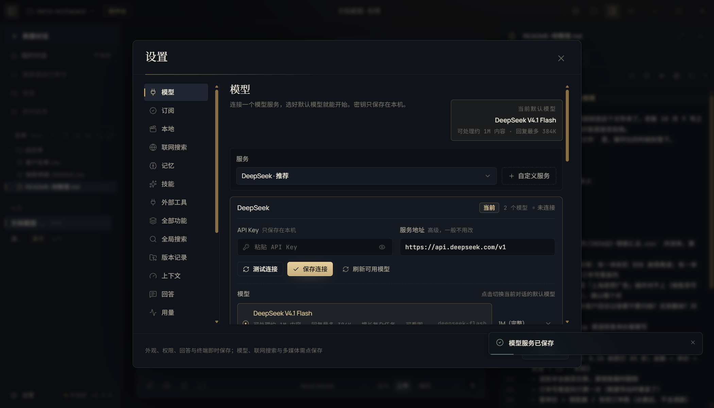
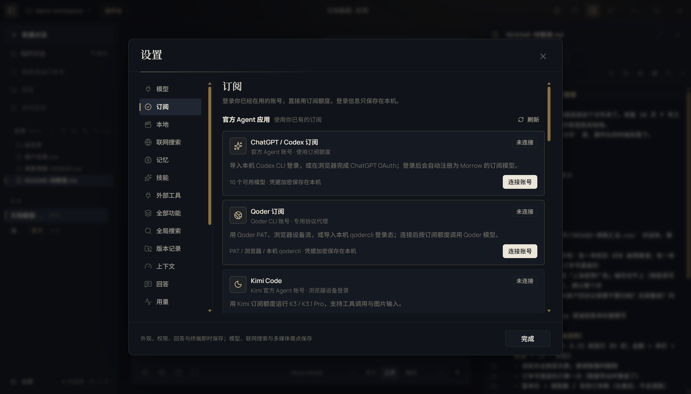

# 从这里开始：装上、接上模型、做出第一个成品

Morrow 是住在 Windows 上的本地优先 AI 工作台：你只说想拿到什么结果，它读工作区、改文件、跑命令、做检查，把能直接打开的成品留在原地。桌面端负责干活，创作台负责长内容，手机端负责看进度与审批。

这一篇只走第一次使用的路：装好桌面版、完成三步引导、接上一个模型、发出第一个任务，再决定要不要装手机端。第一次会慢一些；接模型与选文件夹是必须你动手的两处，其余都可以交给它。Morrow 不自带模型，也不代替你申请 Key。


截图来自测试模式与内置演示工作区，界面与发布版一致。

## 安装桌面版

发布页给两个 Windows 安装文件，功能相同，差别在安装方式与数据放在哪。按你的习惯选一个，不要两个都装。

| 文件 | 安装方式 | 数据目录 |
|---|---|---|
| `Morrow-<版本>-portable.exe` | 单文件，免安装；首次运行在 exe 同级解压运行时，耗时取决于磁盘速度 | exe 同级的 `Morrow Data` |
| `Morrow-<版本>-setup.exe` | NSIS 安装包；可选安装目录，创建开始菜单与桌面快捷方式 | `%APPDATA%\Morrow` |

两个 exe 都没有代码签名。Windows 可能弹出“已保护你的电脑”，点“更多信息 → 仍要运行”即可。如果文件是从浏览器或聊天工具下载的，先右键 exe，打开属性，勾选“解除锁定”，否则 SmartScreen 可能直接拦下。

装之前建议核对完整性。发布页同目录有 `SHA256SUMS.txt`，用 PowerShell 算一遍再比对：

```powershell
Get-FileHash .\Morrow-<版本>-portable.exe -Algorithm SHA256
```

哈希一致才继续。便携版首次运行会生成 `.morrow-runtime-...` 目录，之后启动更快；不要删除它，删了下次会重新解压。安装版默认装到 Program Files，需要管理员权限。Morrow 只提供 Windows 10/11 x64 构建，其他平台没有构建也没有测试。

两个版本的数据不共享：便携版把会话、密钥与日志写在 `Morrow Data`，安装版写在 `%APPDATA%\Morrow`。换版本时不会自动迁移；要带走数据，就在“设置 → 关于”里改数据目录，或先退出应用再手工复制整个目录。卸载安装版默认保留用户数据。

没有代码签名只说明发布者身份未经验证，不等于文件有问题。反过来也成立：不要从发布页以外的地方拿安装包，更不要为了让一个来路不明的 exe 跑起来去关杀毒软件。

## 完成三步引导

第一次启动会出现一个覆盖全屏的引导层，三步：认识 Morrow、连接模型、选择文件夹。右上角可以“跳过引导，先看演示”，第 1 页也有“先看一场演示”。演示完全离线、不消耗额度，但它不是真模型，只能让你先看清界面怎么运转。

1. 第 1 页读一眼三条能力说明，点“开始设置”；想先看界面就点“先看一场演示”。
2. 第 2 页选一个服务商，粘贴 API Key，点“测试连接”，看到“连接正常”后选默认模型，再点下一步。
3. 第 3 页点“选择文件夹”，选一个你愿意让 Morrow 读写的目录，例如桌面新建的 `Morrow 工作区`，然后点“完成，开始使用”。

三步都可以补做：跳过之后引导不会再自动弹出，模型在“设置 → 模型 / 订阅”里补，工作区在“设置 → 工作区”里换。订阅登录不在引导第 2 页，完成引导后去“设置 → 订阅”。

选择文件夹这一步值得慢一点。Morrow 的文件工具被限制在这个目录内；读取目录外的文件要你显式添加为附件，写入目录外会单独询问。把整个 `C:\` 或用户主目录交给它，等于把“越界”这条边界取消掉。

也不要选系统目录、`Program Files` 或正在被其他程序占用的同步盘根目录。工作区里可以有子目录和 `.git`，Morrow 会在里面建检查点；选一个你能随时备份、也愿意让它改动的目录，比选一个“看起来很大”的目录更安全。

## 连接模型

Morrow 不附带模型，也不代充。三条接入路线各有适用的人，选一条就够用；先接一个能对话的模型，再考虑多接几个做对照。

| 路线 | 适合谁 | 你要准备 |
|---|---|---|
| API Key | 有服务商账号、按量付费 | Base URL、模型 ID、API Key |
| 订阅 | 已有 ChatGPT/Codex 或编程订阅 | 在本机登录，或导入已有登录态 |
| 本机模型 | 有显卡、想离线跑 | 本机推理服务已启动并暴露地址 |

走 API Key 时，先在服务商控制台创建 Key，再回到“设置 → 模型”：选服务商、粘贴 Key、点“测试连接”、点“保存连接”，最后在模型列表里点一个模型设为当前。Key 由系统凭据存储加密，界面不回显明文；Morrow 不保存你的账号密码。


截图来自测试模式与内置演示工作区，界面与发布版一致。

走订阅时打开“设置 → 订阅”，选一个渠道。ChatGPT/Codex 可以导入本机 Codex CLI 的登录态，也可以走浏览器登录；其余渠道按页面提示操作。订阅的登录态与额度由服务商决定，Morrow 只负责把请求发过去，未验证的渠道不会显示“已连接”。


截图来自测试模式与内置演示工作区，界面与发布版一致。

走本机模型时，先确认 Ollama、LM Studio 或 llama.cpp 已经在监听，再到“设置 → 模型”选本机类型并填地址。模型没启动时连接测试会明确失败，不会假装可用。

还没有 Key、也不想现在注册，就先用演示把流程走一遍。演示会话会在界面上标出来，不产生费用；它不能替你验证真实模型的质量与速度。模型细节、上下文与思考档位见 [MODELS.md](MODELS.md)。

## 说出第一个任务

第一个任务建议用工作区里现成的表格，成败一眼可见。内置演示工作区带一份 `销售明细-2026Q3.csv`；用自己的文件时，把下面这句话里的文件名换掉即可。

1. 确认输入框右下角的模型不是演示引擎，权限档位显示“询问”。
2. 在输入框里写清结果、口径与验收方式，不要只写“分析一下这个表”。
3. 发送后看进展浮窗：它会读文件、跑命令、写 HTML；需要你决定时会停下来等你。
4. 审批卡出现时读一遍工具、目标与影响范围，确认无误再点“允许一次”。
5. 完成后从画布或工作区文件树打开成品，检查数字与口径对不对。

可以直接用这段：

```text
把工作区里的 销售明细-2026Q3.csv 做成一份单文件 HTML 复盘：
按地区汇总销售额和订单数，列出金额最高的 10 笔订单，
标出退款或金额异常的订单，并在页面顶部写清数据口径与生成时间。
做完后用浏览器打开检查一遍，把文件放在工作区根目录。
```

这句话写清了三件事：输入文件、输出形态、验收动作。Morrow 会用只读工具读表，用写入工具生成 HTML，再自己打开检查。中途它可能要跑一次 Python 或 Node 做汇总，这时会按权限档位决定是否问你。

工作区里没有这份 CSV 也不影响走流程：随便放一份带表头的销售表，把文件名和要汇总的列写清即可。不要只贴一段表的内容让它“看着办”，它需要能反复读取的源文件，才能在不同轮次里核对同一个数字。

## 装上手机端

手机端是桌面端的旁观与审批端：看工位、看进度、批准或拒绝操作、翻成品。它不执行任何工具，所有文件和命令仍然在这台电脑上跑。

装法与配对分两篇：安装、权限、页面与边界见 [MOBILE.md](MOBILE.md)；开通道、生成配对码、六位码与证书指纹见 [PAIRING.md](PAIRING.md)。一句话版本：在“设置 → 手机配对”打开默认关闭的通道，手机装侧载 APK，复制以 `MORROWPAIR1.` 开头的配对请求贴到电脑上，再用电脑显示的六位码走完配对。只有同一局域网可用，公网中继没有实现。

## 怎么算成功

别用“界面能打开”当成功。按下面四条核对，四条都成立才算第一次跑通。

| 检查项 | 成立的样子 |
|---|---|
| 模型 | “设置 → 订阅”显示已连接，或“设置 → 模型”显示 Key 已保存 |
| 当前模型 | 输入框右下角是你接的模型，不是演示引擎 |
| 对话 | 发一句“你好”能收到回复，不是错误提示 |
| 成品 | 工作区根目录出现 HTML 复盘，浏览器打开后数字正确 |

手机端不作为这一轮的成功判据：它能在工位页显示“在线”只说明通道连上了，不代表四个列表已经接了真实数据。那部分现状写在 [MOBILE.md](MOBILE.md) 的已知边界里。

还有一条容易忽略：成功之后要能回退。每个普通工作轮次都会留一个检查点，写文件前先记快照；如果它改坏了你的表，从检查点回退会同时恢复对话与文件。回退前会校验文件哈希，对不上就整体拒绝，不会只还原一半。

## 卡住了

先按现象定位，不要急着重装。多数失败是 Key、地址或权限档位的问题，重装不会改变它们。

| 现象 | 先看什么 | 怎么处理 |
|---|---|---|
| SmartScreen 拦住 exe | 文件是否被标记为来自网络 | 右键属性勾选“解除锁定”，再点“更多信息 → 仍要运行” |
| 401 / 403 | Key 是否复制完整、是否有该模型权限 | 重新生成 Key 再粘贴，不要带空格与引号 |
| 404 | Base URL 是否是 API 地址 | 点回默认地址；不要填浏览器里打开的网页地址 |
| 429 | 余额与请求频率 | 去服务商后台看余额与限流说明，换模型或稍后再试 |
| 一直转圈后超时 | 网络与代理 | 换网络，或确认代理能访问该服务商 |
| 连上了却用不了 | 当前会话选的是哪个模型 | 点输入框右下角模型名，选刚接好的那个 |
| 手机连不上 | 通道是否打开、是否同一局域网 | 按 [PAIRING.md](PAIRING.md) 的故障排查逐条走 |

更多现象见 [TROUBLESHOOTING.md](TROUBLESHOOTING.md)。

## 两条安全规则

第一条：保持默认的“询问”档。询问档会自动执行当前文件夹内的普通写入与命令，但危险命令、访问文件夹外、外部副作用动作仍然先问你。它不是每步都弹窗，也不该为了少点几次就长期切到完全访问。

第二条：只在完全信任当前任务时用“完全访问”。这一档不再逐次审批，写入、命令、危险操作与文件夹外访问都直接执行；换句话说，它把最后一道人工确认交回给你判断。不要在来路不明的仓库、别人给的脚本或临时下载的目录里开它。只读档适合纯阅读：它会直接拒绝写入、删除与命令执行。

审批卡上的“始终允许”只对安全动作出现，危险动作与终端写入没有这个选项。也就是说，即使你在询问档，也不存在“点一次以后都不问”的危险捷径；这是设计，不是按钮缺失。

## 下一步

装好之后按你要做的事挑下一篇：

- 熟悉界面、五种模式、权限与检查点：[DESKTOP-GUIDE.md](DESKTOP-GUIDE.md)
- 接更多模型、订阅渠道与思考档位：[MODELS.md](MODELS.md)
- 写小说或做漫剧：[STUDIO.md](STUDIO.md)
- 把手机接上并搞清安全边界：[PAIRING.md](PAIRING.md)
- 手机端页面与未接线的部分：[MOBILE.md](MOBILE.md)
- 查快捷键、数据路径与环境变量：[REFERENCE.md](REFERENCE.md)