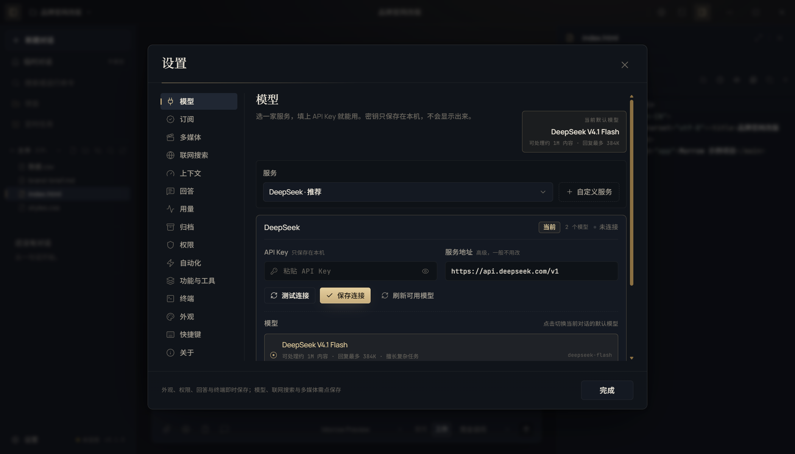

# 快速开始

> 本文为中文文档；英文概览见 [README.md](../README.md)。

这页只覆盖从下载到完成第一个真实任务的路径：装哪个包、首次引导做什么、模型怎么连、工作区怎么选、什么算成功、卡住先查哪里。界面细节见 [用户指南](USER-GUIDE.md)，模型与订阅的完整说明见 [模型与订阅](MODELS.md)。

## 选择安装包并校验

Morrow 0.1.0 提供两个 Windows x64 可执行文件，都在 [Releases](https://github.com/youyuwangzi0001/Morrow/releases) 页面：

| 文件 | 行为 |
|---|---|
| `Morrow-0.1.0-portable.exe` | 单文件便携版。首次运行在 exe 同级解压运行时缓存，数据默认在同级 `Morrow Data`。 |
| `Morrow-0.1.0-setup.exe` | NSIS 安装包，按当前用户安装，创建开始菜单与桌面快捷方式，数据默认在 `%APPDATA%\Morrow`。 |

两个文件都未做代码签名，SmartScreen 可能拦截首次运行。核对哈希后再决定是否运行：

```powershell
Get-FileHash .\Morrow-0.1.0-portable.exe -Algorithm SHA256
Get-Content .\SHA256SUMS.txt
```

哈希一致时，在提示里选择 **更多信息 → 仍要运行**。哈希不一致就不要运行，重新下载。

## 首次启动会发生什么

首次启动进入三步引导：

1. 认识 Morrow 的工作方式；
2. 连接一个模型；
3. 选择工作文件夹。


引导可以关闭，但模型与工作区没配好时无法执行真实任务。模型下拉为空、侧栏显示“未连接”，通常就是这一步没完成。

## 连接一个模型

三条路选一条即可：

- **API Key**：设置 → 模型 → 选择服务商 → 填 Key → 保存。内置服务商包括 DeepSeek、Kimi、Qwen、GLM、MiniMax、MiMo、Anthropic、OpenAI、Gemini、Grok、Meta Muse。
- **本机服务**：设置 → 模型 → llama.cpp / Ollama / LM Studio，填真实的模型 ID；本机或局域网地址允许空 Key。
- **订阅账号**：设置 → 订阅 → 选择渠道登录，或只读导入本机已有的官方客户端凭据。



保存后回到输入框，模型选择器应出现该 Provider 下的模型。若仍为空，检查 Provider 是否启用、模型 ID 是否为空、Key 是否保存成功。

## 选择工作文件夹

点侧栏或文件树的“选择文件夹”。选定后：

- 文件树扫描该文件夹，新建对话绑定这个工作区；
- 终端 cwd 默认进入工作区；
- 文件工具、终端与媒体输入输出都被限制在工作区内；
- 项目可以引用同一个文件夹，并保存背景与资料。

临时对话适合一次性问答：它不写项目记忆，也不持久化到会话列表。

## 完成第一个任务

一个最小可验收流程：

1. 在输入框写下可判断的结果，例如“扫描这个文件夹，找出重复文件，先给整理方案，批准后再移动”。
2. 需要先看方案时切换到计划模式（`/plan`）；否则保持工作模式。
3. 出现审批卡时读目标、影响与风险，再决定允许一次或拒绝。
4. 完成后检查文件树里的改动、画布中的成品或终端输出。

**成功的标准**：工作区里出现了你要的文件或改动；diff 与你的要求一致；审批记录里没有你不认识的操作。模型说“完成了”不算验收，看到文件才算。

## 卡住时先看这几处

| 现象 | 先做什么 |
|---|---|
| 双击没反应或秒退 | 确认系统是 Windows 10/11 x64；便携版首启需要 exe 同级可写空间；查看 `Morrow Data\logs\main.log`。 |
| 模型下拉为空 | 设置 → 模型里保存 Key、启用 Provider、填模型 ID。 |
| 审批一直弹 | 检查当前权限档位；危险命令、越界路径与外部动作始终逐次确认，这是预期行为。 |
| Git Bash 报 MSYS 错误 | 设置 → 终端切 PowerShell 7；受限令牌环境无法创建 MSYS 共享内存。 |
| 生成或审看失败 | 确认 ComfyUI / llama.cpp 已启动、模型 ID 真实、ffmpeg 可用；错误文案会指出缺哪一项。 |
| 不知道数据在哪 | 便携版在 exe 同级 `Morrow Data`，安装版在 `%APPDATA%\Morrow`；设置 → 关于可查看和迁移。 |

更多现象按 [排障指南](TROUBLESHOOTING.md) 的索引排查。