# Morrow 用户指南

本指南按“第一次打开 → 日常使用 → 模型与订阅 → 数据与排障”的顺序写。默认窗口为 2100×1200 物理像素；截图为该尺寸原图。

## 1. 安装与首次启动

### 1.1 两个发布文件

| 文件 | 适合 | 说明 |
|---|---|---|
| `Morrow-0.2.0-portable.exe` | 直接试用、放 U 盘 | 单文件便携版；首次运行在 exe 同级解压运行时缓存 |
| `Morrow-0.2.0-setup.exe` | 日常使用 | NSIS 安装包；可选安装目录，创建开始菜单/桌面快捷方式 |

没有文件夹版、zip 或源码包。两个 exe 均未签名，Windows 可能提示“已保护你的电脑”，选择“更多信息 → 仍要运行”。校验值见 [VERIFICATION.md](VERIFICATION.md)。

### 1.2 三步引导

首次启动依次确认：

1. **认识 Morrow**：它能读工作区、跑命令、做创作台。
2. **连接模型**：填 API Key、选择订阅，或先用本机模型。
3. **选择文件夹**：Morrow 只在这个范围内读写；文件夹外写入仍会单独询问。

可以“跳过引导，先看演示”。演示离线运行，不消耗额度。之后可在设置里重新打开引导。

### 1.3 数据目录

- 便携版：默认在 exe 同级 `Morrow Data`；exe 同级的 `.morrow-runtime-0.2.0-<修订>` 是运行时缓存。
- 安装版：默认 `%APPDATA%\Morrow`。
- 设置 → 关于可更改数据目录；会重启并迁移现有数据。
- 交付包不包含用户数据、缓存或密钥。

## 2. 界面地图

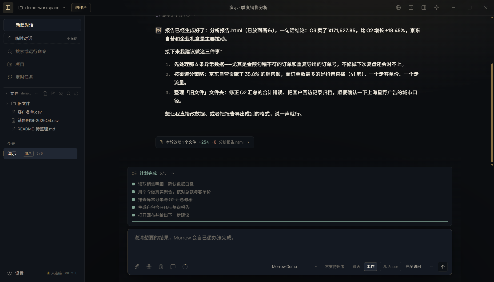

- **左侧栏**：新建对话、临时对话、搜索、项目、定时任务、工作区文件、会话列表、设置。
- **中间**：对话记录与输入框；打开文件/画布时切换为编辑器/画布。
- **右侧**：画布、文件预览、内置浏览器或 Super-Agent 协作面板。
- **底部**：真实终端可收起；状态栏显示模型、分支、对话长度等。
- **顶栏**：文件、编辑、视图、帮助；左侧“创作台”进入作品库；右侧设置、主题、退出。

创作台入口有三个：标题栏“创作台”、命令面板（Ctrl+K）里的新建/继续创作、灵动岛底部“打开创作台”。创作台顶栏“回到 Agent”返回对话。

## 3. 工作方式与输入框

| 方式 | 适合 | 权限 |
|---|---|---|
| 聊天 | 问问题、读代码、讨论 | 只读 |
| 工作 | 改文件、跑命令、做成品 | 按权限档位；可写 |
| 计划 | 先要一份可审阅的计划 | 只读 + 提交计划 |
| 深度研究 | 查资料、保留来源 | 只读 + 白名单网页 |
| 长期目标 | 跨轮推进到可验收结果 | 按权限档位；可写 |

计划和目标是独立开关，会与当前模式组合。输入框支持：

- 选择当前模型；思考强度只显示模型真实支持的档位。
- 查看对话长度；在设置里调整自动整理与保留策略。
- 切换只读 / 询问 / 完全访问。
- 添加图片、PDF、文本、代码附件；附件可读工作区外文件，但仍按不可信数据处理。
- 用 `@` 引用文件、目录、项目或记忆；用 `/` 查看斜杠命令（如 `/btw` 侧聊、`/swarm` 成员协作）。
- 运行中停止、继续、查看工具步骤；长任务显示进度与 token。

Enter 发送，Shift+Enter 换行；可在设置 → 回答中改为 Ctrl+Enter 发送。

## 4. 工作区、文件与画布

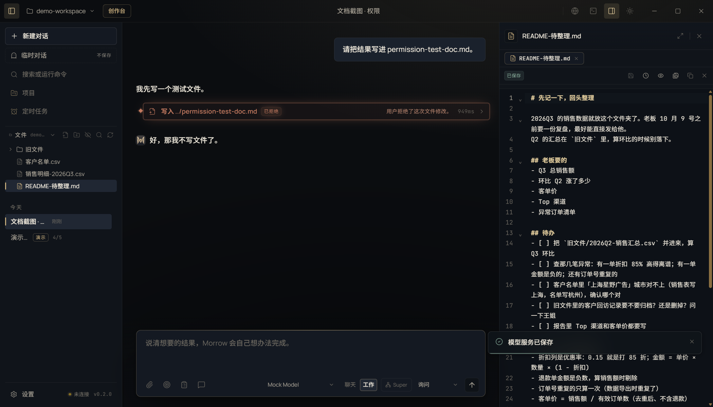

- **选择文件夹**后，左侧文件树只显示该工作区；切工作区会切换文件树、项目记忆、技能、MCP 信任与版本记录。
- **文件树**：新建、重命名、删除、拖拽、搜索；双击打开。
- **编辑器**：CodeMirror；语法高亮、查找、替换、保存、另存为；大文件截断保护。
- **画布**：多标签；HTML/Markdown/PDF/Office/图片/音视频预览；可拖拽分栏。
- **版本与检查点**：每个用户轮次一个检查点；写文件前快照；支持会话回退与文件回退。

## 5. 审批与权限

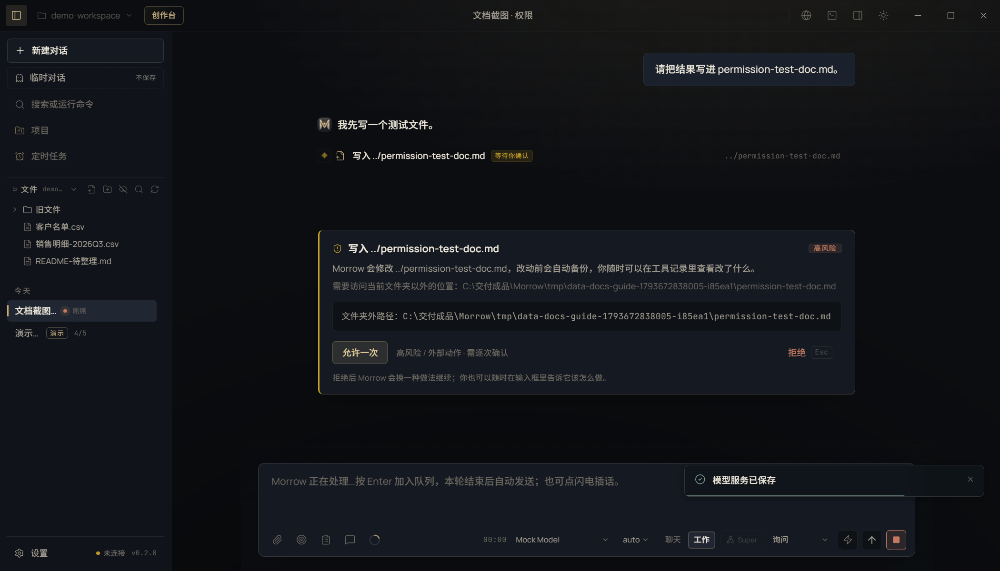

三档权限：

- **只读**：拒绝写文件、跑命令、改记忆；适合读代码、问问题。
- **询问**：工作区内写文件/普通命令直接放行；危险命令、越界路径、外部副作用动作、终端 stdin 逐次询问。
- **完全访问**：全部直接放行，只在你信任当前任务时使用。

审批卡写清“想做什么、影响什么、参数是什么”。可以允许一次、拒绝，或在安全动作上“始终允许”（按工具 + 目标 + 参数哈希）。拒绝优先于允许；危险动作没有“始终允许”。

## 6. 终端、Git、浏览器与电脑操作

### 6.1 真实终端

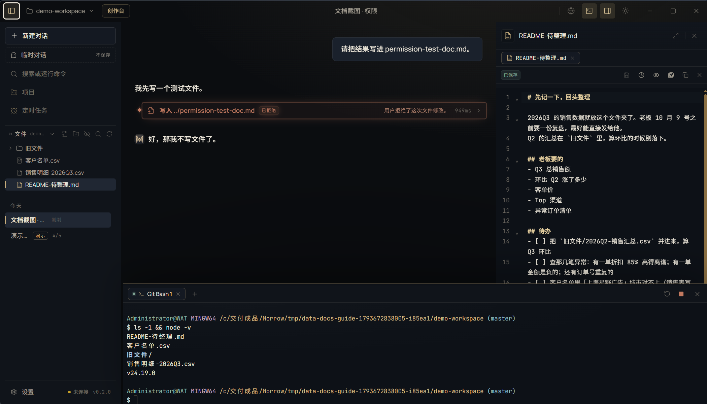

- 真实 PTY（ConPTY），支持 Git Bash（默认）、PowerShell 7、WSL。
- Git Bash 遇到 MSYS 共享内存冲突时，Morrow 会建立独立兼容前缀；优先硬链接，普通权限无法建链接时复制到本机缓存。
- 多标签、后台任务、复制粘贴、拖动调高；隐藏不结束进程，关闭标签才结束。
- 默认终端在设置 → 终端选择。

### 6.2 Git 工作台

变更列表、diff、暂存、提交、分支、历史、放弃改动。diff 超长时截断展示；提交前检查敏感文件。

### 6.3 内置浏览器

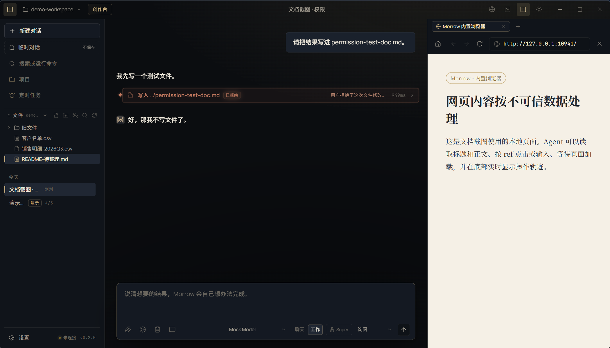

- 多标签、地址栏、前进后退、刷新、开发者工具入口。
- 默认在右侧画布栏打开，宽约 420px，可拖动左边缘调宽；窄屏才全屏。
- 底部实时显示 Agent 的打开、点击、输入、等待、报错和耗时；可停止或回到对话。
- 只允许 http(s)；`window.open` 被拒绝；webview 禁用；网页内容按不可信数据处理。

### 6.4 电脑操作

Agent 可以列举窗口、读取 UI Automation 树、按 ref 读取/点击/设值、截屏，必要时才坐标点击、拖拽、滚轮和键盘输入。应用没装时可先用 winget 搜索/安装，或从官方下载页下载并核对 SHA-256 与 Authenticode 签名。密码、登录、验证码、支付、银行、系统设置等敏感窗口一律拒绝；每次电脑动作仍需审批。

## 7. 模型、订阅与多媒体

### 7.1 模型

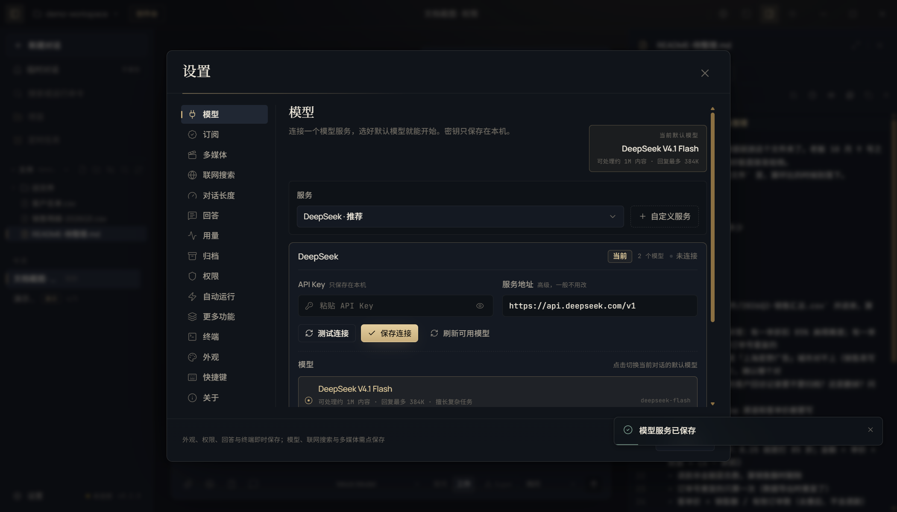

- 设置 → 模型：填 API Key、Base URL、模型 ID；支持 OpenAI 兼容、Anthropic 原生与本机模型。
- 选择器只显示原始模型名；思考强度只列真实支持的档位；未知模型只保留“自动”。
- 连接测试发真实请求；失败时显示 HTTP 状态与可读原因，不伪造已连接。

### 7.2 订阅

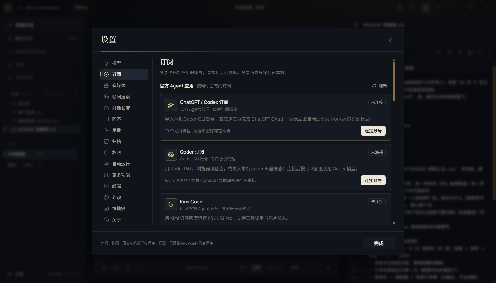

支持 Codex、Qoder、Kimi Code、GLM Coding Plan、MiniMax Code、Step Plan、Command Code、Cline Pass、OpenCode、Google Antigravity、OpenDesign Cloud 等渠道。登录态只保存在本机；额度和可用模型由服务商决定。

当前边界：Codex 提供本机导入/OAuth 与用量接口；Qoder 有账号模型目录实现，但本机未完成登录实测；OpenDesign Cloud 已实现 API Key 校验、模型目录与 Provider，但本机无有效 Key；其余渠道完成登录页/协议实现，未验证已连通。Morrow 不显示假额度、不伪造已连接。详细清单与注意事项见 [REFERENCE.md](REFERENCE.md#订阅渠道)。

### 7.3 多媒体

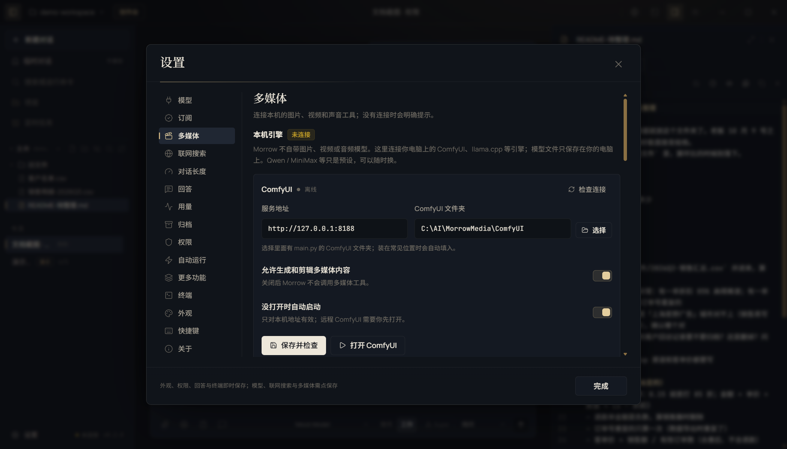

- **ComfyUI**：图片、视频、章节配图；配置地址、模型与超时。
- **本机视觉**：llama.cpp / Ollama / LM Studio；媒体审看优先当前对话模型，失败才回退本地视觉模型。
- **配音**：Qwen3-TTS 本机声线、Windows SAPI 或云端 `/audio/speech`。
- **配乐**：ComfyUI ACE-Step；`local` 只生成草稿并明确标注。
- **FFmpeg**：检测/配置本机；不随包内置，许可证由用户选择。

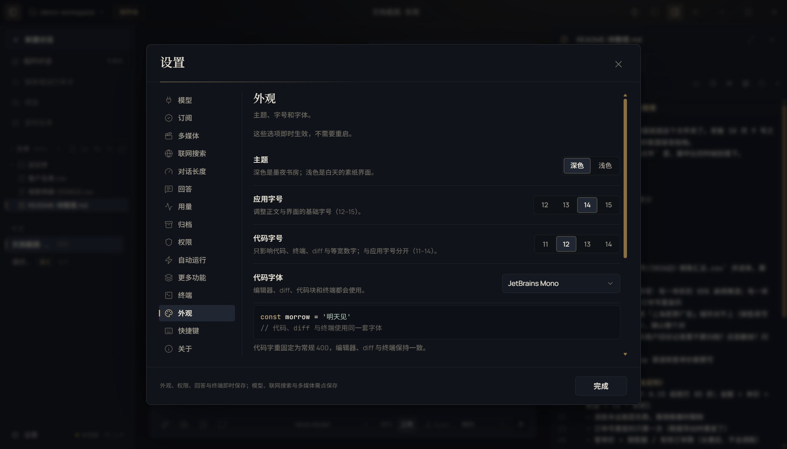

外观支持墨夜/素纸主题、应用字号、代码字号与字体。设置改动即时生效。

## 8. 项目、记忆、技能、MCP 与定时任务

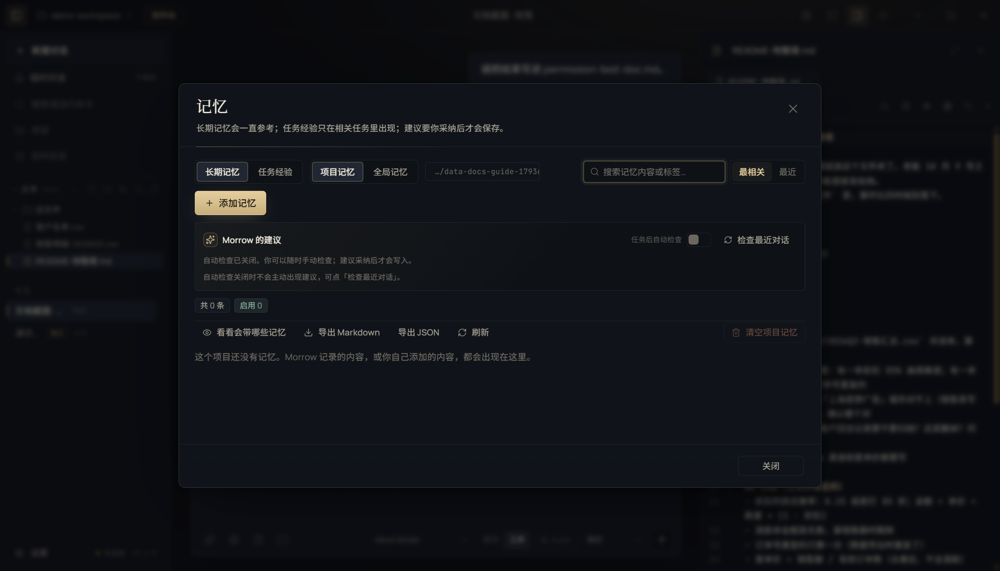

- **项目**：项目主页保存背景、说明、资料、项目内会话与当前文件夹范围；项目记忆只在项目内注入。
- **记忆**：项目记忆、全局长期记忆、任务经验、注入预览与自进化建议。建议只在强信号后出现；采纳后才写入。
- **技能**：20 个内置技能 + 工作区 `.morrow/skills`；支持 Markdown 技能包与安全安装。清单见 [REFERENCE.md](REFERENCE.md#内置技能)。
- **MCP**：stdio / Streamable HTTP / 旧版 SSE；工具、资源、提示词、OAuth 与工作区信任。工具调用仍按权限审批。
- **定时任务**：一次 / 每天 / 每周；只读或可改文件；最多 50 个。无人值守时自动拒绝需要审批的动作，失败记录原因。

## 9. Super-Agent

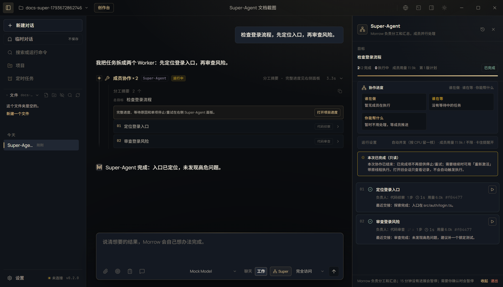

在输入框打开 Super 开关后，Morrow 先拆解目标，成员在独立工作副本中并行执行；右侧协作面板显示：

- 每个任务的状态、负责人、用量、最近交接；
- 谁在做、谁在等、你能帮什么；
- 计划版本、重试、单项暂停/停止、验收结果、成果版本与记录；
- 并发上限、成员用量上限与卡住提醒。

完成项不会重复执行；重开只恢复待办任务，执行中项转人工核对。旧的 Super 会话为只读历史。详细行为见 [ARCHITECTURE.md](ARCHITECTURE.md#super-agent)。

## 10. 数据、快捷键与排障

- 会话、作品、记忆、密钥、日志和缓存都在数据目录；路径见 [REFERENCE.md](REFERENCE.md#数据路径)。
- 常用快捷键见 [REFERENCE.md](REFERENCE.md#快捷键)。
- 设置 → 关于可查看版本、运行环境与数据目录。

常见问题：

| 现象 | 处理 |
|---|---|
| 模型测试失败 | 检查 Base URL、Key、模型 ID 与网络；失败信息会给出 HTTP 状态 |
| 终端打不开 | 设置 → 终端切换 Git Bash / PowerShell 7；确认系统已安装 |
| 多媒体不可用 | 设置 → 多媒体连接 ComfyUI / 本机视觉 / FFmpeg；缺失时不会用假图替代 |
| 订阅未连接 | 重新登录对应渠道；未实测渠道不会显示已连接 |
| 便携版首次启动慢 | 首次解压运行时缓存；之后启动会快很多 |
| 数据要迁移 | 设置 → 关于更改数据目录；会重启并迁移 |

更多边界见 [ARCHITECTURE.md](ARCHITECTURE.md#安全边界) 与 [VERIFICATION.md](VERIFICATION.md)。
