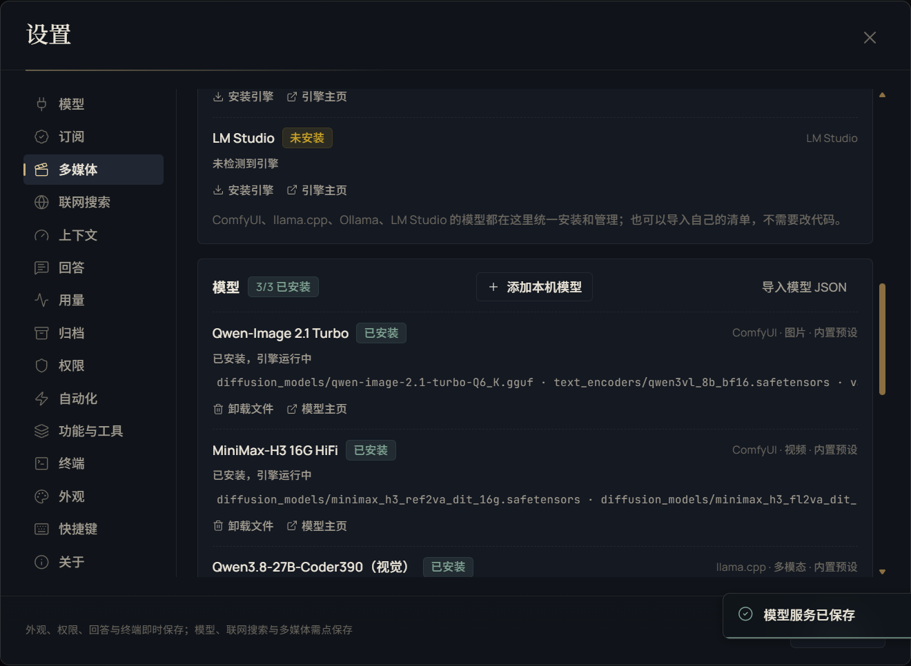

# 多媒体

> 本文为中文文档；英文概览见 [README.md](../README.md)。

这页说明 Morrow 如何驱动本机的图片、视频与音频引擎：接哪个引擎、模型从哪来、生成与编辑工具有什么限制、成品怎么审看。它不覆盖模型订阅，那部分见 [模型与订阅](MODELS.md)；所有媒体文件必须先位于工作区内。

## 目录

- [引擎](#引擎)
- [模型目录与安装方式](#模型目录与安装方式)
- [生成工具](#生成工具)
- [编辑与检查](#编辑与检查)
- [审看优先级](#审看优先级)
- [ffmpeg 与超时](#ffmpeg-与超时)
- [安全与限制](#安全与限制)

## 引擎

多媒体层不是固定绑定某一家模型，而是“引擎 + 模型目录 + 工具”的结构。

| 引擎 | 启动或连接 | 说明 |
|---|---|---|
| ComfyUI | 填安装目录；启动命令为 `python main.py --listen 127.0.0.1 --port 8188 --reserve-vram 2.5` | 120 秒健康检查；支持原生节点与 API 工作流 |
| llama.cpp | 自动补 `-m` / `--host` / `--port` / `--alias` | 180 秒超时；只停止自己启动的进程；视觉需要 `--mmproj` |
| Ollama | 本机 HTTP，可安装、`pull` / `rm` | 不停止其他服务的模型 |
| LM Studio | 本机 HTTP，可安装、`lms get` / `rm` | 同上 |

设置 → 多媒体可以检测引擎、显示版本与显存、填写安装目录与模型目录、指定 ffmpeg、调整超时。ComfyUI 目录为空时会探测常见安装位置，显式填写的目录优先。

## 模型目录与安装方式

内置预设：

| 模型 | 引擎 | 类型 | 能力 |
|---|---|---|---|
| Qwen-Image 2.1 Turbo | ComfyUI | 图片 | 文生图、图片编辑 |
| MiniMax-H3 16G HiFi | ComfyUI | 视频 | 文生视频、首尾帧、参考图 |
| Qwen3.8-27B-Coder390（视觉） | llama.cpp | 多模态 | 图片与视频帧审看、代码任务 |

模型清单字段包括 `id`、`label`、`engine`、`kind`、`capabilities`、`description`、`homepage`、`license`、`install`、`comfy`。用户清单保存在 `<dataDir>/media-models.json`，引擎配置在 `<dataDir>/media-engines.json`。

安装类型：

| 类型 | 行为 |
|---|---|
| `files` | 按 URL 下载到引擎模型目录；`.part` + Range 续传、大小 ±1MB、SHA-256 校验、原子改名 |
| `ollama` | 执行 `ollama pull` / `rm` |
| `lmstudio` | 执行 `lms get` / `rm` |
| `provider` | 只登记已有 Provider 模型，不下载文件 |
| `comfy` | ComfyUI API 工作流；可指定输出节点、输出类型与提示词节点 |

路径必须是引擎模型目录内的安全相对路径，禁止 `..`、绝对路径与符号链接逃逸。卸载只删除清单声明且未被其他模型引用的文件。

应用内注册：设置 → 多媒体 → 添加本机模型。ComfyUI 需要粘贴 API 工作流 JSON（不是 UI 工作流），填写输出节点与输出类型；llama.cpp / Ollama / LM Studio 需要真实模型 ID、上下文、输出与能力声明；也可以直接导入 JSON 清单。

## 生成工具

| 工具 | 能力 | 关键限制 |
|---|---|---|
| `generate_image` | 5 种尺寸；参考图改图（`<image1>`） | 图片 64–2048；默认超时 600s |
| `generate_video` | 16:9 / 9:16 / 1:1；fast / balanced / high；5–15s；首尾帧 | 默认超时 3600s |
| `generate_film` | 2–6 镜；Qwen 首帧 + MiniMax 视频 + 尾帧续接 + ffmpeg 拼接 | 每镜 5–10s |
| `render_animation` | 自包含 HTML + `window.renderAt(t)` 逐帧渲染 | 0.5–60s、8–30fps |
| `describe_media` | 图片或视频抽 1–4 帧审看 | 当前模型优先；本地需视觉能力 |

写生成提示词时具体写主体、动作、场景、光线、构图与风格；改图要写清哪些部分保持不变。视频生成可能耗时数分钟，期间不要重复提交。

媒体产物写入工作区的 `media/images|videos|audio|edited|films|code`。

## 编辑与检查

| 工具 | 用途 |
|---|---|
| `edit_media` | trim / crop / resize / rotate / flip / speed / mute / volume / extract_audio / extract_frame / gif / convert / concat |
| `inspect_media` | 用 ffprobe 读取宽高、时长、帧率与编码，只读 |

先 `inspect_media` 确认素材，再 `edit_media`，可以避免按错误的时长或分辨率剪辑。参考图上传上限 40MB，回传图片上限 120MB，视频上限 1GB。

## 审看优先级

`describe_media` 的顺序固定：

1. **当前对话模型**声明视觉能力时直接使用；视觉请求关闭思考（DeepSeek 的 `off` → `none`），给 2048 输出预算，180 秒超时；
2. 当前模型不支持或失败时，回退到声明视觉能力的本地模型，优先 Coder390 预设；
3. 两边都不可用时返回真实的组合错误，并提示更换支持图片的模型，或启用带 `--mmproj` 的本地视觉模型。

不会用生图模型或纯文本模型冒充视觉审看；工具结果会标注是否 fallback。模型必须如实说明失败，不能编造“看到了”。

## ffmpeg 与超时

Morrow 不内置 ffmpeg。设置 → 多媒体可填写 ffmpeg 路径；否则从 `PATH` 查找，ffprobe 取同目录。它用于：

- 视频缩略图与抽帧；
- `edit_media` 的裁剪、拼接、转码、提取音频与 GIF；
- `generate_film` 的尾帧续接与成片拼接；
- `inspect_media` 的元数据读取。

ffmpeg 不可用时，图片与视频生成本身仍可能工作，但剪辑、拼接与抽帧会明确报错。

图片默认超时 600 秒，视频默认 3600 秒，可在设置中调整。16GB 显存下代码模型与视频模型通常需要分阶段执行；ComfyUI 启动参数保留 `--reserve-vram 2.5`。

## 安全与限制

- 生成、编辑与审看都必须使用真实引擎或模型；未就绪时如实报错，不伪造结果。
- 输入与输出必须位于工作区内；模型文件路径限制在引擎目录内。
- 引擎安装、模型下载、拉取、卸载、启动与停止属于高影响操作，受权限与审批约束。
- 模型下载先写 `.part`，完成后校验大小与 SHA-256；失败保留可续传片段。
- 本机模型能否使用取决于硬件、显存、启动参数与 `--mmproj`；以真实错误为准。
- 具体模型许可见模型主页，Morrow 不改变第三方模型许可。

媒体链路真实生成依赖本机 GPU 与 ComfyUI；没有引擎时相关用例会 skip，不把 mock 结果当作真实生成。排障入口见 [排障指南](TROUBLESHOOTING.md#多媒体)。