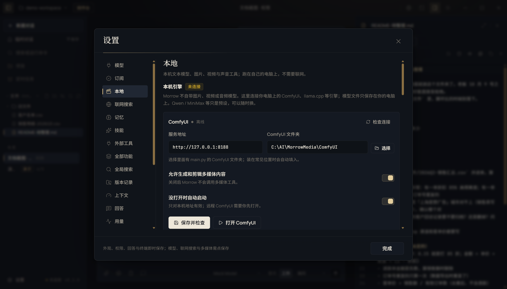
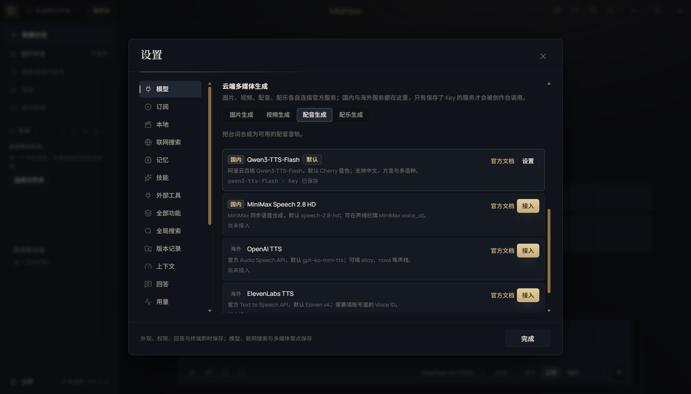
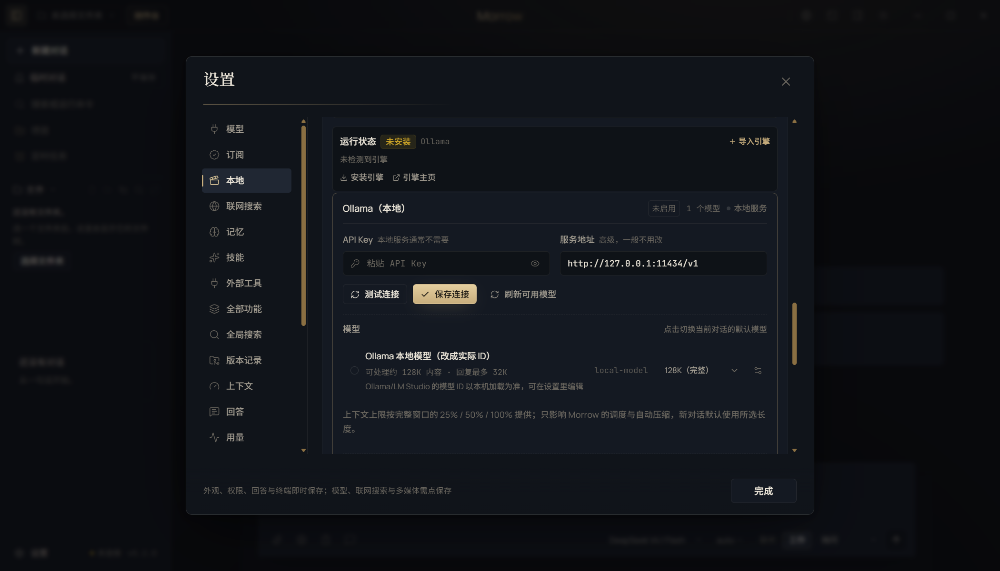

# 图片、视频、配音与配乐

Morrow 的图片、视频、配音与配乐有两条链路：云端服务与本地引擎。云端用你保存的 API Key 调用服务商；本地用你电脑上的 ComfyUI、FFmpeg 与本机声线。两条链路都按真实结果交付，没有可用引擎时直接报错，不用占位图或静音轨冒充成品。

这篇文档说明云端 17 个预设怎么分组、本地引擎各自需要什么、创作台在每一步调用谁，以及费用与密钥边界。第一次接媒体能力，可以先在“设置 → 本地”确认引擎状态。

## 两条链路

云端链路适合不想在本机跑大模型的人：在“设置 → 模型”里选“云端多媒体生成”，按图片、视频、配音、配乐四类保存服务与 Key。本地链路适合已有显卡与模型的人：在“设置 → 本地”连接 ComfyUI、FFmpeg 和本机声线。

| 链路 | 需要什么 | 什么时候用 |
|---|---|---|
| 云端 | 服务商账号与 API Key | 想快速出图、出片，或本机没有对应模型 |
| 本地 | ComfyUI、模型权重、FFmpeg、Python 环境 | 想离线、批量，或避免按次计费 |

云端一共 17 个预设：图片 7 个、视频 4 个、配音 4 个、音乐 2 个。只有保存了 Key 的服务才会被创作台调用；没有 Key 的卡片只表示“可以接”，不代表可用。本地链路不计模型边际费用，但占用你的显卡、内存与磁盘。

怎么选：

- 只偶尔做几张图：先接云端，不必下载模型。
- 要批量出图或离线：先装 ComfyUI 与对应权重。
- 只差配音：装好 Qwen3-TTS 的 Python 环境与模型，或直接用 Windows 系统语音。

截图来自测试模式与内置演示工作区，界面与发布版一致。

## 云端服务

云端只登记有公开官方文档、能实际调用的接口；未验证的平台不会以“可选”形式出现。每张卡片标注“国内”或“海外”，方便你按网络与账号选择。

接入一个云端服务分四步：

1. 在“云端多媒体生成”里选能力页签，点一个服务卡片。
2. 填 API Key；Base URL 与默认模型一般不用改。
3. 点“测试连接”，确认能返回结果。
4. 保存，并在同一页点“设为默认”，把它设为该类能力的默认服务。

| 能力 | 服务 | 地区 | 默认模型 |
|---|---|---|---|
| 图片 | 火山方舟 Seedream 5.0 Pro | 国内 | `doubao-seedream-5-0-pro-260628` |
| 图片 | 火山方舟 Seedream 5.0 Flash | 国内 | `doubao-seedream-5-0-flash-260915` |
| 图片 | 阿里云百炼 Qwen-Image 2.1 Pro | 国内 | `qwen-image-2.1-pro` |
| 图片 | OpenAI Images 2.6 Sunburst | 海外 | `gpt-image-2.6-sunburst` |
| 图片 | OpenAI Images 2.6 Flare | 海外 | `gpt-image-2.6-flare` |
| 图片 | Gemini Nano Banana 2.1 | 海外 | `gemini-nano-banana-2.1` |
| 图片 | Stability SD3.5 | 海外 | `sd3.5-large` |
| 视频 | 火山方舟 Seedance 2.5 | 国内 | `doubao-seedance-2-5-260628` |
| 视频 | 火山方舟 Seedance 2.0 | 国内 | `doubao-seedance-2-0-260128` |
| 视频 | MiniMax H3 | 国内 | `MiniMax-H3` |
| 视频 | Google Veo 3.1 | 海外 | `veo-3.1-generate-001` |
| 配音 | 阿里云百炼 Qwen3-TTS-Flash | 国内 | `qwen3-tts-flash` |
| 配音 | MiniMax Speech 2.8 HD | 国内 | `speech-2.8-hd` |
| 配音 | OpenAI TTS | 海外 | `gpt-4o-mini-tts` |
| 配音 | ElevenLabs TTS | 海外 | `eleven_v4` |
| 配乐 | 昆仑万维 Mureka V9.5 | 国内 | `auto` |
| 配乐 | ElevenLabs Music | 海外 | `music_v2_5` |

图片、视频、配音、配乐四类各自独立保存 Key。同一类里可以接多个服务，在设置页选默认。旧版本保存的默认模型会在读取设置时迁移到当前默认值，你自己填过的其他模型 ID 不会被覆盖。

配音预设自带官方系统音色，打开声线选择器即可选。ElevenLabs 的音色属于账号私有资源，需要填 Voice ID。云端声线 ID 不会发送给本地引擎，本地声线也不会传给云端。

图片用于分镜、封面与插图；视频把分镜图升级成带运动的镜头；配音把台词变成音轨；配乐生成纯器乐背景。四类可以只接一类，创作台会按已保存的能力逐段回退。

云端请求失败时会保留错误与 HTTP 状态，不会用别的服务静默顶替。服务返回的临时下载链接会立即保存为本地素材，避免过期。

截图来自测试模式与内置演示工作区，界面与发布版一致。

## 本地引擎

本地引擎负责把模型与工具跑在你的电脑上。Morrow 不自带图片、视频或音频模型权重；它只提供接线、任务队列与结果归档。

| 引擎 | 作用 | 前提 |
|---|---|---|
| ComfyUI | 图片、视频、配乐工作流 | 安装目录、模型权重、对应节点 |
| FFmpeg | 剪辑、转码、封面、波形、成片合成 | 本机安装，或在设置里指定 `ffmpeg.exe` |
| Qwen3-TTS | 本地 AI 配音 | 脚本随包，Python 环境与模型另装 |
| Windows 系统语音 | 配音回退 | 系统已安装中文语音包 |
| 本地配乐草稿 | 试听用器乐循环 | 不需要模型，不是 AI 生成 |

ComfyUI 侧有三组内置预设，分别对应图片、视频与配乐：

| 预设 | 能力 | 说明 |
|---|---|---|
| MiniMax-H3-Image | 文生图、参考图编辑 | 图片工作流共用一套权重 |
| MiniMax-H3 | 文生视频、图生视频、首尾帧 | 视频工作流 |
| MiniMax Music3 | 纯器乐配乐 | 正式配乐 |

ComfyUI 默认地址是 `http://127.0.0.1:8188`。在“设置 → 本地”填 ComfyUI 文件夹时，选里面有 `main.py` 的根目录；装在常见位置时安装目录会自动填入。只有本机回环地址支持“没打开时自动启动”，远程 ComfyUI 需要你先启动服务。图片与视频各自有超时；超时后任务会失败并保留错误，不会无限等待。生成结果默认写进当前工作区的 `media` 目录。

ComfyUI 的自定义工作流用 API 格式 JSON：填输出节点、输出类型，以及可选的提示词节点。模型文件缺失或节点版本不够时，Morrow 会明确提示并停在失败状态，不会拿别的权重顶替。

内置的图片、视频、配乐预设只是下载与接线清单，权重不随安装包提供，体积以十 GB 计。下载支持断点续传与大小校验；模型文件只保存在你指定的模型目录。

模型权重占用的是磁盘与显存，不是 Morrow 的安装目录；换模型只需要在设置里改模型目录或清单，不需要重装应用。

FFmpeg 不随包内置。它负责剪辑、变速、转 GIF、提取音频、生成封面与波形，以及把时间线合成为成片。图片和视频生成本身不依赖 FFmpeg，但导出成片、音轨与四格漫画需要它；找不到时任务会明确失败，工程包导出不受影响。

Qwen3-TTS 的推理脚本随包提供（`resources/tts/qwen_tts_server.py`），Python 虚拟环境与模型权重需要另装，默认放在 `%LOCALAPPDATA%\Morrow\local-tts` 下。装好后设置页显示“本地 AI 声线”，否则回退到 Windows 系统语音。系统语音不需要额外模型，但音质与情感控制有限；两种声线都只在本机合成。

本地配乐是草稿，不是 AI 模型：它按情绪生成可循环的器乐片段，用于试听与占位，界面会标注“草稿”。要正式配乐，接入云端配乐预设，或在本机装好 MiniMax Music3 配乐工作流。

截图来自测试模式与内置演示工作区，界面与发布版一致。

## 创作台怎么调用

创作台按阶段选择能力，不按“先云后本地”一刀切。生成画面、视频、配音与配乐时，每一步都先看有没有已保存 Key 的云端服务，再决定是否回退本地。

| 阶段 | 首选 | 回退 |
|---|---|---|
| 画面与分镜图 | 已保存 Key 的云端图片服务 | 本机 ComfyUI 图片工作流 |
| 视频 | 云端视频服务，首帧来自分镜图 | 本机 ComfyUI 视频工作流 |
| 配音 | 已保存 Key 的云端配音 | 本机 Qwen3-TTS，再回退 Windows 系统语音 |
| 配乐 | 云端配乐服务 | 本机 ComfyUI 配乐；没有模型时用本地草稿 |
| 成片、音轨、封面 | 本机 FFmpeg | 无，缺 FFmpeg 时明确失败 |

实际顺序通常是这样：

1. 先定分镜，生成每个镜头的分镜图。
2. 用分镜图作为首帧生成视频；不满意就重生成或换镜头。
3. 按角色生成配音，补齐缺失的台词。
4. 生成纯器乐配乐，再装配时间线。
5. 用 FFmpeg 合成草稿或成片，导出字幕、封面与工程包。

分镜图优先生成，视频把当前分镜图作为首帧；没有现成首帧时先补一张。配音按角色与台词逐段生成，本地声线失败会回退系统声线，并在任务记录里说明。配乐默认要求纯器乐，本地草稿只用于试听，不计入正式配乐。

缺少模型、Key 或引擎时，任务直接失败并给出设置入口，不会用静音、空白或占位图补位。要了解创作台的阶段、时间线与导出闸门，见 [STUDIO.md](STUDIO.md)。

## 计费、密钥与边界

- 云端费用记在你自己的服务商账号，账单以服务商为准；Morrow 只显示服务与模型，不估算具体价格。
- 云端按服务商计费；本地的成本来自电费与硬件折旧，Morrow 不做跨服务商比价。
- Key 用 Windows 系统加密保存在本机，界面不回显；只有保存了 Key 的服务会被创作台调用。
- 云端列表是核对过的官方接口，不是全量市场；实际可用性、额度与商用授权以你的账号为准。
- 本地引擎不产生模型费用，但占用显卡、内存与磁盘；模型权重以十 GB 计，不随包内置。
- ComfyUI 自动启动只对本机回环地址有效；远程地址、容器或另一台机器需要你先启动服务。
- FFmpeg 不随包内置，许可证由你选择的发行版决定。
- Qwen3-TTS 的脚本随包提供，Python 环境与模型需要另装；只装脚本不会出现本地 AI 声线。
- 本地配乐草稿不是 AI 模型，不能当作正式配乐交付。
- 云端不可达、Key 失效或模型下线时，任务会失败并保留错误信息；可以先导出工程包与中间文件。

数据目录、环境变量与设置分页见 [REFERENCE.md](REFERENCE.md)；安装与首次配置见 [GETTING-STARTED.md](GETTING-STARTED.md)；连不上服务时先看 [TROUBLESHOOTING.md](TROUBLESHOOTING.md)。