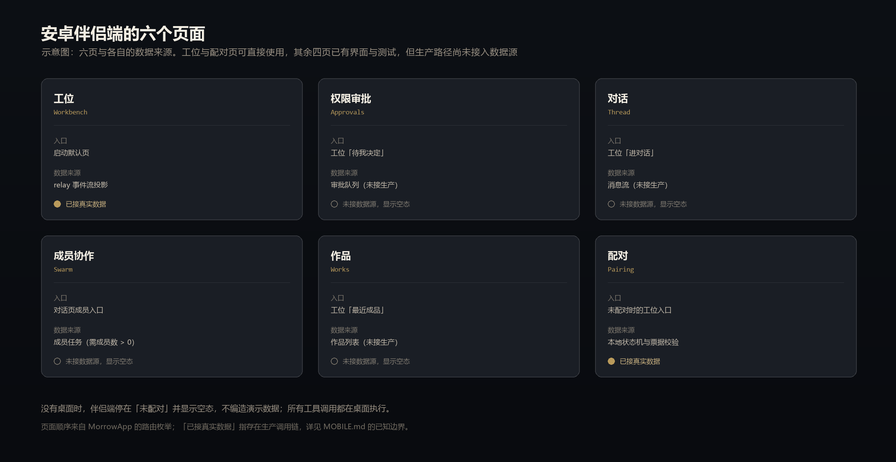

# 手机端：在手机上看进度、批权限

Morrow 安卓版是桌面端的伴侣端。它把桌面上的工位状态、任务进度、待审批请求和成品搬到手机上，让你不必守在电脑前。它不执行任何工具：所有文件读写、命令、浏览器与电脑操作仍然发生在桌面端。

**这一篇已迁出本仓库。** 安卓端现在是独立项目：[Morrow-Android](https://github.com/youyuwangzi0001/Morrow-Android)。它的页面说明、配对步骤、构建方式与已知边界都在那个仓库的 `docs/` 里，并随安卓端自己的版本更新。本页只保留桌面侧需要知道的那部分：配对怎么开、通道的边界在哪。

## 桌面侧要做什么

1. 打开 **设置 → 手机配对**，启用远程通道。默认关闭，关着时连端口都不会创建。
2. 让手机把 `MORROWPAIR1.` 开头的配对请求复制过来，粘进面板生成票据。
3. 把票据与六位码交回手机。票据 90 秒有效、一次性。

面板会自动把局域网地址写进票据；如果本机没有可用的局域网网卡，面板会当场说明原因，而不是让你反复重试。

## 通道的边界

示意图：安卓端页面与数据来源的结构图，不是界面截图；真实界面截图在 [Morrow-Android](https://github.com/youyuwangzi0001/Morrow-Android) 的 `docs/screens/`。

| 项 | 事实 |
|---|---|
| 连接范围 | 同一局域网内的 `wss://` 直连，公网中继是占位实现 |
| 证书 | 自签，手机固定配对时记下的 SHA-256 指纹，不验证证书链 |
| 加密 | ECDH P-256 → HKDF-SHA256 双向密钥 → AES-256-GCM，AAD 含方向与计数 |
| 上行能力 | 只有白名单：审批、停止、发消息、成员干预、拉作品摘要、取单件成品、要快照、探测存活 |
| 执行端 | 始终在桌面。手机不能让它跑任意命令 |

手机端页面细节、截图与验证边界见安卓仓库：

- 页面与数据来源：<https://github.com/youyuwangzi0001/Morrow-Android/blob/main/docs/SCREENS.md>
- 配对与协议：<https://github.com/youyuwangzi0001/Morrow-Android/blob/main/docs/PAIRING.md>
- 验证边界：<https://github.com/youyuwangzi0001/Morrow-Android/blob/main/docs/VERIFICATION.md>
