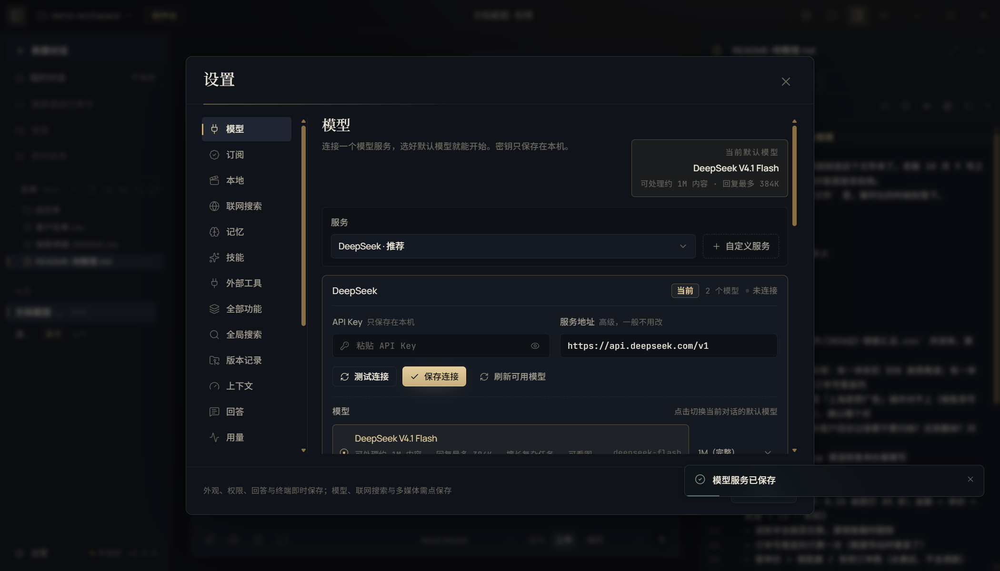
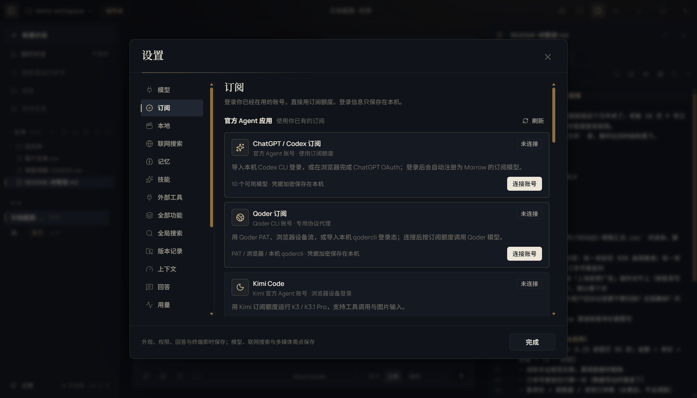

# 模型与订阅

Morrow 不内置商用模型权重。它把模型接入分成三条路线：用 API Key 连接云端服务、登录你已有的订阅账号、连接本机运行的模型。设置里的 15 个 Provider 配置（含一个离线演示引擎）覆盖这三类；你可以随时在输入框的模型菜单里切换当前模型。

这篇文档说明每条路线怎么接、订阅渠道有哪些、思考档位与重试如何工作，以及联网搜索从哪里来。第一次配置可以先看 [GETTING-STARTED.md](GETTING-STARTED.md)。

## 三条接入路线

三条路线回答的是同一个问题：模型跑在哪里、费用记在谁头上、凭据由谁保管。

| 路线 | 适合谁 | 入口 |
|---|---|---|
| API Key | 有服务商 API Key，按量计费，或要接自建网关 | 设置 → 模型 |
| 订阅账号 | 已有 ChatGPT/Codex、Kimi Code、GLM Coding Plan 等订阅 | 设置 → 订阅 |
| 本机模型 | 模型已经在本机运行，或想完全离线 | 设置 → 本地 |

API Key 路线同时覆盖 OpenAI 兼容协议和 Anthropic 原生协议，后两节分别说明。订阅路线不接触你的账号密码，只保存服务商签发的登录态或 token。本机模型不经过 Morrow 的服务器。

demo 也占一个 Provider 配置，但它不属于三条路线：它只用于离线演示与测试，不消耗额度，也不会冒充真实模型。第一次启动可以先选它熟悉界面。

截图来自测试模式与内置演示工作区，界面与发布版一致。

## 连接 OpenAI 兼容服务

OpenAI 兼容服务使用 `POST /v1/chat/completions`。DeepSeek、Kimi、Qwen、GLM、MiniMax、MiMo、OpenAI、Gemini、xAI、Meta 等内置服务都走这条协议，自建网关和多数中转站也一样。

1. 打开“设置 → 模型”，在列表里选择内置服务商，或点“添加自定义服务”。
2. 填 API Key。Base URL 一般保持内置值；接自建网关时填到根地址，Morrow 会按协议补全路径。
3. 填模型 ID。可以从服务商同步模型列表，也可以手动输入；每行一个。
4. 点“测试连接”。它会发真实请求，可能计入服务商用量，失败时会带 HTTP 状态。
5. 保存后，在输入框的模型菜单里选中这个模型。

| 配置项 | 作用 | 注意 |
|---|---|---|
| Base URL | 服务根地址 | 填根地址即可，Morrow 会按协议补全路径 |
| API Key | 服务商签发的密钥 | 只保存在本机，界面不回显 |
| 模型 ID | 请求时使用的模型名 | 必须与服务商文档一致，大小写和日期后缀都算 |
| 上下文窗口 | 一次请求能带多少历史 | 优先用元数据，也可手动填写 |
| 最大输出 | 单次回复上限 | 不能大于上下文窗口 |

每个模型行右侧的齿轮是完整设置：上下文窗口、最大输出、思考强度、工具调用与图片输入。工具调用和图片输入要按模型的真实能力勾选；勾了但服务商不支持时，请求可能失败。

上下文与最大输出优先采用 Provider 元数据，或“同步模型列表”返回的值。网关没有声明时，Morrow 只对已知模型家族做兜底，未知模型不猜。手动改过的长度会带上编辑标记，刷新模型列表不会覆盖。本机服务不参与家族猜测。

重试与退避在服务卡片底部设置：默认重试 3 次，退避依次为 800、2000、5000 毫秒；重试次数填 0 表示不重试。408、409、425、429 与 5xx 会重试；其余 4xx、主动中断与结构化输出拒绝不重试。连接中断时，如果已经收到正文，Morrow 从断点续接；如果只有思考没有正文，会重发原请求。

## 连接 Anthropic 原生服务

Anthropic 原生与 OpenAI 兼容的差别在协议层，不在界面。选择内置的 Anthropic Claude，或在自定义服务里把协议切到“Anthropic Messages”。

| 项目 | OpenAI 兼容 | Anthropic 原生 |
|---|---|---|
| 端点 | `POST /v1/chat/completions` | `POST /v1/messages` |
| 鉴权 | `Authorization: Bearer` | `x-api-key` 与 `anthropic-version` |
| 思考 | `reasoning_effort` | `thinking.budget_tokens` |
| 图片 | `image_url` 内容块 | base64 `source` 内容块 |

Base URL 填根地址，Morrow 会补全 `/v1/messages`；测试连接同样发真实请求。Anthropic 的思考是 token 预算，不是档位，界面只显示该模型真实接受的选项。

Claude 账号登录不在 Morrow 里提供。要用 Claude，只能填 Anthropic API Key，或走支持 Anthropic Messages 的订阅协议。工具调用使用 `tool_use` 与 `tool_result` 内容块；如果网关只做文本转发，工具会不可用，可以在模型设置里关掉工具调用。

## 订阅渠道

设置 → 订阅集中管理 12 类渠道：ChatGPT/Codex、Qoder、9 个 Agent 订阅，以及第三方自定义订阅。它们不共用同一套登录方式，但都只把凭据保存在本机。

截图来自测试模式与内置演示工作区，界面与发布版一致。

| 类别 | 渠道 | 登录方式 |
|---|---|---|
| 官方 Agent 应用 | ChatGPT / Codex | 导入本机 Codex CLI 登录，或浏览器 OAuth |
| 官方 Agent 应用 | Qoder | PAT、浏览器设备流，或导入本机 qodercli 登录态 |
| Agent 订阅 | Kimi Code | 浏览器设备登录 |
| Agent 订阅 | GLM Coding Plan | 浏览器登录，区分中国区与国际区 |
| Agent 订阅 | MiniMax Code | 官方 Agent 账号登录，区分中国区与国际区 |
| Agent 订阅 | Step Plan | 浏览器登录，或粘贴开放平台 Key |
| Agent 订阅 | Command Code | 浏览器授权，或粘贴长期密钥 |
| Agent 订阅 | Cline Pass | 粘贴 Cline API Key |
| Agent 订阅 | Google Antigravity | Google OAuth |
| Agent 订阅 | OpenCode | 导入本机 OpenCode 凭据，或 OpenCode Zen API Key |
| Agent 订阅 | OpenDesign Cloud | OpenDesign Cloud API Key |
| 第三方自定义 | 兼容 coding plan | 填接口地址、token 与模型 ID，协议选 OpenAI 兼容或 Anthropic Messages |

第三方自定义订阅是第 12 类，适合没有独立卡片、但提供兼容接口的 coding plan 或中转站。填名称、接口地址、token 和模型 ID 后，这些模型会出现在模型菜单里；token 加密保存在本机。

登录态与额度由服务商决定。Morrow 只展示服务商返回的账号、模型与额度，不伪造“已连接”、额度或用例。未验证的渠道不会显示“已连接”，也不会被当作可用模型。Google Antigravity 使用 Google OAuth，没有配置 `MORROW_ANTIGRAVITY_CLIENT_SECRET` 时登录无法完成。

不提供 Claude 账号登录，只接 API Key 或订阅协议。订阅协议可能随服务商变化；失败时按提示重新登录，或改用普通 API。重新登录或恢复订阅后，你调过的上下文与最大输出会保留。

## 本机模型

本机模型指跑在你电脑上的推理服务。Morrow 通过 OpenAI 兼容接口连接它们，不会把本机模型混进云端服务选择器。

| 服务 | 说明 |
|---|---|
| Ollama | 先在 Ollama 里拉取模型，再把实际模型 ID 填进 Morrow |
| llama.cpp | 用 `llama-server` 提供 OpenAI 兼容接口 |
| LM Studio | 在 LM Studio 里加载模型并启动本地服务 |
| openai-compat | 任何兼容 `/v1/chat/completions` 的本机服务 |

1. 先启动对应服务，确认它在监听本机地址。
2. 在“设置 → 本地”填服务地址，点“检查连接”。
3. 选一个模型 ID，按本机实际加载的上下文与输出填写长度。
4. 保存后回到对话，在模型菜单里选中它。

本机服务的上下文和输出不参与模型家族猜测，长度由你填。服务没有启动、端口不通或模型没有加载时，模型会显示离线；Morrow 不会把请求悄悄转给云端。本机视觉模型可以在当前对话模型不支持图片时作为审看回退，但不会替代生成模型。

## 上下文、输出与思考

上下文窗口决定一次请求能带多少历史，最大输出决定单次回复的上限。两者都优先取 Provider 元数据；你可以在模型设置里修改，改过的值不会被“同步模型列表”覆盖。

接近上下文上限时，Morrow 会压缩较早的记录，保留最近的消息、关键事实、工具结果与任务约束。换模型不会清空对话，但新模型的窗口与压缩点不同，超出部分仍会被压缩。

思考强度共 7 档：

| 档位 | 含义 | 发送行为 |
|---|---|---|
| 自动 | 不指定力度 | 不下发思考参数 |
| 关 | 不请求思考 | 关闭思考 |
| 低 | 少量思考 | `low` |
| 中 | 中等思考 | `medium` |
| 高 | 高力度思考 | `high` |
| 极高 | 更高力度 | `xhigh` |
| 最大 | 最高力度 | `max` |

只有模型元数据声明支持的档位才会出现在菜单里；未知模型只保留“自动”。模型不支持思考时，界面显示“不支持思考”，不会硬发参数。Anthropic 把档位映射成思考预算，其余 OpenAI 兼容服务映射成 `reasoning_effort`。

对话输入框里可以临时改思考档位，设置里改的是默认值。重试策略随服务保存，只影响请求层，不会改变你的上下文与模型选择。

## 联网搜索

Morrow 的搜索有两个来源：当前模型或渠道自带的原生搜索，以及你配置的搜索服务商。默认开启“自动联网搜索”：优先用原生搜索，模型没有原生能力时回退到内置网页搜索。

| 服务商 | 需要 Key | 适合 |
|---|---|---|
| 原生 | 否 | OpenAI、Anthropic、Gemini、xAI、DeepSeek 等官方渠道 |
| Tavily | 是 | 面向 AI 的搜索，摘要稳定 |
| Brave | 是 | 独立索引，英文资料更全 |
| Serper | 是 | 通过 Google 搜索，中文结果丰富 |
| SearXNG | 否，可选令牌 | 自建实例，填实例地址，需要开启 JSON 输出 |

第三方搜索服务商共 4 家。默认每次返回 5 条结果；模型可以按任务多要或少要，上限 10 条。SearXNG 可以填本机或内网地址，访问令牌是可选项。

搜索请求只从本机发出，网页内容只当参考资料，不当成指令。原生搜索失败或没有来源时，Morrow 会回退到内置检索，并在结果里标明来源。

## 常见问题

| 现象 | 处理 |
|---|---|
| API Key 存在哪 | 用 Windows 系统加密保存在本机数据目录的 `secrets.json`；界面只显示是否已保存，不回显明文。系统加密不可用时 Morrow 会拒绝保存，而不是退化成可还原的编码。 |
| 换模型会不会丢上下文 | 对话记录还在；新模型的窗口与压缩点不同，超出部分会被压缩。 |
| 测试连接失败 | 检查 Base URL、Key、模型 ID 与网络；错误会带 HTTP 状态，先按状态区分鉴权、额度与地址问题。 |
| 429 或超时 | 429 会自动重试；连续失败时检查额度、系统代理与服务商状态。其余 4xx 不重试，先核对 Key 与模型 ID。 |
| 为什么显示离线 | Key 没保存、订阅没登录、本机服务没启动，或地址不可达；先点测试连接看返回。 |
| 模型下拉为空 | 先保存服务并测试连接；订阅渠道在“订阅”页登录成功后才会注册模型。 |
| 订阅恢复后设置丢了 | 上下文与最大输出会保留；确认调整的是同一渠道的同一模型。 |
| 一个 Key 能接多个模型吗 | 可以。同一服务下添加多个模型 ID，每个模型都能单独设上下文、输出与思考档位。 |

更细的排错见 [TROUBLESHOOTING.md](TROUBLESHOOTING.md)；数据目录、环境变量与设置分页见 [REFERENCE.md](REFERENCE.md)；长内容创作怎么选模型见 [STUDIO.md](STUDIO.md)。