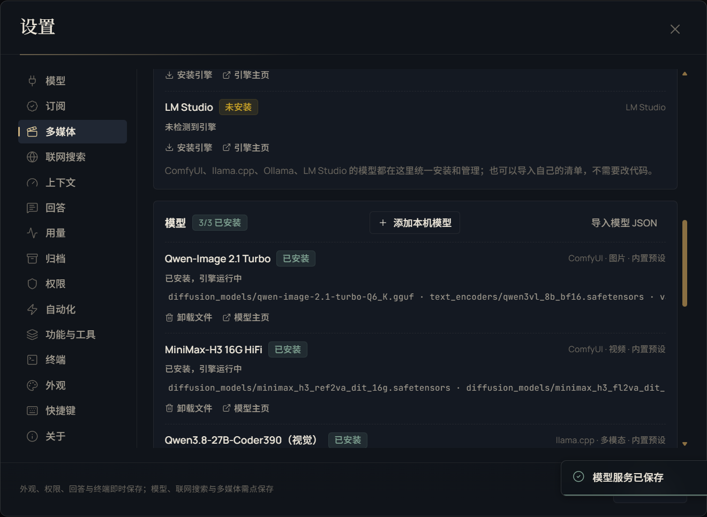

# 模型与思考档位

Morrow 把“模型是什么、能看什么、能想多深、能吃多长上下文”当作运行时元数据，而不是 UI 常量。本文说明内置目录、Qoder 账号目录、同步规则与常见边界。

## 1. 选择顺序

一次请求的模型由三处决定：

1. 会话的 `ModelRef`（Provider + Model）；
2. Provider/模型的能力元数据（视觉、思考档位、上下文档位、最大输出）；
3. 会话级上下文覆盖（如果用户选择了上下文档位）。

模型选择器只显示已启用且已保存 Key/登录态的 Provider；显示原始模型名称，不加“限免/订阅/上下文”等营销后缀。

## 2. 内置 API 预设

当前内置目录（`src/shared/models.ts`）：

| 家族 | 模型 | 上下文 | 最大输出 | 思考档位 |
|---|---|---:|---:|---|
| DeepSeek | V4.1 Flash | 1,000,000 | 393,216 | off / low / high / max |
| DeepSeek | V4 Pro | 1,000,000 | 393,216 | high / max |
| Kimi | K3.1 Pro / K3 / K2.8 Preview | 1,048,576 | 65,536 | low / high / max |
| Qwen | Qwen3.8 Max / Flash Next | 1,000,000 | 65,536 | low / medium / xhigh |
| Anthropic | Claude Fable 5.1 / Opus 5.5 / Sonnet 5.5 / Haiku 5.5 | 1,000,000 | 128,000 | low / medium / high / xhigh / max |
| OpenAI | GPT-6.1 Sol / GPT-6 Astra / GPT-6 Sol / GPT-6 Luna | 1,050,000 | 128,000 | low / medium / high / xhigh / max |
| Google | Gemini 4 Argon / 3.8 Flash | 1,048,576 | 65,536 | low / medium / high |
| 智谱 | GLM-5.3 / GLM-5.3 Flash | 1,000,000 | 128,000 | low / high / max |
| MiniMax | M3.1 Flash / M3 | 1,000,000 | 65,536 / 512,000 | low / medium / high / xhigh / max |
| 小米 | MiMo V2.6 Pro / Flash | 1,048,576 | 131,072 | 仅自动（族规则未公开） |
| Meta | Muse Spark 1.3 | 1,048,576 | 131,072 | low / medium / high / xhigh |
| xAI | Grok 4.7 / 4.6 | 500,000 | 65,536 | low / medium / high / xhigh |

说明：

- **DeepSeek** 官方使用 `none` 表示关闭思考；Morrow UI 统一显示 `off`。直接 DeepSeek Provider 会把 `off` 映射为 `none`；Qoder 代理仍按自己的 `off` 处理。
- **GLM-5.2** 不在官方 API 模型列表内，Morrow 不提供该型号。
- **未知模型**只显示“自动”，不猜测档位；旧设置中的非法档位在请求前回退 `auto`。
- 价格表只用于成本估算，不是账单依据。

## 3. Qoder 账号驱动目录

Qoder 订阅没有静态模型表。登录/恢复后读取账号接口：

```text
GET /algo/api/v2/model/list?Encode=1
```

解析：

- 场景 `chat` → `assistant` → `app`；跳过 `enable:false`；
- `key` 作为模型 ID，`display_name` 作为显示名；
- `is_vl` → 视觉能力；`is_reasoning` / `thinking_config` → 思考能力；
- `context_config.*` 的 `token_count` 与 `is_default` → 上下文档位与默认值；
- `available_context_windows`、`max_input_tokens`、`default_context_window` 作为补充；
- 没有档位时回退 200K。

实测账号返回 15 个 chat 模型，上下文档位为 **200K / 400K / 1M**，默认 200K。设置页可逐模型调整默认上下文；会话中再选择覆盖值时，请求通过 `x-morrow-context-window` 传给 Qoder 代理，代理夹到模型上限并写入 `model_config.max_input_tokens`。Qoder 的 `max_tokens` 硬顶为 32768。

## 4. 模型同步

对支持的 Provider，设置页可“从服务商同步模型列表”：

- 请求 `/models`（最多 200 个）；
- 读取 `context_window/context_length`、`max_output_tokens`、`reasoning_efforts`、`reasoning_effort_support_list`、视觉标记等；
- 上下文夹在 1,024–10,000,000，输出夹在 1–2,000,000；
- Provider 没有返回的字段保留本地值；
- 名称去重，无效条目计数并如实提示。

Step、Command Code、OpenCode、自定义 OpenAI 兼容网关等都会优先使用真实 `/models` 元数据；失败时回退内置预设。

## 5. 思考档位如何生效

| Provider 类型 | 请求字段 | 说明 |
|---|---|---|
| OpenAI 兼容（effort） | `reasoning_effort` | 只发送模型声明的档位；DeepSeek 直接 Provider 的 off→none |
| Anthropic（thinking） | `thinking.budget_tokens` | low 1024 / medium 4096 / high 8192 / xhigh 16384 / max 32768；off 不发送 thinking；temperature=1 |
| 未知/不支持 | 不发送 | UI 只显示“自动”或“不支持思考” |

模型请求前会做安全收敛：如果历史会话保存了当前模型不支持的档位（例如在 DeepSeek 上保存了 medium），自动回退到 `auto`，避免上游 400。

## 6. 上下文与输出

- 会话级 `contextWindow` 只能夹在 1,024 与模型上限之间。
- 上下文环、设置页和请求使用同一个有效值：`ModelRef.contextWindow ?? ModelInfo.defaultContextWindow ?? ModelInfo.contextWindow`。
- 自动压缩默认在 80% 触发；模型上下文越大，不代表应该塞满；压缩仍按完整消息边界执行。
- 最大输出只影响请求预算，不代表服务端一定允许；例如 Qoder 固定 32768，Anthropic 思考会额外预留 budget。

## 7. 本机模型

- **llama.cpp**：模型 ID 必须与 `--alias` 一致；Coder390 视觉审看需 `--mmproj`；默认 64K 上下文、16K 输出。
- **Ollama / LM Studio**：默认模型 ID 是占位符，需要改成真实加载的模型 ID；本机服务允许空 Key。
- 本地模型的能力以 Provider 配置里的 `supportsVision` / `supportsReasoning` / `reasoningEfforts` 为准；未知模型只显示“自动”。
- 媒体审看只选声明视觉能力的本地模型或 Coder390 预设，不会拿任意文本模型冒充视觉模型。

## 8. 常见问题

**为什么模型下拉是空的？** Provider 未启用、没有 Key/登录态，或模型 ID 为空。先保存 Key 并测试连接。

**为什么选不了 medium？** 当前模型没有 medium 档；这是真实能力，不是 UI 缺失。Morrow 不会把不支持的档位发给上游。

**为什么上下文上限不可调？** 该模型没有声明可调档位。Qoder 账号目录和部分 `/models` 返回档位的 Provider 才开放。

**为什么 Qoder 模型名变了？** Qoder 目录来自账号接口，可能随账号/服务端更新；Morrow 不硬编码名称。

**为什么 DeepSeek 选 off 没有报错？** 请求层会把 off 映射为 `none`；这是官方关闭思考的写法。Qoder 代理则继续使用 off。

## 9. 订阅接入

Morrow 可以把已有的官方 Agent 账号或 coding plan 接到本机，用订阅额度驱动 Agent。所有登录态只保存在本机；Morrow 不代充、不共享账号、不绕过限流。

### 9.1 支持范围

| 渠道 | 登录方式 | 模型目录 | 额度/状态 | 备注 |
|---|---|---|---|---|
| ChatGPT / Codex | 本机 `~/.codex/auth.json` 只读导入；内置浏览器 OAuth | 内置 10 个（384K/272K） | `/backend-api/wham/usage` 5h/周/credits | 回调 `localhost:1455`，应用退出后代理关闭 |
| Qoder | PAT、全球区设备流 PKCE、本机 qodercli 只读导入 | 账号 `/algo/api/v2/model/list`，实测 15 个 chat 模型 | `/api/v2/quota/usage` | 区域必须匹配；`max_tokens` 硬顶 32768 |
| Kimi Code | RFC 8628 设备码（中国/国际区） | 6 个，1M/256K | `/coding/v1/usages` 5h/周/月 | 强制思考，补 reasoning_content |
| GLM Coding Plan | ZCode 浏览器轮询 → 专用 Key | 3 个，1M/200K | `/api/monitor/usage/quota/limit` | Anthropic Messages 双鉴权；Key 长期 |
| MiniMax Code | 设备码 + PKCE；本机 auth 导入 | 4 个，1M/200K | `coding_plan/remains` | M3/M3.1 思考方式不同 |
| Step Plan | 云端轮询、粘贴 Key、本机 auth | `/v1/models` 实时 | 仅账号/模型 | 额度需 Oasis 网页会话，无数字 |
| Command Code | 浏览器回调或手贴 Key | `/provider/v1/models`，失败回退预设 | `/alpha/billing/credits` | Claude 走 Messages，其余 OpenAI |
| Cline Pass | WorkOS 设备码或静态 Key | 14 个预设 | `/users/me/plan/usage-limits` | 非流式 `{success,data}` 解包 |
| Google Antigravity | Google OAuth PKCE + 本机回调 | 9 个 | `retrieveUserQuotaSummary` | 不内置 OAuth secret；需环境变量 |
| OpenCode | 本机 auth 只读导入或手贴 Key | 实时 `/models`，回退 5 个 | Zen 无公开额度接口 | 只取 `type:"api"` 的 Zen Key |
| 第三方 coding plan | 名称/协议/Base URL/Key/模型 ID | 自定义 | 按服务商 | 只注册 Provider，不统一抓额度 |

### 9.2 共同结构

每条订阅链路大致相同：

```text
登录/导入 → 凭据加密落盘 → 账号/额度校验 → 模型目录 → 本地回环代理 → Provider
```

- 凭据使用 Electron safeStorage（Windows DPAPI）加密；渲染层只看到账号与“已保存”，不接触明文。
- 模型请求走 `127.0.0.1` 随机端口的本地代理；代理要求随机本地 Bearer，上游 token 与本地 token 分离。
- 401/403 只刷新一次后重试；刷新先落盘再使用。
- 登录窗口是 Morrow 内置 BrowserWindow；登录 session 有自己的导航白名单，避免误把登录页交给系统 Edge。
- 官方接口失败时明确提示，不把“未连接”显示成“已连接”，也不编造额度。

### 9.3 各渠道说明

#### 9.3.1 ChatGPT / Codex

- 入口：设置 → 订阅 → ChatGPT/Codex。
- 方式一：只读导入本机 `~/.codex/auth.json` 或 `$CODEX_HOME/auth.json`；不修改官方文件。
- 方式二：内置浏览器 OAuth，回调固定 `localhost:1455`；重复点击会复用同一个登录 Promise，不会重复占用端口。
- 代理把 OpenAI Chat Completions 转成 Codex Responses；assistant 历史内容必须用 `output_text`，失败会转成明确错误。
- 额度接口显示套餐、5 小时/每周窗口与 credits。
- 代理随应用退出；本机 1455 被占用时会提示。

#### 9.3.2 Qoder

- 三种入口：PAT 兑换、全球区浏览器设备流（PKCE + challenge）、本机 qodercli 登录只读导入（`~/.qoder/.auth/user` + `machine_id`）。
- 区域必须与账号一致；中国站与全球区端点不同。
- 模型目录实时读账号接口，不维护静态表；`context_config` 提供 200K/400K/1M，`thinking_config` 提供真实档位。
- COSY 1.1.72 头签名、请求体 alphabet 编码、RSA/AES runtime auth、`RemoteChatAsk` 信封与 SSE。
- 输出硬顶 32768；代理会再次截断 `max_tokens`。
- 设置页可逐模型调整上下文档位；会话中的上下文选择通过 `x-morrow-context-window` 生效。
- 额度读 `/api/v2/quota/usage`。

#### 9.3.3 Kimi Code

- 设备码登录（`auth.kimi.com` / `auth.kimi.ai`），区域决定后续所有端点。
- 上游是 `api.kimi.com/coding` 的 OpenAI Chat Completions；请求强制 `max_completion_tokens`、开启思考、补齐 `reasoning_content`。
- 模型 K3/K3.1 Pro/K2.8/for Coding/256K/高速变体；上下文 1,048,576 或 262,144。
- 额度读 `usages` 的 5 小时/每周/每月窗口。
- 单飞刷新：并发请求只触发一次刷新。

#### 9.3.4 GLM Coding Plan（ZCode）

- 浏览器轮询登录（`zcode.z.ai/api/v1/oauth/cli/init` + `poll`）。
- 国际区先用 `POST /api/auth/z/login` 换业务 token；中国区直接用 OAuth token。
- `getCustomerInfo` 定位默认机构/项目，找或创建专用 Key `morrow-glm-coding-plan`，取 `secretKey`，拼成 `{id}.{secret}`，配额校验后落盘。
- 模型面走 Anthropic Messages（`/api/anthropic/v1/messages`），同时发送 `x-api-key` 与 `Authorization: Bearer`。
- GLM-5.3 思考 low/high/max；不支持思考的 Turbo 不发；GLM-5.2 不在官方 API 列表，Morrow 不提供。
- 额度接口用裸 Key（不加 Bearer）。
- Key 长期有效，无 refresh；中国区兑换链依赖未公开接口。

#### 9.3.5 MiniMax Code

- 设备码 + PKCE，或导入 `~/.minimax/auth/prod/<region>/mcode-public/auth.json`。
- 按区域选择 Messages 前缀；代理转发。
- M3 使用 `thinking:adaptive`；M3.1 只发 `output_config.effort`；M2.7 不发思考。
- 额度读 `coding_plan/remains`。

#### 9.3.6 Step Plan

- 云端轮询、粘贴 Key、导入 `~/.stepcode/auth.json` 等三路径。
- 模型实时读 `/v1/models`，读取 `max_input_tokens` 与 `reasoning_effort_support_list`；失败复用上次目录。
- 额度需 Oasis 网页会话，只显示账号/模型，不给数字。

#### 9.3.7 Command Code

- 浏览器领取长期 Key，回调从 `127.0.0.1:5959` 探测 1024 端口并校验 `state`；也可手贴 Key。
- `/alpha/whoami` 校验；目录 `/provider/v1/models`，失败回退预设。
- `claude-*` 走 Anthropic Messages，其余走 OpenAI Chat Completions，两个 Provider 共用一个回环代理。
- 仅 Responses 的模型跳过；额度 `/alpha/billing/credits`。

#### 9.3.8 Cline Pass

- WorkOS 设备码 → `/auth/register` 换取会话；`Bearer workos:`；refresh 先落盘再使用。
- 也支持静态 Key，并以 `/users/me/plan/usage-limits` 校验。
- OpenAI 兼容；模型补 `cline-pass/` 前缀；非流式 `{success,data}` 解包。
- 预置 14 个模型，未声明思考档位，UI 只有 auto；额度读 usage-limits。

#### 9.3.9 Google Antigravity

- Google OAuth PKCE + 本机回调，从 51121 起探测端口；新账号 `onboardUser` 免费档取 project。
- 专用代理完成 Chat Completions ↔ Gemini `streamGenerateContent` 翻译，工具调用带 `id/thoughtSignature` 回放。
- 9 个模型；按模型 + effort 选 runtime ID。
- **不内置 Google OAuth client secret**：源码/构建需设置 `MORROW_ANTIGRAVITY_CLIENT_SECRET`，否则登录入口直接提示缺少配置。
- 额度 `/v1internal:retrieveUserQuotaSummary`，剩余比例换算已用。

#### 9.3.10 OpenCode

- 只读导入 `~/.local/share/opencode/auth.json`（或 `XDG_DATA_HOME`），仅取 `type:"api"`，优先 Zen Key。
- 手贴 Key 先用 `/models` 或一次最小真实请求校验；401/403 拒绝。
- `https://opencode.ai/zen/v1` OpenAI 兼容；模型可实时拉取，失败回退 5 个预设。
- Zen 无公开额度接口，页面如实说明。

#### 9.3.11 第三方 coding plan

设置 → 订阅 → 第三方，填写名称、协议、Base URL、token、模型 ID，注册为自定义 Provider；可测试、启停、删除。Morrow 不统一抓取额度。

### 9.4 安全边界

- 所有订阅凭据加密保存；日志与渲染层不出现明文 token。
- 回环代理只监听 `127.0.0.1`，要求本地随机 Bearer。
- 回调校验 `state`；Command Code 还限制 CORS 与请求体大小。
- 本机导入只读，不改写官方客户端文件。
- Antigravity secret 永不写入源码或发布包。
- 订阅请求仍受模型服务自身的条款与限流约束；Morrow 不绕过。

### 9.5 已知限制

- 本机没有可用账号的渠道（Kimi、GLM、MiniMax、Step、Command Code、Cline、Antigravity、OpenCode）只完成协议单测、登录页与真实端点实现，未伪造额度。
- 官方接口可能变化；失败时以设置页/日志中的真实错误为准。
- 部分服务不提供公开额度接口（Step、OpenCode），页面不会显示数字。
- ChatGPT/Codex 的 1455 端口、Qoder/Step/GLM 的轮询流程都依赖本机环境；被防火墙/代理拦截时需先排查网络。

## 10. 多媒体与本地模型

Morrow 的多媒体层不是固定绑定 Qwen/MiniMax，而是“引擎 + 模型目录 + 工具”的开放结构。你可以使用内置预设、ComfyUI 工作流、llama.cpp GGUF、Ollama、LM Studio 或自定义 Provider。

### 10.1 设计边界

- 生成/编辑/审看都必须使用真实引擎或模型；未就绪时如实报错，不伪造结果。
- 输入与输出必须位于工作区内；媒体产物写入 `media/images|videos|audio|edited|films|code`。
- 高影响操作（安装引擎、下载/拉取/卸载模型、启动/停止服务）受权限与审批约束。
- 本地模型的能力以 Provider 配置和模型清单为准；未知能力不猜测。

### 10.2 引擎

| 引擎 | 启动/连接 | 说明 |
|---|---|---|
| ComfyUI | 填安装目录；`python main.py --listen 127.0.0.1 --port 8188 --reserve-vram 2.5` | 120 秒健康检查；支持原生节点与 API 工作流 |
| llama.cpp | 自动补 `-m/--host/--port/--alias` | 180 秒超时；只停止自己启动的进程；视觉需 `--mmproj` |
| Ollama | 本机 HTTP；支持安装、`pull/rm` | 不杀其他服务的模型 |
| LM Studio | 本机 HTTP；支持安装、`lms get/rm` | 同上 |

设置 → 多媒体可以检测引擎、显示版本/显卡/显存、安装目录、模型目录、ffmpeg 与超时。ComfyUI 目录为空时会探测常见安装位置；显式填写的目录优先。

### 10.3 模型目录

内置预设：

| 模型 | 引擎 | 类型 | 能力 |
|---|---|---|---|
| Qwen-Image 2.1 Turbo | ComfyUI | 图片 | 文生图、图片编辑 |
| MiniMax-H3 16G HiFi | ComfyUI | 视频 | 文生视频、首尾帧、参考图 |
| Qwen3.8-27B-Coder390（视觉） | llama.cpp | 多模态 | 图片/视频帧审看、代码任务 |

模型清单字段包括：`id`、`label`、`engine`、`kind`、`capabilities`、`description`、`homepage`、`license`、`install`、`comfy`。用户清单保存在 `<dataDir>/media-models.json`，引擎配置在 `<dataDir>/media-engines.json`。

#### 10.3.1 安装类型

- `files`：按 URL 下载到引擎模型目录，支持 `.part` + Range 续传、大小 ±1MB、SHA-256 校验、原子改名。
- `ollama`：`ollama pull/rm`。
- `lmstudio`：`lms get/rm`。
- `provider`：只登记已有 Provider 模型，不下载文件。
- `comfy`：ComfyUI API 工作流；可指定输出节点、输出类型、提示词节点。

路径必须是引擎模型目录内的安全相对路径，禁止 `..`、绝对路径和符号链接逃逸。卸载只删除清单声明且未被其他模型引用的文件。

#### 10.3.2 应用内注册

设置 → 多媒体 → 添加本机模型：

- ComfyUI：粘贴 API 工作流 JSON，填写输出节点/输出类型/可选提示词节点；
- llama.cpp/Ollama/LM Studio：填写名称、模型 ID、上下文、输出、能力；
- 也可以导入 JSON 清单。

### 10.4 生成工具

| 工具 | 能力 | 关键限制 |
|---|---|---|
| `generate_image` | 5 种尺寸；参考图改图（`<image1>`） | 图片 64–2048；默认超时 600s |
| `generate_video` | 16:9/9:16/1:1；fast/balanced/high；5–15s；首尾帧 | 视频默认超时 3600s |
| `generate_film` | 2–6 镜；Qwen 首帧 + MiniMax 视频 + 尾帧续接 + ffmpeg 拼接 | 每镜 5–10s |
| `render_animation` | 自包含 HTML + `window.renderAt(t)` 逐帧渲染 | 0.5–60s、8–30fps |
| `edit_media` | trim/crop/resize/rotate/flip/speed/mute/volume/extract_audio/extract_frame/gif/convert/concat | 先 inspect 再编辑 |
| `inspect_media` | ffprobe 宽高、时长、帧率、编码 | 只读 |
| `describe_media` | 图片/视频抽 1–4 帧审看 | 当前模型优先；本地需视觉能力 |

生成画面要具体写主体、动作、场景、光线、构图、风格；改图必须写清哪些部分保持不变；视频生成可能耗时数分钟，期间不要重复提交。

#### 10.4.1 创作台中的媒体

- 分镜图默认使用 Qwen-Image 2.1 Turbo；逐镜生成后在候选里选择，可导入本机图片替换。
- 镜头视频升级使用 MiniMax H3 图生视频；未就绪时明确失败，不影响已生成的分镜图。
- 配音使用 Windows 本机语音（WinRT 优先、SAPI 回退）；无可用语音时可导入已录制的配音文件。
- 音乐/音效走本机音频生成或导入；渲染与成片由 ffmpeg 完成。
- 创作台的费用估算按当前引擎与模型能力计算；无法可靠计价时显示“未知”，不会用猜测值替代。

### 10.5 审看优先级



`describe_media` 的顺序：

1. **当前对话模型**声明 `supportsVision`：直接用它；视觉请求关闭思考（DeepSeek off→none）并给 2048 输出预算；180 秒超时；
2. 当前模型不支持或失败：回退到声明视觉能力的本地模型；优先 Coder390 预设；
3. 两边都不可用：返回真实组合错误，并提示换支持图片的模型或启用带 `--mmproj` 的本地视觉模型。

不会用生图模型或纯文本模型冒充视觉审看；工具结果会标注是否 fallback。失败时 Agent 应如实说明，不得编造“看到了”。

### 10.6 ffmpeg

Morrow 不内置 ffmpeg。设置 → 多媒体可填 ffmpeg 路径；否则从 PATH 查找，ffprobe 取同目录。用于：

- 视频缩略图、抽帧；
- `edit_media` 的裁剪/拼接/转码/提取音频/GIF；
- `generate_film` 的尾帧续接与成片拼接；
- `inspect_media` 元数据。

ffmpeg 不可用时，图片/视频生成本身仍可能工作，但剪辑/拼接会明确报错。

### 10.7 下载、显存与超时

- 模型下载先写 `.part`，完成后校验大小与 SHA-256；下载失败保留可续传片段。
- 16GB 显存下代码模型与视频模型通常需要分阶段执行；ComfyUI 启动参数保留 `--reserve-vram 2.5`。
- 图片默认 600 秒、视频默认 3600 秒超时；可在设置里调整。
- 引擎/模型安装、启动、下载与卸载属于高影响操作，必须走审批。

### 10.8 安全与限制

- 引擎安装命令由清单显式声明，UI/工具会展示来源并要求确认。
- 模型文件路径限制在引擎目录内；媒体输入/输出限制在工作区内。
- 参考图上传 ≤40MB、回传图片 ≤120MB、视频 ≤1GB。
- 本机模型能否使用取决于硬件、显存、启动参数与 mmproj；未就绪时以真实错误为准。
- 具体模型许可见模型主页；Morrow 不改变第三方模型许可。

## 11. 联网搜索

- 默认内置搜索会并行查询 Bing / 百度 / DuckDuckGo / Mojeek，合并结果后按 URL 去重与相关性排序；技术查询使用英文市场、去掉中文疑问词，并优先官方文档、GitHub、MDN 等来源。
- 也可以配置 Tavily / Brave / Serper / SearXNG；搜索结果会标注服务商与缓存状态。
- 当前 Provider 协议只提供聊天接口，没有模型原生搜索工具通道；Morrow 不会把内置抓取说成模型原生搜索。

## 12. 相关文档

- [用户指南与功能速查](USER-GUIDE.md)
- [创作台](STUDIO.md)
- [安全与隐私](SECURITY-PRIVACY.md)
- [用户指南 · 排障](USER-GUIDE.md#15-排障按现象)
