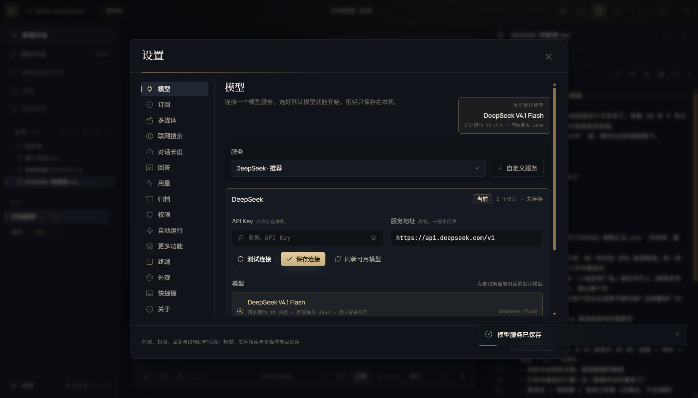
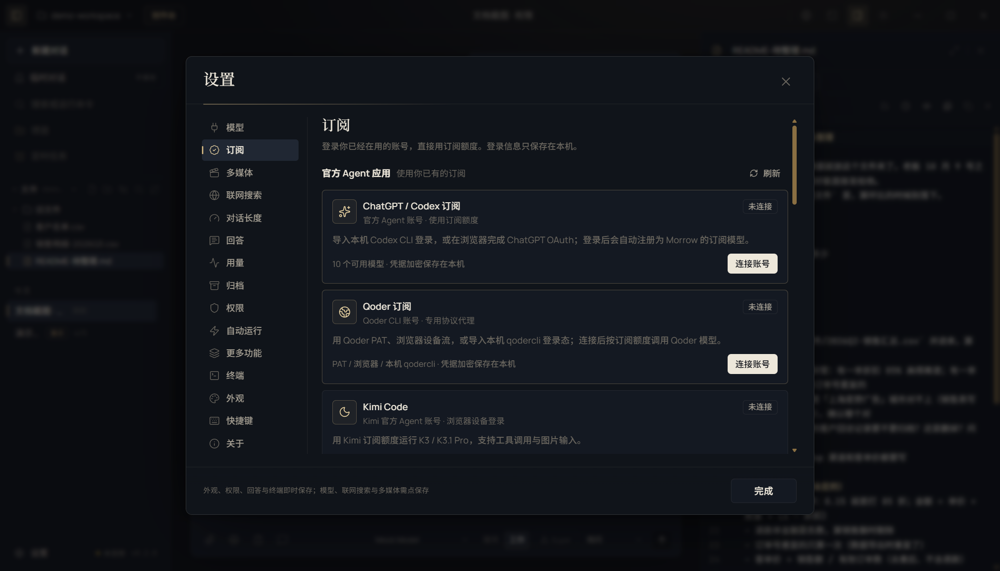

# 模型与订阅

> 本文为中文文档；英文概览见 [README.md](../README.md)。

Morrow 不自带模型。这一页说明三条接入路线、订阅渠道、上下文与思考档位怎么工作，以及哪些状态是“未验证”而不是“已支持”。

## 三条接入路线

| 路线 | 适合 | 入口 |
|---|---|---|
| OpenAI 兼容 API | DeepSeek、Kimi、Qwen、GLM、MiniMax、MiMo、xAI、OpenRouter，或任意兼容网关 | 设置 → 模型 → 添加服务 |
| Anthropic 原生 | Claude 系列 API | 设置 → 模型，协议选 Anthropic Messages |
| 订阅账号 | 已有 ChatGPT / Codex、Kimi Code、GLM Coding Plan 等订阅 | 设置 → 订阅 |
| 本机模型 | Ollama、llama.cpp、LM Studio | 设置 → 本地 |
| 演示引擎 | 离线演示与测试 | 首次引导或输入框模型菜单 |

内置的 `demo` 引擎不消耗额度，只用于演示与测试，不会冒充真实模型。

## 连接一个 API 服务

1. 打开“设置 → 模型”，选择服务商或“自定义服务”。
2. 填 API Key、Base URL 与模型 ID；点“测试连接”会发真实请求，失败时显示 HTTP 状态与可读原因。
3. 保存后，在模型列表里点一个模型作为当前对话模型。

每个模型行右侧的齿轮是完整模型设置：

- **上下文窗口**：128K / 200K / 256K / 400K / 512K / 1M 快捷档，也可手填任意 tokens。
- **最大输出**：32K / 64K / 128K / 256K / 384K。
- **思考强度**：是否启用，`reasoning_effort` 与 `thinking budget` 两种映射，以及该模型真实接受的档位。
- **图片输入与工具调用**：按模型实际能力勾选。

服务卡片底部的“连接与重试”可切换 OpenAI 兼容 / Anthropic Messages 协议，并设置重试次数与退避毫秒。`0` 表示不重试；4xx（429 除外）、主动中断与结构化输出拒绝不会重试。

网关不声明上下文元数据时，Morrow 按已知模型家族兜底（例如 DeepSeek V4 为 1M 上下文 / 384K 输出）；本机服务不做家族猜测。手动编辑过的长度会带 `contextEdited` / `maxOutputEdited` 标记，刷新模型列表不会覆盖。

## 订阅渠道

| 渠道 | 主要接入方式 | 说明 |
|---|---|---|
| ChatGPT / Codex | 本机导入 / OAuth / 用量接口 | 支持账号模型目录与额度读取 |
| Qoder | 账号模型目录 | 有实现，但本机未完成登录实测 |
| Kimi Code | 登录页 / 协议实现 | 以官方渠道为准 |
| GLM Coding Plan | 中国区 / 国际区 | 区分 z.ai 与 bigmodel.cn |
| MiniMax Code | 中国区 / 国际区 | 区分 minimax.cn 与 minimax.io |
| Step Plan | 中国区 / 国际区 / 开放平台 Key | 以官方渠道为准 |
| Command Code | Claude / 通用模型目录 | 使用订阅 Key |
| Cline Pass | API Key | 账号信息按 token 读取 |
| OpenCode | OpenCode Zen API Key | 模型目录以服务商为准 |
| Google Antigravity | OAuth | 不内置 OAuth secret；需设置 `MORROW_ANTIGRAVITY_CLIENT_SECRET` |
| OpenDesign Cloud | API Key + 模型目录 | 额度在 Cloud 控制台查看；上下文长度按模型调整 |

订阅渠道的模型同样可以调上下文档位（25% / 50% / 100%；1M 及以上按 200K / 400K / 1M），并在订阅详情里调整最大输出（32K / 64K / 128K，1M 上下文模型追加 256K）。重新登录或恢复订阅后，这些选择会保留。

边界：

- 登录态与额度由服务商决定；Morrow 不伪造已连接、额度或用例。
- 未完成本机实测的渠道会明确标注，不把“已实现登录页”当成“已连通”。
- 不提供 Claude 账号登录，只接 API Key 或订阅协议。
- 订阅渠道的协议可能随服务商变化；失败时按提示重新登录，或改用普通 API。

## 本机模型

设置 → 本地集中管理所有本地服务：

- Ollama、llama.cpp、LM Studio 以 OpenAI 兼容地址接入，不会出现在云端服务选择器里。
- 本机服务不参与模型家族的长度猜测；上下文与输出由你手填。
- 本机模型可以作为对话模型，也可以作为媒体审看的回退引擎（见 [MEDIA.md](MEDIA.md)）。

## 上下文、输出与思考

- 上下文按“完整窗口的百分比”选择；选择后新对话默认使用该长度，输入框还能再单独调整。
- 自动压缩在接近上限时触发，保留最近用户消息、关键事实、工具结果与任务约束；压缩后仍校验工具配对。
- 思考强度只列模型真实支持的档位；未知模型只保留“自动”，不支持时显示“不支持思考”。
- 断流时：已有正文则断点续接；只有思考没有正文则重发原请求；空闲超时标记为可重试；重试耗尽会给出明确错误。

## 常见问题

| 现象 | 处理 |
|---|---|
| 模型下拉为空 | 先保存服务并测试连接；订阅渠道在“订阅”页登录后才出现模型 |
| 测试连接失败 | 检查 Base URL、Key、模型 ID 与网络；错误会带 HTTP 状态 |
| 回复被截断 | 调大该模型的最大输出后重试；订阅模型在订阅详情里改 |
| 没有思考强度 | 该模型不支持，或网关未声明；换支持思考的模型 |
| 订阅恢复后设置丢了 | 上下文档位与最大输出应保留；确认是在同一渠道同一模型上调整 |

更多现象见 [TROUBLESHOOTING.md](TROUBLESHOOTING.md#模型与连接)。