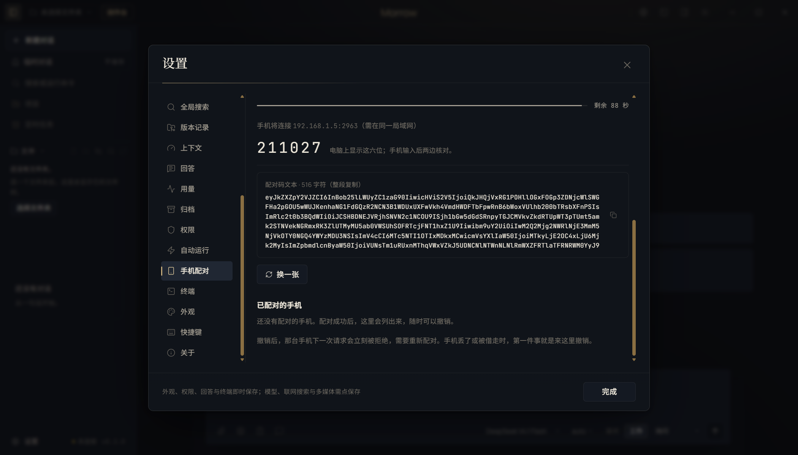
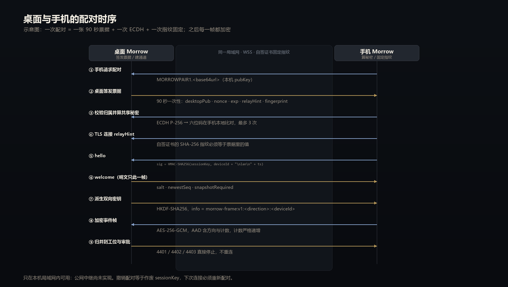

# 配对：让手机连上这台电脑

配对要解决两件事：让手机确认对面真的是你那台电脑，让桌面确认这台手机有资格发指令与批权限。Morrow 的做法是复制一段配对请求、生成一张 90 秒的一次性票据、再人工比对六位码；没有扫码，也没有账号登录。

这一篇讲桌面怎么开通道、手机怎么走完流程、六位码与证书指纹各挡什么，以及为什么只有同一局域网可用。手机端页面本身的功能与边界在安卓仓库的文档里：<https://github.com/youyuwangzi0001/Morrow-Android>。

**当前状态**：0.2.0 的两个产物都能参与这条链路——APK 已声明 `android.permission.INTERNET`，桌面面板签发票据时会自动补上局域网地址（`relayHint`），缺地址时面板当场说明原因。整条路径在同局域网内可用，但只在模拟器联调中跑通过，没有真机证据。

这是桌面端的配对面板；截图来自测试模式与内置演示工作区，界面与发布版一致。

## 它是怎么连上的

一次成功配对可以拆成九步。桌面与手机各做一半，中间靠你搬两段文本。

1. 桌面打开“设置 → 手机配对”，开启“远程通道”。通道默认关闭；关闭时不会监听端口。
2. 手机打开配对页，复制以 `MORROWPAIR1.` 开头的配对请求。它包含这台手机的设备标识与长期公钥。
3. 把请求粘到桌面，点“生成配对码”。桌面签发票据，显示六位码和一段可复制的票据文本。
4. 手机粘贴票据文本，解析出 `deviceId`、`desktopPub`、`nonce`、`exp`、`relayHint` 与 `fingerprint`，并校验票据是否属于本机。
5. 两端各自用 ECDH 共享秘密派生六位码；你输入电脑上显示的六位码，两边比对。
6. 比对通过后，这张票据立即标记为已用，同一张票再提交会被拒绝。
7. 手机把会话密钥与证书指纹存进 Keystore，配对凭据落盘。
8. 手机用 WSS 连桌面，握手时比对固定的证书指纹。
9. 之后每一帧用 HKDF 派生的密钥加密，计数防重放；收到 4401、4402 或 4403 会直接断开且不自动重连。

示意图：从桌面开通道到手机保存凭据的九步时序，包含 90 秒一次性票据、ECDH P-256、证书指纹固定、HKDF-SHA256 与 AES-256-GCM。它不是界面截图。

没有扫码，是因为手机端没有相机依赖；扫码与粘贴在协议里走同一条解析路径，差别只在票据怎么进入手机。桌面也不显示二维码图片，只显示可复制的文本。

## 桌面端开启通道

入口是“设置 → 手机配对”，不是“设置 → 远程”或标题栏。面板从上到下是通道开关、第一步粘贴请求、第二步配对码、已配对的手机。

| 控件 | 作用 | 默认值 |
|---|---|---|
| 远程通道 | 开启后桌面才接受手机连接；关闭时端口不保留 | 关闭 |
| 端口 | 0 表示由系统分配，启动后读回真实端口 | 0 |
| 配对请求输入框 | 粘贴手机复制来的 `MORROWPAIR1.` 文本 | 空 |
| 生成配对码 | 校验请求、签发 90 秒票据 | 不可用，直到请求合法 |
| 已配对手机 | 列出设备名与配对时间，可撤销 | 空 |

端口填 0 是有意的：固定端口容易和本机其他服务撞车，也会把攻击面固化。实际监听端口在启动后由系统分配。手机要连的地址来自票据的 `relayHint` 字段；这个字段缺失时，手机会明确拒绝保存，不会猜一个地址去连。

“已配对的手机”列表显示设备名与配对时间；设备没起名字时显示 `deviceId`，不会留一行空白。读取列表时先显示“正在读取”，读取失败就显示错误，不会把“还不知道”写成“没有设备”。撤销前会弹一句确认，明确告诉你那台手机下一次请求会立刻被拒绝。

通道关闭时点“生成配对码”会明确报“远程通道没有开启”，不会临时起一个只活在内存里的服务。这个设计避免“配上了却永远连不上”：配对服务与监听端口必须同时存在。

如果局域网直连起不来（证书生成失败或端口被占），票据会缺少证书指纹，面板会当场提示。手机侧会拒绝完成配对，而不是存一份没有指纹的凭据。

## 在手机上完成配对

手机端的入口在工位页：未配对时标题行右侧有“去配对”。配对页只有两步，顺序不能反。

1. 点“复制配对请求”，把 `MORROWPAIR1.` 开头的文本发到电脑。聊天工具、便签、数据线都行。
2. 在电脑上粘贴并点“生成配对码”，记下六位数字，复制“配对码文本”。
3. 回到手机，把配对码文本粘进输入框，点“下一步”。
4. 页面显示剩余秒数与“输入六位码”，输入电脑上的六位数字，点“确认”。
5. 看到“配对成功”后回到工位页；手机随后尝试连接，状态从“未配对”变成“连接中”，连上后才是“在线”。

六位码输错会当场提示，并显示还可以试几次；连续错 3 次，这张票据作废，必须回电脑重新生成。手机本地就能判断对错，因为两端用同一个 ECDH 共享秘密派生六位码；本地比对通过不等于配对完成，桌面仍要校验票据状态。

票据只有 90 秒。剩余 15 秒时界面转成提醒色；过期后配对码会被藏起来，避免你拿一张废票反复试。重新生成会得到新的 `nonce` 与新的六位码。

配对失败时从第 2 步重来，不要卸载重装。错码、过期与“票据属于另一台手机”都是票据层的问题，重装应用只会丢掉已有凭据，让本来能用的设备也回到未配对。

## 六位码与证书指纹

两样东西经常被混为一谈，但它们挡的攻击不同。

| 机制 | 挡什么 | 失败时你会看到 |
|---|---|---|
| 六位码 | 中间人替换公钥、票据被掉包 | “六位码不对”，3 次后票据作废 |
| 证书指纹 | 连到冒充的桌面、证书被换 | “证书指纹不匹配”，连接被拒绝 |

六位码不是随机数，而是用 `ECDH(手机私钥, 桌面公钥)` 的共享秘密对 `nonce` 做 HMAC 后取六位。两端各自算，算出来一样才说明双方看到的公钥没有被替换。它只有一百万种可能，所以必须限制尝试次数，并且票据一次性。

证书指纹是桌面自签证书的 `base64url(sha256(DER))`。自签证书没有可信链，链验证必然失败，唯一正确的做法是配对时把指纹记下来，之后每次握手比对。指纹放在票据的 `fingerprint` 字段里；缺失时手机拒绝完成配对，因为存一份没有指纹的凭据只会让下次连接报“配对失效”。

指纹比对不是证书链验证。它不证明“这张证书由某个 CA 签发”，只证明“这张证书和配对时那张是同一张”。对局域网自签场景，这已经足够；跨网络场景不适用，也没有实现。

## 局域网范围

通道只在同一局域网内可用。桌面起一条 WSS 直连，手机连的是这台电脑在局域网里的地址；两台设备要在同一个路由器或交换机下，能互相访问对方的端口。

公网中继是占位实现，没有承载过手机流量。它不会把连接带出局域网，也不能让手机在移动网络下连回家里的电脑。不要把它当远程办公方案，也不要为了“让外网能连”去改端口映射或关防火墙。

配对码不是网络通行证。它只证明这台手机被这台电脑接受，不改变两台设备在网络上的可达性；端口不通、网段不同或防火墙拦着时，配对走得再顺也连不上。

“同一局域网”还要满足几条常见条件：

- 没有开启 VPN 或代理，否则流量会绕到别的出口。
- 路由器没有开启 AP 隔离或客户端隔离，否则两台设备互相不可见。
- Windows 把当前网络视为“专用网络”，防火墙允许 Morrow 的入站连接。
- 桌面通道开着，且端口没有被其他程序占用；端口填 0 时以面板显示的实际值为准。

跨网段、跨 VLAN、手机热点与电脑不在同一子网，都会表现为连不上或连上后立刻断。这类问题不是配对码的错，重新生成多少次都不会好。本轮也没有真机证据：配对状态机与信道有单元测试，但没有在真机上跑通整条链路的记录。

要确认桌面地址，在电脑上执行 `ipconfig`，找当前网卡的 IPv4 地址；手机连的必须是这个地址所在的网段。端口以配对面板显示的实际值为准，不要照抄示例里的数字。Windows 防火墙第一次弹询问时选“允许访问”，并确认勾选的是专用网络。

## 断开与撤销

断开有三种常见来源：手机关屏或切后台、桌面关闭通道、网络切换。前两种会在回到前台或重新开通道后重连；第三种要等网络恢复。

撤销是单方面的：在桌面“已配对的手机”里点“撤销”，那台手机的下一次请求会立刻被拒绝，不需要等它重连。撤销会同时删除设备表里的会话密钥并落盘，重启后不会复活。撤销后要重新配对，旧票据不会因为撤销而复活。

手机丢了或借给别人时，第一件事是回桌面撤销，而不是改 Wi-Fi 密码。撤销只影响这一台设备，其他已配对设备继续可用。

连接被关闭时使用三个专用关闭码，收到后不自动重连：4401 表示未授权（没通过 hello 校验或协议版本不对），4402 表示帧被篡改（GCM 认证失败），4403 表示重放（计数不新于已见）。看到这三种，回桌面检查设备是否已被撤销，再重新配对。

## 故障排查

| 现象 | 先看什么 | 怎么处理 |
|---|---|---|
| 桌面点“生成配对码”没反应 | 远程通道是否打开 | 打开开关；关闭状态下这个按钮按设计不可用 |
| 手机粘贴后说请求格式不对 | 是否复制完整、是否粘成了配对码 | 重新复制整段 `MORROWPAIR1.`；把配对码粘到手机，不要粘回电脑 |
| 提示配对码过期 | 是否超过 90 秒 | 回桌面重新生成，用新码重走第 3 步 |
| 六位码总是不对 | 是否用了上一张票据的码 | 重新生成后核对新的六位码；错 3 次票据作废 |
| 提示票据属于另一台手机 | 请求是否是这台手机复制的那份 | 在手机上重新复制请求，让桌面重新签发 |
| 提示缺证书指纹 | 局域网直连是否起来 | 查端口占用与防火墙；局域网起不来时手机按设计拒绝 |
| 提示配对码里没有中继地址 | 票据是否缺少 `relayHint` | 面板会自动补局域网地址；仍然缺就说明本机没有可用的局域网网卡，先修网络再重新生成 |
| 手机连不上且没有任何网络请求 | 手机是否装了最新 APK | 到 [Morrow-Android](https://github.com/youyuwangzi0001/Morrow-Android/releases) 取最新包；旧包里缺 `INTERNET` 权限，发不出连接请求 |
| 提示指纹不匹配 | 是否换过电脑、重装过或换过数据目录 | 撤销旧设备后重新配对；不要忽略该提示继续连 |
| 通道开着仍连不上 | 是否同一网段、是否开 VPN 或 AP 隔离 | 关 VPN，确认同一子网，防火墙放行 Morrow |
| 端口被占用 | 端口是否填了固定值 | 把端口改回 0，让系统重新分配 |
| 撤销后仍提示在线 | 界面是否还在旧状态 | 回工位页刷新；下一次请求会被拒绝，连接随后断开 |

更多桌面侧现象见 [TROUBLESHOOTING.md](TROUBLESHOOTING.md)。

## 协议与安全细节

票据是一段 base64url 编码的 JSON，字段固定，不含私钥。手机解析后先校验 `exp` 与 `pubKey` 归属，再算密钥。

| 字段 | 含义 |
|---|---|
| `deviceId` | 手机侧稳定设备标识 |
| `pubKey` | 手机的 P-256 长期公钥，65 字节未压缩点 |
| `desktopPub` | 桌面的 P-256 长期公钥，手机用它算 ECDH |
| `nonce` | 一次性随机数，十六进制，16 字节 |
| `exp` | 过期时间戳，签发时加 90 秒 |
| `relayHint` | 手机该连的地址与端口 |
| `fingerprint` | 桌面 TLS 证书指纹，缺失时手机拒绝完成配对 |

票据是一次性的：配对成功后立即作废；同一张票再用会报“已使用”，而不是“已过期”。这个区别是有意的，前者是重复使用或重放的信号，后者只说明你来晚了一步。

密钥协商与信道加密分三层：

1. 配对阶段用 ECDH P-256 得到共享秘密，再用 HMAC-SHA256 派生六位码；六位码只用于人工比对。
2. 会话密钥经 HKDF-SHA256 做域分离，得到收发两个方向的密钥；方向不同，密钥不同。
3. 每帧用 AES-256-GCM 加密，认证数据绑定方向、`deviceId`、连接盐与单调计数；计数不新于已见值即拒绝重放。

应用层还有一层请求签名：手机用会话密钥对 `deviceId`、通道名与时间戳做 HMAC-SHA256，桌面按同一算法复算，时间窗 60 秒。这样即使有人拿到 `deviceId`，也不能只靠明文头冒充设备。

桌面长期私钥与设备表都用 Windows DPAPI 加密后落盘，位置在数据目录的 `relay/` 下：`desktop-key.bin`、`devices.bin`；审计日志是 `relay/audit.jsonl`，只记通道、结果、耗时与参数结构，不记参数值。加密不可用时桌面拒绝持久化，退化为本次运行内有效，不会写明文。

手机端把凭据存进 Keystore 加密文件，退出应用不丢；卸载应用或清除数据会删除凭据，需要重新配对。桌面端删掉 `relay/devices.bin` 或换掉数据目录，效果等同于撤销全部设备；不要用这种方式代替逐台撤销，它不会给你确认机会。