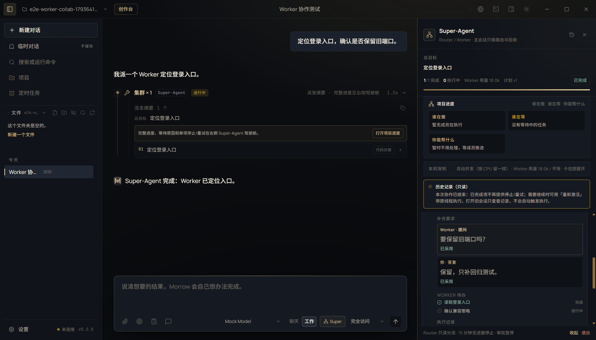
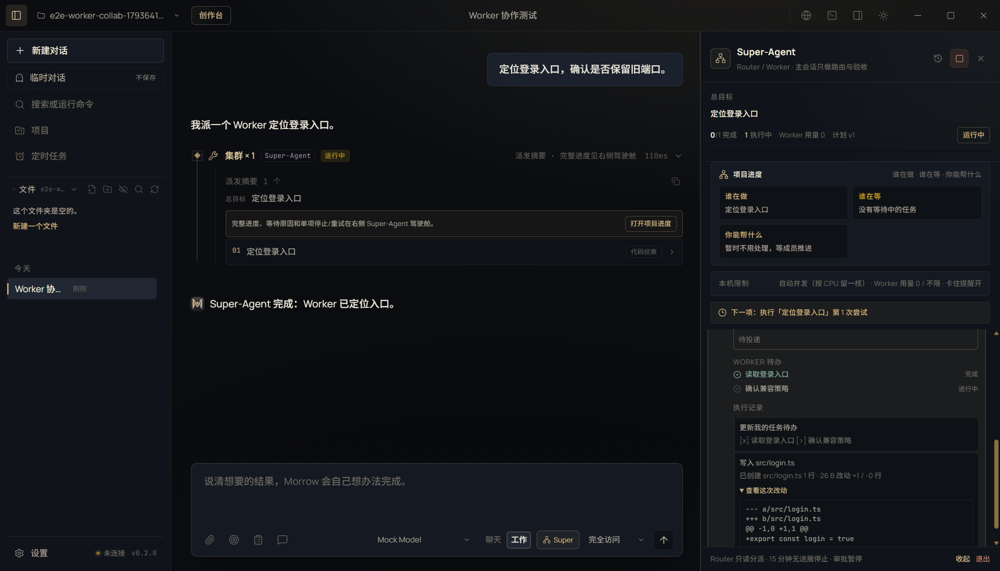

# 子智能体协作升级 · 双向消息、重新激活与共享工作区

- 关联任务卡：T01 并行工具执行引擎、T02 Swarm 真并行派工（在原实现上继续升级）
- 完成时间：2026-11-02
- 核心文件：`src/core/agent.ts`、`src/core/tool-extra.ts`、`src/core/types.ts`、`src/main/collaboration.ts`、`src/main/agent.ts`、`src/renderer/features/superagent.tsx`
- 证据：[REPAIR-SUBAGENT-COLLAB-evidence.json](REPAIR-SUBAGENT-COLLAB-evidence.json)

## 现状与补强

### 原本已经具备

- T01：只读工具按批次并行执行，写操作有屏障，同批最多 4 个。
- T02：`swarm` 按 DAG 并行派发 Worker；Worker 与主对话使用同一套工具和权限链，审批回到主界面；只排除 `swarm / update_goal / todo_write`，防止嵌套派工和改坏父目标。
- 用户补充要求可以在 Worker 的安全步投递。

### 本次补强

#### 1. 真正双向的消息

协作消息现在区分：

- `direction`：`main`（用户/主代理）或 `worker`（子智能体）；
- `kind`：`directive`（补充要求）、`note`（进展汇报）、`question`（提问）、`answer`（答复）；
- `replyTo` 把答复关联回原问题。

Worker 新增两个工具：

- `worker_message`：主动向主代理汇报中间结论、风险或进度，立即送达；
- `worker_ask`：向主代理提问并等待答复，最多等 10 分钟；超时或取消后继续执行，不会把整个线程卡死。

主代理驾驶舱里可以直接看到 Worker 提问、点击「答复」并发送；答复会即时送达正在等待的 Worker。主代理也能继续发送补充要求，Worker 在下一个安全步读取。

#### 2. Worker 自管待办

新增 `worker_todo_write`：

- 只更新当前 Worker 自己的待办，不碰主任务计划面板；
- 实时显示在任务卡片的「Worker 待办」区域；
- 完成、进行中、待办三种状态；任务结束后随线程保留。

#### 3. 带上下文重新激活

已完成、失败、阻塞或取消的 Worker 可以「重新激活」：

- 保留原 `taskId`、尝试历史、自管待办和压缩后的对话线程；
- 追加一条新指令后继续执行，不必重跑其他已完成任务；
- 线程只保留可展示的用户/助手文本（最多 24 条、每条 1200 字），不保存隐藏推理和完整工具参数。

#### 4. 共享工作区与实时改动审阅

- 普通工作会话的多个 Worker 共享同一个工作区；调度器按任务声明的 `files` 加文件租约，同一文件同一时间只允许一个 Worker 写入；不同文件仍可真正并行启动。
- 每次写文件/编辑后，操作记录会带上 diff 预览；驾驶舱任务详情里可以展开「查看这次改动」，主代理不用等整个任务结束就能审阅。
- Super-Agent 仍默认给 Worker 独立工作副本，diff 同样实时可见，合并/冲突仍走原有候选版本和验收流程。

截图：

- 双向消息、答复和 Worker 待办：
- 实时改动预览：

## 验证

```bash
npm run typecheck
npm run test:unit                    # 486 passed（新增 6 项 Worker 协作/租约测试）
npm run test:suite                   # 486 unit / 77 e2e
npx playwright test tests/e2e/ui.spec.ts -g "Worker 可向主代理提问"  # 1 passed
```

单元覆盖：

- 消息方向/类型/答复关联与安全步投递过滤；
- Worker 提问等待主代理答复并标记已采用；
- `worker_message`、`worker_ask`、`worker_todo_write`；
- 重新激活时把原线程与新指令交给 Worker；
- 同一文件的两个 Worker 串行、不同文件并行启动。

Electron 覆盖：

- Worker 主动提问，主代理在驾驶舱答复；
- Worker 待办实时显示；
- Worker 写文件后实时出现 diff 预览；
- 任务结束后带原线程重新激活，出现第 2 次尝试并完成。

## 任务卡操作区修正（2026-11-03）

失败任务的右侧本来就有三个独立动作：单独重试、带原线程重新激活、失败追溯。之前重试和重新激活共用 `.super-task-retry`，且都被绝对定位到 `top:8px; right:8px`，视觉上叠成一个按钮。

现在：

- 任务头和操作按钮放进 `.super-task-top`，按钮统一在 `.super-task-actions` 内并排；
- 重新激活使用独立类 `.super-task-reactivate`，不再和重试混淆；
- 运行中只显示停止；已完成只显示重新激活；失败/阻塞按需显示重试、重新激活与失败追溯；
- E2E 断言重试与重新激活的水平位置不同，防止再次重叠。

## 已知边界

- 文件租约只覆盖 Worker 在 `swarm` 计划里声明的 `files`；模型若绕过声明写其他文件，仍可能与其他 Worker 竞争。正常流程要求写文件必须列进计划。
- Super-Agent 的 Worker 仍在独立副本里工作，主文件只在合并/验收后更新；这样能避免未审阅的写入直接污染主工作区。
- 重新激活保留的是压缩文本线程，不是完整隐藏推理；足够继续工作，但不等于逐 token 恢复模型内部状态。
- Worker 仍不能启动新的 Worker，也不能修改父任务目标；这是为了避免无限嵌套和越权改目标。
