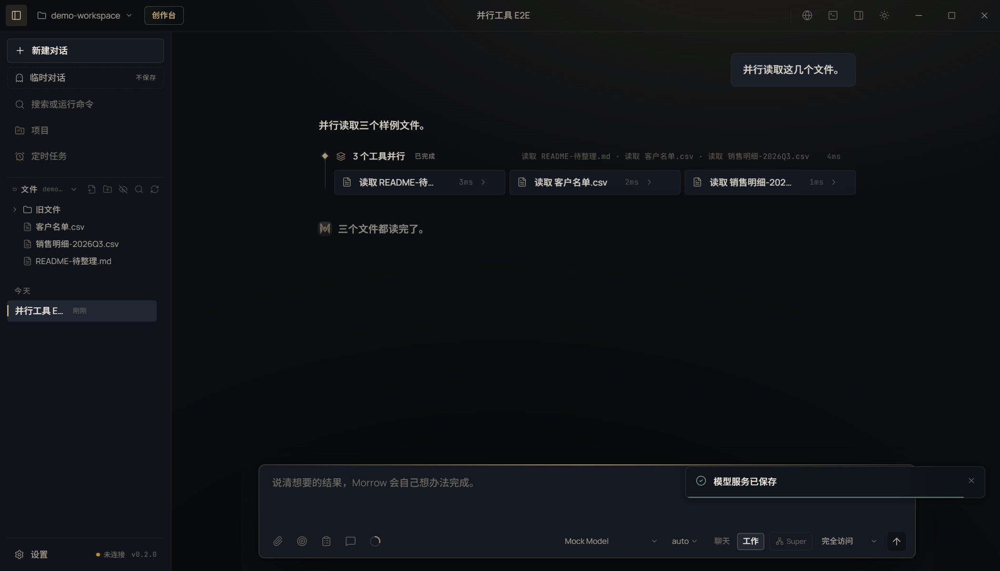

# T01 交接记录 · 并行工具执行引擎

- 任务卡：T01（P0 · Agent 内核）
- 完成时间：2026-11-02
- 起始版本：Morrow `0.2.0`，提交 `c6c7de2`
- 核心文件：`src/core/agent.ts`、`src/shared/types.ts`、`src/renderer/features/activity.tsx`、`src/renderer/features/activity.css`
- 证据：[REPAIR-T01-evidence.json](REPAIR-T01-evidence.json)

## 现在怎么并行

- 同一条助手消息里的工具调用按顺序分段：**连续只读工具**组成一个并行批次，写文件、命令、MCP、桌面操作、提问卡按原顺序串行。
- 只读白名单：`read_file`、`read_pdf`、`read_docx`、`read_xlsx`、`read_pptx`、`list_dir`、`glob`、`grep`、`list_skills`、`read_skill`、`browser_read`、`web_fetch`。
- 每批最多 **4** 个并发，避免一次打开过多文件或网络请求。
- 写入是屏障：例如「读 A、读 B、写 C、读 C」，会先并行读完 A/B，再写 C，最后读 C；写操作不会和读操作抢同一路径。
- 权限审批仍走原来的串行队列；并行只读调用不会同时弹多张审批卡。
- 中断信号在每个工具执行前检查；未完成的调用统一标记为 `interrupted`，不会留下悬空工具结果。

## 界面

截图：

- 同一批只读工具显示为一个「N 个工具并行」组，组头有状态、总耗时和工具名摘要。
- 组内每个工具是一张小卡，保留独立状态、耗时和展开详情；失败卡仍显示原有锈红提示。
- 组头可折叠为一行摘要，再点开恢复；窄窗下卡片自动换行。
- 中断时组头变为「已中断 / 部分中断」，各分支同步灰态，不逐个标红。

## 验证

```bash
npm run typecheck
npx vitest run tests/unit/tool-parallel.test.ts   # 2 passed
npx playwright test tests/e2e/ui.spec.ts -g "并行只读工具并排展示"  # 1 passed
npx vitest run                                    # 452 passed
node scripts/check-test-suite.mjs                 # 452 unit / 69 e2e
```

单测覆盖：

1. 连续 3 个 `read_file` 共享同一个 `parallelGroup`，3 个 `tool_started` 都发生在首个 `tool_finished` 之前。
2. 「读 A、读 B、写 C、读 C」写入屏障成立；读 C 能读到刚写入的 C，且只有 A/B 带并行组标记。

## 已知边界

- 并行白名单是保守集合；MCP、媒体生成、电脑操作等即使只读也不并行，避免隐式副作用和资源争用。
- 并发上限固定为 4；后续如需按模型/网络能力调节，可再抽成配置。
- 不把「并行」当成真实提速结论：单测验证的是启动/屏障顺序，真实耗时仍取决于工具和模型。
- 同一批只读工具如果读取同一个正在被外部程序改写的文件，仍可能读到不同版本；写入屏障只约束本消息内的写调用。
