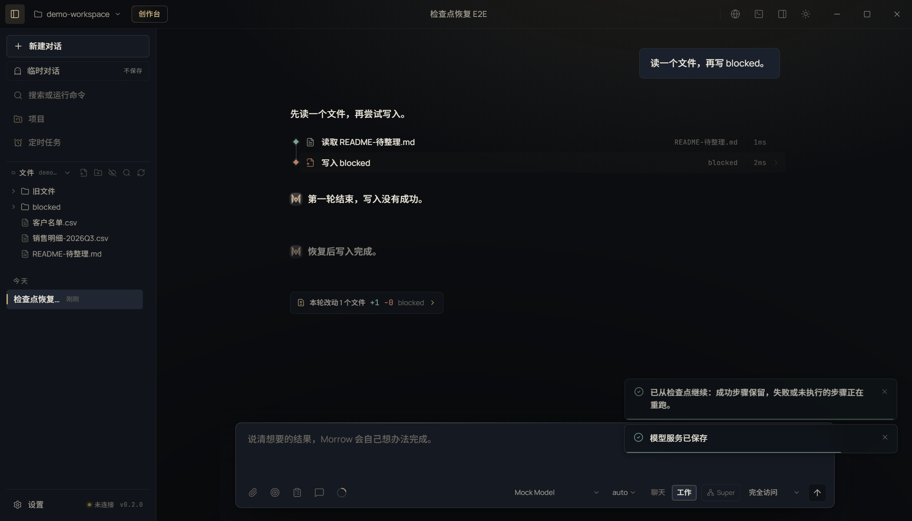

# T04 交接记录 · Checkpoint 断点重放

- 任务卡：T04（P0 · 会话/可靠性）
- 完成时间：2026-11-02
- 起始版本：Morrow `0.2.0`，提交 `c6c7de2`
- 核心文件：`src/shared/checkpoint.ts`、`src/shared/types.ts`、`src/core/agent.ts`、`src/main/session.ts`、`src/main/agent.ts`、`src/main/ipc.ts`、`src/preload/index.ts`、`src/shared/contracts.ts`、`src/renderer/features/checkpoints.tsx`
- 证据：[REPAIR-T04-evidence.json](REPAIR-T04-evidence.json)

## 现在怎么恢复

1. 打开任意一轮的「回退」面板；面板下方新增「从检查点继续」。
2. 先给出预览：
   - **跳过**：上次已成功、且写入文件哈希仍一致的步骤；
   - **重跑**：上次失败、中断或没有拿到结果的步骤；
   - **保持拒绝**：用户上次明确拒绝的步骤，不自动重试；
   - **冲突**：上次成功写入的文件后来被外部修改，阻止恢复，避免覆盖用户改动。
3. 确认后只重跑失败/未执行步骤；成功步骤保留原结果。模型在下一步能看到这些结果，不需要从头再来。
4. 重跑仍走当前权限模式与审批链，不复用旧的「始终允许」授权；不会扩大任何文件或命令权限。

截图：

## 恢复分类

| 上次状态 | 恢复动作 |
|---|---|
| `ok=true` 且文件哈希未变 | 跳过，保留结果 |
| `ok=false` | 重跑 |
| 中断/没有结果 | 重跑 |
| 用户拒绝 | 保持拒绝，不自动重试 |
| 成功写入后文件被外部修改/删除 | 冲突，阻止恢复 |

## 验证

```bash
npm run typecheck
npx vitest run tests/unit/checkpoint-replay.test.ts       # 3 passed
npx playwright test tests/e2e/ui.spec.ts -g "检查点恢复只重跑失败步骤"  # 1 passed
npx vitest run                                             # 455 passed
node scripts/check-test-suite.mjs                          # 455 unit / 70 e2e
```

单元用例覆盖：

1. 成功、失败、未执行、拒绝四种分类。
2. 成功写入被外部修改时进入冲突，不直接跳过。
3. `runAgent` 只重跑失败/未执行步骤：成功的 kept.txt 不动，失败的 retry.txt 写入成功，缺失的读取拿到结果；模型只看到一次新请求，且请求历史里已有重跑后的结果。

Electron 用例：

- 第一轮读取成功、写入因目标是文件夹而失败；
- 删除文件夹后打开检查点，预览显示「跳过 1 / 重跑 1」；
- 点击「重跑未完成步骤」后只出现一次写入工具事件，写入成功，读取没有重跑。

## 已知边界

- 只恢复最后一轮带工具调用的助手消息；更早的成功步骤作为历史保留，不会重复执行。
- 成功写入的哈希核对只覆盖带 `absolutePath` + `afterHash` 的写入；命令、网络读取等没有文件指纹的步骤按结果成功跳过。
- 用户拒绝的步骤保持拒绝，恢复不会替用户改回允许。
- 如果检查点对应的用户消息已被压缩移除，不能恢复；需要从更新的检查点继续或只回退文件。
- 恢复会新开一轮运行并创建新的检查点；旧检查点保留，仍可在回退面板查看。
- 上一条回复的失败/成功状态会随重跑更新到原轨迹中，不会另造一份重复卡片。
