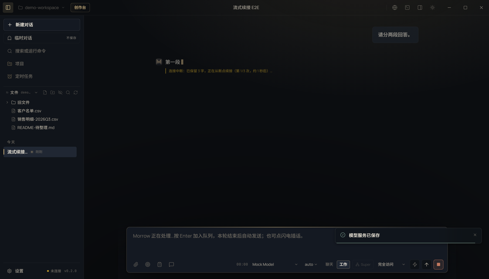

# T05 交接记录 · 流式中断续传

- 任务卡：T05（P0 · Provider）
- 完成时间：2026-11-02
- 起始版本：Morrow `0.2.0`，提交 `c6c7de2`
- 核心文件：`src/core/providers.ts`、`src/core/agent.ts`、`src/core/types.ts`、`src/shared/types.ts`、`src/renderer/store.ts`、`src/renderer/features/chat.tsx`、`src/renderer/features/chat.css`
- 证据：[REPAIR-T05-evidence.json](REPAIR-T05-evidence.json)

## 现在怎么续接

- 已经收到文字后连接中断，不再把整段回答丢掉，也不直接报错。
- **OpenAI 兼容接口**：把已收到的文本作为 assistant 前缀，再让模型接着写；新流开头如果重复了旧文本，按最长「旧文本后缀 / 新文本前缀」重叠去掉。
- **Anthropic**：使用 assistant 预填，模型从部分回复之后继续。
- 适用于 `incomplete_stream`、429、5xx、408 和网络错误；最多重试 3 次，每次间隔加 20% 抖动，避免多个 Worker 同时重连。
- 一开始就没有任何产出的空响应仍按原策略重试，不会误走续接。
- 已经产生工具调用的流不自动续接，避免重复执行工具；交给原有错误处理。
- UI 在流式文字下方显示「连接中断：已保留 X 字，正在从断点续接（第 N/3 次，约 X 秒后）…」；续接文字到达后提示自动消失，不再弹整段错误。

截图：

## 验证

```bash
npm run typecheck
npx vitest run tests/unit/provider-continuation.test.ts        # 3 passed
npx playwright test tests/e2e/ui.spec.ts -g "流式断流后保留已收文字"  # 1 passed
npx vitest run                                                  # 458 passed
node scripts/check-test-suite.mjs                               # 458 unit / 71 e2e
```

单元用例：

1. OpenAI 第一段后断流，第二段重复了第一段；最终输出只出现一次，并发出「已保留 3 字」提示；第二次请求包含 assistant 前缀和续写指令。
2. Anthropic 第一段后断流，第二次请求以 assistant 预填结尾，最终拼接为完整两段。
3. 开始即空响应仍走普通重试，不误判为断点续接。

Electron 用例：

- Mock 第一次只发「第一段」就断开，第二次延迟 2.5 秒再发「第二段」；
- 界面先显示「第一段」和续接状态，最终消息为「第一段第二段」。

## 已知边界

- 这不是协议级字节续传：OpenAI 兼容接口没有断点续传协议，续写依赖模型理解「接着写」指令；极少数模型可能改写措辞。
- 重叠去重只处理新流开头的重复；如果模型在中途重复整段，仍可能重复。
- 工具调用流不续接，避免同一写入/命令执行两次；这类失败保留原有错误，由 Agent 自修复或用户重试。
- 每次重连都是真实请求，用量会按实际请求累计；提示里的「已保留 X 字」只是已收到的正文长度，不代表计费。
- 429 的等待仍受模型服务返回与当前重试策略约束；不会无限重试。
