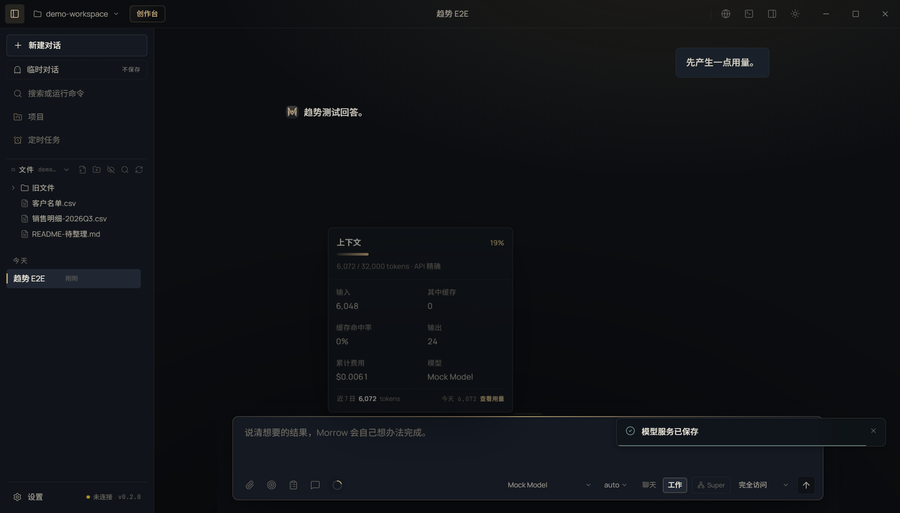

# T07 交接记录 · 用量历史趋势（轻量）

- 任务卡：T07（P1 · 界面）
- 完成时间：2026-11-02
- 起始版本：Morrow `0.2.0`，提交 `c6c7de2`
- 核心文件：`src/renderer/features/composer.tsx`、`src/renderer/features/composer.css`
- 证据：[REPAIR-T07-evidence.json](REPAIR-T07-evidence.json)

## 补了什么

上下文圆环弹出面板原本已有：占用百分比、已用/上限、输入、缓存、命中率、输出、累计费用、模型。本卡**不重复这些字段**，只在面板底部加一行：

> 近 7 日 6,072 tokens · 今天 6,072 · 查看用量

- 数字来自 `token-activity` 账本，跨会话累计。
- 点击整行打开「设置 → 用量」的按天用量页。
- 没有新增图表、没有第二个弹层、没有把已有字段再列一遍。
- 面板仍是随用随开；未打开时不额外请求账本。

截图：

## 验证

```bash
npm run typecheck
npx playwright test tests/e2e/ui.spec.ts -g "上下文面板底部显示近 7 日趋势"  # 1 passed
npx vitest run                                                  # 486 passed
node scripts/check-test-suite.mjs                               # 464 unit / 73 e2e
```

Electron 用例：

- 完成一次普通回答后打开上下文面板；
- 底部出现「近 7 日 / tokens / 今天 / 查看用量」；
- 点击后打开设置中的用量页，页面显示近 7 天汇总。

## 已知边界

- 这一行只显示 token，不显示金额：按天账本只记录 token；本次对话费用仍在面板上方「累计费用」里，避免用会话费用冒充跨天金额。
- 近 7 日按本地日期统计，包含服务商未返回 usage 时的本地估算。
- 趋势只在打开面板时拉取；对话结束后不会自动刷新历史，重新打开即可看到最新。
- 不铺图表；需要按天/周/累计查看时，点「查看用量」进完整页面。
