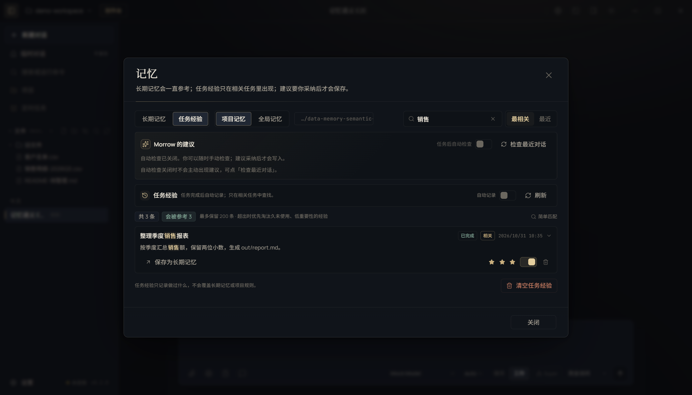

# T08 交接记录 · 语义记忆与向量检索

- 任务卡：T08（P1 · 记忆）
- 完成时间：2026-11-02
- 起始版本：Morrow `0.2.0`，提交 `c6c7de2`
- 核心文件：`src/main/memory.ts`、`src/main/embedding.ts`、`src/main/media.ts`、`src/renderer/features/memory.tsx`、`src/shared/memory-search.ts`
- 证据：[REPAIR-T08-evidence.json](REPAIR-T08-evidence.json)

## 补了什么

### 1. 本机嵌入模型 + 离线向量双通道

- 记忆语义检索复用 MediaCatalog 已登记的本机模型服务：llama.cpp、Ollama、LM Studio。
- 自动探测这些服务里是否有嵌入模型（`embed` / `bge` / `nomic` / `mxbai` / `text-embedding` / `e5` / `gte` 等），有则调用 `/embeddings` 或 `/api/embed`。
- 没有本机嵌入模型时，退回确定性的 256 维词面向量（字符二元组 + 字段哈希），完全离线、零额外下载。
- 向量索引是独立小文件：项目内 `.morrow/episode-vectors.json`，离线索引 `.morrow/episode-vectors-hash.json`；换模型会按模型重建，不会混用维度。
- 记忆页顶部显示当前索引来源：「语义索引 · 模型名」或「离线词面向量」。

### 2. 检索不再只看字面

- 任务经验检索从「直接 `includes` + 时间排序」改为混合评分：
  - 向量余弦相似度；
  - 精确词面命中（文件名、命令、专有名词）；
  - 重要性 1–3 星；
  - 时间衰减（最近用过的经验权重更高）。
- 注入仍然只取最相关的 1–2 条，并保持 token 预算截断。
- 被真正带进对话的经验会记录 `lastUsedAt` / `useCount`，用于后续衰减和淘汰；同一条经验 6 小时内不重复累加。
- 不相关的查询不再硬塞一条「最近的」经验；没有匹配就不注入。

### 3. 重要性、衰减、自动遗忘

- 长期记忆和任务经验都支持 1–3 星重要性；新建任务经验默认 1 星，用户可点星提升。
- 注入排序使用重要性 + 新鲜度；重要经验不会被时间衰减直接压没。
- 超出`最多保留`上限时，按「重要性 × 新鲜度 × 使用次数」淘汰，而不是简单丢掉最早的一条；3 星经验优先保留。
- 淘汰计数持久化，记忆页显示「已自动遗忘 N」。
- 说明：自动淘汰只在达到容量上限时发生，不会按时间静默删除用户数据。

### 4. 记忆页搜索与可读性

- 搜索框旁新增「相关度 / 时间」排序切换，带 `aria-pressed`。
- 支持语义向量搜索；命中片段高亮，并显示「匹配 N%」。
- 每条记忆 / 任务经验显示 1–3 星重要性，点击即可调整。
- 空结果明确区分：
  - 无记忆：「这个项目还没有记忆」/「还没有全局记忆」；
  - 无匹配：「没有匹配「xxx」的…」，并提供「清除搜索」。

截图：

## 验证

```bash
npm run typecheck
npm run test:unit                                      # 486 passed（新增 6 项语义记忆测试）
npm run test:suite                                     # 464 unit / 73 e2e
npx playwright test tests/e2e/ui.spec.ts -g "记忆中心支持相关度排序"   # 1 passed
npx playwright test tests/e2e/journey.spec.ts -g "强信号任务自动复盘"  # 1 passed
```

Electron 用例覆盖：

- 长期记忆无数据 / 搜索无匹配两种空状态；
- 任务经验列表显示 3 条、每条 3 颗星、当前索引来源；
- 默认「相关度」排序，3 星经验排在最前；
- 搜索「销售」只命中销售报表，命中片段高亮并显示匹配百分比；
- 切到「时间」排序后最新经验排在最前；
- 点第 3 颗星后写入磁盘，刷新后仍为 3 星；
- 搜索「火箭发射窗口」显示无匹配，清除后恢复 3 条。

## 已知边界

- 对话注入必须同步完成，使用离线词面向量，不等待本机模型；记忆页的「相关度」搜索会使用本机嵌入模型（如果已安装并运行）。两者共用同一套索引文件和评分口径，不会出现两个列表。
- 不会自动下载嵌入模型。用户需要先在 llama.cpp / Ollama / LM Studio 里装好并启动一个嵌入模型；没有模型时功能完整可用，只是退化为词面向量。
- 向量索引只保存向量和内容哈希，不保存原始对话；删除/清空经验后索引会在下次检索时清理孤儿项。
- 自动遗忘只在达到容量上限时触发；不按天数删除用户经验。
