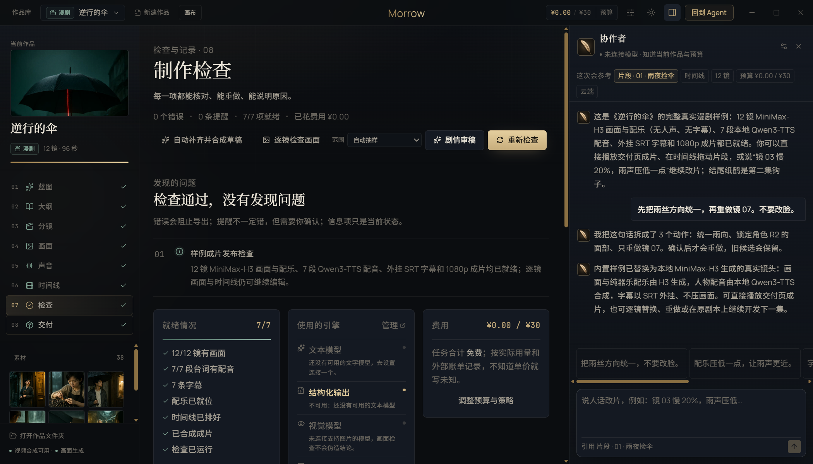

# T09 交接记录 · 响应级结构化输出

- 任务卡：T09（P1 · Provider）
- 完成时间：2026-11-02
- 起始版本：Morrow `0.2.0`，提交 `c6c7de2`
- 核心文件：`src/core/providers.ts`、`src/core/types.ts`、`src/main/studio.ts`、`src/shared/studio.ts`、`src/renderer/features/studio.tsx`
- 证据：[REPAIR-T09-evidence.json](REPAIR-T09-evidence.json)

## 补了什么

### 1. Provider 真正支持响应级结构化约束

- `ProviderStreamRequest` 新增 `responseFormat`：`name + JSON Schema + strict`。
- OpenAI 兼容接口：
  - 原生支持时发送 `response_format: { type: 'json_schema', json_schema: {...} }`；
  - 模型拒绝完整 Schema 时自动降级为 `{ type: 'json_object' }`；
  - 连 `response_format` 也不支持时再降级为提示词约束；
  - 每次降级都发出 `notice`，说明实际使用的模式和原因，不再静默假装成功。
- Anthropic：
  - 使用强制工具 `morrow_structured_output`，`tool_choice` 固定到该工具；
  - 把工具参数 JSON 转成普通文本增量交给上层，工具调用不会泄漏到 Studio 的工具循环；
  - 兼容端点不支持强制工具时自动降级为提示词约束并提示。
- 结构化请求不启用流式「断点续写」：避免把断开的 JSON 当前缀续写成更长的坏 JSON；失败由上层明确报错并拒绝写入残缺结果。

### 2. Studio 审稿接入真实 Schema

- 长篇审稿与漫剧剧情审稿传入 `studio_review` Schema：`summary + issues[level/title/detail/…]`。
- 其他结构化动作自动带一个宽松对象 Schema，至少保证返回合法 JSON 对象。
- 仍然保留原有的 `extractJson` 容错与「截断即拒绝写入」规则；Schema 是增强，不是唯一防线。

### 3. 检查页状态标

「制作检查 → 使用的引擎」新增「结构化输出」一行，按真实状态显示：

- `原生 Schema · 模型名`：实际使用了 JSON Schema；
- `已降级：JSON 对象模式 / 提示词约束`：模型能力不足，附原因；
- `不可用：还没有可用的文本模型`：没有配置模型；
- `自动探测`：尚未真正生成过，首次生成会尝试原生 Schema。

截图：

## 验证

```bash
npm run typecheck
npm run test:unit                    # 486 passed（新增 5 项结构化输出测试）
npm run test:suite                   # 486 unit / 77 e2e
npx playwright test tests/e2e/studio.spec.ts -g "入口、作品库、写作、分镜、时间线与交付的真实走查"  # 1 passed
```

单元用例覆盖：

- OpenAI 三档 `response_format` 写入；
- `json_schema` 被拒绝后自动降级为 JSON 对象，且第二次请求体确实改变；
- Anthropic 强制工具参数被转成 JSON 文本，不产生 tool_call 事件；
- 能力提示区分 OpenAI / Anthropic / DeepSeek / 自定义；
- 检查页文案覆盖原生、降级、不可用、待探测四种状态。

## 已知边界

- Schema 约束能减少字段漂移，但不能代替业务校验；例如镜号/章号仍会做范围核对。
- `strict` 默认 false，避免不同兼容层对 `additionalProperties` 的处理差异；需要严格模式时由调用方显式打开。
- 能力提示在首次生成前是推断值；检查页会明确标「自动探测」，真正的原生/降级状态以实际生成为准。
- 不支持 `response_format` 的模型仍可工作，但只能依赖提示词与后置解析；检查页会如实显示降级原因。
