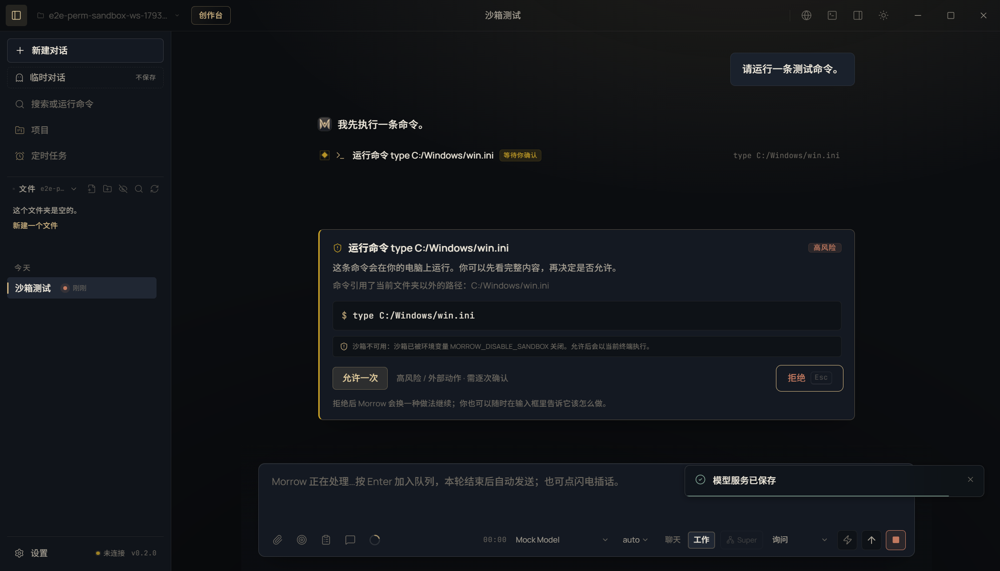

# T11 交接记录 · 命令执行沙箱

- 任务卡：T11（P1 · 安全）
- 完成时间：2026-11-02
- 起始版本：Morrow `0.2.0`，提交 `c6c7de2`
- 核心文件：`src/main/sandbox.ts`、`src/core/tool-media.ts`、`src/core/agent.ts`、`src/main/agent.ts`、`src/main/ipc.ts`、`src/renderer/features/activity.tsx`
- 证据：[REPAIR-T11-evidence.json](REPAIR-T11-evidence.json)

## 补了什么

### 1. 可选的 Docker 命令沙箱

- 启动时探测本机 Docker：需要守护进程可用、使用 Linux 容器、并且沙箱镜像已经存在。
- 默认镜像 `node:22-bookworm`，可用 `MORROW_SANDBOX_IMAGE` 覆盖；**不会自动拉取镜像**，避免偷偷下载几个 GB。
- 审批卡出现时提供「在沙箱中运行」复选：
  - 容器只挂载当前工作区到 `/workspace`；
  - `--network none` 默认断网；
  - `--cap-drop ALL`、`no-new-privileges`、2GB 内存、2 CPU、256 进程上限；
  - 命令在容器内用 POSIX `sh` 执行。
- 沙箱不可用时（没有 Docker、守护进程未启动、Windows 容器、镜像未就绪）审批卡如实显示原因，不提供假复选，也不假装命令已隔离。

### 2. 审批与执行链路

- `PermissionRequest` 增加沙箱能力、镜像和建议预选；`PermissionResponse` 记录用户是否选择沙箱。
- 只有用户明确勾选且沙箱当时可用时，`ToolContext.sandbox` 才会被设置；命令执行层据此改用 Docker，不会静默降级。
- 沙箱启动失败时直接返回错误，命令不在宿主机重跑；提示用户取消沙箱后重试。
- 工具审计记录 `sandbox: true`，便于事后核对哪些命令在容器内执行。

### 3. 审批卡焦点与降级提示

- 审批卡出现时焦点默认落在「拒绝」，危险动作不会被 Enter 误放行。
- 沙箱不可用时显示「沙箱不可用：…。允许后会以当前终端执行。」。
- 允许按钮不再显示 Enter 快捷键；拒绝仍可用 `Esc`。

截图：

## 验证

```bash
npm run typecheck
npm run test:unit                    # 486 passed（新增 3 项沙箱测试）
npm run test:suite                   # 486 unit / 77 e2e
npx playwright test tests/e2e/journey.spec.ts -g "命令审批默认焦点在拒绝"  # 1 passed
```

覆盖：

- Docker 参数只挂载工作区、断网、降权、限制资源；
- 工作区子目录正确映射到容器内路径；
- 环境变量关闭沙箱时返回真实原因；
- Electron 审批卡显示沙箱降级说明、无假复选、焦点默认在拒绝，拒绝后命令不执行。

## 已知边界

- 沙箱依赖 Docker Desktop / Docker Engine；本机未安装 Docker 时功能如实降级，不会用 `cwd + 危险命令检测` 冒充隔离。
- 沙箱内是 POSIX `sh`，PowerShell 专有语法（如 `Get-ChildItem`）在沙箱里不适用；需要时取消沙箱或换 POSIX 写法。
- 默认断网，`npm install` / `pip install` 等需要联网的依赖安装会失败；这是安全取舍，需要联网时请在镜像内预装依赖，或明确在宿主机执行。
- 镜像需要用户提前 `docker pull`；Morrow 不会自动下载镜像。
- 截图环境没有 Docker，展示的是「沙箱不可用」降级路径；Docker 参数构造由单元测试覆盖，真实容器执行需要安装 Docker 后复验。
