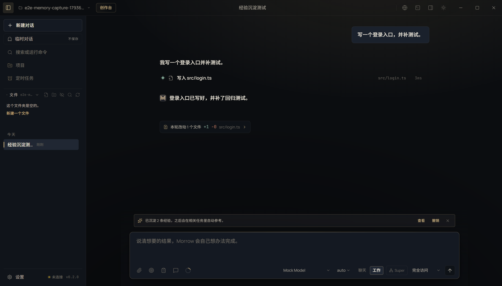

# T12 交接记录 · 自动经验沉淀

- 任务卡：T12（P1 · 记忆）
- 完成时间：2026-11-02
- 起始版本：Morrow `0.2.0`，提交 `c6c7de2`
- 核心文件：`src/main/agent.ts`、`src/main/memory.ts`、`src/renderer/store.ts`、`src/renderer/features/activity.tsx`
- 证据：[REPAIR-T12-evidence.json](REPAIR-T12-evidence.json)

## 补了什么

### 1. 任务收尾自动抽经验

任务正常完成后，如果本轮有真实工具/文件/成果产出：

- 先用本地规则压一条「这轮做了什么、结果如何」的基础经验；
- 再用本轮同一个轻量模型抽取 0–2 条可复用经验，字段为 `title / intent / summary / tags / files`；
- 抽取提示明确排除一次性调试、闲聊、密钥、密码和个人隐私；
- 结构化输出沿用 T09 的 JSON Schema；模型不支持时自动降级；
- 超时 30 秒；任何失败都静默跳过，不影响任务收尾；
- 有排队消息时不插入额外模型调用，等队列最后一轮再抽取，避免抢在用户下一条消息前消耗请求；
- E2E / 打包冒烟环境默认关闭自动复盘与经验抽取，需要验证时由用例显式开启。

### 2. 语义去重

- 新经验写入前先和已有经验做向量相似度比较；
- 相似度过高（0.86）视为重复，直接跳过，不反复堆积同一结论；
- 基础经验和模型抽取经验之间也会去重。

### 3. 收尾提示与撤销

- 任务结束后输入框上方出现一行：
  - 「已沉淀 N 条经验，之后会在相关任务里自动参考。」
  - 「查看」打开记忆中心的任务经验页；
  - 「撤销」删除这一轮自动沉淀的所有经验；
  - 「关闭」只收起提示，不删除。
- 撤销后记忆页通过变更事件刷新；不弹大窗口，不打断当前对话。

截图：

## 验证

```bash
npm run typecheck
npm run test:unit                    # 491 passed
npm run test:suite                   # 491 unit / 83 e2e
npx playwright test tests/e2e/ui.spec.ts -g "任务完成后自动沉淀经验"  # 1 passed
```

覆盖：

- 经验 JSON 解析、条数上限、超长裁剪、绝对路径收敛为文件名；
- 语义去重命中相似经验、不误判无关经验；
- 非法/空模型输出不写入；
- Electron 任务完成后出现沉淀提示，可查看任务经验，撤销后条目归零。

## 已知边界

- 只有正常完成且确实用了工具/产出文件或成果的轮次才沉淀；纯聊天、临时对话、演示、无人值守和计划模式不写。
- 使用当前会话模型做抽取，会消耗少量 token；抽取失败静默跳过，不会让用户看到半截结果。
- 去重使用本地词面向量，能挡住高度相似的重复总结，但不等同于人工审阅；用户仍可撤销。
- 经验只是参考背景，不构成指令或授权；模型仍按当前权限执行。
