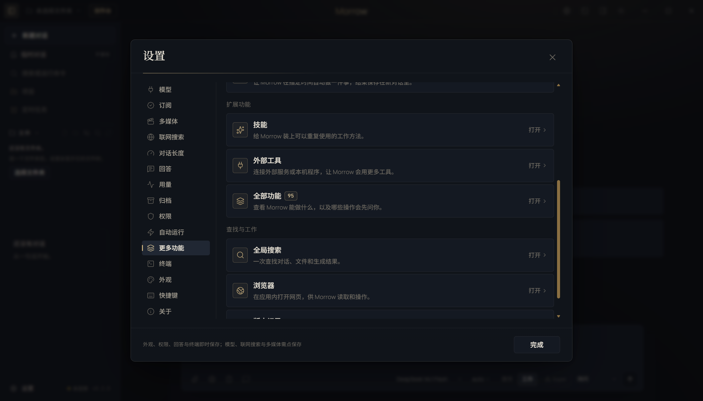
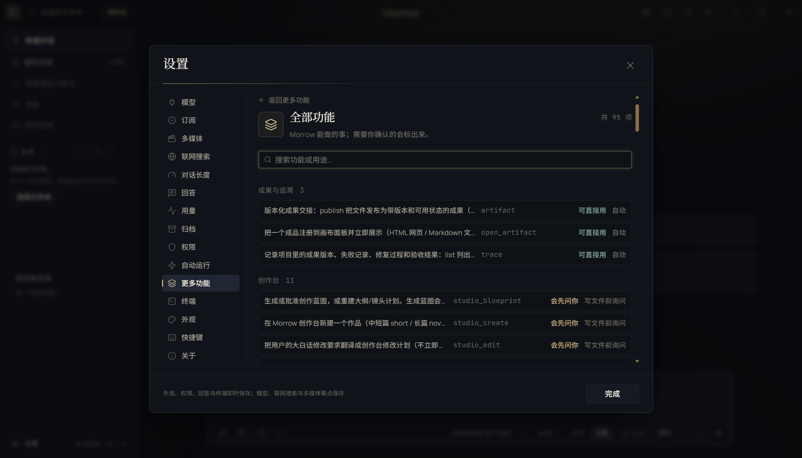

# T13 交接记录 · 工具生态补齐

- 任务卡：T13（P2 · 工具）
- 完成时间：2026-11-02
- 起始版本：Morrow `0.2.0`，提交 `c6c7de2`
- 核心文件：`src/core/tool-media.ts`、`src/core/tools.ts`、`src/core/util.ts`、`src/main/artifacts.ts`、`src/main/features.ts`、`src/renderer/features/settings.tsx`
- 证据：[REPAIR-T13-evidence.json](REPAIR-T13-evidence.json)

## 补了什么

### 1. HTTP API 调试工具

新增 `http_request`：

- 支持 `GET / POST / PUT / PATCH / DELETE / HEAD`；
- 支持自定义请求头和请求体（请求体上限 256KB）；
- 复用 `web_fetch` 的公网校验与 DNS 安全解析：默认拒绝 localhost、内网、非 http/https；
- 不自动跟随重定向，返回 `Location` 让人确认下一步；
- 高风险外部动作，每次审批；请求头和请求体不会写入工具审计日志；
- 二进制响应不展开，避免把图片/压缩包塞进上下文。

### 2. 浏览器多标签管理

新增 `browser_tab`：

- `list`：列出全部标签、当前活动标签；
- `new`：新建并打开公网/localhost 地址；
- `activate` / `close`：切换和关闭指定标签；
- 复用内置浏览器同一个标签栏，Agent 和用户看到的是同一组标签。

### 3. 全部功能子页

设置 → 更多功能 → 扩展功能 → **全部功能**：

- 入口与「技能」「外部工具」等子页使用同一行 UI：图标、标题、说明、数量徽标和「打开」；
- 点击后进入独立子页，不在入口列表下方堆叠清单或对话框；
- 子页左上角「返回更多功能」回到入口列表；
- 直接读取运行时真实注册的工具（不是手写列表）；
- 按域分组：联网与 API、浏览器、电脑操作、命令与终端、记忆与技能、创作台等；
- 每个工具显示风险档位与审批方式（免审批 / 按权限档位 / 写操作审批 / 每次审批）；
- 支持搜索工具名、用途或域。

截图：





## 验证

```bash
npm run typecheck
npm run test:unit                    # 491 passed
npm run test:suite                   # 491 unit / 83 e2e
npx playwright test tests/e2e/ui.spec.ts -g "全部功能子页"  # 1 passed
```

覆盖：

- POST 真实发送自定义头和请求体；Host/Content-Length 等危险头被忽略；
- 302 不自动跟随，返回 Location；
- 默认拒绝 localhost/内网；
- 非法方法和超过 256KB 的请求体被拒绝；
- 浏览器标签 list/new/activate/close 全部走真实 bridge；
- 全部功能入口与现有子页同一行样式，首页不再内联清单；点击进入子页、返回后回到入口；
- 子页按域展示 95 个工具，搜索 `http_request` 只显示一条并标注高风险、每次审批。

## 已知边界

- 本卡按“按需补”实现自包含的 HTTP 调试和浏览器多标签；**没有**为了凑清单加入 Jupyter、LSP、数据库、Docker 工具。这些工具依赖外部运行时或凭据，未经真实环境验证就接入会变成假功能；需要时再按同一套风险/审批规范单独补。
- `http_request` 只允许公网；不能用来调试本机 API。本机 API 请用 `run_command`（可配合 T11 沙箱）或内置浏览器。
- 请求体重放会原样发给目标服务；用户需在审批卡里确认。审计日志只记录方法、URL、状态，不记录请求头和请求体。
- 浏览器标签工具改变用户可见界面，因此按高风险外部动作逐次审批。
