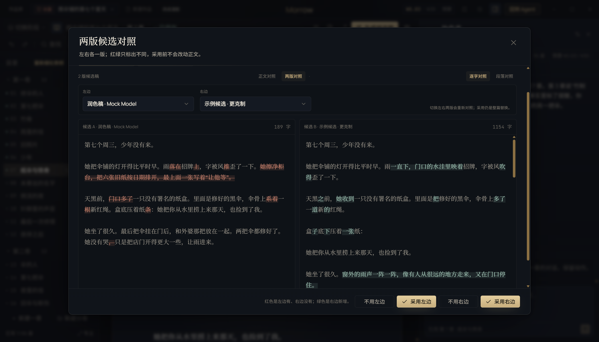

# T16 交接记录 · Studio 版本 diff 与 A/B

- 任务卡：T16（P2 · 创作台）
- 完成时间：2026-11-02
- 起始版本：Morrow `0.2.0`，提交 `c6c7de2`
- 核心文件：`src/main/studio.ts`、`src/renderer/features/studio.tsx`、`src/renderer/features/studio.css`
- 证据：[REPAIR-T16-evidence.json](REPAIR-T16-evidence.json)

## 补了什么

### 1. 候选稿 A/B 并排 diff

- 候选对照弹窗新增「正文对照 / 候选 A/B」切换；
- A/B 两侧都能单独选候选，选中对方正在用的候选时自动交换；
- 红绿只表示两稿差异：左边 A 有而 B 没有的标红，B 新增的标绿；
- 正文对照仍保留原来的「现在的正文 ↔ 候选稿」逐字/段落 diff；
- 只展示原文差异，不给出任何质量分、模型评审或“哪一版更好”的结论。

### 2. 逐条采纳

- A/B 模式两侧各有一个「用 A/B 替换」按钮，不必来回切换候选；
- 采纳前仍会先保存当前正文，再整篇替换；
- 采纳后自动留档，历史版本原因记录「采用候选《…》前自动留档」，可从版本列表追溯；
- 采纳记录只保存在版本历史里，不做胜出次数或评分统计。

截图：

## 验证

```bash
npm run typecheck
npm run test:unit                    # 486 passed
npm run test:suite                   # 486 unit / 79 e2e
npx playwright test tests/e2e/studio.spec.ts -g "候选稿可并排 A/B"  # 1 passed
```

覆盖：

- 演示作品《雨伞铺的第七个夏天》第 7 章自带候选，再通过真实 mock 模型润色生成第二个候选；
- 打开候选对照只显示原文与字数，不出现「结构分」或评分标签；
- 切到「候选 A/B」后两侧分别选择候选，双栏 diff 与两侧字数可见；
- 采纳 A 后弹窗关闭，正文被替换，剩余候选为 1，版本原因包含「采用候选」；
- 项目数据里没有 `candidateStats` 等评分/胜出统计字段。

## 已知边界

- 只展示原文 diff，不判断文笔、剧情或哪一版更好；判断权完全在作者。
- 「逐条采纳」指每个候选可以单独比较、单独采用；本轮没有做按段落/句子挑选合并，采用仍是整章替换。
- A/B 只比较候选与候选；正文与候选的对照仍走「正文对照」。
- 大文本沿用原有 6 万字显示上限与 2 万字自动段落级对照；采用时使用完整内容。
