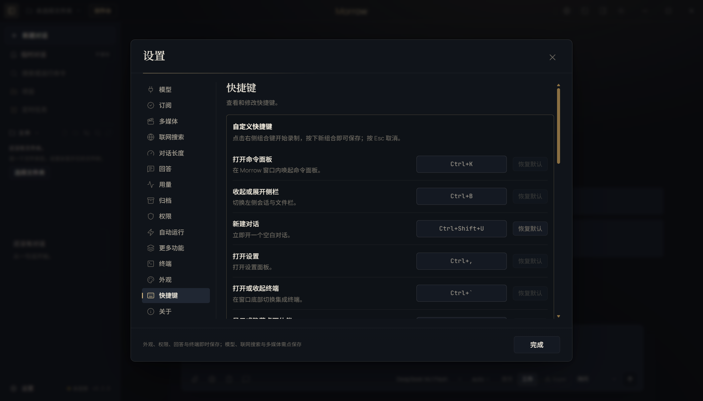
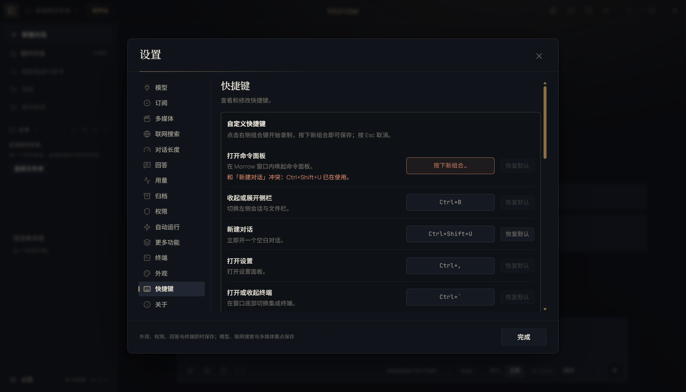

# T17 交接记录 · 快捷键自定义

- 任务卡：T17（P2 · 界面）
- 完成时间：2026-11-02
- 起始版本：Morrow `0.2.0`，提交 `c6c7de2`
- 核心文件：`src/shared/shortcuts.ts`、`src/shared/types.ts`、`src/shared/contracts.ts`、`src/main/settings.ts`、`src/main/shortcuts.ts`、`src/main/ipc.ts`、`src/main/index.ts`、`src/renderer/App.tsx`、`src/renderer/features/settings.tsx`、`src/renderer/features/shell.tsx`、`src/renderer/features/island.tsx`
- 证据：[REPAIR-T17-evidence.json](REPAIR-T17-evidence.json)

## 补了什么

### 1. 可保存的 keymap

- 新增 `Settings.shortcuts`，统一存 `CommandOrControl+Shift+M` 这类跨平台形式；
- 六个动作可改：命令面板、侧栏、新建对话、设置、终端、桌面伙伴；
- 旧设置没有该字段时自动补默认值；无效、保留或重复的组合在读取时回落到默认；
- 保存前由主进程再校验一次，避免绕过界面写入坏配置。

### 2. 设置页录制改键

- 设置 → 快捷键新增「自定义快捷键」；
- 点击右侧组合键开始录制，按下新组合立即保存；
- `Esc` 取消录制；
- 组合键至少包含 Ctrl / ⌘ / Alt 之一；
- 与其他自定义动作重复时，行变红并给出「和「…」冲突」；
- 命中 Ctrl+C/V/X/Z/S 等系统或输入框保留组合时同样拒绝保存；
- 每行支持「恢复默认」。

截图：





### 3. 改键真正生效

- 渲染层全局按键不再硬编码 Ctrl+K/B/N/,/`，统一读取 `settings.shortcuts`；
- 侧栏 tooltip、标题栏、桌面伙伴提示都跟随当前键位显示；
- 桌面伙伴的全局快捷键保存后立即重新注册；系统拒绝或组合被占用时撤销本次修改并提示原因；
- 托盘不再写死快捷键文案，改为指向设置页。

## 验证

```bash
npm run typecheck
npm run test:unit                    # 490 passed（新增 4 项快捷键归一化/冲突/匹配）
npm run test:suite                   # 490 unit / 80 e2e
npx playwright test tests/e2e/ui.spec.ts -g "快捷键可录制改键"  # 1 passed
```

覆盖：

- 录制 `Ctrl+Shift+U` 后写入 `new-session`，设置持久化为 `CommandOrControl+Shift+U`；
- 关闭设置后按新组合确实新建对话；
- 再给命令面板录制同一组合会出现红框冲突提示，原组合保持不变；
- `Esc` 取消录制后错误提示消失；
- 归一化、平台显示、保留组合、冲突检测与完整映射校验均有单测。

## 已知边界

- 本轮只提供六个窗口级动作和一个桌面伙伴全局动作；编辑器内的 Ctrl+F/Ctrl+S 等上下文快捷键仍是只读展示。
- 快捷键是单组合键，不支持 Ctrl+K 再按 Ctrl+S 这类组合序列。
- 全局快捷键的真实注册在测试模式下会跳过；E2E 验证的是保存、冲突与窗口内按键生效。系统级注册需在未启用测试模式的桌面环境验证，注册失败会回滚并提示。
- 系统或输入法抢先占用某个组合时，Morrow 无法强制生效；保存时会明确拒绝，而不是显示成功。
