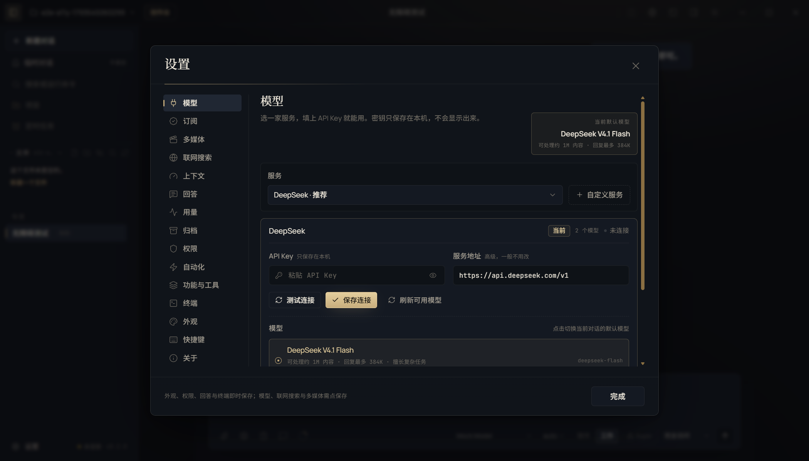
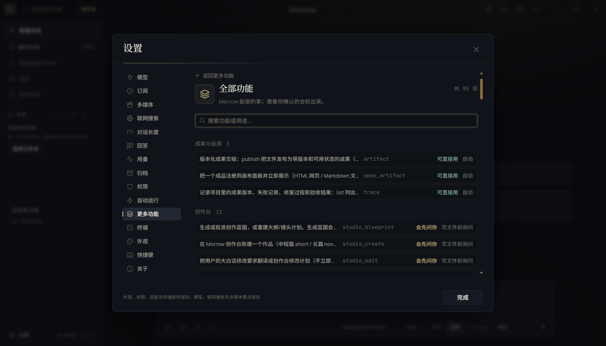

# T18 交接记录 · 无障碍系统性支持

- 任务卡：T18（P2 · 界面）
- 完成时间：2026-11-02
- 起始版本：Morrow `0.2.0`，提交 `c6c7de2`
- 核心文件：`src/renderer/features/a11y.tsx`、`src/renderer/App.tsx`、`src/renderer/features/island.tsx`、`src/renderer/components.tsx`、`src/renderer/features/chat.tsx`、`src/renderer/features/terminal.tsx`、`src/shared/motion.ts`、`src/renderer/styles.css`、`scripts/ui-token-audit.mjs`
- 证据：[REPAIR-T18-evidence.json](REPAIR-T18-evidence.json)

## 补了什么

### 1. 系统性读屏播报

新增 `LiveAnnouncer`，常驻两个不可见 live region：

- polite：Morrow 开始处理任务、处理完成、上下文压缩开始/完成；
- assertive：需要确认工具操作、需要回答问题。

约束：

- 不播报流式 token，避免读屏被每个字打断；
- 审批/提问只播报一次，处理完自动清空，下一次可以再次播报；
- 对话区 `role="log"` 保持 `aria-live="off"`，运行中加 `aria-busy`，结束后移除；
- 桌面伙伴独立窗口新增隐藏 live region，播报「桌面伙伴：状态。详情。进度」；状态文案不再依赖视觉小字；
- 既有 Toasts `aria-live="polite"` 保持。

### 2. 统一焦点环与焦点管理

- 新增令牌：
  - `--focus-ring-width: 2px`
  - `--focus-ring-color: var(--text)`（前景色在金色按钮与深色背景上都有足够对比）
  - `--focus-ring-offset: 2px`
- 全局 `:focus-visible`、输入框、按钮/图标按钮统一 2px；按钮用 `box-shadow` 焦点环，避免被按钮自身阴影覆盖；
- 全部自定义焦点指示（列表行、文件树、对话轮次、滑杆、拖拽分隔条等）统一改用令牌，不再出现 1px/2px/3px 混用；
- Modal 增加 `aria-describedby` 关联说明文字；原有 Tab 焦点陷阱与关闭后焦点恢复保留，并由 E2E 验证 Tab 循环不会离开弹窗。

截图：





### 3. 减少动效全链路

- 同时响应系统 `prefers-reduced-motion` 与设置里的「减少动效」；
- 全局把动画/过渡时长压到 1ms、延迟归零、滚动行为改为即时；
- JS 平滑滚动（对话、目标栏、创作台、设置预算定位）统一走 `preferredScrollBehavior()`，开启减少动效时立即跳转；
- xterm 终端关闭光标闪烁；
- 审计：29 个 CSS 中 166 处动画声明都由全局减少动效规则覆盖。

## 验证

```bash
npm run typecheck
npm run audit:ui                    # 焦点环 2px 令牌 + 字号令牌审计通过
npm run test:unit                   # 491 passed（新增减少动效单测）
npm run test:suite                  # 491 unit / 83 e2e / 41 域
npx playwright test tests/e2e/ui.spec.ts -g "焦点环统一"        # 1 passed
npx playwright test tests/e2e/ui.spec.ts -g "桌面伙伴状态"      # 1 passed
npx playwright test tests/e2e/journey.spec.ts -g "命令审批默认焦点"  # 1 passed
```

覆盖：

- 运行开始/结束分别进入 polite live region；运行中对话区 `aria-busy=true`，结束后移除；
- 焦点环计算结果为 2px、`:focus-visible` 命中；焦点陷阱 Tab 循环仍在弹窗内；
- 命令审批出现时 assertive 区域播报「需要你确认工具操作：run_command」；
- 桌面伙伴独立窗口的 live region 存在、`role=status`、播报状态；
- 设置减少动效后动画时长变为 0.001s；系统 `prefers-reduced-motion: reduce` 同样生效。

## 已知边界

- 自动化验证的是 DOM/ARIA 与计算样式，不能替代 NVDA / Narrator / VoiceOver 的真实朗读验收；发布前仍建议用至少一个读屏软件走一遍审批、提问、完成三个场景。
- 内置浏览器网页、PDF/Office 预览属于第三方内容，可访问性由对应页面/渲染器决定，Morrow 不注入或改写它们的语义。
- xterm 终端的内容朗读能力受 xterm.js 限制；本轮只保证光标闪烁跟随减少动效，不宣称终端全文可被读屏完整读取。
- 系统原生菜单、托盘菜单由操作系统绘制，不受应用焦点环与字号设置影响。
- 焦点环按 2px 绘制；在 2x 截图缩放到文档尺寸时可能显得很细，但计算样式与真实 100% 显示均为 2px。
