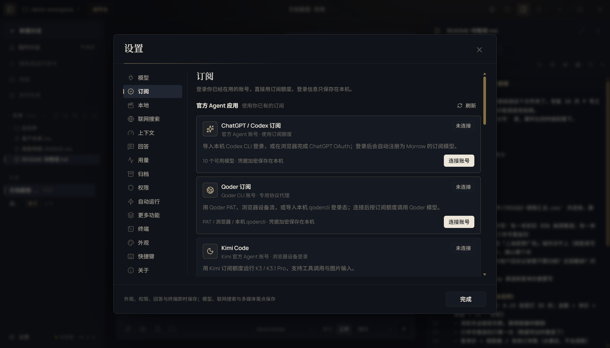
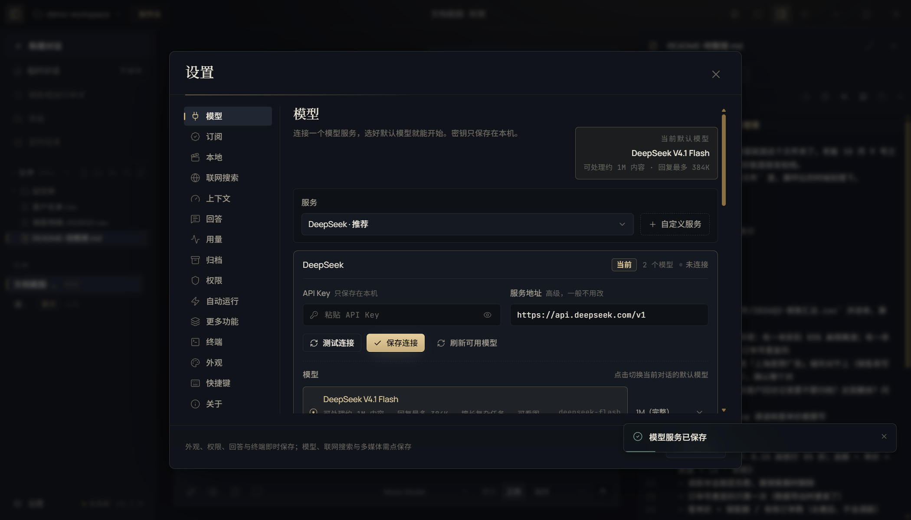

# Morrow 首次使用：3 步开始

这一页只讲正式使用前必须做的事。装好 Morrow 后，5 分钟内完成。

Morrow 不自带模型。先给它一个模型来源，再给它一个工作文件夹。

## 最小检查清单

- [ ] Morrow 能打开
- [ ] 模型连接成功（订阅显示“已连接”，或模型显示“Key 已保存”）
- [ ] 选好工作文件夹
- [ ] 发一句“你好”，能收到回复

## 第 1 步：打开 Morrow

双击 `Morrow-0.2.0-portable.exe`（或安装版快捷方式）。

Windows 提示“已保护你的电脑”时，点“更多信息 → 仍要运行”。

## 第 2 步：接上模型（唯一门槛）

### 路线 A：已经在用 Codex / 有 ChatGPT 订阅（推荐）

不用申请 API Key，直接复用 Codex 的登录态：

1. 点左下角齿轮“设置”。
2. 左侧选“订阅”，找到“ChatGPT / Codex”，点“连接账号”。
3. 点“导入本机 Codex CLI 登录”。
   - 如果提示找不到登录文件，点“浏览器登录 ChatGPT”，在打开的网页里登录。
4. 看到“已连接”后，关闭设置。
5. 点输入框右下角的模型名，选一个 GPT-6 / GPT-5.6 模型。这是订阅提供的模型。

Morrow 只读取本机 Codex 的登录文件，不修改它；登录态只保存在这台电脑上。

### 路线 B：没有订阅，用 API Key

1. 先创建 Key（只需要一次）：
   - DeepSeek（新手推荐）：打开 https://platform.deepseek.com/ → 注册/登录 → 充值少量 → API Keys → 创建 → 复制。
   - 用 Kimi、通义千问也可以，在各自控制台找“API Keys”。
2. Morrow 左下角齿轮“设置” → 左侧“模型”。
3. 选“DeepSeek”（或你的服务商），把 Key 粘贴到“API Key”。
4. 点“测试连接”。看到“连接正常 · xxx ms”再继续；没有成功就看下面的“卡住了”。
5. 点“保存连接”。
6. 在下方的“模型”列表里点一个模型（例如 DeepSeek V4.1 Flash）。它会成为当前对话的模型。

API Key 按量付费，费用由服务商收取；Morrow 不代充、不加价。

### 如果是第一次打开，还在三步引导里

- 第 1 页点“开始设置”。
- 第 2 页就是路线 B：选服务商 → 粘贴 Key → 测试连接 → 下一步。订阅登录不在这页，需要完成引导后去“设置 → 订阅”。
- 第 3 页选文件夹 → “完成，开始使用”。

已经点过“跳过引导”也没关系：引导不会再自动出现，按上面的“设置 → 模型 / 订阅”补上即可。

## 第 3 步：选工作文件夹

首次引导最后一页点“选择文件夹”。选一个你愿意让 Morrow 读写的文件夹，例如在桌面新建一个“Morrow 工作区”。

Morrow 只在这个文件夹里读写；文件夹外的写入会单独问你，之后也可以换。

## 怎么算成功

- 设置 → 订阅 显示“已连接”；或 设置 → 模型 显示“Key 已保存”。
- 输入框右下角的模型名不是“演示引擎”。
- 发一句“你好”，能正常回复。

## 卡住了

| 现象 | 怎么办 |
|---|---|
| 401 / 403 | Key 复制不全或没有权限。重新生成一个再粘贴。 |
| 404 | 服务地址被改错了。点回默认，不要填浏览器里打开的网页地址。 |
| 429 | 余额不足或请求太频繁。去服务商后台看余额。 |
| 一直转圈 / 超时 | 网络或代理问题。换网络，或确认代理能访问该服务商。 |
| 导入 Codex 登录失败 | 改用“浏览器登录 ChatGPT”；或改用路线 B。 |
| 刚连好却用不了 | 点输入框右下角模型名，选刚连接的模型。 |
| 不会申请 Key | 先走路线 A；没有订阅就先点“先看一场演示”。 |

## 两条安全规则

1. API Key 只粘贴到 Morrow 设置页。不要发到聊天、文档、截图里，也不要发给 AI 助手。
2. 如果已经把 Key 发给过 AI 助手或别人：去服务商后台吊销，重新生成一个，再只在 Morrow 里粘贴。

## 给帮你配置的 AI 助手（Codex 等）

不要用 computer-use 反复操作 Morrow 的界面。模型连接这一步需要用户本人粘贴 Key 或登录账号，你只需要：

1. 确认 Morrow 已启动。
2. 告诉用户点“设置 → 订阅”或“设置 → 模型”。
3. 等用户说连接成功后，帮他确认当前模型不是“演示引擎”，再发一条测试消息。

## 附：配置文件在哪（只给排障的人看）

- 安装版：`%APPDATA%\Morrow\settings.json`；便携版：exe 同目录 `Morrow Data\settings.json`。
- API Key 不在 `settings.json` 里，而在 `secrets.json`，由 Windows DPAPI 加密。手工改配置文件不能填入可用 Key。
- Morrow 没有 `--config`、配置文件导入或 `MORROW_API_KEY` 环境变量。唯一受支持的模型配置入口就是界面里的“设置 → 模型 / 订阅”。
