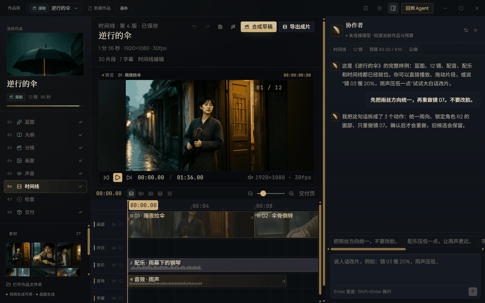

# Morrow 创作台

创作台把中短篇、长篇和漫剧放在同一个作品底座里：一份作品文件保存蓝图、章节、分镜、素材、剪辑表、任务与交付物。你可以随时退出、回到 Agent、再继续；所有创作判断只来自内嵌的写作大师、编剧大师、导演大师三套方法，本地只做可计算的检查与交付。

## 1. 入口与界面约定

- Agent 标题栏左侧「创作台」是唯一入口；命令面板有「新建作品」「继续创作」；灵动岛也有「打开创作台」。
- 作品首页显示「今天，想把哪句话变成作品？」、筛选（全部作品 / 最近打开 / 漫剧 / 中短篇 / 长篇 / 模板）、搜索、使用指引、看演示与新建作品。
- 打开作品后，顶栏是当前作品与阶段；左侧是阶段/目录，中间是当前工作区，右侧是协作者。协作者在蓝图、写作、分镜、时间线、检查、交付页可用；首页、画布、镜头详情、片段详情、人物面板或专注模式下自动收起。
- 全应用禁用斜体；创作台不出现单独的产品标题或顶栏图标；协作者头部、空态和首次指引使用品牌徽记。

## 2. 三种形态与阶段

| 形态 | 阶段 | 主要产物 |
|---|---|---|
| 中短篇 | 蓝图 → 大纲 → 写作 → 检查 → 交付 | 章节正文、候选稿、事实连续性、TXT/EPUB/PDF/Word 等 |
| 长篇 | 蓝图 → 大纲 → 写作 → 画面 → 检查 → 交付 | 分卷、章纲、章节、章节配图、EPUB/Word/PDF 等 |
| 漫剧 | 蓝图 → 大纲 → 分镜 → 画面 → 配音 → 音乐 → 时间线 → 检查 → 交付 | 场景/镜头、画面/视频、配音、配乐、音效、字幕、成片 |

漫剧的阶段栏把「配音 + 音乐」合并显示为「声音」，底层仍保留 `voice` 与 `music` 两个阶段。长篇的「画面」阶段负责章节配图。

## 3. 从一句话开始

创建作品时选择形态、写一句故事、选择制作精细度（速成草稿 / 精制 / 电影级）、画面比例与补充要求，然后点「生成故事蓝图」或按 Ctrl+Enter。蓝图需要已连接文本模型；未连接时明确提示，不生成固定模板。

蓝图包含故事主线、人物、地点、结构、风格与预算。**蓝图确认前不会批量生成正文或画面。** 确认后可以「去写作页 / 去分镜页」逐阶段推进，也可以「一键写完 / 一键做到草稿」自动推进；付费步骤仍逐项过预算。

## 4. 中短篇链路

1. **蓝图**：确认故事主线、人物、结构、语气与目标字数。
2. **大纲**：生成或细化章纲；每章有标题、梗概、目标字数与节拍。
3. **写作**：逐章「AI 写这一章 / 生成候选稿」，也可以「连续写 3 章」；候选稿在写作台对照，点「用这一版替换」才写入正文。用户手改过的章节锁定，候选不会自动覆盖；每章保留最近 30 个版本。
4. **检查**：运行本地检查与模型审稿；问题分错误/提醒/信息。
5. **交付**：TXT、Markdown、EPUB、PDF、Word、工程包、封面与发布文件包。写作工具条的「导出 Word」只导出当前作品视图。

正文润色与整章改写都走真实文本模型；`rewrite-chapter` 完成后直接替换正文并先留章内版本；`update-chapter` 也可以按计划直接替换正文。未连接模型时不会生成本地假候选。

## 5. 长篇链路

- **分卷蓝图**：先写全书骨架，再生成人物/地点，最后按卷生成章节骨架；每批 4 章。
- **章纲**：每批 12 章细化；跨章带摘要与全局事实，避免后文忘记前文。
- **写作**：只对空章自动落稿；已有正文的章节进入候选或按计划重写，不静默覆盖。超长章节按分片存储，编辑器仍显示完整文本。
- **画面**：按章节生成配图，可「先生成 2 张」「用这张」；配图嵌入 EPUB/DOCX/PDF。
- **检查与交付**：连续性、人物语气、缺失素材与交付格式；可导出 EPUB/Word/PDF/TXT 与工程包。

## 6. 漫剧链路

1. **蓝图**：故事主线、人物、场景、风格、镜头数量与时长。
2. **大纲**：把故事拆成场景与镜头计划；可重新生成并同步到分镜。
3. **分镜**：生成/补齐分镜，逐镜编辑标题、动作、台词、说话人、运镜、景别、时长、衔接与画面提示词；可「按蓝图同步」「批量调整」。
4. **画面**：逐镜生成/导入画面，升级为视频；参考锁定会写入后续提示词。画面/视频走 ComfyUI。
5. **声音**：配音页可生成/重新配音、导入配音、选择声线；音乐页可生成正式配乐、生成草稿或移除。音效只支持雨声/伞骨/心跳/街声四类。
6. **时间线**：画面/对白/音乐/音效/字幕五轨；自动排好、拖动、剪开、音量、速度、转场、字幕样式；合成草稿或导出成片。
7. **检查**：缺失素材、配音时长、时间线引用、设定冲突、预算、镜头覆盖；可运行剧情审稿与模型审稿。
8. **交付**：草稿 540p，成片 1080p/4K，MP4/MOV/MKV/WebM，画面内/单独字幕，SRT/ASS、封面、工程包、发布包、四格漫画与音轨。

## 7. 协作者：按当前步骤改

协作者不是只会聊天的侧栏。每次发送需求时，前端把 **当前步骤**（`focusedStage`）和当前步骤真正可用的选中项（章节 / 镜头 / 片段）一起交给主进程；主进程再把作品快照、当前页面、选中项和一套大师方法交给模型。首页和画布不带选中项，避免旧选中项串台。

### 7.1 修改计划

协作者先给计划，不直接改作品：

- 计划卡列出会改哪些地方、影响哪些下游、预计耗时/费用，状态为「待确认」。
- 按钮是「取消 / 用这套方案」；确认后才应用。
- 应用前写整项目快照；应用后可以「撤销这次修改」。如果应用后又有新修改或还有排队任务，整体撤销不可用，需到历史版本处理。
- 计划最多 12 个动作；未提到的字段、人物、事实、素材和正文保持原样。

### 7.2 支持的动作

| 页面/意图 | 动作 | 结果 |
|---|---|---|
| 蓝图 | `update-blueprint` | 更新标题、一句话、类型、语气、受众、故事核、情绪、提要、结构、风格、人物、地点；下游标过期 |
| 大纲 | `replace-outline` | 只改列出的单元；`title`/`summary` 可以只给一个，未提字段保留；也可补场景 |
| 章节信息 | `update-chapter` | 改标题、梗概、节拍；传完整正文时直接替换并留档 |
| 整章正文 | `rewrite-chapter` | 排队真实模型，完成后替换正文 |
| 正文顺序 | `move-chapter` | 把第 N 章移到目标位置；同步章号、大纲单元与卷内顺序；检查/交付标过期 |
| 镜头顺序 | `move-shot` | 把第 N 镜移到目标位置；同步镜号、蓝图单元与场景范围；画面/配音/时间线/检查/交付标过期 |
| 镜头文字 | `update-shot` | 改标题、动作、台词、说话人、运镜、景别、时长、衔接、提示词、声线 |
| 人物局部 | `update-character` | 改名、身份、年龄、外观、声线、欲望、恐惧、秘密、弧光、关系、参考图；不重写整个人物表 |
| 地点局部 | `update-place` | 改名、描述、参考图 |
| 改名 | `rename-entity` | 人物/地点改名，并同步蓝图、大纲、正文、分镜、事实与时间线标签 |
| 配音 | `regenerate-voice` | 单镜重配，或 `scope: all` 全片重配有台词的镜头 |
| 声线 | `update-shot.voiceId` / `update-character.voiceId` | 换声线会清空旧配音并自动排队重配；人物声线变更会重配该人物所有台词 |
| 音效 | `generate-sfx` / `remove-sfx` | 雨声、伞骨、心跳、街声 |
| 配乐 | `generate-music` / `remove-music` | 生成正式配乐或草稿；移除配乐 |
| 画面/视频 | `regenerate-shot-image` / `regenerate-shot-video` | 重做画面或升级视频，保留旧候选 |
| 补镜头 | `append-shots` | 补全新镜头并同步大纲、分镜与蓝图 |

时间线类的 `set-clip-*`（速度、音量、字幕位置、转场、时长）由本地规则处理，模型不生成这些动作；这样简单的“镜 01 慢 20%、雨声压低”不花模型费用，也不会被模型改错。

### 7.3 自动替换与下游过期

- 改台词、说话人、声线：清空旧配音并排队重配；画面不变时只标配音/时间线过期。
- 改人物外观、地点参考：画面与分镜标过期。
- 改蓝图、大纲、改名、补镜头：按影响范围把下游标过期，不删除已有素材。
- 改章序/镜序：正文与素材跟着对象走，编号重排；检查与交付必须重新核对。
- 改正文/镜头文字：旧画面、旧配音、时间线与交付在需要时标过期，不会假装仍然有效。

## 8. 三套大师方法（内嵌）

创作台不内置自己的创作手法库、七维权重或六条门禁。所有创作判断只来自三套大师方法：

- **写作大师**：中短篇/长篇的蓝图、大纲、章节、改写、审稿。
- **编剧大师**：改编、剧本、漫剧蓝图与大纲。
- **导演大师**：分镜、画面、视频、配音、音乐、时间线与漫剧助手。

三套内容以 gzip + base64 编译进主进程的 `creative-prompts.generated.ts`，运行时只从内存解压；不再读取桌面「写作+编剧+导演」文件夹、`resources/prompts` 或旧 `prompt-library.ts`。主文件按任务选段，方法论按任务取 1–2 份，并按模型上下文收紧预算（默认 22k 字符，范围 4k–60k；主文件最多约 70%）。

更细的路由、预算与协作者契约见 [底层提示词与质检](QUALITY-FRAMEWORK.md)。

## 9. 引擎与费用

- 文本：蓝图、大纲、正文、分镜、模型审稿必须使用已连接文本模型；长篇分批调用。
- 画面/视频：ComfyUI；未就绪时明确失败，不生成占位图。
- 配乐：正式配乐走本机 ComfyUI ACE-Step；`local` 只生成草稿并明确标注，不算完成音乐阶段。
- 音效：本机合成四类音效。
- 配音：云端 `/audio/speech` 或本机 Qwen3-TTS；失败可回退 Windows SAPI，也可导入配音。
- 合成：FFmpeg；未配置时明确失败。
- 预算：每次付费调用前检查预算；计划卡显示预计费用；实际账单记录在任务里。

## 10. 数据、恢复与回收站

- 创作台作品目录默认在本机数据目录的 `studio/` 下；可在设置 → 数据与安全单独更换并迁移作品、素材、版本、任务，不移动 Agent 对话与密钥。
- 删除作品先进入回收站；可恢复到作品库或彻底删除。
- 任务记录保留输入快照；失败/中断任务可重试，队列可暂停。
- 应用修改计划前写整项目快照；应用后可整体撤销（没有新修改、没有排队任务时）。每章另有版本历史。

## 11. 内置样例

作品库固定三份可编辑样例：

- 《雨停之前》——中短篇，12 章。
- 《雨伞铺的第七个夏天》——长篇，36 章计划、7 章已写。
- 《逆行的伞》——漫剧，12 镜、96 秒。

样例是随包冻结数据，不调用本地生成器；首次进入时复制到数据目录。演示使用漫剧样例走真实工作台。

## 12. 设置

创作台设置五页：

1. **模型与预算**：文本/图像/视频/语音模型与预算上限；模型和密钥仍在 Agent 设置里统一管理。
2. **配音与引擎**：配音方式（本机/云端）、本机 ComfyUI、FFmpeg、本机 AI/系统声线状态。
3. **历史版本**：作品版本与回退。
4. **回收站**：恢复或彻底删除。
5. **数据与安全**：创作台数据目录、迁移、恢复默认；不动 Agent 对话与密钥。

## 13. 快捷键与手势

### 全局

| 操作 | 快捷键 |
|---|---|
| 生成蓝图（首页） | Ctrl+Enter |
| 新建对话 | Ctrl+N |
| 命令面板 | Ctrl+K |
| 设置 | Ctrl+, |
| 终端 | Ctrl+` |

### 写作

| 操作 | 快捷键 |
|---|---|
| 保存 | Ctrl+S |
| 查找 / 替换 | Ctrl+F / Ctrl+H |
| 撤销 / 重做 | Ctrl+Z / Ctrl+Shift+Z |
| 目录 / 人物设定 / 历史版本 / 专注 / 排版 | 写作工具条按钮 |

### 分镜与画布

| 操作 | 快捷键 |
|---|---|
| 剧本 / 分镜板 | 页签切换 |
| 生成分镜 / 补齐画面 / 逐句字幕 / 排好时间线 | 工具条按钮 |
| 撤销 / 重做 | Ctrl+Z / Ctrl+Y |
| 复制 | Ctrl+D |
| 全选 | Ctrl+A |
| 编组 / 解组 | G |
| 删除 | Delete |
| 平移 | Space / Alt / 中键拖动 |
| 缩放 | 滚轮 |

### 时间线

| 操作 | 快捷键 |
|---|---|
| 播放 / 暂停 | Space |
| 变速 | J / K / L |
| 逐帧 | ← / → |
| 分割 | S |
| 删除片段 | Delete |
| 撤销 / 重做 | Ctrl+Z / Ctrl+Shift+Z |
| 保存 | Ctrl+S |

### 指引与演示

- 指引：Esc 关闭。
- 演示：Space 暂停/继续，R 重播，Esc 关闭。

## 14. 已知边界

- 文本模型、ComfyUI、ACE-Step、Qwen3-TTS、FFmpeg 都是外部能力；未就绪时明确失败，不伪造成功。
- 视觉检查在没有可用视觉模型时记录“未检查”，不冒充通过。
- 订阅渠道的服务端接口可能变化；登录/额度/模型目录失败会明确提示。
- 代码签名未配置，首次运行可能触发 SmartScreen。
- 文件夹版、zip、源码包不再进入交付目录；最终只交付两个单文件 exe。

