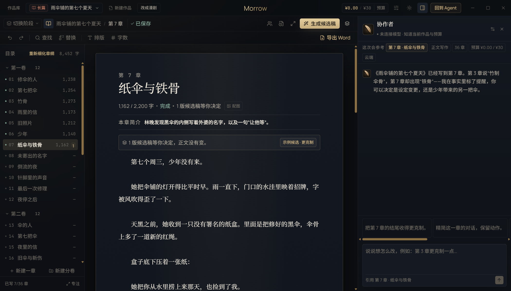
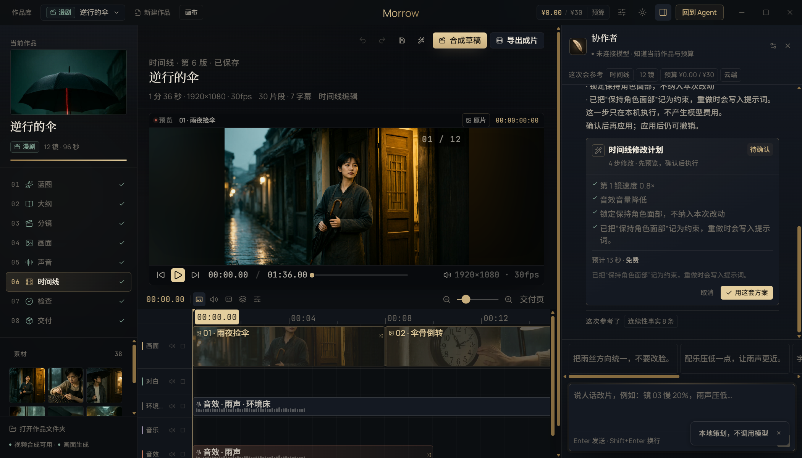
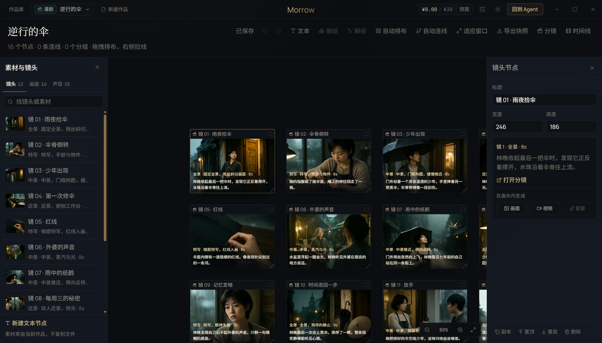
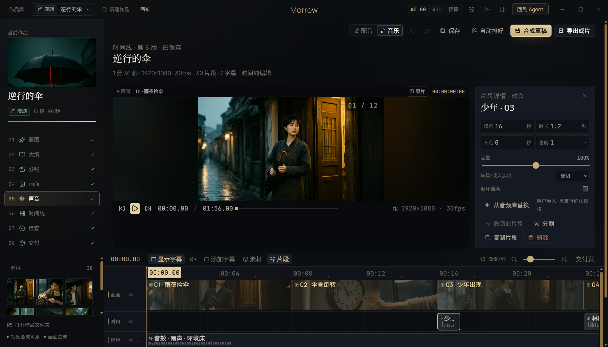
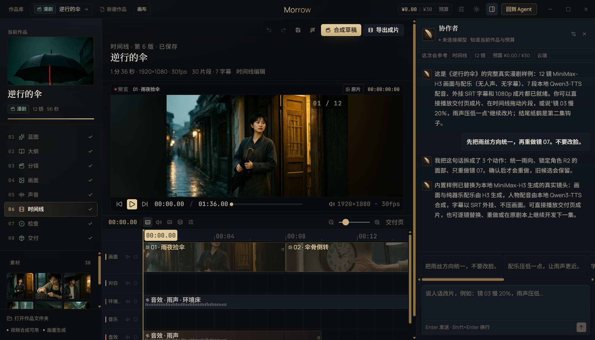
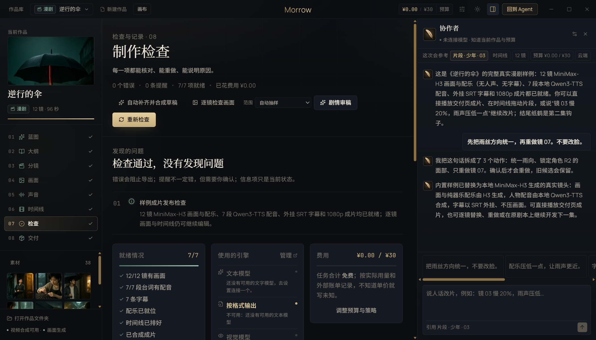
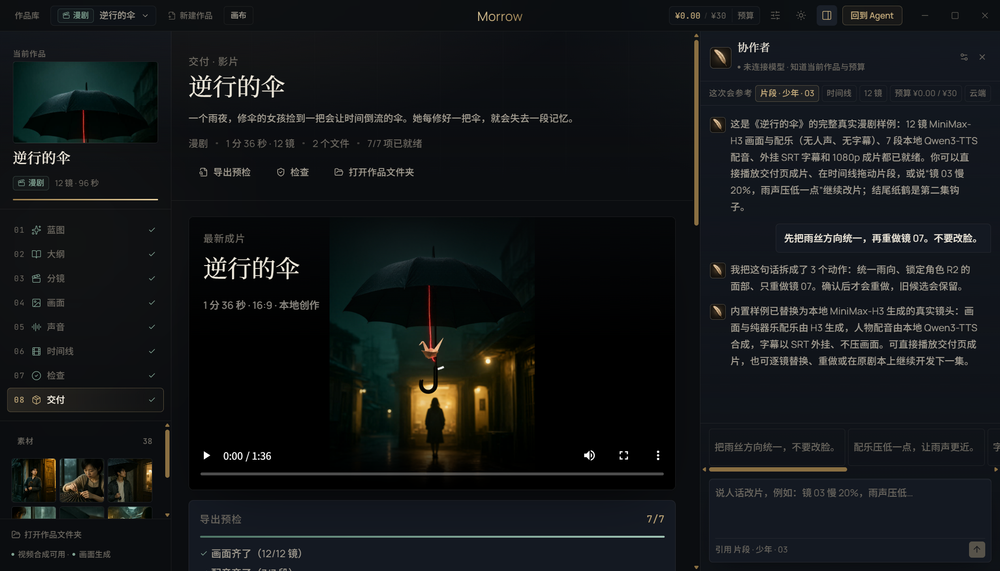
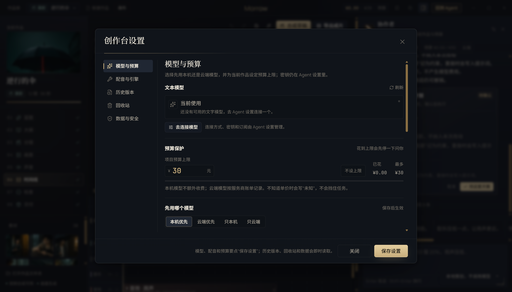
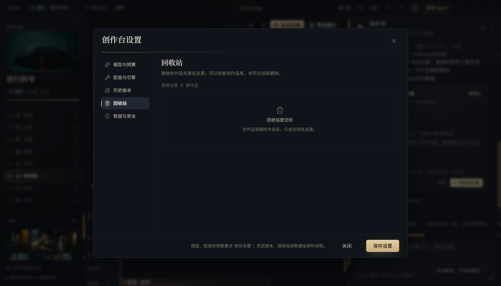

# 创作台：从一句话到可交付作品

创作台负责中短篇、长篇与漫剧。你先拿到一份可修改、可计价的蓝图；确认之后才进入正文、分镜、画面与媒体，每一步费用单独记录。

这篇文档按界面顺序说明每一步做什么、会在哪里失败，以及导出前必须满足什么条件。

## 入口与作品库

创作台有三个入口：标题栏的「创作台」按钮、命令面板（`Ctrl+K`）里的新建与继续创作、灵动岛底部的「打开创作台」。打开作品后，左侧是阶段栏，顶部「作品库」回到列表，「回到 Agent」退出创作台。

作品库顶部是「今天，想把哪句话变成作品？」的创作区；下面是筛选（全部作品、最近打开、漫剧、中短篇、长篇、模板）、搜索与作品卡片。卡片显示进度、章节与字数（漫剧显示镜数），可以继续创作、复制或删除。

作品库把新建入口与已有作品放在同一屏；截图来自测试模式与内置演示工作区，界面与发布版一致，作品为内置样例。

- 删除作品会先移入回收站，不会立刻永久删除。
- 模板只搭结构，故事、风格与花费仍由你决定。
- 测试模式会注入中短篇《雨停之前》、长篇《雨伞铺的第七个夏天》与漫剧《逆行的伞》；打包版不含演示素材，正式使用时作品库默认为空。

日常操作与权限、终端等桌面能力见 [DESKTOP-GUIDE.md](DESKTOP-GUIDE.md)。

## 三种形态与真实范围

新建时先选形态。三种形态的默认值与可选档位如下，数字来自创建表单与任务参数，不是建议值。

| 形态 | 默认规模 | 可选档位 | 阶段数 |
|---|---|---|---|
| 中短篇 | 1.8 万字 | 3 万 / 5 万 / 8 万 | 5 段 |
| 长篇 | 30 万字 | 20 万 / 30 万 / 50 万 / 100 万 | 6 段 |
| 漫剧 | 96 秒 | 60 / 96 / 120 秒 | 9 段 |

阶段一共 10 个：蓝图、大纲、写作、分镜、画面、配音、音乐、时间线、检查、交付。三种形态各取子集：中短篇是蓝图、大纲、写作、检查、交付；长篇多一个画面，用于章节配图；漫剧是蓝图、大纲、分镜、画面、配音、音乐、时间线、检查、交付。

漫剧侧栏把配音与音乐合并成一个「声音」入口，点进去再用标签切换；底层仍是 9 个阶段。

制作精细度有速成草稿、精制、电影级三档，画面比例有 16:9、9:16、1:1。精细度是创作取向，不等于分辨率或成片质量；草稿与成片的区别、1080p 与 4K 的清晰度，在交付页另选。

## 从一句话到蓝图

1. 选形态，写一句故事，最多 2000 字。
2. 需要时展开「补充要求」，填故事类型、给谁看、整体语气与目标篇幅。
3. 选制作精细度与画面比例，点「生成故事蓝图」。
4. 蓝图生成期间可以离开页面，任务会留在任务记录里。
5. 逐项检查并修改，点「确认并开始」。

创建表单收拢形态、一句话、精细度、比例与目标篇幅；截图来自测试模式与内置演示工作区，界面与发布版一致，作品为内置样例。

蓝图只由真实文本模型生成。没有连接文本模型时，点击后会明确报错，不会用本地模板冒充。生成过程调用模型并按实际 token 计入项目预算；单价未知时显示「未知」，不猜数字。

蓝图页并排显示主线、人物、费用区间与章节或镜头安排；截图来自测试模式与内置演示工作区，界面与发布版一致，作品为内置样例。

- 蓝图包含故事主线、人物（想要、害怕、秘密、变化）、地点、结构、风格设定、章节或镜头安排、费用区间与警告。
- 确认前改蓝图不会产生下游内容；确认后才进入大纲、正文、分镜或画面。
- 确认后每一步的模型调用单独计费；云端媒体调用按服务商账单记录。细化大纲本身也会调用文本模型。
- 修改已确认的蓝图会保留已有正文，但把受影响的阶段标成过期，提醒你重新核对。

模型怎么连、怎么选，见 [MODELS.md](MODELS.md)。

## 写作台

写作台分三栏：左边目录，中间纸页，右边协作者。目录按分卷与章节列出字数、状态与候选数，可以新建章节或分卷、查找、替换。

写作台左侧目录、中间纸页、右侧协作者同时可见；截图来自测试模式与内置演示工作区，界面与发布版一致，作品为内置样例。

- 纸页编辑器支持撤销与重做、查找替换、专注模式；字号、行距与页宽只改变视图，不改正文。
- 状态栏显示「保存中」「已保存」「保存失败」；保存失败时草稿保留在原章，不会切走。
- 「生成候选稿」「润色」都会先产出候选，采用前不改正文；空章的「AI 写这一章」会直接写入初稿，同时保留候选。
- 手动改过并保存的章节会被锁定，候选不会自动覆盖；已有正文时，保存手改前会自动留一份历史版本。
- 「连续写 3 章」只推进还没有正文的章节，每章一版候选，空章会先写入初稿；长篇的章纲与分批写作会从中断的批次继续。
- 「导出 Word」导出当前章，可继续修改；整本交付在交付页完成。

## 协作者与修改计划

右侧协作者知道当前阶段、选中的章节或镜头、预算与模型路由。你用大白话说目标，它先给修改计划，不直接改作品。

计划卡列出动作、影响范围、预计费用与引用来源；截图来自测试模式与内置演示工作区，界面与发布版一致，作品为内置样例。

1. 在输入框写清楚要改什么，例如「镜 01 慢 20%，雨声压低一点，不要改脸」。
2. 协作者把话拆成一条条动作，标出会改到的章节、镜头或片段，以及预计费用。
3. 点「用这套方案」才应用；点「取消」丢弃计划。
4. 应用后如果之后没有新修改、也没有排队中的任务，可以点「撤销这次修改」整体回退。

- 计划状态有待确认、已应用、已撤销、已取消。
- 撤销依赖应用前的版本快照；应用之后又有新修改时，撤销会被拒绝，只能去历史版本里选一个恢复。
- 预算不足时协作者只给本地建议，不会偷偷调用付费模型。
- 涉及重做图片、视频、配音或配乐的动作会另排任务，费用单独记录。

## 分镜

分镜页把每个镜头做成一卡：画面、角色参考、动作、台词、说话人、时长、景别、运镜与前后衔接。选中镜头后在右侧改字段，或生成、替换画面。

分镜板以卡片展示画面、台词与单镜详情；截图来自测试模式与内置演示工作区，界面与发布版一致，作品为内置样例。

- 单镜可改动作、台词、说话人、时长、景别、运镜与连续性说明；手改后不会被后台结果静默覆盖。
- 生成图片或升级视频会排队；已有候选可以对照采用。
- 重新生成分镜先选范围：当前镜头、指定章节、全书分批。默认只更新所选范围，其他镜头、画面与配音不动。
- 「允许模型增删本范围的镜头」默认关闭；关闭时保留原镜头数。
- 某一批失败时，已完成批次会保存；重试从下一批继续，不会从头再来。
- 画面阶段负责逐镜出图、锁定角色参考与升级视频；没有图片或视频引擎时明确失败，已有素材仍可用。

## 漫剧画布

漫剧画布把镜头、画面、视频、音频与文本节点放在一张可缩放的画布上。它记录工作流，不替代时间线。

画布用节点与连线组织镜头、画面、声音与文本；截图来自测试模式与内置演示工作区，界面与发布版一致，作品为内置样例。

- 从左侧素材栏拖入镜头或素材，或新建文本节点；节点可拖动、缩放、复制与删除。
- 从节点右侧圆点拉线到另一个节点，连线可以写「参考」「生成」「配音」「合成」。
- 框选或按住 Shift 多选，按 G 编组；「自动排布」按镜号整理节点，「自动连线」建立顺序关系。
- 选中镜头节点可以直接生成图片、视频或配音，进度显示在节点和顶部任务条。
- 画布改动有防抖保存；离开画布、切换作品或关闭视图时会补存最后一次修改。
- 画布操作可以撤销；「导出快照」把当前画布写进交付记录。

## 声音

声音页分「配音」与「音乐」两个标签。配音按角色与镜头生成，音乐按情绪与时长生成，两者进入时间线的不同轨道。

配音页按角色选择声线，并可逐镜生成或导入录音；截图来自测试模式与内置演示工作区，界面与发布版一致，作品为内置样例。

- 每个角色可以指定声线；可逐镜生成、重配或导入现成录音。
- 配音引擎有三种：本机 Qwen3-TTS、Windows 系统声线、云端 `/audio/speech`。Qwen3-TTS 的 Python 环境与模型需要另装；本机声线失败会回退系统声线，并在任务消息里写明。
- 云端配音需要先在 Agent 设置里配置服务商与 Key；不支持时会明确报错，不会悄悄换回系统声线。
- 没有可用声线时明确失败；导入录音仍然可用。
- 配乐由本机 ComfyUI 的 MiniMax Music3 或云端配乐服务生成，必须纯器乐。出现人声会被判为「假语言」并阻断最终出包。

音乐页区分正式配乐与本地草稿，并显示纯器乐检查；截图来自测试模式与内置演示工作区，界面与发布版一致，作品为内置样例。

- 写提示词时正向描述乐器编制，例如 felt piano、cello drone；只写「无人声」效果更差。
- 「本地草稿」只生成可试听的器乐草稿，标注为草稿，不是 AI 模型；检查会提示只有草稿，不能当正式配乐。
- 音效可用雨声、心跳、伞骨、街声等素材，或导入自己的音频；时间线波形来自真实音频。

引擎与密钥配置见 [MEDIA.md](MEDIA.md)。

## 时间线

时间线是漫剧的剪辑台：上方监视器，中间播放头与时间码，下方 6 条轨道。

| 轨道 | 内容 |
|---|---|
| 画面 | 分镜图或视频 |
| 对白 | 角色配音 |
| 环境床 | 雨声、街声等铺底 |
| 音乐 | 正式配乐或草稿 |
| 音效 | 点状音效 |
| 字幕 | 逐句字幕 |

时间线把 6 条轨道、监视器与真实波形放在同一屏；截图来自测试模式与内置演示工作区，界面与发布版一致，作品为内置样例。

- 片段可以拖动改位置、拖两端改长短；片段详情可改起点、时长、入点、速度、音量、转场与淡入淡出。
- 字幕片段可改文本、纵向位置、字号、颜色与底板。
- 画面轨只取画面，成片声音由对白、环境床、音乐与音效重建；不要指望视频自带音轨。
- 「自动排好」会按镜头重建时间线；已有片段时会先确认，确认后替换现有裁剪、音量、转场与手动片段。
- 时间线改动可撤销；装配会留下可回退的快照。
- 实测帧数不足时按实测时长重算，不补帧、不放慢；要更长就重做那一镜。
- 草稿预览是 540p 快速合成，成片可选 1080p 或 4K。

## 检查与导出闸门

检查页把本地确定性检查与模型审稿放在一起。检查分 8 类，按形态与素材动态生成，不是固定清单：漫剧查镜头、配音、音乐与时间线，小说查章节、人物事实与预算；没有对应素材的检查项不会硬凑。

| 类别 | 主要看什么 |
|---|---|
| 连续性 | 人物设定冲突、重复片段、引用失效 |
| 画面 | 缺画面、静帧、接缝重复、内嵌字幕 |
| 音频 | 近乎无声、配乐有人声、长段静音 |
| 字幕 | 时间线有没有字幕 |
| 缺失 | 缺正文、缺配音、缺素材、时间线未装配 |
| 价格 | 项目是否超预算 |
| 配音 | 声线、逐句配音与角色一致性 |
| 质量 | 字数、开篇压力、结尾钩子、镜头语言 |

检查页并列本地检查、模型审稿与引擎状态；截图来自测试模式与内置演示工作区，界面与发布版一致，作品为内置样例。

- 本地检查只读作品，不改正文、镜头或时间线；能算的指标在本机算。
- 模型审稿调用文本模型看人物、事实与前后矛盾；画面检查调用支持图片的视觉模型。没有对应模型时明确说明，不伪造结论。
- 审稿范围可选自动、当前章或当前镜、全书或全片分批；覆盖范围会记录，未覆盖的部分会提示。
- 问题分信息、提醒、错误三级；错误会阻止最终导出，提醒需要你判断，信息只是状态。
- 导出前会核对检查；检查已过期时会先重跑本地检查。**存在未解决的 error 级检查时不能导出最终稿**；在对应内容存在时，可以先导出字幕、封面或工程包，这些不算最终交付。

## 交付格式

交付页分三块：合成（漫剧）、导出与交付记录。导出前可以点「导出预检」，看字体、FFmpeg 与每种格式是否就绪；预检不生成文件，也不改作品。

| 类别 | 格式 | 说明 |
|---|---|---|
| 文本 | TXT、MD | 纯文本，无字体依赖 |
| 排版 | DOCX、EPUB、PDF | DOCX 用 eastAsia=宋体；EPUB 写字体回退栈；PDF 由 Chromium 嵌入实际字形 |
| 封面 | PNG | 1200×1600 真实渲染 |
| 字幕 | SRT、ASS | 外挂字幕，不压进画面 |
| 工程包 | `.morrowcraft` | 保留章节、素材、时间线与检查记录，可继续修改 |
| 视频 | MP4、MOV、MKV、WebM | 漫剧成片，1080p 或 4K |
| 音频 | WAV、MP3、AAC、FLAC | 从最近成片提取音轨 |
| 四格漫画 | PNG | 按 2×2 排版，至少 4 镜有画面 |
| 发布套组 | 文件夹 | 成片、封面与字幕 |

交付页把成片预览、格式选择、预检与交付记录放在一起；截图来自测试模式与内置演示工作区，界面与发布版一致，作品为内置样例。

- 通用格式是 TXT、MD、DOCX、EPUB、PDF、封面、字幕与工程包；漫剧另有 MP4、MOV、MKV、WebM、WAV、MP3、AAC、FLAC、四格漫画与发布套组。
- 草稿合成是 540p 快速预览；成片按 1080p 或 4K 输出。草稿与中间文件不算最终交付。
- 交付记录保存文件名、大小、时间与哈希；时间线或素材变化后，旧成片会标为过期。

## 任务队列与退出行为

创作台把每次生成、合成、导出与审稿都记成任务。任务先写盘再提交，重复点击同一个请求只算一个任务；结果不确定时进入「需核对」，不会自动重试。

任务有 10 种类型、6 种状态。类型是文本、图片、视频、配音、音乐、音效、合成、导出、审稿、导入；状态是排队中、进行中、需核对、完成、失败、已取消。

- 任务记录在检查页下方，显示类型、状态、进度、费用、时间与消息流；可以取消排队中或进行中的任务。
- 失败或需核对的任务，如果有可重放的输入快照，可以点「重试」；外部图片或视频任务可以「取回外部结果」。
- 队列可以暂停与恢复；暂停会让还没开始的任务停在排队中，恢复后继续，已经开始的任务不会被取消。
- 每个作品保留最近 120 条任务记录。
- **应用退出后任务不会继续执行。** 下次启动时，所有 running/queued 任务一律改成 review（需核对）；有外部任务号的图片或视频任务会注明可自动核对，没有任务号的会标为「任务中断（结果未确认）」。
- 需要长时间生成时保持应用运行；关机或退出不会在后台续跑。

任务一直停在需核对、或取不回外部结果时，见 [TROUBLESHOOTING.md](TROUBLESHOOTING.md)。

## 设置、回收站与主题

创作台设置只有五页，切页不会离开当前作品。

| 页面 | 能改什么 |
|---|---|
| 模型与预算 | 本机优先 / 云端优先 / 只本机 / 只云端；项目预算上限（默认 ¥30，0 表示不限）与已花费用 |
| 配音与引擎 | 系统配音或云端配音；查看 ComfyUI、FFmpeg、本机声线与系统声线是否就绪 |
| 历史版本 | 关键节点自动留档；每个作品最多 60 个版本；恢复前先备份当前版本 |
| 回收站 | 删除的作品先放这里；可恢复或彻底删除 |
| 数据与安全 | 作品目录、迁移、恢复默认；只迁移创作台数据，不动 Agent 对话、设置与密钥 |

设置只有五页，模型、预算、配音与引擎状态在同一处；截图来自测试模式与内置演示工作区，界面与发布版一致，作品为内置样例。

回收站保留已删除作品，可恢复或彻底删除；截图来自测试模式与内置演示工作区，界面与发布版一致，作品为内置样例。

素纸主题沿用同一布局，只换纸色与文字颜色；截图来自测试模式与内置演示工作区，界面与发布版一致，作品为内置样例。

- 作品默认保存在 Morrow 数据目录下的 `studio/`；安装版是 `%APPDATA%\Morrow\studio`，便携版在 exe 同级的 `Morrow Data\studio`。
- 可以在「数据与安全」里换目录；迁移只复制创作台的作品、素材、历史版本与任务记录，完成后应用会重启。
- 删除作品先进回收站；彻底删除会移除章节、素材、历史版本与交付记录，无法恢复。
- 主题有墨夜与素纸两套，共用同一布局与组件，切换即时生效，不改变作品数据。

## 能力边界

创作台的每项生成都要求真实能力。缺模型或引擎时，它会在对应步骤明确失败，不用占位图、假候选或假额度把流程走完。

| 缺失项 | 会怎样 |
|---|---|
| 文本模型 | 蓝图、大纲、正文、模型审稿都报错；不提供本地模板 |
| 图片或视频引擎 | 分镜画面与视频升级失败；已有素材仍可导入、采用与合成 |
| FFmpeg | 无法合成、提取音轨或生成四格漫画；文档导出不受影响 |
| TTS | 配音失败；可以导入录音；云端不支持时明确报错 |
| 正式配乐模型 | 只能生成「本地器乐草稿」；草稿不是 AI 模型，检查会提示不能当正式配乐 |
| 视觉模型 | 画面检查不运行，不用文字模型冒充看图 |

- 打包版不含演示素材，内置样例只在开发树的测试模式可用；正式包的作品库默认为空。
- 单作品上限 512 MB，单素材 2 GB，工程包 300 MB；历史版本最多 60 个，任务记录最多 120 条。
- 作品、素材、历史版本与任务记录只在本机；密钥在 Agent 设置里保存，不写进交付文件。
- 手机端只能查看与审批，不能编辑创作台作品；配对与局域网限制见 [TROUBLESHOOTING.md](TROUBLESHOOTING.md)。

模型与云端媒体配置见 [MODELS.md](MODELS.md) 与 [MEDIA.md](MEDIA.md)；桌面端日常操作见 [DESKTOP-GUIDE.md](DESKTOP-GUIDE.md)。