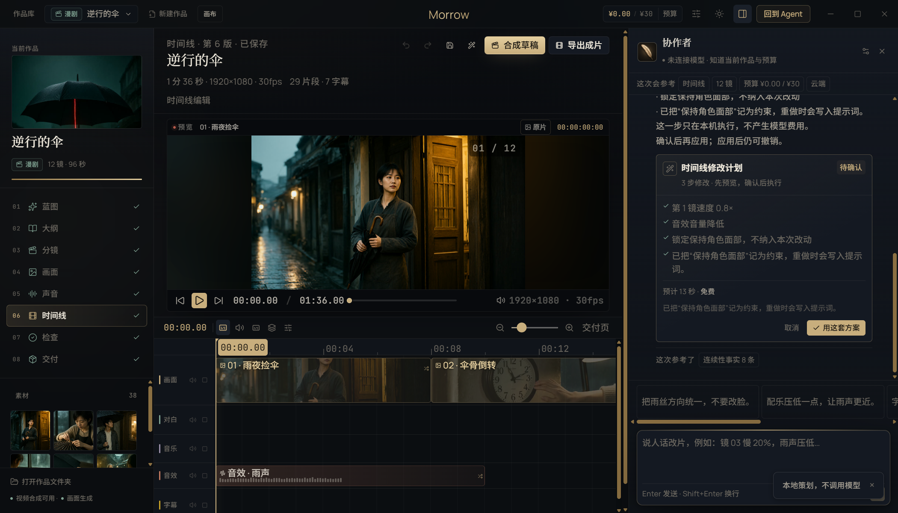
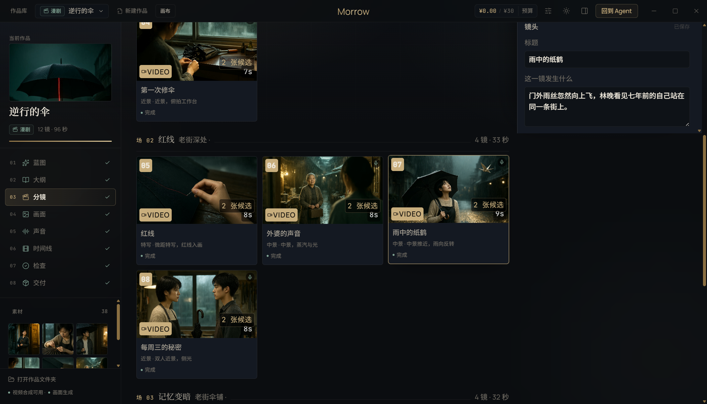
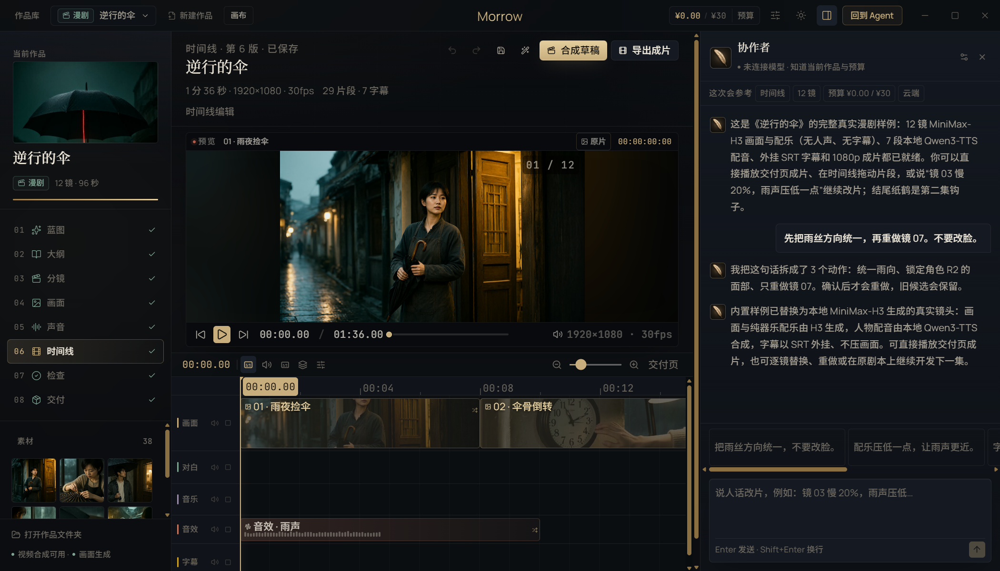
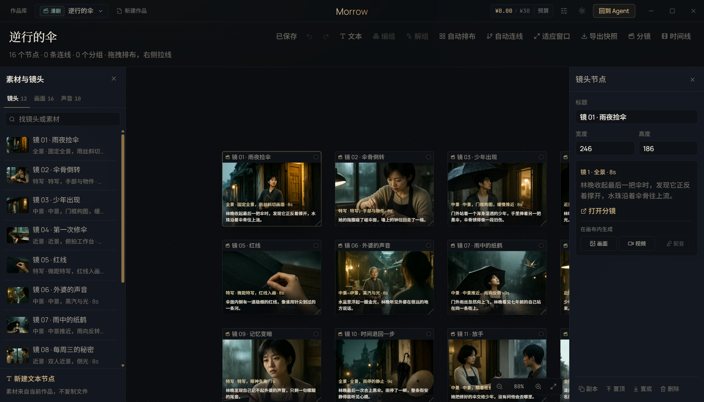
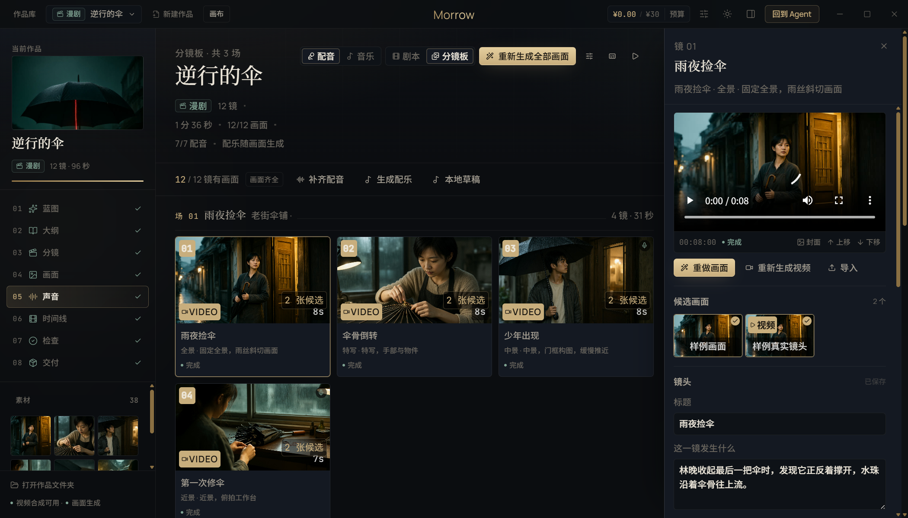
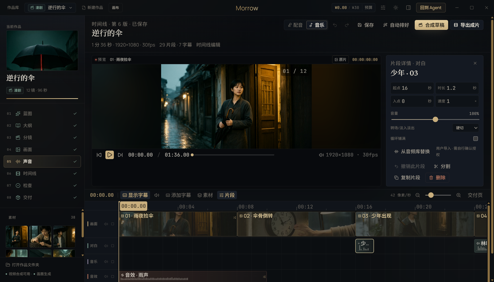
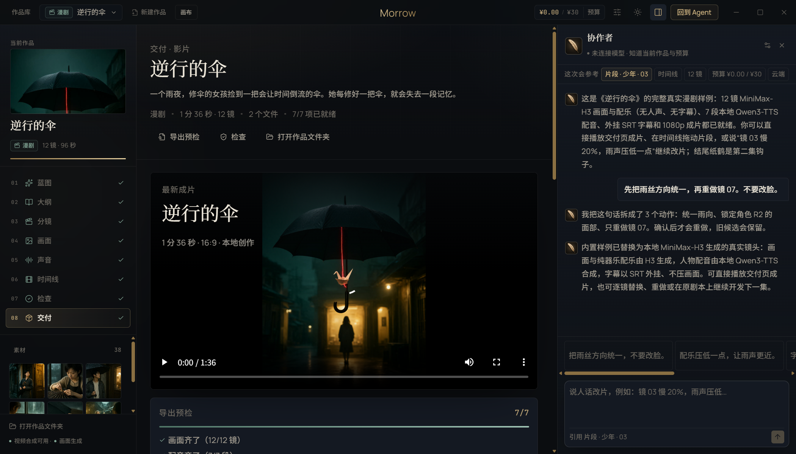
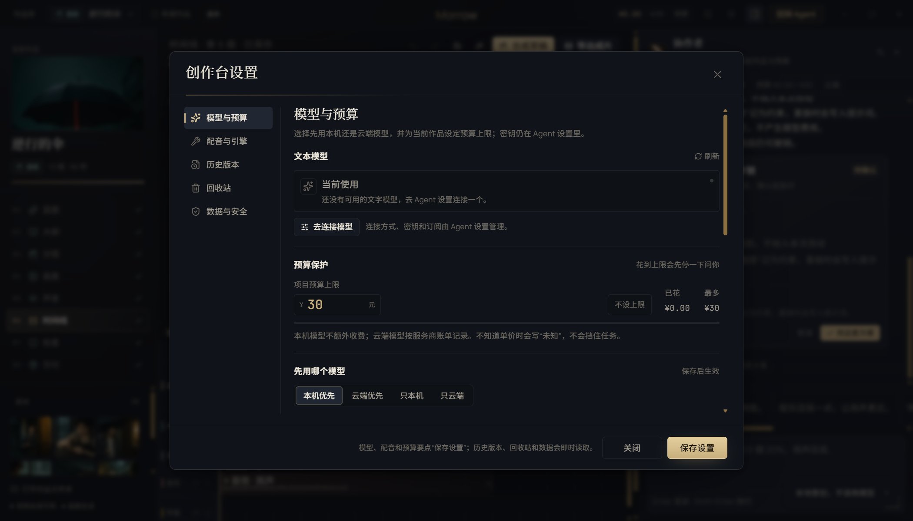
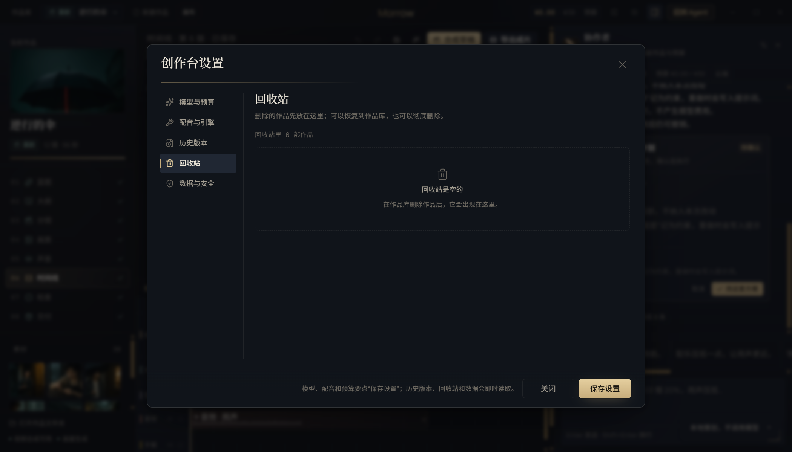

# 创作台：从一句话到可交付作品

> 本文为中文文档；英文概览见 [README.md](../README.md)。

创作台负责中短篇、长篇与漫剧。它先给出可修改的蓝图：蓝图由文本模型生成并按 token 计费；确认蓝图后才开始写正文、分镜、画面或媒体，这些步骤另计费用。每一步都能预览、撤销或继续修改。

## 目录

- [入口与作品库](#入口与作品库)
- [三种形态与阶段](#三种形态与阶段)
- [从一句话到蓝图](#从一句话到蓝图)
- [写作台](#写作台)
- [协作者与修改计划](#协作者与修改计划)
- [分镜](#分镜)
- [时间线](#时间线)
- [漫剧画布](#漫剧画布)
- [声音：配音与配乐](#声音配音与配乐)
- [检查](#检查)
- [交付](#交付)
- [设置、回收站与主题](#设置回收站与主题)
- [能力边界](#能力边界)

## 入口与作品库

三个入口：

1. Agent 标题栏左侧“创作台”；
2. 命令面板（`Ctrl+K`）→ 新建/继续创作；
3. 灵动岛底部“打开创作台”。

作品库顶部是“今天，想把哪句话变成作品？”的创作区，下面是“继续创作”。测试模式会注入三份样例（中短篇《雨停之前》、长篇《雨伞铺的第七个夏天》、漫剧《逆行的伞》）；普通“看演示”入口不会写入作品库，正式用户的作品库默认为空。

- 顶栏“作品库”回到列表，“回到 Agent”返回对话。
- 主题与设置只作用于创作台，不新增第三套主题。
- 作品、素材、历史版本与任务记录都保存在本机数据目录。

## 三种形态与阶段

| 形态 | 规模 | 主要交付 |
|---|---|---|
| 漫剧 | 30–180 秒；分镜、配音、配乐、成片 | MP4、字幕、工程包 |
| 中短篇 | 3–8 万字；章节、情绪起伏 | 电子书、排版稿、DOCX、工程包 |
| 长篇 | 20–100 万字；分卷分章、人物与设定 | 同上，支持分卷与分批生成 |

界面把八个阶段展示为**蓝图 → 大纲 → 分镜 → 画面 → 声音 → 时间线 → 检查 → 交付**（源码里漫剧是 9 个 stage，“声音”在界面上合并了配音与配乐）。小说没有分镜、配音/配乐与时间线，保留蓝图、大纲、写作、画面（章节配图）、检查与交付。

制作精细度（速成草稿 / 精制 / 电影级）是创作取向，不等于分辨率或成片质量保证；草稿、成片与清晰度在交付页另选。

## 从一句话到蓝图

1. 选择形态（漫剧 / 中短篇 / 长篇）。
2. 写一句故事；点“补充要求”可填类型、受众、风格、约束、目标字数或时长。
3. 点“生成故事蓝图”。蓝图只由真实模型生成；没有文本模型时会明确提示，不用本地模板冒充。

蓝图包含故事主线、人物、结构、风格、章节/镜头安排与费用预估。生成蓝图本身会调用文本模型并计费；确认前可以逐项修改，确认后才开始写正文或做画面，这些步骤另计费用。修改已确认的蓝图会保留下游内容，但标记需要重新核对。

## 写作台

- 左侧目录显示分卷、章节、字数与状态；可新建章节/分卷、查找、替换、排版。
- 中间是纸页编辑器：字号、行距、页宽、字数统计、保存状态与候选稿。
- 右侧协作者按当前章节与上下文给出修改建议。
- 长篇支持分批生成、断点续写、候选对照与覆盖范围记录；手改内容不会被自动覆盖。
- 可导出 Word，或进入交付页生成电子书、排版稿与工程包。

## 协作者与修改计划

在右侧输入大白话，例如“镜 01 慢 20%，雨声压低一点，不要改脸”。协作者会先拆成可审阅的计划：

- 列出动作、影响范围、费用与引用来源；
- 等待确认后才应用，可整体撤销；
- 自动替换与下游过期会标出需要重新核对的章节/镜头；
- 计划卡可取消、应用、查看引用，历史保留。

## 分镜

- 镜头卡展示画面、角色参考与单镜详情。
- 单镜可改动作、台词、说话人、时长与画面候选；人工修改不会被后台结果静默覆盖。
- 重新生成分镜先选范围：当前镜、指定章节或全书分批；允许模型增删本范围镜头。
- 分镜失败会保存已完成批次，重试只补未完成部分。

## 时间线

- 监视器、播放头、五轨剪辑（画面/对白/音乐/音效/字幕）与时间码。
- 片段可拖动、裁剪、改转场或淡入淡出；检查器显示起点、入点与时长。
- 波形来自真实音频；预览可按低清或原片切换。
- “自动排好”会先确认，避免静默覆盖手工剪辑；所有修改可撤销。

## 漫剧画布

画布把镜头、画面、配音和音乐组织成工作流：从左侧添加节点，拖拽排布，从节点右侧拉线建立“参考 → 生成 → 配音 → 合成”的关系。画布只保存工作流，不替代时间线；离开前会补存防抖窗口内的最后一次修改。

## 声音：配音与配乐

- 每个角色可选声线；支持逐镜生成/重新配音与导入现成录音。
- 配音引擎可以是本机 Qwen3-TTS、Windows SAPI 或云端 `/audio/speech`；缺失时真实失败并提示。
- 配乐使用 ComfyUI ACE-Step；`local` 只生成草稿并明确标注。
- 音效素材可导入；时间线波形来自真实音频。

## 检查

- 本地确定性检查：正文指标、连续性、镜头检查、字幕与交付闸门。
- 真实模型审稿：人物、事实、前后矛盾；没有模型时不伪造审稿结论。
- 检查报告列出使用的引擎、问题等级与修复建议；交付前的硬问题必须处理。
- 全书分批审稿保存覆盖范围与版本，重试只审原来那一章/批次。

## 交付

- 漫剧：草稿/成片、分辨率、字幕与格式；预览为真实成片。
- 小说：电子书、A4 排版稿、DOCX，以及可继续修改的工程包。
- 导出前预检中文字体、PDF、FFmpeg 与字幕，缺失时明确提示。
- 交付记录保存版本、哈希、字幕与时间线版本；成片过期会标出。

## 设置、回收站与主题

创作台设置分五页：

- **模型与预算**：本机优先 / 云端优先 / 只用本机 / 只用云端；项目预算上限与已花费用。
- **配音与引擎**：草稿配音方式；本机 ComfyUI、FFmpeg 与声线状态。
- **历史版本**：关键节点自动留档；恢复前先备份当前版本。
- **回收站**：删除的作品先放这里，可恢复或彻底删除。
- **数据与安全**：作品目录、迁移、恢复默认；只迁移创作台数据，不动 Agent 对话、设置与密钥。

作品数据默认在用户数据目录的 `studio/`；超长章节按内容哈希分片，`project.json` 成功后清理旧分片。路径见 [REFERENCE.md](REFERENCE.md#数据路径)。

墨夜与素纸两套主题共享同一布局与组件；素纸使用米白纸页与深墨文字，切换即时生效，不改变作品数据。

## 能力边界

- 三套内嵌大师方法只来自 `src/main/creative-prompts.generated.ts`；不引入本地创作手法库、七维权重或固定故事模板。
- 本地只做可计算检查；创作判断来自模型与内嵌方法。
- 没有真实文本模型、ComfyUI、ACE-Step、FFmpeg 或 TTS 时明确失败，不用占位图、假候选或假额度冒充。
- 长篇分批生成、候选对照、覆盖范围、恢复与回收站都有回归保护。

快捷键见 [REFERENCE.md](REFERENCE.md#快捷键)；协作者与质量门槛的代码落点见 [ARCHITECTURE.md](ARCHITECTURE.md#创作台架构)。