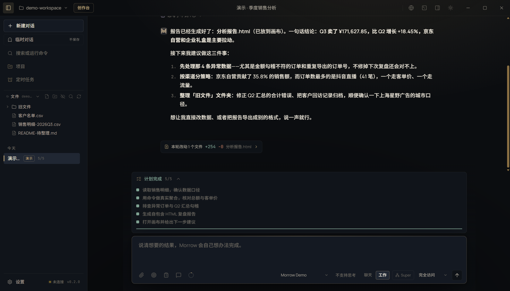
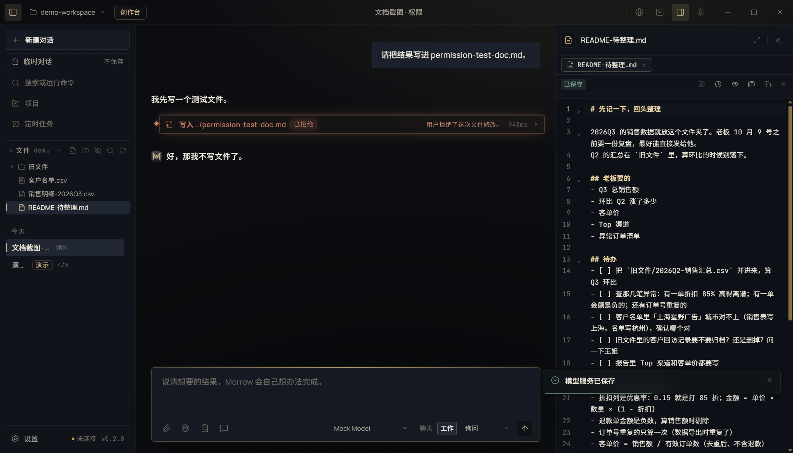
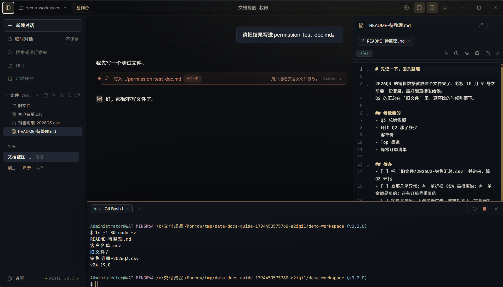
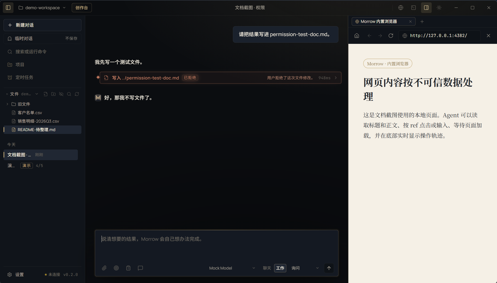
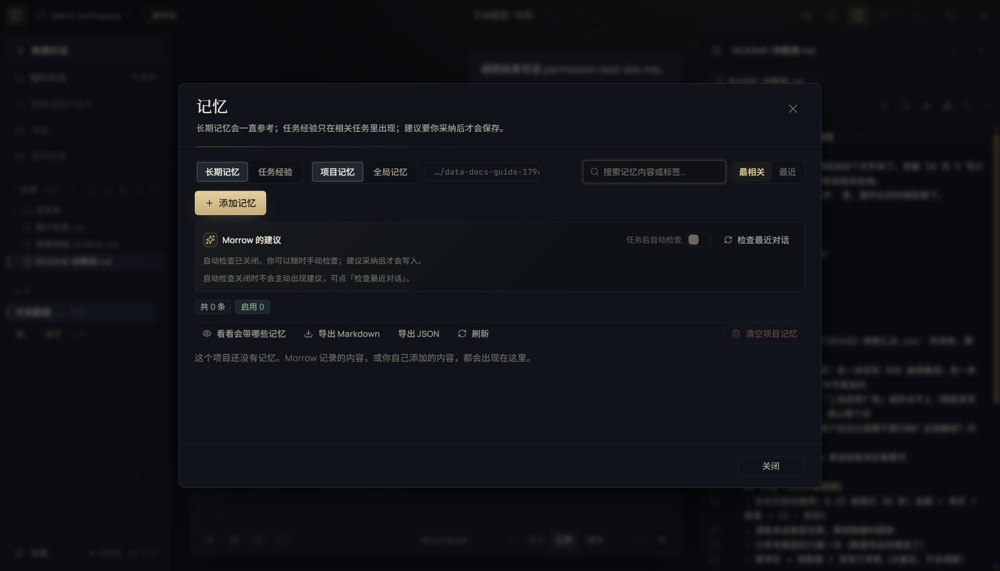
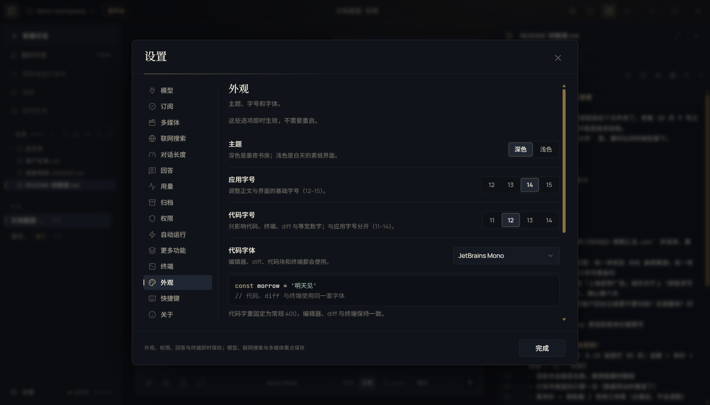

# 用户指南：界面、工作方式与权限

> 本文为中文文档；英文概览见 [README.md](../README.md)。

这页覆盖日常操作：界面怎么分区、五种工作方式怎么选、权限与审批如何生效、文件和终端在哪里。模型与订阅见 [MODELS.md](MODELS.md)，创作台见 [STUDIO.md](STUDIO.md)，排错见 [TROUBLESHOOTING.md](TROUBLESHOOTING.md)。

## 目录

- [界面地图](#界面地图)
- [五种工作方式](#五种工作方式)
- [输入框](#输入框)
- [工作区、文件与画布](#工作区文件与画布)
- [审批与权限](#审批与权限)
- [终端、Git、浏览器与电脑操作](#终端git浏览器与电脑操作)
- [项目、记忆、技能、MCP 与定时任务](#项目记忆技能mcp-与定时任务)
- [协作任务](#协作任务)
- [外观、数据与快捷键](#外观数据与快捷键)
- [遇到问题](#遇到问题)

## 界面地图

- **左侧栏**：新建对话、临时对话、搜索、项目、定时任务、工作区文件、会话列表、设置。
- **中间**：对话记录与输入框；打开文件或画布时切换为编辑器/画布。
- **右侧**：画布、文件预览或内置浏览器；协作进度显示在对话内的成员卡片里。
- **底部**：可收起的真实终端；状态栏显示模型、分支与上下文。
- **顶栏**：文件、编辑、视图、帮助；左侧“创作台”进入作品库，右侧是设置、主题与退出。

创作台有三个入口：标题栏“创作台”、命令面板（`Ctrl+K`）里的新建/继续创作、灵动岛底部“打开创作台”。创作台顶栏的“回到 Agent”返回对话。

## 五种工作方式

| 方式 | 适合 | 权限 |
|---|---|---|
| 聊天 | 问问题、读代码、讨论 | 只读 |
| 工作 | 改文件、跑命令、做成品 | 按权限档位；可写 |
| 计划 | 先要一份可审阅的计划 | 只读 + 提交计划 |
| 深度研究 | 查资料、保留来源 | 只读 + 白名单网页 |
| 长期目标 | 跨轮推进到可验收结果 | 按权限档位；可写 |

“计划”和“长期目标”是独立开关，会与当前模式组合。工作模式没有单独的协作开关：简单工作由主代理直接完成，需要并行或独立验收时它会派发成员。

## 输入框

- 选择当前模型；思考强度只显示模型真实支持的档位。
- 查看上下文占用；自动压缩与保留策略在设置里调整。
- 切换只读 / 询问 / 完全访问。
- 添加图片、PDF、文本、代码附件。附件可以读取工作区外文件，但仍按不可信数据处理。
- 用 `@` 引用文件、目录、项目或记忆；用 `/` 查看斜杠命令（如 `/btw` 侧聊、`/swarm` 成员协作）。
- 运行中可以停止、继续、查看工具步骤；长任务显示进度与 token 消耗。

`Enter` 发送，`Shift+Enter` 换行；可在设置 → 回答中改为 `Ctrl+Enter` 发送。

## 工作区、文件与画布

- 选择文件夹后，左侧文件树只显示该工作区；切换工作区会同时切换文件树、项目记忆、技能、MCP 信任与版本记录。
- **文件树**：新建、重命名、删除、拖拽、搜索；双击打开。
- **编辑器**：CodeMirror；语法高亮、查找、替换、保存、另存为；大文件截断保护。
- **画布**：多标签，支持 HTML、Markdown、PDF、Office、图片、音视频预览，可拖拽分栏。
- **版本与检查点**：每个用户轮次一个检查点，写文件前留快照；会话与文件都能回退。

## 审批与权限

三档权限：

| 档位 | 行为 |
|---|---|
| 只读 | 拒绝写文件、跑命令、改记忆与外部副作用动作 |
| 询问 | 工作区内写入与普通命令放行；危险命令、越界路径、外部副作用动作、终端 stdin 逐次询问 |
| 完全访问 | 全部直接放行，只在你信任当前任务时使用 |

审批卡写清“想做什么、影响什么、参数是什么”。可以允许一次、拒绝，或在安全动作上“始终允许”（按工具 + 目标 + 参数哈希）。拒绝优先于允许；危险动作没有“始终允许”。

## 终端、Git、浏览器与电脑操作

### 真实终端

- 真实 PTY（ConPTY），支持 Git Bash（默认）、PowerShell 7 与 WSL。
- Git Bash 遇到 MSYS 共享内存冲突时，Morrow 会建立独立兼容前缀；优先硬链接，无法建链接时复制到本机缓存。
- 多标签、后台任务、复制粘贴、拖动调高；隐藏不结束进程，关闭标签才结束。
- 默认终端在“设置 → 终端”选择。

### Git 工作台

变更列表、diff、暂存、提交、分支、历史、放弃改动。diff 超长时截断展示；提交前会检查敏感文件。

### 内置浏览器

- 多标签、地址栏、前进后退、刷新与开发者工具入口。
- 默认在右侧画布栏打开，宽约 420px，可拖动左边缘调宽；窄屏才全屏。
- 底部实时显示 Agent 的打开、点击、输入、等待、报错与耗时，可停止或回到对话。
- 只允许 http(s)；`window.open` 被拒绝，webview 禁用，网页内容按不可信数据处理。

### 电脑操作

Agent 可以列举窗口、读取 UI Automation 树、按 ref 读取/点击/设值、截屏，必要时才用坐标点击、拖拽、滚轮与键盘输入。应用未安装时可先用 winget 搜索/安装，或从官方下载页下载并核对 SHA-256 与 Authenticode 签名。密码、登录、验证码、支付、银行、系统设置等敏感窗口一律拒绝；每次电脑动作仍需审批。

## 项目、记忆、技能、MCP 与定时任务

- **项目**：项目主页保存背景、说明、资料、项目内会话与当前文件夹范围；项目记忆只在项目内注入。
- **记忆**：项目记忆、全局长期记忆、任务经验、注入预览与自进化建议。建议只在强信号后出现，采纳后才写入。
- **技能**：20 个内置技能加工作区 `.morrow/skills`；支持 Markdown 技能包与安全安装，清单见 [REFERENCE.md](REFERENCE.md#内置技能)。
- **MCP**：stdio、Streamable HTTP 与旧版 SSE；工具、资源、提示词、OAuth 与工作区信任。工具调用仍按权限审批。
- **定时任务**：一次、每天或每周；只读或可改文件；最多 50 个。无人值守时自动拒绝需要审批的动作，并记录失败原因。

## 协作任务

简单工作由主代理直接完成；需要并行、隔离副本或独立验收时，主代理会派发成员。协作不再占用右侧栏，也没有单独的入口按钮，全部进度展开在主对话的“成员协作”卡片里。

成员卡片显示：

- 总目标、完成/执行中数量、计划版本与成员总用量；
- 谁在做、谁在等、你能帮什么；
- 每个成员的状态、负责人、步数、耗时、token 消耗与最近交接；
- 停止全部，以及每个成员的停止、插话、重试、继续（带原线程重新激活）；
- 独立验收、成果版本、文件冲突与卡住提醒；
- 并发上限与卡住提醒开关。

历史协作保留静态摘要，只有当前这次展开为可操作驾驶舱。完成项不会重复执行；重开只恢复待办任务，执行中项转人工核对。实现细节见 [ARCHITECTURE.md](ARCHITECTURE.md#协作任务)。

## 外观、数据与快捷键

- 外观支持墨夜/素纸主题、应用字号、代码字号与字体，改动即时生效。
- 会话、作品、记忆、密钥、日志与缓存都在数据目录；路径见 [REFERENCE.md](REFERENCE.md#数据路径)。
- 常用快捷键见 [REFERENCE.md](REFERENCE.md#快捷键)。
- “设置 → 关于”可查看版本、运行环境与数据目录。

## 遇到问题

先查 [TROUBLESHOOTING.md](TROUBLESHOOTING.md) 的现象表。涉及安全边界与实现细节时，再看 [ARCHITECTURE.md](ARCHITECTURE.md#安全边界)。