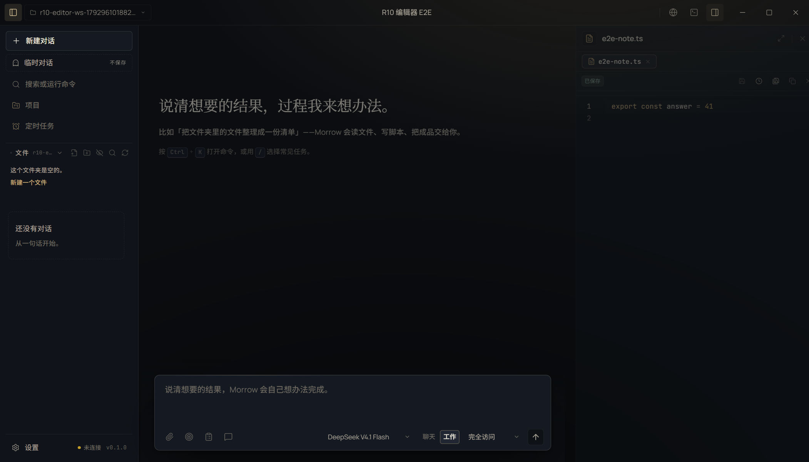
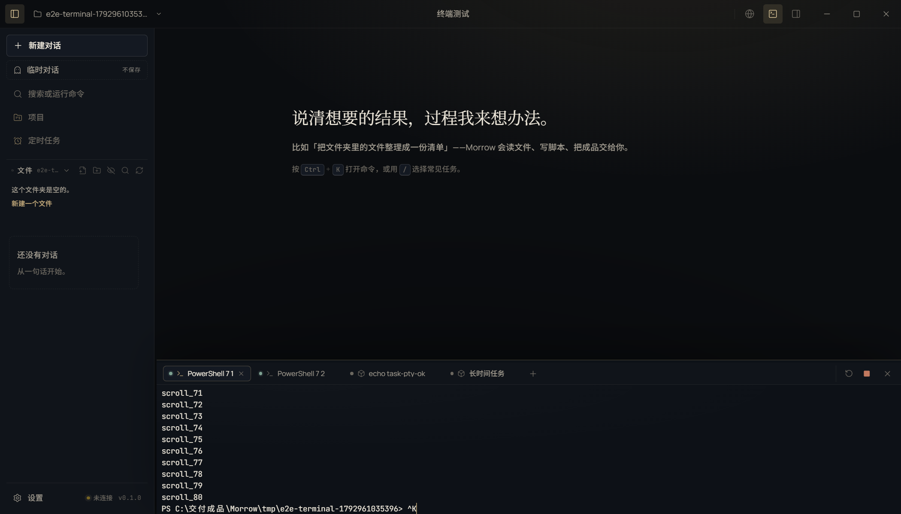
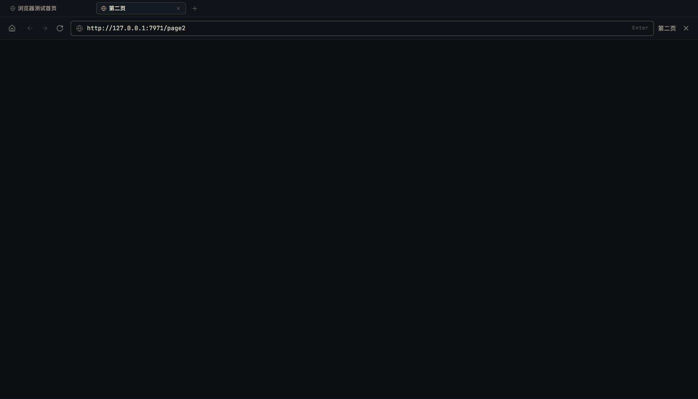
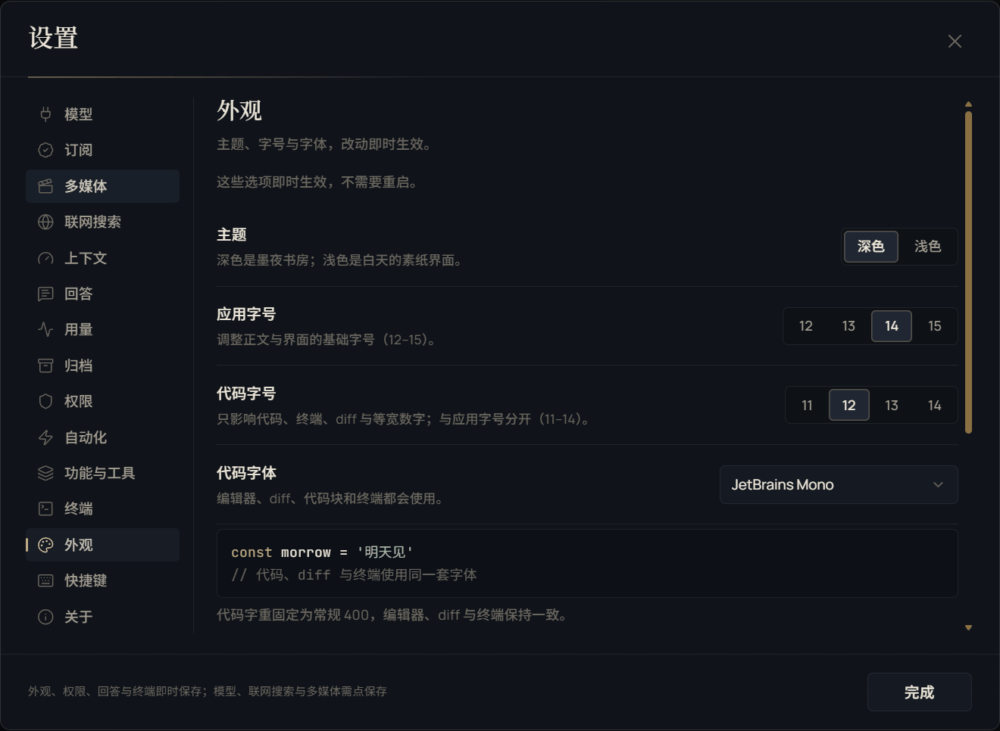

# 用户指南

> 本文为中文文档；英文概览见 [README.md](../README.md)。

这页讲清界面怎么用、一次任务怎么从请求走到交付、权限在哪里设、文件与自动化能力怎么用。它不解释内部实现，进程与数据格式见 [架构说明](ARCHITECTURE.md)；查询型的快捷键、路径与技能清单见 [参考手册](REFERENCE.md)。

## 目录

- [界面地图](#界面地图)
- [五种工作方式](#五种工作方式)
- [权限与审批](#权限与审批)
- [输入框与运行中的操作](#输入框与运行中的操作)
- [文件、编辑器与画布](#文件编辑器与画布)
- [终端、Git 与内置浏览器](#终端git-与内置浏览器)
- [项目、记忆与技能](#项目记忆与技能)
- [MCP 连接器](#mcp-连接器)
- [定时任务、钩子与自定义命令](#定时任务钩子与自定义命令)
- [外观与数据](#外观与数据)
- [常见任务怎么做](#常见任务怎么做)

## 界面地图

| 区域 | 内容 |
|---|---|
| 标题栏 | 左侧侧栏开关与当前文件夹；中间会话标题（双击或 F2 重命名）；右侧浏览器、终端、画布开关与窗口控制。 |
| 侧栏 | 新建对话、临时对话、搜索或运行命令、项目、定时任务、文件树、会话分组与底部设置。宽度 200–400px，可收起为图标栏。 |
| 主区 | 消息轨迹、计划、来源、运行中心、队列与输入框。 |
| 右侧画布 | 多标签文件与成品、编辑器、预览、版本历史与导出；宽度 320–960px。 |
| 底部终端 | 真实 PTY、多标签与后台任务。 |
| 桌面伙伴（灵动岛） | 独立置顶小窗，显示当前会话进度、todo 与快速发送；需在设置 → 外观开启。 |

### 会话管理

- 会话可以置顶、归档、重命名（双击标题或按 `F2`）和删除；归档的会话不再占用侧栏列表，但数据仍在。
- 侧栏会话列表最多显示 300 条；更早的会话可通过搜索找到，不会因为不在列表里被删除。
- 从任意一条消息可以“分叉”：原会话完整保留，新会话从该条消息继续，两者互不影响。
- 临时对话不写入项目记忆，也不出现在持久化会话列表里。

## 五种工作方式

输入框左下方在“聊天 / 工作”之间切换；`/plan`、`/research`、`/goal` 进入对应模式。

| 方式 | 能做什么 | 不能做什么 |
|---|---|---|
| 聊天 | 读文件、搜索、提问、联网（已配置时） | 写文件、执行命令、写记忆、启动集群 |
| 工作 | 读写文件、运行命令、终端、Git、媒体与完整工具链 | 仍受权限、审批与工作区边界约束 |
| 计划 | 只读探索，产出可审阅计划；批准后转执行 | 批准前不能写入或执行 |
| 深度研究 | 搜索与抓取、保留来源、生成报告并放上画布 | 只读工具集合；计划阶段不暴露工具 |
| 长期目标 | 跨轮推进，直到完成或预算耗尽 | 完成必须提供工作区内、非空、晚于目标创建的证据文件 |

**计划模式**：只读探索最多 2 步，最后用 `submit_plan` 提交计划；批准后转成执行任务与 todo，批准前不写文件、不执行命令。

**深度研究**：`quick` 为 2 轮 / 4 个来源，`standard` 为 4 轮 / 10 个来源，`deep` 为 6 轮 / 20 个来源。批准后才开始检索；报告带来源，来源面板可查看实际抓取的页面。研究中的插话写入下一轮，不强行打断当前工具。

**长期目标**：需要目标、验收标准与预算，默认 2–256 轮；完成声明必须附带工作区内的证据文件，没有证据时目标继续。同一时刻只允许一个目标循环，应用重启后运行中的目标变为暂停。

**临时对话**：不写入项目记忆，不持久化到会话列表，适合一次性问答或敏感内容试算；也不能回退或生成成品版本。

## 权限与审批

输入框右侧的“只读 / 询问 / 完全访问”对应三档权限：

| 档位 | 工作区内普通写与命令 | 危险命令 | 越界路径 | 外部副作用 |
|---|---|---|---|---|
| 只读 | 拒绝 | 拒绝 | 拒绝 | 拒绝 |
| 询问 | 放行 | 询问 | 询问 | 询问 |
| 完全访问 | 放行 | 询问 | 询问 | 询问 |

- **允许一次**只对本次调用生效。
- **始终允许**只对同一工具 + 目标 + 参数哈希生效，并落为当前工作区的 allow 规则。
- **拒绝**让工具返回 denied，运行继续，模型需要自行调整。
- 危险命令、越界路径与外部副作用动作不提供“始终允许”；deny 规则优先。
- 审批日志在 `permissions/approval-log.jsonl`，规则在 `permissions.json`。
- 无人值守的定时任务自动拒绝审批与提问，不会挂起等待。

## 输入框与运行中的操作

**模型与思考强度**：选择器只列出已启用且已保存 Key / 登录态的 Provider，显示原始模型名；思考档位只显示模型真实支持的级别，不支持时显示“不支持思考”，未知模型只保留“自动”。

**上下文**：只有声明了可调档位的模型才显示上限选项（例如 Qoder 的 200K / 400K / 1M）。选择后写入会话，上下文环与请求使用同一个值。

**附件与引用**：最多 8 个附件；单张图片超过 5MB 会压缩或转码到最长边 1568px。`@相对路径` 引用工作区文件，模型仍需用 `read_file` 读取正文。只发附件不写字也可以发送。

**运行中的三个动作**：

- 闪电：先取消当前运行，再立即发送；
- 箭头：加入队列，本轮结束后自动发送；
- 方块：停止当前运行。

队列按会话隔离，最多 20 条、单条 20k 字、最多 8 个附件；取消或出错时队列保留。

## 文件、编辑器与画布

- **文件树**：扫描工作区，支持展开、新建、重命名、删除、拖动、右键菜单与只读提示。
- **编辑器**：CodeMirror，多标签、语法高亮、查找、撤销/重做、保存（`Ctrl+S`）、另存为、版本历史与强制保存；产物或只读文件会锁定编辑。
- **画布预览**：HTML、Markdown、SVG、图片、PDF、Word、Excel、PPT、压缩包、音频与视频；图片与 PDF 支持缩放，不支持的格式提供“系统应用打开 / 文件夹中显示 / 重新加载”。
- **版本历史**：每个文本成品最多 30 个版本，单版最大 8MB，可 diff、恢复与导出。
- **导出**：原文件、Markdown、网页、纯文本、PDF。
- **快照与检查点**：写、编辑、删除前自动快照；每个用户轮次最多 100 个检查点，可回退代码、对话或两者。命令产生的副作用不在通用回退范围内。
- **大文件**：画布文本上限 8MB，超出会提示截断。

## 终端、Git 与内置浏览器

### 终端

- 终端面板使用真实 PTY（Windows ConPTY），默认 Shell 为 **Git Bash**；可在设置 → 终端切换 PowerShell 7 与 WSL。
- Windows PowerShell 5.1 与 CMD 选项已移除；保存的旧选择会回退到默认。
- 支持多标签、拖动调高、复制粘贴、后台任务、停止与重启；关闭面板后进程继续运行。
- 滚动条只在内容溢出时显示，轨道 8px、滑块 6px 实色全圆角。
- 受限令牌或低完整性环境可能无法运行 Git Bash（MSYS 共享内存错误），此时切换 PowerShell 7。

### Git 工作台

提供变更、diff、暂存与取消暂存、提交、新建或切换分支、历史记录与放弃改动。未跟踪文件可以丢弃；越界路径与非变更文件会被拒绝；工作区位于更大仓库内部时拒绝操作，避免影响仓库根。

### 内置浏览器

支持多标签、地址栏、主页、前进/后退与真实页面内容。登录窗口与普通浏览共用浏览器服务，但登录 session 有自己的 http(s) 导航白名单。网页内容视为不可信数据，不能当作 Agent 指令。

## 项目、记忆与技能

### 项目

项目保存背景、说明、资料文件、会话与当前文件夹范围。资料单文件最大 512KB、最多 20 个；失效资料会被标记但可继续修改。在项目页新建的会话，首句会自动注入项目说明与资料上下文。

### 记忆中心

| 类型 | 位置 |
|---|---|
| 项目记忆 | `<工作区>/.morrow/memories.json`（兼容迁移 `MEMORY.md`） |
| 全局长期记忆 | `<dataDir>/memories/global.json` |
| 任务经验 | 项目内 `.morrow/episodes.json` 或全局 `episodes/global.json` |

记忆中心支持新增、启停、删除、注入预览与自进化建议。临时对话不写入记忆。

### 技能

- 内置技能随首次启动安装到 `<dataDir>/skills/`，可禁用或删除；用户修改过的内置技能不会被升级覆盖。
- 工作区技能放在 `<工作区>/.morrow/skills/<name>/SKILL.md`。
- 安装 Markdown 或 zip 技能包时会跳过脚本可执行文件，并保留 zip-slip、大小与数量限制。
- 技能是参考资料，不是授权，不能扩大工具权限。

## MCP 连接器

支持 stdio、Streamable HTTP 与旧版 SSE。配置优先级为：显式路径 → `MORROW_MCP_CONFIG` → `<dataDir>/mcp.json` → `<工作区>/.morrow/mcp.json`。

工作区配置默认不自动启动，需要 `mcp-trust.json` 哈希登记（或 `MORROW_MCP_TRUST_WORKSPACE=1`）。OAuth token 存在 `mcp-oauth.json`；配置里的密钥可以写成 `$MORROW_SECRET:<id>` 标记，由主进程用系统加密解析。MCP 工具、资源与提示词都有超时和结果大小上限。

## 定时任务、钩子与自定义命令

**定时任务**：设置 → 功能与工具 → 定时任务。支持一次、每天、每周，最多 50 个；应用运行中每 5 秒检查，同一时刻只跑一个；错过后 1 小时内补跑，单次 30 分钟超时；无人值守任务自动拒绝审批。

**钩子**：`user_prompt_submit`、`post_tool_use`、`run_finished` 三类，每类最多 5 个，单次 15 秒超时；钩子进程能读到 `MORROW_HOOK_EVENT` 与 `MORROW_WORKSPACE`。

**自定义命令**：工作区 `.morrow/commands/*.md` 与用户 `~/.morrow/commands/*.md`；支持 `description`、`argument-hint`、`$ARGUMENTS` 与 `$1..$9`，不能覆盖内置保留名。

**自定义角色**：内置角色之外，可放在 `~/.morrow/agents` 或工作区 `.morrow/agents`，单文件最大 32KB。

## 外观与数据

| 选项 | 默认值 |
|---|---|
| 主题 | 墨夜（另有素纸浅色主题） |
| 应用字号 | 14（12–15） |
| 代码字号 | 12（11–14） |
| 代码字体 | JetBrains Mono（另有 IBM Plex Mono、系统等宽） |
| 减少动效 | 关 |
| 关闭行为 | 每次询问（另有最小化到任务栏、完全退出） |

数据目录可在设置 → 关于查看与迁移。迁移会重启应用，复制会话、设置、记忆、项目、技能、快照与日志，不包含系统浏览器缓存与登录态。备份时关闭应用后复制整个数据目录。

## 常见任务怎么做

**整理一个文件夹**

1. 选择文件夹；
2. 输入“先扫描这个文件夹，列出重复与过期文件，给出整理方案，批准后再移动”；
3. 在计划模式审阅方案，批准后执行；
4. 在改动卡里检查文件列表与 diff，必要时撤销。

**开发一个页面并验收**

1. 工作模式，选择项目文件夹；
2. 输入目标、受众、视觉方向与验收标准；
3. 让 Morrow 先读现有 token 与组件，再实现；
4. 用内置浏览器打开真实页面，检查交互与双主题；
5. 需要时用 `describe_media` 审看截图，最后把成品放上画布。

**研究一个主题**

1. 输入 `/research` 并选择 quick / standard / deep；
2. 审阅研究计划，批准后等待检索；
3. 在来源面板核对链接与摘要，导出报告。

**生成并审看一张图**

1. 设置 → 多媒体确认引擎与模型；
2. 输入具体的画面描述并生成；
3. 让 Morrow 用 `describe_media` 审看；
4. 按建议重新生成或使用 `edit_media` 修改。

遇到异常先查 [排障指南](TROUBLESHOOTING.md)；模型与订阅的完整规则见 [模型与订阅](MODELS.md)。